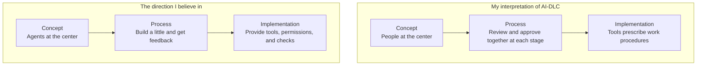
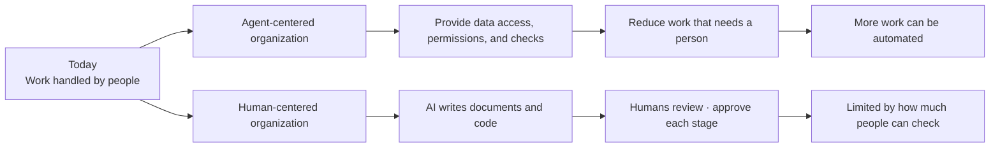
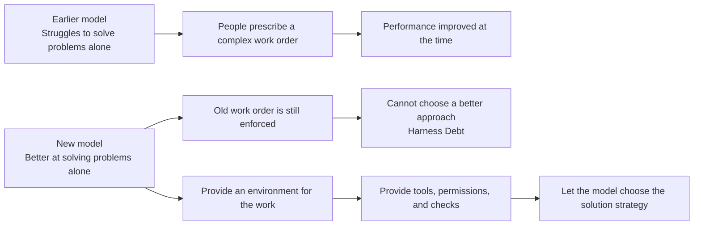

```mermaid
flowchart TB
    subgraph BIG["Compressing one large loop"]
        BR["Many requirements"] --> BD["Design · planning"]
        BD --> BI["Batch implementation"]
        BI --> BT["Integrated testing · review"]
        BT --> BF["Late product feedback"]
    end

    subgraph SMALL["Closing small loops continuously"]
        S1["Small requirement"] --> P1["Working result"] --> F1["User feedback"]
        F1 --> S2["Next small requirement"] --> P2["Next result"] --> F2["Next feedback"]
    end
```

## TL;DR

- AWS AI-DLC differs substantially from my view of agentic development across concept, process, and implementation.

## Introduction

The views in this post are my own and do not represent AWS. They are based on public sources and my personal experience.

I first encountered AI-DLC (AI-Driven Development Life Cycle), an approach to developing software with AI, two years ago while I was in AWS PACE (Prototyping and Cloud Engineering). Its original author gave me a brief introduction.

At the time, my attention as a developer was entirely on reducing the time and effort development required and making the process more efficient. I listened without giving AI-DLC much thought.

Early last year, a team dedicated to AI-DLC was formed, and I was supposed to move to that team.

In the meantime, my own views on agentic engineering—giving development work to AI agents—had taken shape. I had come to believe we should remove the reasons people have to keep stepping in, so agents can finish the work on their own.

But the AI-DLC processes I had encountered emphasized having people review and approve results at each stage of development. I found that direction difficult to agree with, so I moved to my current account team to avoid working on AI-DLC.

Even on the account team, though, I increasingly found myself having to explain AI-DLC. I expect that work to become more common across the company as well.

That is why I want to write down which parts of AI-DLC I find difficult to agree with. I want to examine my own views and understand why they differ from the experiences of customers adopting it.

My view differs from AI-DLC in three areas: **Concept → Process → Implementation**.

The future we aim for shapes how we divide and repeat work, and those choices carry through to the tools and environments we build.





## 1. The Conceptual Difference — Keeping Humans at the Center

In an earlier post, I chose a way to judge the direction of agentic engineering: giving development work to AI agents that use tools to carry out tasks.

**I think the long-term direction of agentic engineering is to remove the human in the loop, or HITL—the need for people to keep stepping in while the agent works.**[^3]

That does not mean removing every person immediately, but resolving the work people have to handle because the agent lacks data access, permission to act, or a way to check its results. Looking at tasks that need help from another team in the same way can expand what the agent can finish on its own.

AI-DLC begins from a different premise.

In the official introduction, AI plans and executes while people make important decisions. The team meets to check AI-generated requirements and designs as they are produced, in sessions called `Mob Elaboration` and `Mob Construction`.[^1]

The more recent adaptive workflow chooses which stages are needed and how much detail each requires for the task, so a simple bug fix and a new system do not have to follow the same procedure. This is a clear improvement over the initial version.

Even so, human approval remains central rather than exceptional.

The official article also says people are needed to check whether AI's results can be trusted, who is responsible, and whether the results are correct. It therefore requires the team to review and approve the results together at every stage.[^2]

This approach can be useful for a team running its first workshop with AI, or for an organization that must make clear who is responsible for what to meet regulatory and audit requirements.

However, I think **teams building real services in the future will remove the reasons a person is currently required, one by one**.

If data is scattered and a person has to find it, connect it so the agent can find what it needs. If a person has to act because the agent lacks permission, build a tool with only the permissions it needs.

If a person must read every result because it cannot be trusted, define what the result must satisfy, check it with tests, and use logs and measurements to see how the system actually behaved.

Assuming a person will always check the work makes it easier to leave data access and permission problems unresolved, with people continuing to handle them.

The two organizations may look similar today, but I think they will look completely different in two or three years.





Suppose that three years from now it has been sufficiently proven that agents can take over major tasks.

Starting only then to connect data held separately by teams, give agents the permissions they need, and provide ways to check their results may be too late. Models change quickly, but how a company manages data and assigns responsibility does not change at the same pace.

This is where the future I expect and the concept behind AI-DLC diverge.

Amazon's Frontier Development aims to let agents work for long periods without human intervention. In her talk on this approach, AWS engineer Clare Liguori describes 50 Amazon Stores teams working on existing systems. The teams with large gains in deployment speed deliberately changed how they worked. What interested me was that results diverged even though most used similar tools.[^16]

Kiro's published Frontier Engineering guide makes that direction more concrete. Its second principle is to maximize agent time while minimizing human involvement, and describes the goal this way:[^13]

> “The goal is to progressively remove yourself from the loop”

People set the direction and verify the outcome, while agents handle the repeated implementation, testing, and fixes in between.

I favor expanding what agents can finish on their own over AI-DLC's approvals at each stage.

## 2. The Process Difference — Making the Big Loop Run Faster

What I have found most powerful about developing with AI is **the ability to shorten the cycle of defining requirements, building, testing, and receiving feedback to something close to real time**.

In the past, even an attempt to test a small version of a product often stopped at drawing screens on paper or showing a simple screen layout.

Today, even with temporary substitutes for some functions and data, we can connect existing code and real screens to make something close to the service. Users can try it first, then decide what they need next.

The software development life cycle (SDLC) covers planning, building, and operating software. Consider an approach that collects requirements in one batch before design and development: it resembles bending a hundred-meter wire into one large circle.

Requirements are collected, the system is designed, development and testing follow, and the circle closes for the first time only at the end.

My model of agentic development looks more like stacking ten-meter circles into a spring.

Each circle is a small feature built from the screen through to the processing behind it so a user can try it from start to finish, a unit called a vertical slice. The circle can be smaller or larger depending on the problem.





Because people can try the product, become familiar with it, and decide what they need next, they do not have to list requirements in a meeting room for something nobody has ever seen. This reduces cognitive load: the mental effort of imagining the whole product and making decisions about it.

Reviewers can also inspect one newly added behavior and its evidence instead of reconstructing the whole product at once.[^4]

The AI-DLC processes I have experienced felt closer to using AI to make the existing large loop run faster than to replacing it with many small loops.

The process I prefer instead repeatedly closes small loops of requirements, working results, and user feedback.

The official methodology does use short work periods called `bolts` and divides the work into small Units of Work. The adaptive workflow also skips unnecessary stages.

Yet the people involved still meet at each stage to build a shared understanding of the problem and its background, review AI-generated plans and results, and approve moving to the next stage.

The total duration can fall, but compressing the same volume of requirements, design decisions, and review into less time can increase human cognitive load.

Liguori also describes product decisions and launch approvals taking longer than implementation once coding accelerates. She recommends making decisions faster, especially when they are easy to reverse.[^16][^5]

This observation supports my view that compressing implementation within the same large development cycle is not enough. I prefer small loops because I want to reduce the scope of each decision and review, shortening the wait for the next round of customer feedback.

Participants in AI-DLC workshops often said that bringing stakeholders together reduced communication overhead.

That effect matters, but it may come as much from Amazon's team culture as from AI-DLC itself: the Two-Pizza Team approach keeps teams small so they can decide quickly, while DevOps has teams share responsibility for building and operating the software.

If good collaboration culture and the effect of the methodology are treated as the same thing, it becomes difficult to know what another organization must reproduce.

## 3. The Implementation Difference — A Harness That Prescribes the Order of Work

These differences also show up when the way of working is built into tools and their execution environment.

Here, a harness means all the things a model needs to do its work: background information, tools, access permissions, a place to run code, and ways to check the results.[^6]

The longer an agent works without a person, the more it needs a good harness, but I think it is useful to distinguish two roles a harness can play.

| Type | Role | As models grow stronger |
| --- | --- | --- |
| Rules for thinking and work order (cognitive scaffolding) | Forces how the model should think and in which order it should work | Likely to shrink |
| An environment for doing the work (execution infrastructure) | Provides tools, permissions, an isolated space to run code, tests, and records of what happened | Remains necessary |

One approach divides work among agents with different roles, such as a Planner to make plans, a Critic to find problems, a Reviewer to check results, and a Reflection Agent to look back over the work; another has people prescribe how work should be broken down. These procedures can help with problems a model struggles to solve on its own.

A strong model can choose a different first action for each problem.

It may read the error log immediately, run tests first, or look through the code's change history to find when a problem began. Some problems need a short plan, while for others, writing a long plan is itself a waste of time.

If the harness always forces `Research → Plan → Break down tasks → Implement → Review → Reflect`, it decides in advance how the model must solve the problem.

I use **Harness Debt** to describe rules created to help an older model that remain in place and get in a newer model's way.

Kiro's tenth principle also says to revisit workarounds for an older model's weaknesses when a new model arrives.[^14] I read this as a reminder that removing constraints that are no longer needed matters just as much as learning from failures and adding useful instructions and tools.





Pi, which has recently attracted attention, describes itself as a "minimal agent harness": a harness with a small set of basic features. Users can add features through extensions, task instructions through skills, and reusable requests through prompt templates to create their own workflows.[^7]

That freedom is appealing, but with the latest models, making more changes yourself does not guarantee better results, because a procedure you design may stop the model from choosing a better approach.

Fixed procedures may be needed for payment and financial tasks with work sequences and approval rules that must be followed, but whether all software development should work that way is a separate question.

Because the organizations behind Claude Code and Codex develop both models and agent products, they can test which information and instructions to provide and which decisions to leave to the model with each new release.

Anthropic also says it is difficult to predict what information and instructions future models will need. In Managed Agents, it therefore separates and connects the session, which manages work records; the harness, which helps the model do the work; and the sandbox, an isolated place to run code.[^8]

OpenAI's Codex case also includes written plans, reviews between agents, and repeated fixes. What caught my attention was the environment: it automatically checks code structure and rules, and lets agents inspect the application UI and logs themselves.[^9]

> **A harness should provide the playing field, not decide how the model plays the game.**

Kiro's Frontier Engineering guide also recommends preparing code that agents can navigate, informative error messages, and tools that let them carry out their work.[^17] It calls for giving agents tools to run tests and inspect the UI so they can repair failures without a person passing results between tools.[^18]

These investments fit the execution infrastructure I described earlier. They reduce the work of people receiving and fixing each result by letting agents check their work and try again themselves.

The harness decides which code repositories the model can read, where it can run commands, which data it can access, which actions are forbidden, and which tests it must pass.

Within those boundaries, the model should choose how to solve the problem whenever possible.

Kiro's eighth principle similarly recommends limiting access to the files, tools, and network the agent needs, then letting it work without constant supervision. Its statement that “Every guardrail you automate is one less reason to stay in the loop” is close to the role I expect a harness to play.[^15] Approval remains for actions that cannot be undone, while the system takes over checks that previously required a person each time.

AI-DLC's adaptive workflow greatly reduces the problem of applying the same procedure to every task, but the tools still prescribe what to produce at each stage, when to get approval, and when to review the work together. In that sense, I think they still prescribe how the model should think and in which order it should work.

As models improve, I think we should revisit the work sequences and solution strategies prescribed by the harness, and delegate more of those decisions to the model.

## 4. Customer Adoption and Results Keep Challenging My View

I think AI-DLC is difficult to adopt for production development and expand across teams and organizations. Across concept, process, and implementation, it also differs in many ways from the direction I see the market taking.

Yet **I keep encountering customers who say AI-DLC works well for them, and others who plan to adopt it.** Each time I hear that, it shakes my confidence in my own view.

An AWS article describes an early AI-DLC adoption case at a European financial institution. It reports that one product owner and three developers delivered 35 features per sprint—a fixed period of work.[^10]

Cases like this make me wonder whether I have missed a condition that matters, or assumed that my experience with personal projects applies equally to teams and organizations.

I think I need to try the approach I believe in at the team and organizational level, beyond my own projects. Working on real customer problems, launching a service, and dealing with both operational incidents and the difficulties of working together would help me understand which parts hold up and which need to change.

**Until I gain those insights firsthand, I suspect I will keep wrestling with the gap between my views and customers' experiences.**

## 5. From Personal Experience to Experience Across Teams and Organizations

There is a video from a 1992 MIT talk in which Steve Jobs discusses consultants.

<iframe width="560" height="315" style="width: 100%; max-width: 560px; aspect-ratio: 16 / 9; height: auto;" src="https://www.youtube.com/embed/-c4CNB80SRc" title="Steve Jobs on consultants" frameborder="0" allow="accelerometer; autoplay; clipboard-write; encrypted-media; gyroscope; picture-in-picture; web-share" referrerpolicy="strict-origin-when-cross-origin" allowfullscreen></iframe>

Jobs argues that seeing many companies is not enough if you never implement your recommendations or live with their results and failures over time. His analogy is that you may have seen many pictures of fruit without ever tasting it.[^11]

I currently work as a Solutions Architect (SA), helping customers choose technologies and design systems. Working with customers over time and revealing recurring patterns and options across companies are real forms of expertise, so I do not want to turn Jobs's remarks into a judgment of every SA.

But one question remains for me: `Do I experience the operational consequences of my recommendation?`

I began my career as a developer and continued to build, deploy, and operate my own services after becoming an SA. I invest my own time and money in services with roughly 200,000 and 100,000 lines of code and take responsibility for their operations, but they are not official customer cases.

That experience has helped me develop a clearer view of how I prefer to build software. But operating my own services can only tell me so much about whether the same approach works when several people must share an understanding of the problem and its background, make decisions together, and divide operational responsibilities.

I have also seen people in product organizations complete assigned tickets without taking an interest in the actual outcome. **I think experience at the team and organizational level comes from staying involved from problem definition through operation, and using the results to inform the next decision.**

As AI narrows the differences in people's ability to write code, I think it becomes more important for a team to share the problem and its background, check results, and improve the harness so the same failures do not happen again.

This is what I want to understand better through practice: what needs to change when a team shares the working methods and harness that suited one person, and how lessons from operating the product can change the way the organization works.

## Conclusion

I still believe agentic engineering will move toward removing, one by one, the reasons people have to keep stepping in. Yet the more customers I meet who adopt AI-DLC and get results, the more I want to understand why their choices differ from the direction I expected.

I want to put the approach to agentic development I believe in into practice at the team and organizational level, working together on real customer problems. This means applying the Lean Startup practice of building something small and learning from it to the development process and harness as well.[^12]

As I work this way, using customer responses and operational results to guide what comes next, I think I will gradually learn which parts of my thinking held up and what I missed.

---

[^1]: AWS, [AI-Driven Development Life Cycle: Reimagining Software Engineering](https://aws.amazon.com/blogs/devops/ai-driven-development-life-cycle/) (2025.07.31) — introduces the core AI-DLC structure in which AI plans and executes while people validate important decisions.

[^2]: AWS, [Open-Sourcing Adaptive Workflows for AI-Driven Development Life Cycle](https://aws.amazon.com/blogs/devops/open-sourcing-adaptive-workflows-for-ai-driven-development-life-cycle-ai-dlc/) (2025.11.29) — describes changing the procedure to fit the task while keeping human checks at each stage.

[^3]: [A Lens for Interpreting Phenomena—and Agentic Engineering](/en/2026/06/12/lens-for-agentic-engineering.html) — explains the use of HITL removal as a lens for interpreting the direction of agentic engineering.

[^4]: [AI Wrote the Code Faster—Why Is Review Harder? Reducing Shifted Cognitive Load](/en/2026/08/18/ai-coding-review-cognitive-load.html) — discusses cognitive load moving into review and the need for small development cycles.

[^5]: [Why Did Some Teams Get Up to 10x Faster with the Same AI Tools?](/en/2026/08/31/frontier-development-habits.html) — examines Amazon cases in which product decisions and launch approval became bottlenecks after implementation accelerated.

[^6]: [How I Built the EncBird Harness Layer by Layer — Harness Engineering in Practice](/en/2026/06/16/harness-engineering-in-practice.html) — describes adding the information, tools, checks, and execution environment a model needs in a real project.

[^7]: [Pi Coding Agent](https://pi.dev/) — a harness that lets users build workflows by adding features, task instructions, and reusable requests.

[^8]: Anthropic, [Decoupling the brain from the hands](https://www.anthropic.com/engineering/managed-agents) — explains the Managed Agents design that separates session, harness, and sandbox.

[^9]: OpenAI, [Harness engineering: leveraging Codex in an agent-first world](https://openai.com/index/harness-engineering/) — describes an agent's work environment that automatically checks code structure and rules and tests the results.

[^10]: AWS, [AI-Driven Development Lifecycle for Financial Services](https://aws.amazon.com/blogs/industries/ai-driven-development-lifecycle-for-financial-services/) (2026.05.26) — presents an early AI-DLC adoption case at a European financial institution.

[^11]: MIT Sloan, [Steve Jobs talks consultants, hiring, and leaving Apple in unearthed 1992 talk](https://mitsloan.mit.edu/ideas-made-to-matter/steve-jobs-talks-consultants-hiring-and-leaving-apple-unearthed-1992-talk) — summarizes Jobs's argument that learning can remain shallow without implementing recommendations and living with their consequences over time.

[^12]: [Why Avoiding Failure Comes First](/en/2026/06/27/failure-comes-first.html) — explains my ideas about using AI to lower the cost of experiments and choosing the next attempt based on customer responses.

[^13]: Kiro, [Maximize agent time, minimize your involvement](https://kiro.dev/topics/frontier-engineering/maximize-agent-time/) — the second Frontier Engineering principle, which calls for reducing human involvement to setting direction and verifying outcomes.

[^14]: Kiro, [Continuously tune your agent setup](https://kiro.dev/topics/frontier-engineering/tune-your-setup/) — the tenth principle, on improving instructions and tools after failures and revisiting old workarounds when new models arrive.

[^15]: Kiro, [Trust the boundaries, not the agent](https://kiro.dev/topics/frontier-engineering/trust-the-boundaries/) — the eighth principle, on reducing repeated human intervention through access limits and automated checks while retaining approval for irreversible actions.

[^16]: Clare Liguori, [From AI-Assisted to AI-Native: Building a Frontier Development Team](https://ai.engineer/talks/pqlWNihgdjI-from-ai-assisted-ai-native-building-frontier) — the official talk transcript, covering the 50-team Amazon Stores pilot and decision bottlenecks after implementation accelerates.

[^17]: Kiro, [Build your codebase for agents](https://kiro.dev/topics/frontier-engineering/build-for-agents/) — the third principle, on preparing code, documentation, and tools that agents can understand and use.

[^18]: Kiro, [Give agents a fast feedback loop](https://kiro.dev/topics/frontier-engineering/fast-feedback-loop/) — the fourth principle, on providing fast checks so agents can test and repair their work themselves.
