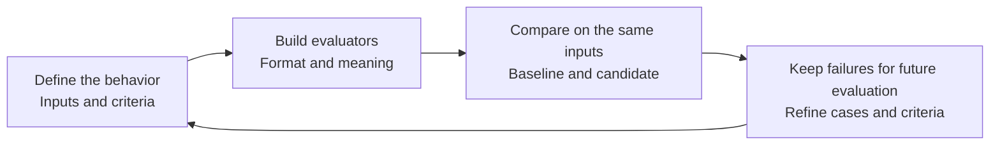
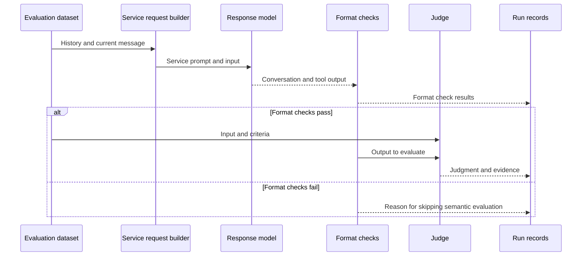

## TL;DR

- I stored failed conversations as inputs and acceptance criteria.
- I separated format checks from semantic evaluation.
- I compared improvements and side effects on the same cases.

## Introduction

[EncBird](https://encbird.com), the service I run, helps learners practice expressing their thoughts in English. In DiaryChat, a learner writes about their day in English, and a coach provides a follow-up question and corrections.[^1]

One conversation in the DiaryChat evaluation dataset goes like this: the learner describes visiting a cafe with their wife and explains why they ordered an iced latte. The model then asks what their wife ordered.[^2]

The question is grammatical and related to the conversation. But a sequence of questions like this turns practice expressing thoughts into a list of drink orders. “The response sounds natural” was not enough to catch that problem.

I built an evaluation dataset and runner in EncBird to check behavior like this. **I saved conversations that reproduce failures, wrote down the expected behavior, and made it possible to rerun models on the same inputs for comparison.**

This playbook presents that implementation in an order someone building their first evaluation can follow. It takes the cafe conversation from an evaluation case through automated judgment and result comparison. The dialogue comes from a synthetic regression case and the model output preserved with it in the repository. Numerical examples later in the post are hypothetical.





## 1. Turn One Conversation into an Evaluation Case

### 1-1. Translate the Product Goal into Observable Conditions

I scoped the evaluation to **generating one next response from a fixed conversation history**. Keeping the history fixed makes it easier to identify which inputs produce different behavior after a change.

DiaryChat helps learners express experiences and thoughts about their day in English. Getting long or advanced answers is not the goal in itself. I broke that intent into conditions we can check in a conversation.

| Area | Expected behavior |
| --- | --- |
| Conversation progress | Help the learner express one relevant thought without asking again for information they have already explained |
| Response burden | Ask at the learner's level and accept short, meaningful answers |
| Corrections | Repair only what needs correction, preserving subject, negation, tense, and uncertainty |
| Closing | When the server marks the final turn, close without another question or task |

Those conditions make the cafe problem concrete. The learner has already explained their choice and its reason. The next question has no need to collect another drink order.

I also added a condition to DiaryChat's current criteria: once an activity has been sufficiently discussed, move to another part of the day or a topic the learner chooses. Being related to the conversation is not a reason to keep probing details of the same activity.[^2]

### 1-2. Store the Context Before the Failure Separately from the Criteria

Here is an abbreviated view of the cafe history. The coach rows translate only the question portions of the original Korean messages.

| Turn | Message |
| --- | --- |
| Learner | I went to a cafe with my wife today. |
| Coach | Could you write in English about what you ordered at the cafe? |
| Learner | I ordered an iced latte. |
| Coach | Could you write in English about why you chose that drink? |
| Learner | It was hot, and I wanted something cold without much sweetness. |

I ended the evaluation input here. The stored next response—“Could you write in English about what your wife ordered at the cafe?”—remained evidence of the failure. I did not show it to the model generating a new response.

Supplying only the last sentence would change the task. The preceding questions and answers establish that the learner has already discussed the order and their reason. I also preserved context used in the actual request, such as proficiency level and the time.

Each case keeps four groups of information. In the JSON, these are organized under fields such as `input`, `reference`, and `provenance`.[^2][^3]

| Material | What the cafe case preserves |
| --- | --- |
| Input | Proficiency level, preceding conversation, current learner message |
| Criteria | Avoid repeating the same explanation; offer an appropriate opportunity to express a thought |
| Provenance | Whether the dialogue is synthetic or drawn from actual records, and the failure it reproduces |
| Case management | Case ID, source group, development/validation split, evidence supporting the criteria review |

I did not fix the answer to one particular question. Several follow-ups may be appropriate in the same situation. The cafe case therefore leaves `reference.output` empty and records allowed and prohibited behavior in `reference.criteria`.

To apply this to a new app, choose one failed response and separately save **the input immediately before it and the conditions that explain why it failed**. You can preserve both even when writing a single correct answer is difficult.

### 1-3. Add Normal Cases and Exceptions to Make a Small Dataset

Alongside the cafe case, I included situations that require clarification. They distinguish when to ask a follow-up from when to move on.

The dataset containing this case, `diary-thought-expression.json`, also includes short but meaningful answers, ambiguous references, learners who cannot think of anything to say, topic changes, and closing turns. As of October 13, 2026, it contains 14 synthetic cases, all assigned to development.[^2]

For example, if context does not establish what “it” refers to in “I liked it,” clarification is useful. Asking again for a reason the learner has already explained is repetition. Including both prevents a crude fix that bans every follow-up on the same topic.

I used this dataset for regression testing: checking whether a new change breaks existing behavior. Its purpose differs from a representative sample of users or a validation dataset whose answers have all been labeled by people.

## 2. Turn the Criteria into Automated Evaluators

### 2-1. Check Format in Code and Judge Meaning Separately

An evaluator is code or a model that checks an expected condition. In DiaryChat, the visible conversation and the correction tool output are separate results, so I treated them separately.

The model writes a conversational reply first, then calls `provide_feedback` once. I required `feedback.original` to contain the complete latest learner message unchanged, and valid writing to remain free of unnecessary corrections.[^4]

| Conditions code can check | Conditions that require reading for meaning |
| --- | --- |
| Tool call order, count, and required fields | Does the question repeat something already explained? |
| Exact match between `feedback.original` and source input | Is the correction necessary, and does it preserve meaning? |
| Existence and overlap of source spans to correct | Does the question provide a suitable opportunity to express a thought? |
| Closing state reflected in the request | Does the final response assign a new task? |

Code can count question marks, but a sentence with one question mark may ask the learner to do three things. For conditions like this, I supplied a language model with the input, result, and criteria together. This is **LLM-as-a-Judge**; I refer to the model making the judgment as the judge.

For the cafe case, I set `judgmentTarget: conversation`. The runner first checks whether the tool output has a valid format, then has the judge evaluate the coach's conversational text. The semantic quality of corrections is outside this case's score.[^3]

### 2-2. Give the Judge Product Intent and Evidence of Failure

“Evaluate whether this is a good answer” does not explain what good means for EncBird. I combined the actual input, generated answer, product intent, and case-specific criteria in the judge's input.

A concise version of the cafe criteria reads like this:

> The learner has already described the cafe visit, drink choice, and reason. Do not ask for the same explanation or merely collect more order details. Offer one opportunity to express a thought at the learner's level. Respect requests to change the topic and allow necessary clarification. On the final turn, close without a new question.

A set of criteria specifying both the behavior and its exceptions is a rubric. If two people read it and reach different judgments, examine that disagreement before changing the judge model.

I built EncBird's runner with the evaluation library DeepEval to return 1 when the criteria are satisfied, or 0 and a reason for a concrete violation. It treats text inside the input and model output as material to evaluate, rather than instructions to follow.[^3]

### 2-3. Check Judgment Evidence on a Sample

**Executing an evaluator does not establish that its judgment is correct.** If a person identifies a repeated question that the judge passes, read the judge's reason. It may have missed earlier dialogue or accepted relevance alone as success.

To validate a judge, a person separately reviews flagged failures, ambiguous cases, and a sample of automatic passes. Suppose a human-labeled sample of 20 failures and 80 successes produces the following results.

| Human judgment | Judge also says failure | Judge says success |
| --- | --- | --- |
| 20 failures | 16 | 4 |
| 80 successes | 8 | 72 |

Overall agreement is `(16 + 72) / 100 = 88%`. For a failure detector, recall—the share of actual failures found—is `16/20 = 80%`. Precision—the share of failure alerts that are correct—is `16/(16+8) ≈ 66.7%`. Reading the four missed failures and eight false alerts helps narrow down what needs repair.

Cases examined while revising the criteria become development material. Use a separate sample for the final check, keeping turns derived from one diary in the same split. I added source-group splitting to EncBird's data preparation tools for this purpose. The 14 development cases above do not, by themselves, establish that the judge has been validated.[^3]

### 2-4. Pair the Improvement Metric with Checks for Side Effects

If the only goal is fewer repeated questions, a model could score better by dropping questions or ending conversations early. I therefore included appropriate expression opportunities, the learner's wish to change topics, and closing conditions alongside repetition in the criteria.

A metric that checks whether improving the target damages another quality is a **tension metric**. This playbook pairs them as follows.

| Behavior to improve | Primary metric | Tension metric |
| --- | --- | --- |
| Avoid requesting the same explanation again | Repeated-question failure rate | Rate of removing expression opportunities or ending sessions early |
| Correct genuine English errors | Share of actual errors corrected accurately | Unnecessary correction rate on valid writing; meaning distortion rate |
| Respect final turns | Rate of adding a task on the final turn | Rate of treating ordinary turns as final |

Calculate each metric on cases where its condition can be assessed. Count new tasks on final turns among closing cases, and unnecessary corrections among cases containing valid writing. An overall pass rate does not reveal which quality deteriorated.

The current cafe case returns one semantic 0/1 judgment for its conversation criteria as a whole. Producing the rates in this table requires separate violation labels for each output and aggregation of those labels. Correction metrics also need cases that evaluate the correction output.

I discuss metrics displacing their original goals, and the pairing of delivery and stability metrics, in the [Software Factory post](/en/2026/10/05/software-factory-evals-and-tension-metrics.html). Here I focused on the conversation quality needed for the next comparison.

## 3. Run and Compare on the Same Inputs

### 3-1. Prepare the Requests the Service Actually Uses

A separate copy of the prompt for evaluation can drift from the service. In EncBird, I made the evaluation tool call the service's actual prompt and request-building functions.

`check` validates the dataset; `prepare` turns it into requests for the model. Run the following commands from the EncBird repository root with Python 3.11–3.13, Go, uv, and pnpm available.[^3]

```bash
pnpm eval:llm check \
  --dataset packages/eval/python/llm_eval/fixtures/diary-thought-expression.json

pnpm eval:llm prepare \
  --dataset packages/eval/python/llm_eval/fixtures/diary-thought-expression.json \
  --out output/llm-eval/diary-playbook-prepared
```

The resulting `prepared.json` contains the actual requests and hashes of relevant source files. A hash is an identifier used to detect changes in input or code. I excluded expected answers and evaluation criteria from generation requests, supplying them only to the later judge call.





### 3-2. Separate the Call Plan from Live Execution

`run` takes the prepared requests, selected cases, repeat count, and output location. This command checks the execution plan without calling a model.

```bash
pnpm eval:llm run \
  --dataset packages/eval/python/llm_eval/fixtures/diary-thought-expression.json \
  --prepared output/llm-eval/diary-playbook-prepared/prepared.json \
  --feature diarychat.turn --split dev --repeat 2 \
  --out output/llm-eval/diary-playbook-plan
```

Without a generation model override, it uses the model and settings in the prepared service request. For live generation and semantic evaluation, specify the judge and call limit as follows. This command incurs costs because it includes `--live`; use a fresh output directory.

```bash
pnpm eval:llm run \
  --dataset packages/eval/python/llm_eval/fixtures/diary-thought-expression.json \
  --prepared output/llm-eval/diary-playbook-prepared/prepared.json \
  --feature diarychat.turn --split dev --repeat 2 \
  --judge-model openai.gpt-6.1-sol \
  --live --max-calls 56 \
  --out output/llm-eval/diary-playbook-baseline
```

Generating 14 cases twice takes 28 calls. Judging each output once adds 28, for a total of 56 calls. `--max-calls` caps generation and judgment calls together; it is not a dollar limit. The current runner uses the local Bedrock `default` profile in `us-east-1`.[^3]

I preserved more than the response after each run. `run.json` stores inputs, prompts, settings, conversation and tool outputs, format checks, semantic judgments, and their reasons. Each generation and judgment call goes into `calls.jsonl`. These execution records are traces; I used them to work backward from a failed output to its input and judgment evidence.

`NOT_RUN` means the model was not executed, and a run without a judge leaves semantic evaluation inconclusive. Call failures and missing criteria do not count as successes. Result files containing source text are kept in private output directories excluded from Git.

### 3-3. Change Only the Intended Variable and Read Case-Level Differences

For comparisons, I held the dataset and criteria fixed and changed only the intended target. For a model comparison, rerun the same prepared requests with a different `--model` and output directory. For a prompt revision, preserve the old requests and results first, then run `prepare` again from the revised code.

Compare the two run records with this command.

```bash
pnpm eval:llm compare \
  --baseline output/llm-eval/diary-playbook-baseline/run.json \
  --candidate output/llm-eval/diary-playbook-candidate/run.json \
  --out output/llm-eval/diary-playbook-comparison
```

The current comparison tool rejects differences beyond the model by default. For a prompt experiment, `--allow-incompatible` produces comparison material that exposes those differences. When using it, check that the inputs and criteria did not change along with the intended prompt revision.[^3]

The following example shows how to read the results. Suppose we run 30 ordinary-turn cases and 10 closing cases once each, then label each output's violation types. These are not measured results from running the 14 cases above.

| Check | Old prompt | Revised prompt |
| --- | --- | --- |
| Repeated questions | 8 of 30 ordinary turns | 3 of 30 ordinary turns |
| Early closing without an expression opportunity | 0 of 30 ordinary turns | 0 of 30 ordinary turns |
| New task on the final turn | 0 of 10 closing turns | 1 of 10 closing turns |

Repetition decreased, but a closing violation appeared. If closing violations are disallowed, reject this candidate and use that case's input and response for the next revision. Combining different qualities into one average can hide the failure behind the improvement.

Model outputs can vary between runs, so repeat important cases and record case counts and repeat counts together. Evaluating one next response against fixed history does not establish whole-session quality. That requires a separate run that feeds generated responses into subsequent turns.

## 4. Add New Failures to Regression Evaluation

### 4-1. Distinguish the Task from the Failure Mode in Traces

The cafe case concerns the task of continuing a conversation and the failure of collecting only more incidental details. Corrections or memory extraction from the same cafe story need different criteria. I therefore preserved both feature IDs and failure evidence in the evaluation cases.

Use this distinction when analyzing new records, too. Give AI the product intent and trace, then ask it to extract the task, suspected failure, and supporting passage. You can start by reviewing representative cases of recurring failures and ambiguous judgments, rather than requiring a person to classify every record first.

Also trace where the failure began. Suppose a learner says, “My friend moved to Busan; I live in Seoul,” and the next conversation asks, “How is life in Busan?” The fix depends on whether memory extraction stored the move as the learner's, or the conversation model misread a correctly stored fact.

EncBird has separate evaluation paths for memory extraction, storage, and context selection.[^5] Even if a failure appears in conversation, reproduce it using the inputs and expected results of the responsible stage. Changing only the next-question prompt can leave an incorrect stored fact intact.

### 4-2. Separate Repeatable Checks from Samples for Human Review

In EncBird, I added tests that check data format, request construction, and exclusion of evaluation criteria from generation inputs without calling a model. I separated these checks from semantic evaluation so new cases can pass them first.[^3]

Use the same distinction when connecting evaluations to CI, the automated checks run when code changes. Check formats and request construction on each change; schedule model-based evaluation according to the feature changed and the consequences of failure. Fixing the baseline and candidate output paths also lets an agent continue from revision to reevaluation.

The agent making improvements must not raise its score by changing validation expectations. If the product intent changes and the criteria are revised, reevaluate the old model under the new criteria for the comparison to remain useful.

When adding production samples, distinguish random samples for estimating general behavior from records selected because of complaints or retries. A failure rate in deliberately selected problem cases is not the overall user failure rate. Read some automatically passed samples, too, to find problems outside the existing criteria.

Feed confirmed failures back through **source review → reproduction input → criteria update → comparison with the baseline**. This checks response quality. Learning gains, speech recognition, pronunciation, and interruption handling each require their own usage evidence and evaluation.

## Closing Thoughts

Asking what someone ordered at a cafe may suit another app. In EncBird, the problem was asking for another order after the learner had already finished their explanation. I had to make that distinction before writing the criteria.

For a first evaluation, I think it helps to start with one conversation you can explain as a failure in your own app. Preserve that judgment as an input and criteria, and the next change can be checked against the same problem.

---

[^1]: EncBird's `docs/product-intent.md`. Defines DiaryChat's purpose: organizing thoughts about actual experiences and expressing them in English.
[^2]: EncBird's `packages/eval/python/llm_eval/fixtures/diary-thought-expression.json`. Contains the inputs and criteria for `diary-thought-wife-order-trap`, plus model output preserved in `observedFailure`. The cases are synthetic; a criteria-review record is not a human gold label.
[^3]: EncBird's `packages/eval/python/llm_eval/README.md`, `grading.py`, `cli.py`, and `packages/eval/go/cmd/tools/prepare-llm-eval/README.md`. Cover request preparation, separation of generation input and evaluation criteria, the judge, data splits, execution, comparison, and scope. Commands and paths reflect the repository on October 13, 2026. No paid model calls or production data retrieval were performed while revising this post.
[^4]: EncBird's `packages/api-infra/functions/main/internal/feature/diarychat/prompt/template/sol_chat_system.txt`. Defines feedback calls after conversational replies, preservation of the complete latest message, and minimal corrections.
[^5]: EncBird's `packages/eval/python/memory_eval/README.md`. Covers alignment between facts and evidence and evaluation of individual memory stages. My [harness-building post](/en/2026/06/16/harness-engineering-in-practice.html) separately describes the environment I built for delegating development to agents.
