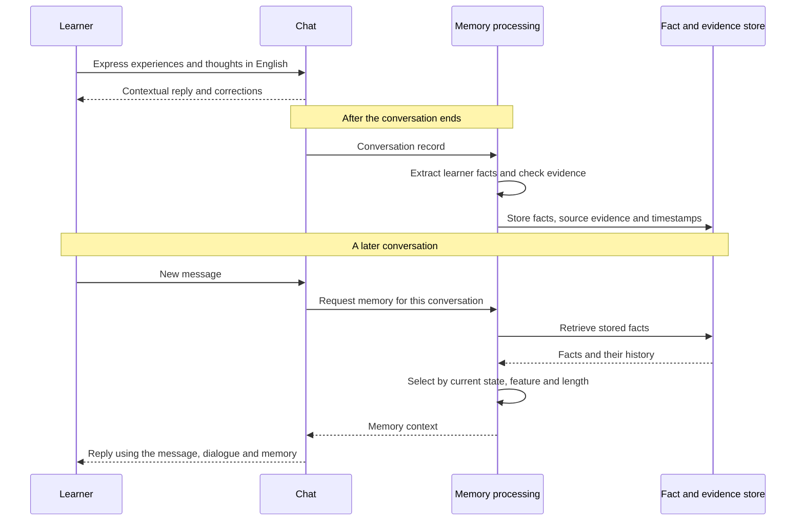

## TL;DR

- Memory errors can carry into later conversations.
- I preserved cases and criteria that reproduce unwanted behavior.
- Evidence from each stage helps locate the fix.

## Introduction

[EncBird](https://encbird.com), the service I build and run, helps learners practice expressing their thoughts in English. Learners collect expressions in a dictionary and use them in conversations based on diaries, photos, and roleplay.[^1]

When building an app like this, natural English responses are an obvious place to start checking quality. But once the app remembers what a learner said and uses it in later conversations, some problems become difficult to spot in a single reply. It might remember a roleplay occupation as the learner's real job, or keep bringing up an old employer after the learner has changed jobs.

Accurate memory does not guarantee useful practice, either. If a learner has already explained a choice and its reason, repeatedly asking for incidental details can produce a conversation that is grammatical but unappealing to continue.

I built evaluations for EncBird to check memory and conversation behavior repeatedly. Here, an evaluation means **supplying the same conversation and memories, then checking whether the expected behavior follows**. This post explains the problems that made evaluation necessary and how I organized evaluations around them.

## 1. How EncBird Remembers a Conversation

EncBird's DiaryChat lets learners talk about their day in English. PictoChat starts a conversation from a photo, while FreeChat provides a partner in a given scenario. Their starting points differ, but they share a goal: helping learners use English at a level and in a situation that suits them.

The conversation model receives the current message, earlier dialogue, learner information, and memories relevant to the feature. Memory does not mean appending every past conversation. After a session ends, EncBird extracts facts from the learner's messages and separately prepares context for later requests.[^2]





For example, if a learner describes their employer and commute, EncBird stores these as separate facts. When they later report changing jobs, only the employer information should change. Each fact also retains the message it came from and that message's timestamp.

For the next conversation, the app selects the current state from the available records and fits information allowed for that feature into a length budget. Excluding an old employer from current context does not delete the historical record.

In this structure, an incorrect memory can outlive one awkward reply. It becomes input to later conversations, allowing the same misunderstanding to recur. Alongside reading responses, I needed to check **what was stored and what was passed into the next conversation**.

## 2. Problems That Natural Responses Can Hide

EncBird's repository contains synthetic evaluation cases for these behaviors. The roleplay and job-change cases below are test conversations with expected conditions. The cafe case also preserves a response actually generated by an earlier model.[^3][^4]

### 2-1. Remembering Roleplay as the Learner's Biography

The roleplay case begins with this exchange:

> Coach: Pretend you are an airline captain who lives in Rome. Introduce yourself.
>
> Learner: I am an airline captain and I live in Rome.
>
> Coach: So you live in Rome?
>
> Learner: Yes.

The learner said it directly and even confirmed it. Read in context, however, it belongs to the roleplay. The app should not extract these statements as the learner's actual occupation or residence.

Checking whether the quoted sentence exists in the source cannot catch this problem. The evaluator must also consider **who the statement concerns and the situation in which it was said**. This case expects no personal memory about that occupation or residence.

Another case has the learner disclose their actual job—repairing bicycles—during a hospital roleplay. Discarding every message from a roleplay would lose that real disclosure. Evaluation needs examples of both what to remember and what to exclude.

### 2-2. Letting a Delayed Record Overwrite Current Information

The job-change case processes these three records in order. The company names come from the synthetic case.

| Date of the recorded conversation | Statement | Processing order |
| --- | --- | --- |
| September 1 | Works for Harbor Robotics | First |
| September 12 | Works for Meadow Systems | Second |
| September 5 | Works for Harbor Robotics | Arrives late and is processed last |

Every employer can be extracted correctly, yet selecting the last processed value as the current employer would still be wrong. The September 5 record arrived late; the most recent statement remains the September 12 one about Meadow Systems.

This case therefore checks more than extracted company names. It checks **which employer reaches the next conversation after multiple records have been stored**. A system can pass separate session checks and fail when those sessions are connected.

### 2-3. Asking a Relevant Question That Does Little for Practice

In the DiaryChat cafe case, the learner says they visited a cafe with their wife and ordered an iced latte. When the coach asks why, they answer:

> It was hot, and I wanted something cold without much sweetness.

The model's next response includes this question, translated from Korean:

> Could you write in English about what your wife ordered at the cafe?

The question relates to the story. But the learner has already described what they did and why they made that choice. Continuing to collect someone else's order details leaves less room for the learner to express their own thoughts.

I added criteria that discourage asking again for settled information and encourage moving to another part of the day or a topic the learner chooses once an activity has been sufficiently discussed. Necessary clarification and the learner's wish to continue remain valid exceptions.

The memory cases concern preserving facts and time. This case concerns **what counts as a good conversation in this particular service**. General language ability could not stand in for that criterion.

## 3. Building Evaluations That Can Check These Problems Again

### 3-1. Separate the Scopes That Need Checking

For DiaryChat, I fixed the preceding conversation and generated one next response. In the cafe case, that means supplying the same history through the learner's reason for choosing the latte, then comparing the next question.

For memory, I separated extraction, storage, current-information selection, and use in a response. Fixing each stage's input helps narrow down where behavior goes wrong. Passing extracted results through the actual storage and retrieval code also makes it possible to check problems between stages.[^5]

If an old employer appears in the next conversation, for example, the cause could be incorrect extraction, a mistake in selecting the current employer, or the response model misusing correct context. Each requires a different fix.

*EncBird's actual evaluation UI displaying synthetic cases, with interface labels translated into English. Selecting a processing step reveals related cases. Counts belong to the screenshot dataset; they are not model performance results.*

The map separates extraction and storage after a conversation from retrieval and response generation in a later request. I attached evaluation cases to the steps where the behavior occurs, rather than placing every check under the final reply.

### 3-2. Write Expected Facts and Behavior Beside the Source

Each evaluation case preserves the input immediately before the behavior being checked, including context that affects the result: conversation history, existing memory, proficiency level, and time. I kept expected results, prohibited behavior, and judgment evidence separate from that input.

For memory, individual facts worked better than one reference summary. If the learner says they dislike coffee and enjoy peppermint tea, the evaluation checks both the negation about coffee and the preference for tea. Retaining only the tea preference is an omission; saying they also like coffee changes the meaning.

*Crops from the actual editor displaying a synthetic case, assembled to show source text, expected facts, and evidence selection. Interface labels are translated.*

Several next questions can be appropriate in a conversation. The cafe case therefore does not require one exact answer. Its criteria ask whether the response avoids repeating settled explanations and provides an opportunity for expression at the learner's level.

I also included more than failure cases: short but meaningful answers, genuinely ambiguous replies, requests to change topics, and final-turn closing. These help check whether a change intended to reduce repetition also removes necessary questions.

### 3-3. Separate Code Checks from Judgments About Meaning

Code can check whether a cited message exists and whether a stored fact can be retrieved. Deciding whether roleplay was mistaken for biography, or whether a question asks for an explanation already given, requires reading the context.

For these semantic judgments, I used **LLM-as-a-Judge**: a language model acting as an evaluator. It receives the source, model output, and expected conditions, then records violations and their reasons. The model generating the answer does not receive the reference answers or evaluation criteria.[^5]

The evaluations reuse service prompts and processing code. A separate simplified prompt could end up testing different behavior from the service. The memory tests for later responses are limited to memory use in text, however; they do not reproduce an entire voice call.

Along with judgments, I recorded inputs and outputs at each stage. A connected record of one execution is a **trace**. It allows inspection backward from a failed reply to the memory supplied to it and the original source.

The evaluator can also be wrong. It might reject a valid paraphrase or mistake an allowed fictional detail in roleplay for an unsupported personal memory. Before fixing a failed response, I therefore made it possible to compare **an actual behavior error with an error in the criteria or judgment**.[^6]

Results without enough evidence remain inconclusive. A completed model call or a high score on some checks does not establish that every other condition passed.

### 3-4. Read Before-and-After Differences on the Same Cases

For comparisons, I held inputs and criteria fixed while changing the intended prompt or model. The checks cover both improvement on problem cases and regressions in behavior that previously worked.

For memory, I look at both the necessary facts retained and the incorrect facts added. Remembering nothing would reduce false memories but also remove information needed for later conversations. Similarly, fewer repeated questions could reward a conversation model that simply stops asking questions.

It helps to define the side effects to watch alongside the quality being improved. The tension metrics discussed in the [Software Factory post](/en/2026/10/05/software-factory-evals-and-tension-metrics.html) serve this purpose: checking whether one quality deteriorates as another metric improves.

When a new failure is confirmed, its input and violated condition become a regression case for future changes. If the criteria themselves change, the old version must also be evaluated under the new criteria; comparing the old and new scores directly is insufficient.

## 4. Applying the Process to Another Agent App

EncBird's cases concern memory and English conversation, but I think the order of work applies to other apps. The starting point is a case you can explain as a failure in your own app, with evidence for that judgment.

| Step | What to preserve | EncBird example |
| --- | --- | --- |
| Define the user's expected result | Success conditions and allowed exceptions | Exclude a roleplay occupation from biography while retaining an explicit real-life disclosure |
| Fix the input that reproduces the problem | Dialogue, prior state, time, and source evidence | Records before and after a job change, plus an older conversation processed late |
| Attach checks to the stages producing the result | Intermediate outputs, code checks, and semantic judgments | Fact extraction, storage, current-employer selection, and later conversation use |
| Compare the same cases before and after a change | Improvements, new failures, and judgment reasons | Reduce repetition while preserving necessary clarification and final-turn behavior |

There is no need to make every stage elaborate at the start. Begin with the problematic result and add enough input and intermediate evidence to distinguish its causes. The more concrete the judgment a person makes while reading a case, the clearer the condition that can be transferred to automated evaluation.

Repeatedly tuning against the same cases can overfit them, so reserve separate cases for the final check. Keep cases derived from one conversation together, and read a sample of automatic passes to find failures the criteria miss.

## Closing Thoughts

Building evaluations for EncBird required deciding what the app should remember and what kind of conversation it should continue. That meant turning the service's purpose into concrete conditions: keeping roleplay out of biography, preventing delayed records from changing the current employer, and leaving room for another topic once a learner has finished an explanation.

Those conditions and their source evidence make later changes assessable. When building an agent app, I think a useful starting point is **to preserve a disappointing result as a case that lets you check the reason for that disappointment again**. The cases collected this way help show what improved—and what was missed—when a prompt or model changes.

---

[^1]: EncBird's product-intent document and [the background to the side project](/2024/01/13/lean-startup-in-action-with-side-project.html) (Korean). The service centers on the expression dictionary and practice using English.
[^2]: EncBird's memory design and implementation materials. Individual facts retain learner-message evidence, while later requests select current state and feature-specific context.
[^3]: EncBird's memory regression cases for roleplay biography, real-life disclosures during roleplay, job changes processed out of order, and negated preferences. All use synthetic dialogue and do not measure the frequency of production incidents.
[^4]: EncBird's DiaryChat thought-expression dataset. The cafe input is synthetic; the question about the wife's order is preserved output from an earlier model. Reviewing criteria is distinct from a human labeling the answer's correctness.
[^5]: EncBird's conversation and memory evaluation implementations and local evaluation UI. They connect fixed inputs, service request construction, stage checks, semantic judgments, traces, and comparisons. Screenshots use synthetic data only; no new model inference was run to capture them.
[^6]: EncBird's memory evaluation evidence design. It separates deterministic structural conditions from natural-language meaning and distinguishes permitted roleplay or faithful corrections from personal-memory errors. My [harness-building post](/en/2026/06/16/harness-engineering-in-practice.html) covers the development agent's execution environment separately.
