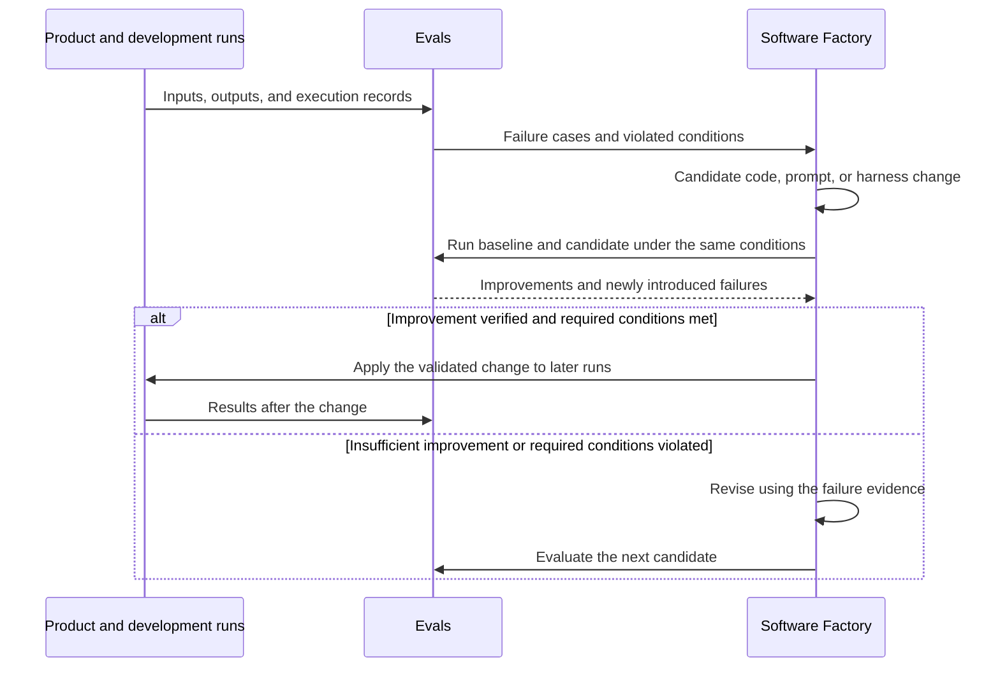

## TL;DR

- Evals guide a Software Factory's self-improvement.
- Full automation requires the Software Factory to manage its KPIs too.
- KPIs and tension metrics together help reject changes that only improve the numbers.

## Introduction

A development agent may be able to change code and run tests, but if a person must read every proposed change and assign the next task, improvement remains limited by how quickly that person can decide. Connecting failure discovery, task selection, and validation allows development to continue while the person is away.

A Software Factory is a system in which AI agents build and operate software, then use the results to improve both the product and how it is developed. I think **Evals are central to making this self-improvement possible**. The system needs to judge what failed and which changes are better before it can choose the next improvement.

Even if agents handle those changes, human intervention remains if people must continually decide what counts as progress and set the next target. I think full automation will require **the Software Factory to manage its key performance indicators, or KPIs, as well**.

If it only tries to raise a KPI, however, it can accept changes that do not help users. That is why it needs **tension metrics: measures that show whether another aspect of quality gets worse while the target metric improves**.

## 1. What a Software Factory does

A Software Factory connects implementation, validation, deployment, and fixes for problems found in operation. Factory, the company behind the development agent Droid, also identifies continual learning and self-improvement as core requirements for a Software Factory.[^1]

Suppose users report repeated failures during signup. The Software Factory finds relevant execution records, creates a case that reproduces the failure, changes the code, and checks whether signup actually works. After deployment, it looks for a reduction in the same failure and turns remaining problems into further work.

**The development agent's own working methods are also candidates for improvement.** If it repeatedly skips signup tests, changing the product code is not enough. It should also revise its test procedure or working instructions to reduce the same omission on later tasks.

I call the combined instructions, tools, execution environment, and validation and recovery procedures the **harness**. In my post about building EncBird's harness, I described turning recurring failures into rules in `AGENTS.md`, tools, and tests.[^3] With a Software Factory, I want execution results to drive changes to that harness too.

If one run fixes an error and the next repeats it, the development process has not improved much. Validated changes need to persist in code, tests, and working instructions that affect later runs. This kind of self-improvement can happen through changes to instructions and tools without retraining model weights.

## 2. Why Evals are central to self-improvement

Producing more candidate changes does not tell us which ones to keep. **An Eval defines inputs and expected outcomes, runs the system, and checks whether the actual results satisfy those conditions**. Comparing the existing and revised versions under the same criteria reveals both improvements and regressions.

Factory Missions defines a Validation Contract before dividing implementation into features. It specifies the observable behaviors required to consider the work complete. Agents separate from the implementers use the system as a real user would to validate those conditions, and the problems they find become further fix tasks.[^2]

In this way, **Evals connect failure discovery, the choice of what to fix, and the acceptance of improvements**. Without evaluation, an agent can mistake a change in behavior for evidence that the system has become better.

### 2.1. Execution records need to lead to the next change

Evaluation first requires knowing what happened. A **trace** connects a request's input, tool calls, intermediate results, and final outcome. Observability is the ability to understand execution through records like these.

Both the product and its development process need observation. A failed signup trace can reveal a product defect; the development agent's record can reveal that it skipped a test while fixing that code. Knowing which version failed on which input makes it possible to validate a change under the same conditions.

The Software Factory turns these records into failure cases and runs candidate changes to code, prompts, or the harness. Evaluation checks whether the problem is resolved and whether other behavior has become worse before the change is kept. This is the self-improvement process I have in mind.





### 2.2. Define what makes a result good

EncBird, the English practice app I run, uses AI to continue conversations and offer sentence corrections when learners describe their experiences in English. It needs to correct language errors while preserving what the learner meant.[^4]

Suppose a learner says `I might visit Busan, but I haven't decided yet.`, and the app changes it to `I visited Busan.` A possible future visit has become a completed event. A check that the correction reached the screen could pass even though meaning preservation failed.

To fix this, the evaluation case needs the original sentence, the incorrect correction, and the condition that the possibility of a visit and the undecided state must remain. After changing the prompt or processing code, comparing the same input with the existing version can establish whether the original problem was resolved, beyond merely producing a different sentence.

Code can check whether feedback reached the screen. A language model can evaluate questions that require reading context, such as whether the meaning was preserved. That evaluator can also be wrong, so its judgments need comparison with cases people have labeled to check for missed errors and rejected valid results.[^5]

Cases not used to develop the change help detect a fix tailored to one sentence. Where model responses vary, repeated runs under the same conditions allow failure-rate comparisons. Evals drive self-improvement when this evidence becomes input to the next change.

## 3. Full automation also requires KPI management

Where Evals validate individual changes, KPIs aggregate results across runs to guide what to improve and by how much. If the correction feature's KPI is the proportion of actual errors corrected, for example, evaluation results can establish the current level and help identify which error types to address first.

Even with that work automated, the Software Factory still waits for people if they select KPIs, define aggregation rules, adjust targets, and assign the next improvement. **If full automation is the goal, selecting, defining, measuring, and adjusting KPI targets should also be the Software Factory's responsibility.**

The KPI management I have in mind goes beyond periodically reading numbers. It means selecting measures that reflect the product's purpose, building the records and evaluations needed to measure them, and changing improvement priorities based on the results. If an existing metric misses important failures, the system should refine or replace that metric too.

For example, when first adding corrections, a team might track whether feedback is delivered without omissions. Once delivery is stable, keeping that as the only KPI would reward a product that reliably displays incorrect corrections. The improvement focus should then move to correcting actual errors properly, while delivery failures remain monitored.

If the Software Factory handles this process, it updates **what it considers an improvement in response to operational results**, alongside changing the product. The product purpose and required conditions set by people guide its search for KPIs that represent that purpose more faithfully.

In ALPS Writer Plugins, which I develop, I already separate the acceptance conditions for a new feature from metrics for later improvement. ALPS is a format for product requirements. In the 0.9.6 update, I added guidance to consider evidence of the intended outcome and tension metrics in both the detailed Full ALPS and the shorter Lite ALPS formats.[^7]

For corrections, that means separating the condition “deliver corrections that preserve the learner's meaning” from the KPI “proportion of actual errors corrected.” So far, I have connected criteria like these to planning and implementation guidance. The Software Factory I envision also measures them in operation, sets the next target, and checks whether the metrics still reflect the product's purpose.

## 4. Why KPIs need tension metrics

If a Software Factory manages KPIs and evaluates its own changes against them, it can also find ways to improve only the numbers. It might split meaningless changes into smaller releases to increase deployment frequency, or remove failing tests to raise the test pass rate. The user's outcome stays the same or gets worse while the metric improves. This is **metric gaming**.

When choosing a KPI, the system should also ask **what could get worse if that were the only metric it optimized**. Measuring that side effect with a tension metric helps prevent the Software Factory from automatically treating a KPI increase as an improvement.

### 4.1. A higher correction rate can produce worse corrections

Suppose a hypothetical evaluation set contains 100 sentences: 40 with errors and 60 without, with one evaluated error in each incorrect sentence. The KPI is the proportion of errors corrected. The tension metric is the proportion of valid sentences changed unnecessarily.

| Version | Error correction rate | Unnecessary correction rate |
| --- | --- | --- |
| Existing version | 30 / 40 = 75% | 3 / 60 = 5% |
| Revised version | 36 / 40 = 90% | 18 / 60 = 30% |

The revised version fixes more errors, but also changes many more valid sentences. Accepting it on the correction rate alone teaches the Software Factory to treat more aggressive editing as success. With both rates in the evaluation, the Software Factory can try another change that reduces unnecessary corrections instead of accepting the higher correction rate as sufficient evidence of improvement.

The same reasoning applies to the process that develops the product.

| KPI to improve | Tension metrics to examine alongside it | Side effect to check |
| --- | --- | --- |
| Speed of delivering changes | Change fail rate and rework rate | Does skipping validation merely create more fixes after release? |
| Development cost per task | Share of tasks missing completion criteria and retry costs | Does the work look cheaper because less was completed or later retry costs were excluded? |
| Actual English error correction rate | Unnecessary correction rate and meaning distortion rate | Are valid sentences or the learner's meaning being changed too? |

These metrics do not have to move in opposite directions. The desired result is a higher correction rate with fewer unnecessary corrections. DORA, which researches software delivery performance, similarly warns about gaming when a single metric becomes the focus and recommends considering multiple metrics with tension between them.[^6]

### 4.2. Changes to metrics need evaluation too

Adding one tension metric does not prevent every form of gaming. Removing difficult cases from evaluation or splitting the same task into several tasks changes the denominator and can make both metrics look better.

KPI management therefore also needs to cover formulas, evaluation populations, aggregation periods, and exclusion rules. Comparisons need the same criteria. If a metric's definition changes, the existing version should be evaluated under the new definition too. Keeping records under the old definition makes it possible to distinguish a better product from a different calculation.

Metrics to monitor and conditions that must hold also need to remain distinct. A small increase in rework time does not necessarily justify rejecting every change. But if a change violates the requirement to preserve the learner's meaning, a higher correction rate cannot offset that failure. Combining metrics into a single weighted score should not conceal this distinction.

When changing a KPI, the Software Factory should reconsider its tension metrics and continue checking previously identified failures in the new evaluation. Separate cases and operational results can reveal failures the metrics miss and guide further changes.

---

[^1]: Matan Grinberg, Eno Reyes, [Factory 2.0: From coding agents to software factories](https://factory.com/news/software-factory). Describes the scope of Software Factories and continual learning and self-improvement.
[^2]: Theo Luan, Factory, [How Missions Work](https://factory.com/news/missions-architecture). Describes setting completion criteria before implementation and validating with separate agents.
[^3]: [How I Built the EncBird Harness Layer by Layer — Harness Engineering in Practice](/en/2026/06/16/harness-engineering-in-practice.html). My process of turning repeated failures into instructions, tools, and validation.
[^4]: [How Do You Evaluate AI That Remembers Users? — Memory and Conversation in EncBird](/en/2026/10/05/evaluating-new-agent-applications.html). Discusses preserving source evidence and expected conditions, then evaluating behavior and meaning at each stage.
[^5]: Anthropic, [Demystifying evals for AI agents](https://www.anthropic.com/engineering/demystifying-evals-for-ai-agents). Covers code and model graders, repeated trials, separate evaluation cases, and checking evaluator judgments.
[^6]: DORA, [DORA’s software delivery performance metrics](https://dora.dev/guides/dora-metrics/). Discusses single-metric optimization, metric gaming, and using metrics with tension between them.
[^7]: [ALPS Writer Plugins](https://github.com/haandol/alps-writer-plugins). Connects acceptance conditions, improvement metrics, and tension metrics to planning and implementation guidance.
