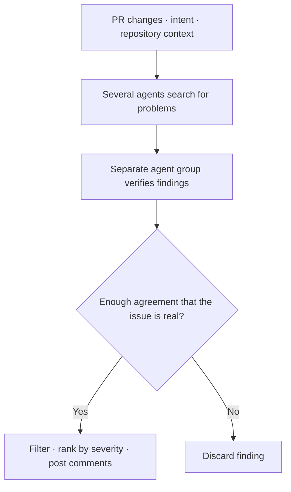
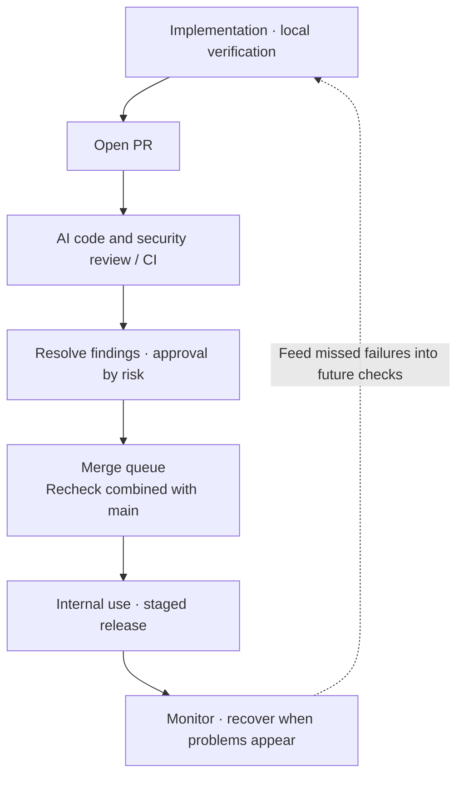
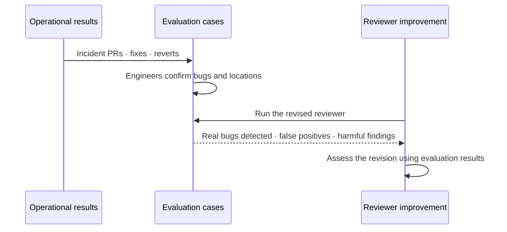

## TL;DR

- The Claude Code team allocates human review according to change risk.
- Scion illustrates infrastructure bottlenecks after code generation.
- Review automation needs to be evaluated alongside operational quality.

## Introduction

Faster AI coding does not shorten delivery time by the same amount if reading, checking, and merging the changes cannot keep up. Anthropic's articles on code review and source control address this problem at different scopes.

The October 15 article, “How the Claude Code team does code review,” describes the team's review process.[^1] The October 13 article, “Redesigning source control at Anthropic,” covers a source control system called Scion.[^2] **Claude Code uses a separate repository, so these accounts should not be read as one repository's workflow.**

Here I summarize the two cases and connect them to my earlier posts on cognitive load and Software Factories. I think they help explain both what people need to understand and decide, and how automated verification can improve.

## 1. What the Claude Code team verifies automatically

### 1.1. Track review savings alongside failed changes

A pull request, or PR, asks for code changes to be reviewed and merged into a repository. The Claude Code team reports that merged PRs more than doubled from June to September 2026, while the proportion reverted fell by over 40%.[^1]

Other figures in the article have different scopes. The share of internal PRs receiving substantive review comments rose from 16% to 54% after AI review was introduced. Across Anthropic's monorepo, a repository containing multiple projects, daily merges rose from roughly 2,500 in May to over 30,000 in September. Neither figure should be presented as a Claude Code repository result measured over the same period.[^1]

The goal is for most PRs to involve at most one person, who can be the author, without increasing reverts or incidents. The reported results come from multiple checks, staged releases, and fast recovery together; they do not isolate the effect of AI review alone.

### 1.2. Verification starts before the PR

After Claude changes code, it runs tests and builds and inspects the output. UI changes are compared with the design, and a subagent reviews the changes with context separate from the implementation session. Separate skills also look for bugs, simplify code, and check user behavior from beginning to end.[^1]

Recurring findings move into instructions or automated checks. `CLAUDE.md` describes the stack, development conventions, and goals. `REVIEW.md` describes the failures that matter in that part of the code. The team separately checks whether the reviewer follows those instructions.

For a booking cancellation feature, for example, the criteria could look like this:

```text
Booking cancellation review criteria

- Check whether someone other than the booking owner can cancel it.
- Check behavior when the same request targets an already canceled booking.
- Include the triggering conditions and relevant file and line in each finding.
```

If the same authorization issue keeps recurring, the team can go beyond recording it in instructions and add a test that rejects attempts to cancel someone else's booking. Future changes can then be checked against the same failure condition.

### 1.3. Other agents verify the review findings

Every PR receives an AI review. The reviewer reads the changes, surrounding repository code, and the PR's stated purpose to check whether it solves the original problem or breaks other behavior. Several agents search for problems in parallel, and a separate group assesses each finding.[^1]





This reduces false positives: reports of bugs that are not actually present. The diagram simplifies the detection and verification process; the article does not disclose the exact number of agents or the agreement threshold.

Existing problems are marked `Pre-existing`. Every finding must be fixed or resolved with a reason for leaving the code as it is. Security review runs separately, and unresolved bug or security findings block merging.[^1]

The public Code Review product that posts findings should be distinguished from the Claude Code team's merge policy. The product does not provide the approval itself; making unresolved findings block a merge is a team rule.

### 1.4. Connect automated checks to recovery after release

AI review runs alongside CI, or continuous integration: automated checks used when integrating changes. These check code conventions and types, run tests across platforms, and build the software. PRs describe how the change was tested and how to undo it. Even when Claude fills in those details, the person who requested the change verifies them.[^1]

The following diagram shows the Claude Code team's workflow. The next section explains when human approval is required.





A merge queue schedules changes and checks them again against the latest `main`, because PRs that pass separately can still fail when combined. New behavior usually goes to employees first behind a feature flag, a switch for enabling or disabling it, followed by staged public releases.[^1]

If a problem appears after release, the team can disable the flag or revert the change. Incident reviews also ask which verification layer missed it. The article presents these recovery measures as part of what makes broader automated review possible.

## 2. How the team manages human approval and repeated reviews

### 2.1. Change risk determines the required approval

The Claude Code team classifies risk by the change, rather than the author's experience.[^1]

| Risk | Example changes | Required human approvals |
| --- | --- | --- |
| Low | Documentation, copy, internal features, additions behind a flag | Zero when automated checks and other conditions are met |
| Medium | Ordinary product changes, caching, the auto-updater, system prompts | One |
| High | Highest-risk code and paths that always require two people | Two |

One AI classifier assigns the risk tier. Another checks whether this particular change needs an additional person. CI configuration and paths marked sensitive by their owners always require human review.

The lighter approval paths apply only to authors on the repository's trusted list. For an agent-written PR, the person directing the agent remains accountable and may count toward the required reviewers. An agent's approval cannot fill a required human slot.

Approval covers a specific commit. It must be renewed after changes the system cannot vouch for, such as an agent's revision or a manually resolved merge conflict.[^1]

### 2.2. Review also needs to finish

An AI author and an AI reviewer can keep creating work for each other. One Claude Code PR went through more than 50 rounds of review and fixes overnight. Investigation found that about 59% of the repeatedly flagged code had already existed at the first review. The reviewer was mostly finding more old problems, rather than new bugs introduced by the fixes.[^1]

The team changed re-review accordingly.

| Revised rule | Purpose |
| --- | --- |
| Ask the author to reconsider the approach after three rounds | Stop repeating the same process indefinitely |
| Focus on the newly changed code—the diff—after the first few passes | Limit repeated expansion into existing code |
| Flag a class of bug rather than one line | Fix similar instances together |
| Do not repeat findings already posted | Avoid duplicate revision and review work |

Three rounds is a point for reconsidering the approach, not permission to pass unresolved defects. Nightly reviews also inspect existing code separately, so narrowing PR re-review does not mean abandoning older bugs.[^1]

### 2.3. Human decisions and shared understanding

People decide whether a feature should exist, which risks to accept, and whether an architecture should become a pattern for other code. They also read test output and review evidence to understand what the checks might miss. The person directing the work remains responsible for the shipped change.[^1]

The team supplements review's knowledge-sharing role with explanations of the part of the code someone needs to understand. Engineers ask Claude to explain the module they are about to change or create a visualization. The article does not claim this is a formal knowledge-sharing process.

## 3. Scion addresses the source control bottleneck

Reviewed changes still need to be fetched, merged, and tested. Scion is a centralized service built for online agents and jobs in a huge monorepo. Clients retrieve needed files and query changes and history through APIs. It is not proposed as a general Git replacement.[^2]

Merge policies differ too. Claude Code uses a merge queue, while the monorepo invested in post-merge, pre-deploy testing because globally locking the queue proved impractical.[^1][^2]

Reading these cases together makes me think review policy and infrastructure capacity need to be considered together. Fast approval still leaves changes waiting if automated checks are backed up. Conversely, fast checks do not remove the cost of understanding and judgment when a person must reread every result.

## 4. Connections to cognitive load and Software Factories

### 4.1. Reduce the cost of understanding and the share requiring review

In my cognitive-load post, I described how understanding accumulated during implementation can become concentrated at the point when AI delivers the result.[^3] Cognitive load here is the burden of holding information in mind to understand and judge the code's intent, behavior, and exceptions.

The two responses I proposed were to reduce the cost of understanding each change or remove people from recurring verification. The Claude Code team's module explanations and verification evidence connect to the former; its risk-based approval policy connects to the latter.

This does not remove the need for understanding. People still need enough context to judge what should be built, which failures matter, and what automated checks establish. The approach reduces repeated reading while providing evidence for the decisions that remain.

### 4.2. Turn operational failures into reviewer evaluations

My Software Factory post described a system in which AI connects implementation, verification, and operation to improve both the product and the development process.[^4] Evals—running defined inputs and comparing actual results with expected outcomes—provide the basis for deciding what to change next.

The Claude Code team collects PRs that caused incidents, together with their fixes and reverts. Engineers familiar with the code confirm each bug and its location. The reviewer is evaluated against this dataset daily and again when its prompts, tools, or model change.[^1]





The team also runs the reviewer on known-clean PRs to check for findings that could lead to harmful code changes. For comments on real PRs, it records whether people fixed the issue, rejected the finding as wrong, or explained that the behavior was intentional, among other responses.[^1]

I see a direct connection to Software Factories here: a product failure leads not only to a product fix, but also to an evaluation of the reviewer that missed it. When recurring failures change the tests and instructions used on future tasks, the development process improves too.

### 4.3. Evaluate throughput alongside quality

In the Software Factory post, tension metrics reveal whether other aspects of quality deteriorate while the target metric improves.[^4] Optimizing only review comment counts or approval speed can make results look better while real defects go unnoticed.

The Claude Code team tracks the following together.[^1]

| What is evaluated | What the team seeks to improve | Quality checked alongside it |
| --- | --- | --- |
| Human involvement | Human approvals per PR at the median and 95th percentile, comments, time waiting on people | Revert rate and incident rate |
| Reviewer | Real bugs detected and rounds needed to pass | False positives and potentially harmful findings |

The 95th percentile is the value at or below which 95% of PRs fall, helping the team track changes that need more approvals.

The article prioritizes catching real bugs first and reducing review rounds second. Saving review time would not be an improvement if people then spent more time responding to incidents.

It also states that no mechanism yet automatically tightens approval requirements when incident or revert metrics worsen. This is not evidence of the automated selection and target adjustment of KPIs—key performance indicators used to judge results—that I proposed in the Software Factory post. What the account establishes is a process that connects operational results to evaluations and tracks human time alongside change failures.

## Conclusion

These cases make me think review automation needs to extend beyond reading code. Verifying findings, bringing review to a close, testing combined changes, and preserving operational failures as evaluation cases all need to connect.

For adoption, I would follow the article's suggestion to start with an AI reviewer in one repository, tune the instructions, and then expand. Recording both what people wait for and what fails after deployment provides evidence for deciding whether to improve review rules or the verification environment next.

---

[^1]: Addy Osmani, Morgan Westlee Lunt, Qing Wang, [How the Claude Code team does code review](https://claude.dev/blog/solving-code-review-at-anthropic/) (2026-10-15).
[^2]: Anthropic, [Redesigning source control at Anthropic](https://www.anthropic.com/engineering/redesigning-source-control) (2026-10-13, updated October 15).
[^3]: [Why AI Code Review Feels Overwhelming — Time to Learn the Context and Cognitive Debt](/en/2026/08/18/ai-coding-review-cognitive-load.html).
[^4]: [How a Software Factory Can Improve Itself — Evals, KPIs, and Tension Metrics](/en/2026/10/05/software-factory-evals-and-tension-metrics.html).
