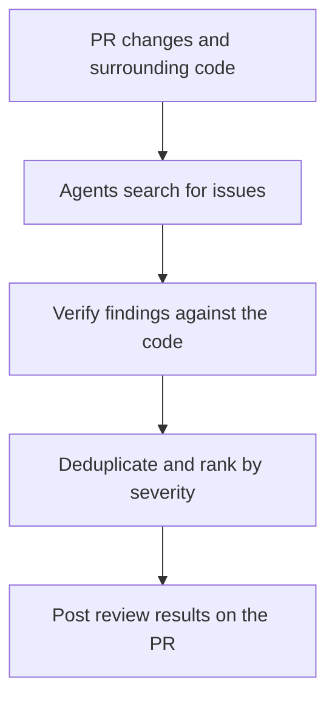

## TL;DR

- Automated review findings need supporting evidence.
- Review instructions should describe concrete failure conditions.
- Time saved in review needs to be assessed alongside quality.

## Introduction

If people must understand and review every change, faster AI coding moves the next bottleneck to review. In an earlier post about review's cognitive load, I argued for lowering the cost of understanding context and automating recurring judgments.[^2]

I read Anthropic's account of code review on the Claude Code team.[^1] Here I summarize its main points and add details from the public documentation to explore what can actually be automated.

## 1. Track review time alongside failed changes

The team reports that merged PRs more than doubled from June to September, while the proportion reverted fell by over 40%. Its aim is to reduce human time without increasing reverts or incidents.[^1]

A pull request, or PR, is a request to review code changes and merge them into a repository. The team combines multiple checks with staged releases and fast recovery.[^1] The figures describe those operational results; they do not isolate the effect of automated review alone.

I think this is a useful way to assess review automation. Less review time may not mean less work if engineers spend more time fixing problems after release. Saving an hour of review each day while adding two hours of incident response would make faster approval a poor measure of improvement.

## 2. Separate execution from verification

### 2.1. Check the implementation first

Claude Code's best-practices guide recommends giving agents checks they can run: tests, builds, or visual comparisons. Reading the results and revising the work allows an agent to continue without waiting for another human instruction. The guide also describes verification by an agent with context separate from the implementation session.[^3]

For a booking cancellation feature, for example, a claim that the cancel button exists is insufficient. Define the expected behavior, such as how a canceled booking appears in the list and whether repeating the request preserves its state, then compare it with execution results.

### 2.2. Check the review findings too

In the public Code Review service, several agents inspect the changes and surrounding code. A verification step checks candidate findings against the code; remaining findings are deduplicated and posted on the PR in severity order.[^4]





The service does not approve or block PRs. **Finding issues and deciding whether to accept a change are separate responsibilities.** Security review is also available through the separate `/security-review` command or a GitHub Action that runs on PRs.[^4][^5]

Repository rules need to define which failed checks block a merge and who decides what to do with unresolved findings. The existence of a review comment does not establish that its issue has been resolved.

## 3. Describe failures in REVIEW.md

Once the tool is connected, it needs to know which problems matter to the team. The public documentation distinguishes project-wide instructions in `CLAUDE.md` from review-specific instructions in `REVIEW.md`. The latter can specify checks, severity, and exclusions.[^6]

There is an important difference between tools: the Code Review service reads both files, while the local `/code-review` command reads only `CLAUDE.md`. Rules intended for both paths belong in `CLAUDE.md`.[^6]

I think instructions work better when they describe failure conditions instead of saying “check security carefully.” For the booking cancellation example, I would write something like this:

```text
Booking cancellation review criteria

- Check whether someone other than the booking owner can cancel it.
- Check behavior when the same request targets an already canceled booking.
- Include the triggering conditions and relevant file and line in each finding.
```

This extends the review from successful cancellation to ownership and repeated requests. It also makes it easier to distinguish a guess based on a filename lacking `secure` from a finding that traces how a user could change someone else's booking.

Writing the criteria does not complete verification. A test showing that a request to cancel another user's booking is rejected connects the rule to implementation behavior. The document preserves the question to ask; the test makes that condition executable on later changes.

## 4. Manage human judgment and repeated reviews

On the Claude Code team, trusted authors can merge low-risk changes on automated checks alone. Higher-risk changes need human approval, which agent approvals cannot replace.[^1]

Applying this to another team requires deciding which failures are costly. Changing a cancellation button's text and changing cancellation permissions can affect the same screen while carrying different consequences. I think review policy should reflect that difference, with human review adjusted to what automated checks can establish.

Less human review will not finish a change if automated review keeps requesting revisions. The article describes reconsidering the approach after three rounds.[^1]

Three rounds should not be read as permission to pass unresolved issues. When review does not converge, it helps to inspect whether the remaining findings are actual defects or conflicting requirements before running the same process again.

Suppose returning success for repeated cancellations is the agreed behavior, but the reviewer keeps demanding an error response. More revisions will not resolve that disagreement. Record the expected behavior in both review instructions and tests, then check whether the reviewer raises the same objection again.

The reviewer's ability to find real problems also needs checking. The Claude Code team evaluates its reviewer daily against past incidents.[^1]

In an earlier post about Software Factory evaluation, I described tension metrics: measures that reveal whether other aspects of quality deteriorate as a target metric improves.[^7] The same perspective applies to review. Tracking both review duration and missed defects helps avoid treating a reviewer that merely posts fewer comments as a better reviewer.

## Conclusion

I think a useful starting point for review automation is turning one recurring finding into a concrete verification condition. State when it fails, locate the relevant code, and make the behavior something that can be checked by running it.

Once that condition can be verified automatically, people have less reason to inspect it repeatedly. Review automation helps development when the time saved goes toward behavior that remains unverified and decisions about what the product should do.

---

[^1]: Anthropic, [How the Claude Code team does code review](https://claude.dev/blog/solving-code-review-at-anthropic/).
[^2]: [Why AI Code Review Feels Overwhelming — Time to Learn the Context and Cognitive Debt](/en/2026/08/18/ai-coding-review-cognitive-load.html).
[^3]: Anthropic, [Best practices for Claude Code](https://code.claude.com/docs/en/best-practices).
[^4]: Anthropic, [Code Review](https://code.claude.com/docs/en/code-review).
[^5]: Anthropic, [Automated Security Reviews in Claude Code](https://support.claude.com/en/articles/11932705-automated-security-reviews-in-claude-code).
[^6]: Anthropic, [Customize Code Review](https://code.claude.com/docs/en/code-review-customize).
[^7]: [How a Software Factory Can Improve Itself — Evals, KPIs, and Tension Metrics](/en/2026/10/05/software-factory-evals-and-tension-metrics.html).
