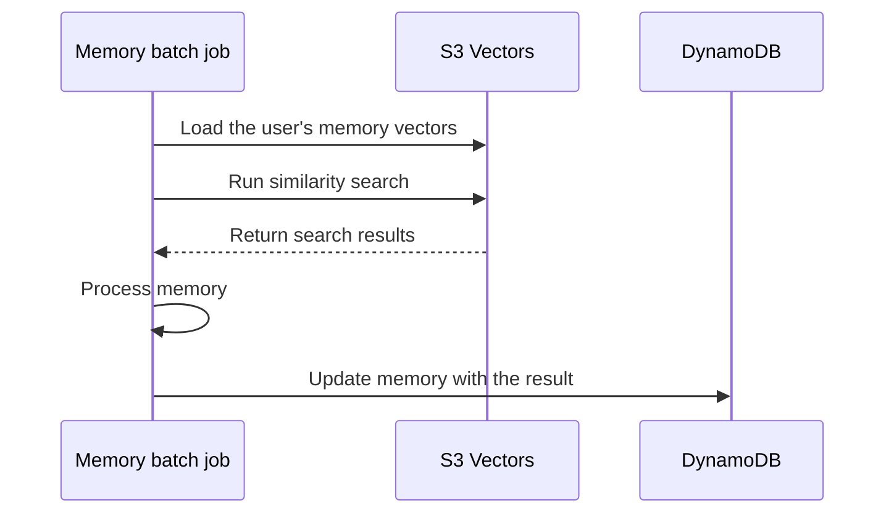

## TL;DR

- Keep fixed operating costs low until product-market fit.
- Avoid continuously running application servers.
- Payment and insurance costs can exceed server costs.

## Introduction

When building a side project or a business on my own, I would like users to arrive as soon as I launch. That rarely happens so neatly. The service still needs to run while I learn which problems matter and which features people keep using.

**I think it matters to be able to keep going until product-market fit (PMF), when the product meets market demand.** Learning from users and revising features takes time. Fixed costs accumulating across services make it harder to afford that time.

I build and operate [Encbird](https://www.encbird.com), an English learning service, and [PixelbankStudio](https://www.pixelbankstudio.com), an AI image editing service.

**The services are in different domains but share the same serverless architecture. When users are not using them, there is no compute charge for keeping application servers running.** Executing jobs, calling AI models, storing files, and transferring data have their own costs.

In this post, I want to share how to build and run a service cost-effectively when starting a solo business or side project.

## 1. Lowering the cost of keeping a service available

Hosting several services on one server can spread its cost across them. But I still pay for the time that server is running, even when nobody visits.

Encbird and PixelbankStudio serve their web interfaces as static files and run their backends on AWS Lambda. Lambda executes code in response to requests or events. Keeping a service available this way does not require a continuously running application server for each product.

The application interface is a single-page application (SPA). I chose client-side rendering (CSR), where JavaScript constructs the interface in the browser, to reduce the cost of server-side rendering (SSR), which generates HTML on the server for incoming requests.

The HTML and JavaScript files are stored in Amazon S3 and delivered through Amazon CloudFront. S3 stores files; CloudFront is a content delivery network (CDN) that caches and delivers them close to users.

CSR makes search engine optimization (SEO) more challenging because a search engine needs to execute JavaScript to read the page content. I address that by prerendering public pages that can be prepared in advance, generating their HTML at build time.[^1]

These public pages are deployed as HTML files containing the page content, so the server does not need to render them again for each incoming request.

Both services store data in Amazon DynamoDB using its on-demand capacity mode, which charges for reads and writes as they are used. I do not keep a separate database server running for either application.[^2]

That difference matters when requests are infrequent. Compute costs follow incoming requests and executed jobs more closely than the length of time the service has been available.

| Responsibility | Components | What contributes to cost |
| --- | --- | --- |
| Delivering web files and assets | S3 + CloudFront | Storage, requests, and data transfer |
| Handling API requests | API Gateway + Lambda | API requests and function execution |
| Storing and retrieving data | DynamoDB on-demand | Reads, writes, and storage |
| Processing background jobs | SQS + Lambda | Queue usage and job execution |

API Gateway connects incoming requests to the backend. Simple Queue Service (SQS) holds jobs for processing. Separating these responsibilities does not mean adding a continuously running server for each one.

### Choosing a suitable language to reduce cold starts and memory requirements

Low compute costs between requests come with a possible delay when a new execution environment needs to be prepared. That delay is a cold start. The INIT phase, which starts the runtime and loads libraries and initialization code, is also billed. Since August 1, 2025, INIT billing has also applied to the previously exempt combination of managed runtimes, ZIP packages, and on-demand execution.[^3]

That is why **I think Go or Rust is worth considering when Python or TypeScript is not a requirement.** Running a compiled binary and keeping startup dependencies small can help reduce both memory use and cold starts.

Encbird's server was written in Go from the beginning. PixelbankStudio started in Python because part of the work involved loading and testing local models.

On a Lambda configured with little memory, I found that **the Python implementation's cold start took more than one second longer than Go's.** That difference led me to move PixelbankStudio's backend APIs and workers entirely to Go.

Still, Lambda charges depend on request count, execution duration, and allocated memory. Libraries and initialization code affect execution duration too, so I need to consider the execution setup as well as the language. In my case, keeping that setup light with Go helped me run the backend with less memory allocated to Lambda.

If I need Python or Java for existing code or libraries, even at a slightly higher cost, **Lambda SnapStart is worth considering.** It reduces cold starts by saving and restoring an initialized execution environment, and supports Java 11 or later and Python 3.12 or later. Python incurs charges for maintaining and restoring that saved state, while Java managed runtimes have no additional SnapStart charge.[^13]

## 2. The AWS stack in use

**Encbird and PixelbankStudio share the same foundational architecture.** S3 and CloudFront serve the static web app, Lambda runs APIs and background jobs, and DynamoDB and S3 store the data.

The diagram adds scheduling, email, observability, and deployment support to that shared foundation. Encbird uses S3 Vectors for long-term memory processing, while Step Functions connects multi-step jobs. These workload-specific components are shown alongside the shared foundation, with multiple functions or stores of the same role grouped together.

### Encbird: separating requests from follow-up processing

In Encbird, I separate the processing needed for an immediate user response from work that can process the resulting data later. API Lambda functions respond to requests, while lengthy follow-up work travels through events and queues to separate Lambda workers.

Learning data is stored in DynamoDB, and images and other files go into S3. Later requests and background jobs can reuse the stored data.[^4] Stages that need an AI model call an external model API, so I do not operate GPU servers to host the models.

SNS delivers events, and SQS holds work to be processed, connecting request handling to background work. A worker is a program that executes queued jobs; here, it runs on Lambda. The API therefore does not have to hold its response until all processing has finished.

Supporting work such as scheduling, email, and logs also uses managed services, so I do not keep separate servers running for those capabilities. The overview diagram groups these services by role.

CloudFront Functions normalize file requests, while Lambda@Edge resizes images when needed. Caching the transformed result avoids recomputing it every time the same file is displayed.

Adding work can mean adding APIs and workers. Having more functions does not, by itself, create a bill for keeping a separate server running all day for each one.

Scheduled jobs and follow-up work can still incur costs when no user is online. What I have reduced is the cost of continuously running application servers just to keep the service available.

### PixelbankStudio: separating file transfer from long-running jobs

In PixelbankStudio, I separate interface work that can finish in the browser from file processing and generation jobs handled by the backend. The web interface is served statically, while Lambda runs the server APIs.

For uploads, I also avoided having an API Lambda receive an entire image and forward it to S3. The server issues a presigned URL, which grants temporary permission to upload a particular file, and the browser uploads directly to S3. Before subsequent processing, the server checks matters such as the file's ownership and intended use.

This keeps large image files from being relayed through API Gateway and Lambda. Lambda issues upload permissions and validates requests; S3 handles the file transfer.

Work such as image generation can take 30 seconds or more to produce a response, making it difficult to wait for completion within an ordinary HTTP API request. The API Gateway HTTP API used for this path has a maximum integration timeout of 30 seconds.[^5] The API therefore queues a job in SQS and returns its ID first. A Lambda worker then calls the model API and stores the result in S3. The browser checks the job's status and retrieves the completed file through CloudFront.

Calling models through external APIs removes the need to maintain my own GPU servers. Each generation incurs the model provider's usage charge instead.

Asynchronous processing separates long jobs from the request's time limit. Time spent waiting for a model API response inside a Lambda worker is still billed as Lambda execution.[^6]

I distinguish results users want to keep from temporary data used during processing. Expiration policies for temporary data help limit unnecessary storage costs after the work has finished.

### Splitting long jobs into stages and keeping compute on Lambda

Making the API asynchronous does not remove the maximum 15-minute limit on a single ordinary Lambda execution.[^7] An overall job that chains several processing steps can take longer than that.

I therefore split long jobs into processing stages. Each stage finishes within its Lambda execution limit, with progress and results stored between stages. Step Functions connects the stages. The overall job can exceed 15 minutes without any single Lambda running for more than 15 minutes.

Amazon Bedrock AgentCore Runtime is another good option when one agent execution needs to stay alive for longer. Its serverless microVM configuration uses small virtual machines and can maintain an execution environment for up to eight hours.[^8] Consumption-based pricing follows actual CPU and memory usage, with no CPU charge for waiting on model responses when no CPU is consumed.[^9]

**For now, I find it easier to manage staged Lambdas and keep compute on Lambda.** That lets me continue using the deployment, permissions, and logging setup I already have. Moving to AgentCore Runtime is an option, rather than a requirement; my choice depends on whether I can split the work and how simple I can keep the execution environments I operate.

## 3. Managing Encbird's long-term memory with S3 Vectors

Processing Encbird's long-term memory requires finding content with similar meanings even when the wording differs. I use similarity search, which represents sentences as numerical arrays called vectors and finds vectors that are close to one another.

I initially considered Qdrant and Amazon OpenSearch Serverless for similarity search, then chose Qdrant because of cost. Qdrant Cloud's Free Tier let me use a small hosted vector database without a monthly charge.[^17]

Encbird processes memory in batches, grouping the work by user. I can temporarily load the relevant user's memory into a vector database, process it, and update the memory in DynamoDB with the result. **This work does not require keeping a vector database server running continuously.**

I also tried running a small vector database directly inside a Lambda execution environment for this purpose. After trying several approaches, I found S3 Vectors' speed and pricing reasonable for the way I process memory.

**I now manage Encbird's long-term memory with S3 Vectors.** It provides vector storage and search through dedicated vector buckets and indexes, without requiring me to maintain separate vector database compute capacity.[^10] The current processing flow is as follows.





I still need to account for S3 Vectors storage, writes, and queries, plus the cost of generating embeddings to convert source content into vectors.[^11]

## 4. Keeping development and deployment affordable

### Keeping dev and prod separate

I cannot try every feature change directly in production. A separate development (dev) environment lets me check changes with test data before applying them to production (prod).

Serverless pricing is useful here too. A development environment often receives requests only during testing. With Lambda and DynamoDB on-demand, having that environment ready does not require keeping application and database servers running continuously.

I define infrastructure with AWS CDK, a tool for creating and connecting resources such as Lambda functions, tables, and queues in code. Starting from the same infrastructure definitions, environment-specific settings can separate API addresses, tables, buckets, queues, and authentication configuration for dev and prod.

Changing an environment's name while pointing it at the same tables and queues would not separate it. The connections must also keep development requests and test data within the development environment.

**I can keep a development environment with a similar architecture to production while keeping its idle compute costs low.** There is less need to start and stop servers every time I develop just to save money.

Stored files, logs, and scheduled work still have costs. Lambda's Provisioned Concurrency also charges for keeping capacity initialized.[^6] The benefit described here assumes an on-demand setup without that continuously prepared capacity.

### Using GitHub Actions' included minutes for deployment

I also use GitHub Actions' included execution minutes for deployment instead of maintaining a separate build server. The web pipeline verifies the code, builds static files, uploads them to S3, and invalidates the CloudFront cache.

**GitHub Free includes 2,000 minutes per month for private repositories using standard Linux runners.** A runner is the environment that executes builds and tests. The allowance is shared across repositories owned by the same account or organization; it is not a separate allowance for each repository.[^12]

The workflows use Ubuntu runners. They run checks for the affected scope and reuse dependency and build caches to avoid unnecessary execution. PixelbankStudio's web deployment reuses the artifact produced during verification, so publishing does not require another build.

Keeping builds and deployments within the included minutes avoids adding a continuously running server on the development side as well. Artifact storage and the AWS resources receiving the deployment have separate costs to manage.

## 5. In the era of agentic engineering, operating is the bigger hurdle

Encbird is aimed at users in Korea, while PixelbankStudio targets the US market. Despite serving different markets, both use **Toss Payments** as their payment processor to handle payments and settle the proceeds. Toss Payments also supports cards issued outside Korea, but enabling this requires an additional agreement and a review by the card companies.[^14]

**In my case, expenses such as surety insurance premiums for payment processing exceed my server costs.** Toss Payments' official fee page lists a one-time signup fee of KRW 220,000 and an annual maintenance fee of KRW 110,000; the terms can vary by contract.[^15]

Surety insurance helps cover settlement risk when a merchant fails to deliver a product or service. Toss Payments offers an exemption when the monthly settlement limit is KRW 10 million or less, but the merchant's industry and products can affect eligibility.[^16]

In an era of agentic engineering, where AI agents help with implementation and testing, I think operating a service is a bigger hurdle than developing it. Even when writing code takes less effort, I still need to deal with payment contracts, provider reviews, insurance renewals, and the costs of running the service.

## Closing

I think this architecture fits side projects and solo businesses that are still looking for PMF. It keeps compute costs low while users are few and avoids adding continuously running servers for development and deployment.

The same principle can apply when trying another service: build around the work that actually runs and the data that must remain, while also accounting for payment contracts and insurance premiums. While learning which services people need, I want an environment where maintenance costs do not force an early end to an attempt.

---

[^1]: [Nuxt rendering modes](https://github.com/nuxt/nuxt/blob/main/docs/3.guide/1.concepts/1.rendering.md) — CSR and static deployment with build-time prerendering.
[^2]: [Amazon DynamoDB pricing](https://aws.amazon.com/dynamodb/pricing/) — on-demand reads, writes, and storage.
[^3]: [AWS Lambda INIT billing standardization](https://aws.amazon.com/blogs/compute/aws-lambda-standardizes-billing-for-init-phase/) — effective August 1, 2025. Custom runtimes and container images were already billed for INIT before this change.
[^4]: [Connecting Encbird's conversation data to review features](/en/2026/03/12/genai-flywheel-for-business.html)
[^5]: [API Gateway HTTP API quotas](https://docs.aws.amazon.com/apigateway/latest/developerguide/http-api-quotas.html) — maximum integration timeout of 30 seconds. The article refers to this ordinary HTTP API path; separate REST API and response-streaming configurations have different limits.
[^6]: [AWS Lambda pricing](https://aws.amazon.com/lambda/pricing/) — requests, execution duration, memory, and Provisioned Concurrency. Diagrams use [AWS Architecture Icons](https://aws.amazon.com/architecture/icons/).
[^7]: [Lambda execution timeout](https://docs.aws.amazon.com/lambda/latest/dg/configuration-timeout.html) — ordinary Lambda configurations have a maximum execution time of 900 seconds.
[^8]: [AgentCore Runtime lifecycle settings](https://docs.aws.amazon.com/bedrock-agentcore/latest/devguide/runtime-lifecycle-settings.html) — microVM execution lifetime and idle timeout. See also [async task tracking](https://github.com/aws/bedrock-agentcore-sdk-python/blob/main/tests_integ/async/README.md).
[^9]: [Amazon Bedrock AgentCore pricing](https://aws.amazon.com/bedrock/agentcore/pricing/) — CPU and memory billing for consumption-based microVMs.
[^10]: [Amazon S3 Vectors](https://docs.aws.amazon.com/AmazonS3/latest/userguide/s3-vectors.html) — vector storage and search without separately provisioned infrastructure.
[^11]: [Amazon S3 pricing](https://aws.amazon.com/s3/pricing/) — S3 Vectors storage, write, and query charges.
[^12]: [GitHub Actions billing](https://docs.github.com/en/billing/concepts/product-billing/github-actions) — GitHub Free for individuals and organizations includes 2,000 monthly minutes for private repositories. Standard GitHub-hosted runners are free for public repositories; artifact storage is accounted for separately from execution time.
[^13]: [Lambda SnapStart](https://docs.aws.amazon.com/lambda/latest/dg/snapstart.html) — restoring initialized execution environments, supported runtimes, and additional charges.
[^14]: [Toss Payments international payment guide](https://docs.tosspayments.com/guides/v2/learn/foreign-payment) — support for cards issued outside Korea, additional agreements, and card-company reviews.
[^15]: [Toss Payments fees](https://www.tosspayments.com/about/fee) — signup and annual maintenance fees, with terms varying by contract. Checked October 30, 2026.
[^16]: [Toss Payments surety insurance requirements and exemptions](https://www.tosspayments.com/blog/articles/54333) — the insurance's purpose and conditions by industry and settlement limit. See also the [renewal guide](https://www.tosspayments.com/blog/articles/48553).
[^17]: [Qdrant Cloud pricing](https://qdrant.tech/pricing/) — a Free Tier with a small free cluster. Capacity and features beyond its limits belong to paid plans.
