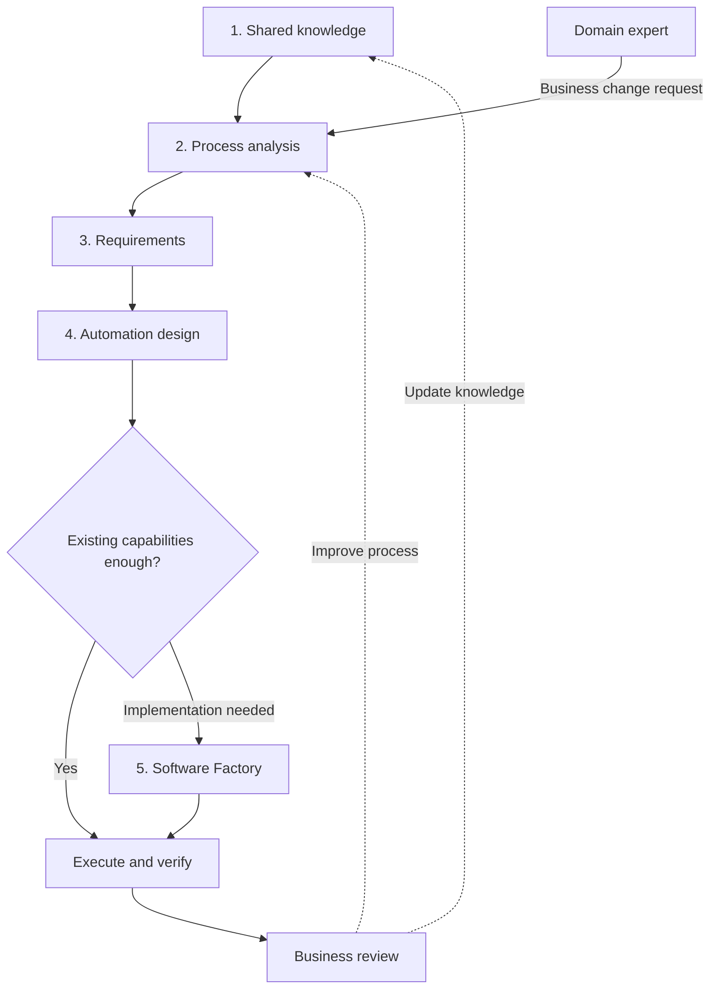
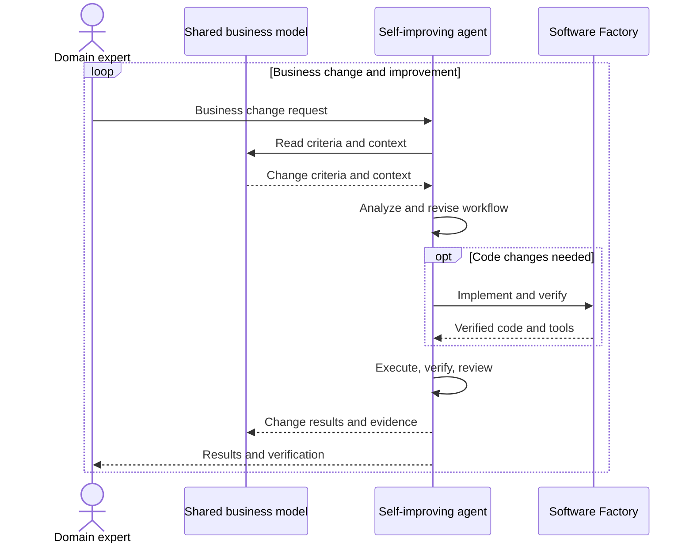

## TL;DR

- Enterprise AX should be built on reusable solutions.
- DDD keeps business language, models, and implementation consistent.
- Business changes should flow into agent-led implementation, verification, and improvement.

## Introduction

AX (Agentic Transformation)—moving business work to agent-based systems—requires data connections, access controls, business knowledge, evaluation, and ongoing operations. When each team builds these capabilities from scratch, it repeats the setup work, and later changes can remain dependent on the technical specialists who built the first version.

**Enterprise AX should be built on reusable solutions while keeping the customer's business and its implementation aligned in meaning.** Products and shared platforms provide recurring capabilities, with customer-specific business rules and processes configured on top.

In traditional software development, business processes were often recast to fit resource limits or technologies and structures familiar to the development team. If this changed their meaning or flow, business teams discussed the original work while developers answered in terms of the implemented system. Different interpretations of the same work made recurring conflicts likely.

Reducing this conflict requires the business language and rules agreed by business and development teams to remain intact in the implementation. **DDD (Domain-Driven Design) makes that shared business model the reference for design and code.** It treats the model and implementation together so that addressing technical constraints does not change business meaning.

Agent-based business automation and self-improving agents can help put this model into practice and maintain it. When a domain expert who understands the rules and exceptions recognizes a business change and requests an update, agents should revise the workflow against the same business model. A Software Factory carries the necessary code through implementation, verification, and delivery.

This post describes the solutions that support this flow and the organizational responsibilities needed for domain experts to lead changes.

## 1. Connecting solutions to introduce AX

An organization introducing AX can start with these five steps. After the initial build, domain experts' change requests should enter the same flow and lead to system improvements.





Existing solutions provide the common capabilities at each step. Teams configure the rules and connections for their business. If the automation design needs a missing capability, the Software Factory implements it before it is used in execution.

| Step | Role | Result |
| --- | --- | --- |
| 1. Shared knowledge | Prepare business sources and access | Knowledge with traceable evidence |
| 2. Process analysis | Analyze current and target work and responsibility | Target processes and transformation candidates |
| 3. Requirements | Agree on business rules and success criteria | Criteria for implementation and verification |
| 4. Business automation | Configure and test existing agents and tools | An execution flow and any missing capabilities |
| 5. Software development | Implement and verify missing capabilities | Code and tools for automation |

A team that has already mapped processes with business experts can use that work to identify the data it needs. Automating process analysis itself requires readable sources and access first. Either way, shared knowledge is difficult to postpone.

### How AWS and Palantir FDEs build on reusable solutions

An FDE (Forward Deployed Engineer) works inside a customer or business team to build systems with them. Public AWS and Palantir materials describe how customer-specific work is implemented on shared technical foundations.

AWS describes deploying a semantic layer connecting business meaning to data in the customer's account and letting agents use a governed, versioned knowledge graph. The graph, runbooks, and architecture documentation remain with the customer, with customer engineers progressing from co-builders to independent operators.[^1]

Its partner guidance identifies a reusable **harness** of business knowledge, tools, and checks. Partners accumulate ontologies, evaluation frameworks, external-tool connections, agent operations capabilities, and design records for use in later engagements.[^2]

Palantir provides Foundry for data and business models, AIP for agents and AI workflows, and Apollo for deployment and infrastructure. FDEs work with customers to build capabilities on this foundation.[^3] The Ontology at its center connects business objects and relationships with actions and functions, carrying business meaning into executable logic.[^4]

The common pattern is **combining a reusable technical foundation with each customer's business model**. The official materials do not establish that either company has adopted DDD or that every change is handled autonomously. DDD is this article's design perspective for keeping business and implementation aligned on top of such solutions.

## 2. Preserving business meaning through shared knowledge and DDD

To understand a domain expert's change request, agents need access to terms, existing processes, rules, and exceptions. The shared knowledge platform holds the sources, while governance of ownership, provenance, and permitted use determines access for agents and external services.

Business teams decide the meaning of rules and their permitted scope. Platform teams ensure those decisions apply to retrieval and execution. Preparing data and granting access need to happen together.

### General information and business knowledge need different retrieval methods

Documents, meeting notes, and support records need **hybrid retrieval** combining similarity search with BM25, which ranks documents by matching terms. This covers both different expressions of the same meaning, such as “I want my money back” and “refund request,” and specific terms such as product codes.

If agents must reconstruct refund approval responsibilities, processing sequences, and effects on other work from document fragments each time, their interpretations can differ. An **ontology** makes the business concepts, relationships, and rules they should follow explicit.

A graph database is not mandatory. Business knowledge can be written in a text format such as Turtle, with routes from an overview into the required detail.

First show the responsibilities and core work of bounded contexts (BCs), the scopes within which terms and rules have consistent meanings. Agents can then find rules and exceptions inside relevant BCs. Retrieval can work without every internal relationship being complete, provided BC membership and paths into the details are established.





When agents can read an overview and decide where to look next, they can narrow the scope before reading details instead of taking in material from across the enterprise at once. Retrieving details only from relevant areas reduces unrelated context as business knowledge grows. The saving is in how much information agents must read, rather than storage retrieval time.

For this to work, each overview must be accurate enough to guide the next retrieval step. Exceptions omitted from an overview must still be available in detailed rules and original sources.

This 3D view in the [ontology tool](https://github.com/haandol/alps-writer-plugins) shows the “Expression dictionary” BC of [EncBird](https://www.encbird.com), an English learning service. It shows how expression registration, expansion, and dictionary management relate to conversations, podcasts, and review.[^5]

Changing expression registration requires checking how expressions arrive from conversations and podcasts, and how registration affects review and learning records. The relationships recorded in the ontology guide agents toward the processes whose conditions and exceptions they need to read.

### Separating business meaning from implementation responsibilities

“Cancellation completed” in ordering and “refund completed” in payments are different events even when they belong to the same process. From a DDD perspective, their meanings should be clear within each BC, with the conditions and results connecting the two recorded explicitly.

Business models hold process purpose, participants, conditions, and exceptions. ADRs (Architecture Decision Records) hold design decisions and conditions the implementation must satisfy; code and data mappings hold the concrete methods. Renaming a refund-status column must not change the meaning of a completed refund. Changing the completion criterion, however, requires corresponding implementation and verification changes.

These boundaries must also shape agent execution: which BC's rules to read, which tools and permissions to use, and which results to pass to other BCs. One agent can handle several BCs while preserving the decision criteria of each.

## 3. Connecting process analysis to automation and implementation

### Finding current and target work

Use shared sources and business-expert explanations to understand the current process (As-Is) and design the target process for agents (To-Be). Approaches such as agent storming or [Event Storming](/2020/12/10/demystifying-event-storming.html) (Korean) collect events, rules, and exceptions and identify who owns outcomes and changes.

For refunds, examine how support intake, order-team delivery checks, and finance approval connect. If every case waits for a person to approve it, faster tools still leave that wait in place. The target process must include the conditions and authority for agents to act and the exceptions people retain.

### Turning a change request into verifiable requirements

Suppose a domain expert asks, “Refund orders canceled before shipping without separate approval.” The agent uses the shared model's meanings of shipping, cancellation, approval, and refund to find what is affected and establish which cases should be allowed or rejected.

Requirements need the necessary data, inputs and outputs, conditions and exceptions, and cases with expected results. The expert judges business meaning and success criteria rather than specifying fields or functions. Initial design and development criteria are agreed with technical specialists; subsequent changes within that scope should proceed against the same model.

### Configuring automation with existing agents and tools

Next, check whether existing agents and tools meet the requirements. When the necessary query and action capabilities and permissions are available, connect them into a workflow and test it with business cases. Missing capabilities become implementation requests for the Software Factory.

Check that inputs and outputs match, business rules hold, and failures are handled as intended. Self-improving agents should then use change requests, execution records, and review findings to revise the workflow and tool use. The agreed business model remains the reference.

### Implementing missing capabilities with the Software Factory

The Software Factory implements and verifies missing capabilities and supplies code and tools that automation can use. It should read the business model, ADRs, and current implementation together to determine impact, then check the business conditions through tests and scenarios.

Alongside code, it should leave **evidence of which business conditions changed and what was verified**. Generated code alone does not establish correct business behavior. [Software Factory evaluations](/en/2026/10/05/software-factory-evals-and-tension-metrics.html) need to distinguish the two.

This role continues after the initial build. When a business change requires code changes, implementation and verification should follow the same criteria, without requiring a domain expert to rewrite every request in technical terms.

## 4. Reviews and organizational responsibilities that enable self-improvement

Differences found in execution records and session or workflow reviews need changes appropriate to their cause. If the ontology's business model is missing a rule or exception, correct it against the sources. If execution violates an existing rule, fix the workflow or code. Business meaning and verification criteria must not be changed just to accommodate the code.

A correct answer may still have relied on source retrieval to compensate for a wrong business definition. Evaluating the final result and stored knowledge separately helps prevent the same incorrect rule from being reused.

Changes with established business criteria can follow the flow below. When a new business judgment is needed, return its evidence to the domain expert.





### Moving decision authority and verification responsibility together

This flow also requires organizational change. Domain experts accountable for the business model and its outcomes need authority over changes and responsibility for verification. Platform and technical teams should own the shared execution foundation and its access, verification, and recovery standards.

| Role | Responsibility |
| --- | --- |
| Domain experts | Recognize business changes, decide rules and outcome criteria, verify results |
| Platform and technical teams | Operate reusable execution, access, verification, and recovery capabilities |
| FDEs | Establish initial models and adoption; enable business teams to change and verify their work |

When several departments participate in one process, they need shared completion criteria and agreement on change ownership. Moving people without changing decision authority or evaluation criteria leaves teams waiting for one another's judgments.

If the common platform team builds every business-specific feature, growing demand puts teams back in its queue. [Internal FDEs](/en/2026/09/03/developers-to-internal-fde.html) can help establish the system, but should enable business teams to continue changing and verifying their work afterward.

### Checking with one business change

Use an actual business change to check whether the system can handle it without technical specialists reinterpreting the request. When a refund policy changes, check whether the domain expert can request the new conditions in business terms and verify the system's changes through business cases.

Include the time experts spend explaining and checking results alongside processing time, failures, and rework. If every change still requires an FDE or developer to reinterpret the request, some execution may have been automated while the dependency for changes and maintenance remains.

## Conclusion

The ideal outcome of AX is **a system whose business processes, organizational responsibilities, and implementation follow the same business model, with implementation details managed autonomously within those criteria**.

If business experts must learn the solution's technical interpretation after an FDE finishes the build and leaves, they have inherited work previously handled by developers. They need to be able to request changes and judge results in their own business terms.

Reaching that goal requires **applying DDD on top of reusable solutions to keep business language, models, and implementation consistent**. Software Factories and self-improving agents should maintain that alignment through repeated changes and verification, while organizations give domain experts the authority and responsibility to lead the process.

---

[^1]: AWS, [AWS invests $1 billion to embed AI forward deployed engineers with customers](https://www.aboutamazon.com/news/aws/aws-1-billion-forward-deployed-ai-engineers), June 30, 2026. Describes the customer-account semantic layer, knowledge graph, and customer engineers' progression toward independent operation.
[^2]: AWS Partner Network Blog, [Introducing Forward Deployed Engineering for Partners](https://aws.amazon.com/blogs/apn/introducing-forward-deployed-engineering-for-partners-winning-the-future-of-enterprise-ai/). Describes the partner-owned, reusable harness of ontologies, evaluation, tool connections, and agent operations.
[^3]: Palantir, [Integrated platforms: AIP, Foundry, and Apollo](https://www.palantir.com/docs/foundry/architecture-center/platforms). Describes the standard platforms, customer-specific customization, and FDEs.
[^4]: Palantir, [Ontology building](https://www.palantir.com/docs/foundry/ontology/overview). Describes the operational layer combining business objects and relationships with actions and functions.
[^5]: [3D view in the business ontology tool](https://github.com/haandol/alps-writer-plugins/tree/main/plugins/ontology-writer). The “Expression dictionary” BC generated from EncBird's business model. Screenshot labels were translated into English for this version.
