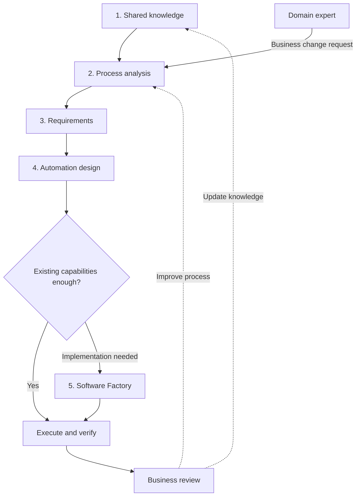
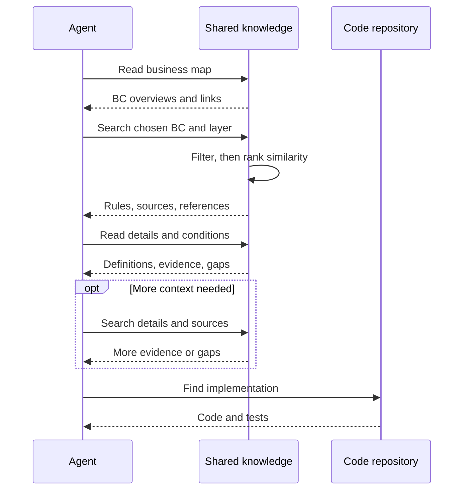
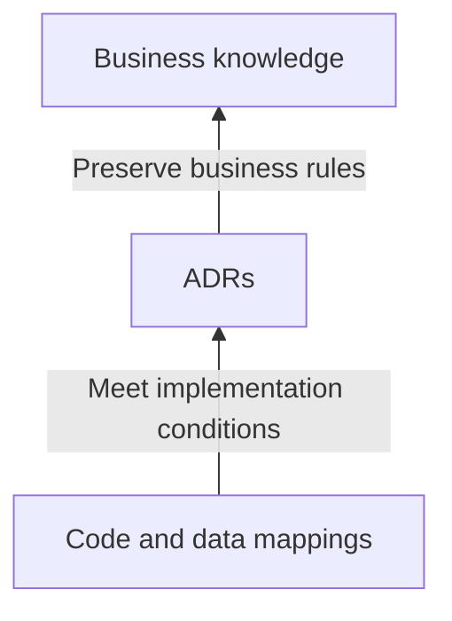
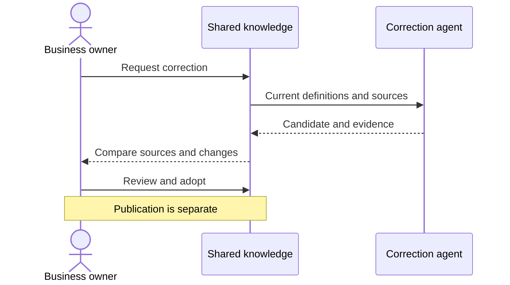
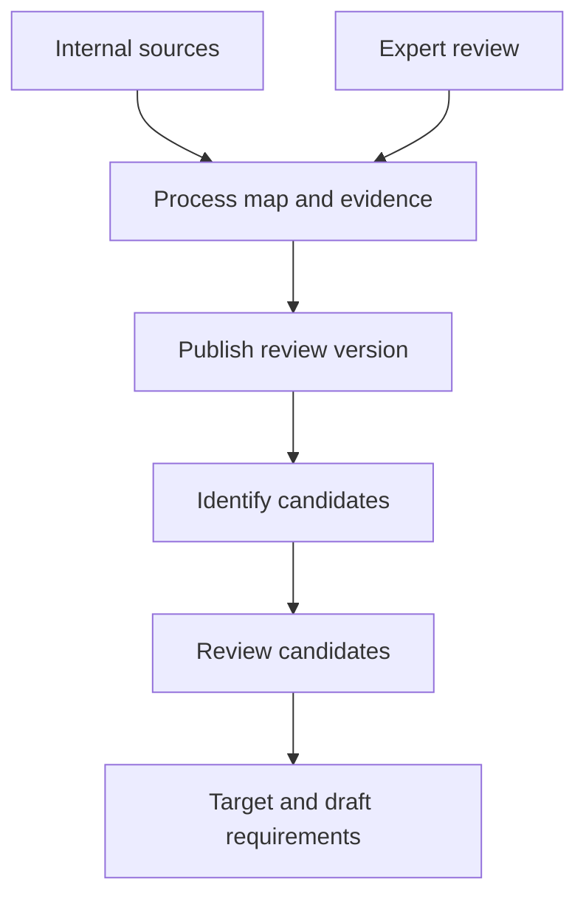
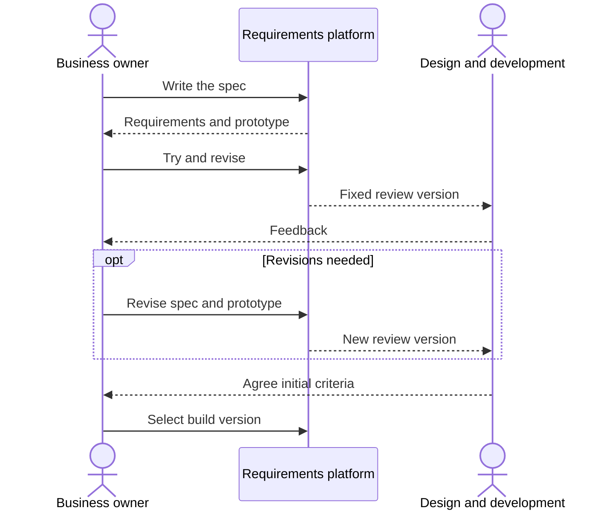
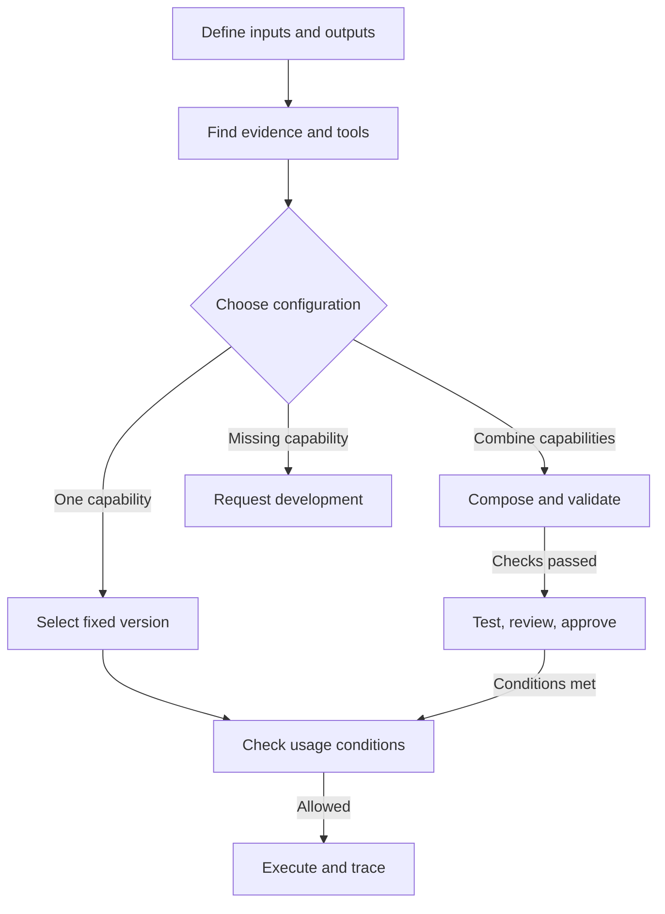
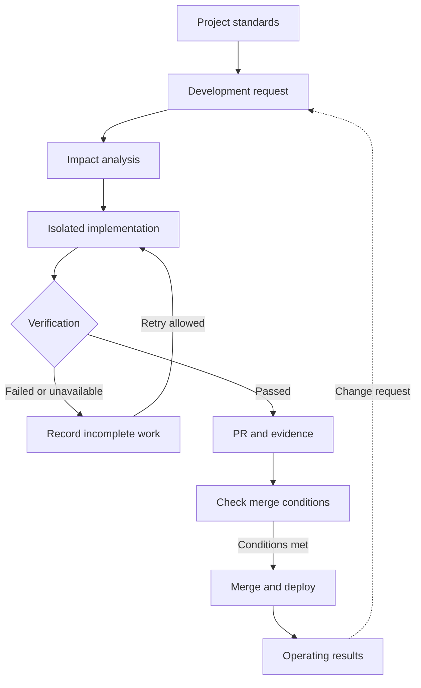
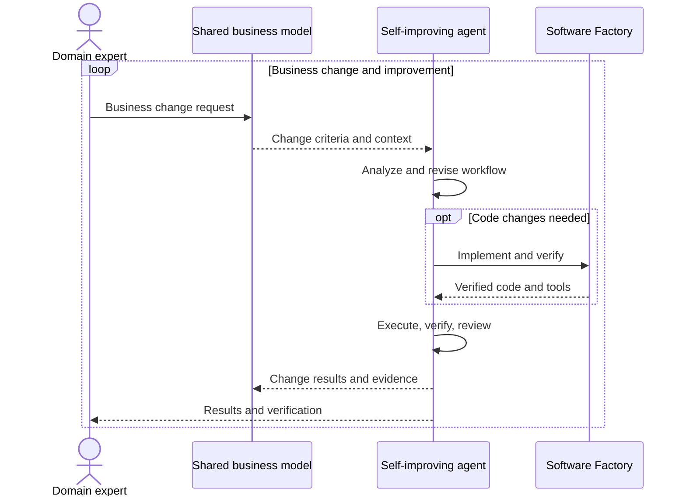
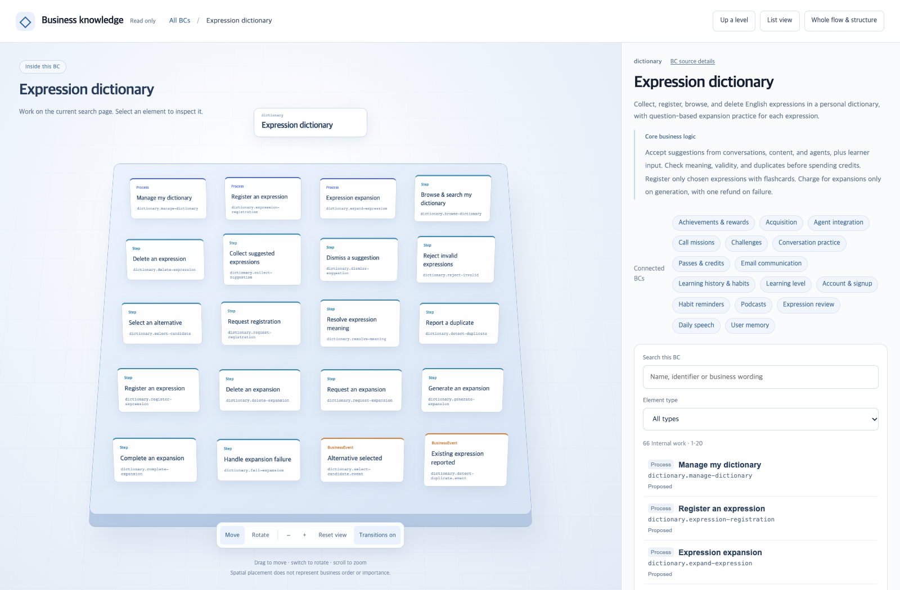

## TL;DR

- Domain experts' business change requests should lead to system improvements.
- DDD keeps business meaning consistent across requests, models, and implementation.
- Software Factories and self-improving agents carry out changes and verification.

## Introduction

Domain experts are the first to notice that a business process has changed because they encounter customer needs, business rules, and exceptions in daily work.

When the system's concepts and processing flow differ from the business, even a small change requires a developer to reinterpret it in technical terms. Domain experts know what needs to change, but need a separate explanation to judge whether the implementation preserves that meaning.

Writing about harness engineering, the cognitive load of reviewing AI-generated code, internal FDEs—engineers working on automation with business teams—and Software Factories has led me to think about closing this gap.

The AX (Agentic Transformation) I want is **a structure in which domain experts request changes in business terms and the system improves its business model, workflows, and code accordingly**. Self-improving agents revise the processing flow using requests and execution results, while the Software Factory implements, verifies, and delivers the capabilities needed.

This flow needs a shared reference that preserves a request's meaning throughout. DDD (Domain-Driven Design) is an approach to keeping business language and rules consistent across models and implementation. When people and agents read the same business model, a domain expert's request can become the basis for a change without a developer first rewriting it in technical terms. Agents handle the concrete translation into code and data mappings.

I think **the alignment between business models and implementation pursued by DDD is essential for this form of AX**. Software Factories and self-improving agents need to work against the same business criteria, and organizations need to give domain experts authority over business changes and responsibility for verifying outcomes.

This post follows an organization introducing AX through shared knowledge, process analysis, requirements, automation design, and implementation of missing capabilities. These five steps build the structure that carries domain experts' change requests into improved execution and code. I use examples from platforms I am developing to make the requirements concrete.[^7]

## 1. From AX adoption to business change

An organization introducing AX can start with these five steps. After the initial build, domain experts' change requests should enter the same flow so the system can reanalyze and improve the affected models and execution.





This is an adoption flow that uses existing services and tools to transform work. Each step can be supported by a shared platform or a commercial service. When the automation design needs a missing business capability, the Software Factory implements it, and the result is incorporated into the automation before execution.

| Step | What to establish | What passes forward |
| --- | --- | --- |
| 1. Shared knowledge | Business sources, ownership, access, and versions | Data and knowledge for analysis and execution |
| 2. Process analysis | Current and target work, roles, rules, and exceptions | As-Is and To-Be, business boundaries, responsibilities, and candidates |
| 3. Requirements | Agreed goals, data, inputs/outputs, and success criteria | Reviewed requirements, prototypes, and verification cases |
| 4. Business automation | Compose and test workflows with existing agents and tools | Execution configuration and missing capabilities |
| 5. Software development | Implement, verify, and deliver missing capabilities | Verified code, tools, and business-verification evidence |

Separating process analysis from business automation distinguishes deciding what to change from configuring agents to perform that work. Both continue using shared knowledge, while the Software Factory carries business-model changes into code and tests after the initial implementation as well.

A team that has already mapped processes with business experts can use that work to identify the data it needs. Automating process analysis itself, however, requires readable sources and access first. This post starts with shared knowledge and shows how execution and review lead back to earlier steps.

Each step needs to preserve the business meaning and verification criteria in the domain expert's request. Organizational roles should support experts deciding changes, agents carrying them into implementation and operation, and experts assessing results in business terms.

## 2. Shared knowledge: providing data and business knowledge

To handle a business change request, agents need to read the domain expert's terms, existing processes, rules, and exceptions against the same reference. The shared knowledge platform manages those criteria and their evidence. Analysis agents need sources and access for the initial business scope to understand the actual work.

Automating process analysis requires access to business documents and existing work records. The data is accumulated on the shared knowledge platform, with its owner, source, and permitted uses recorded. **The platform uses these governance rules to grant agents and external services access to the knowledge they need.** Business teams decide the meaning of rules and their permitted scope; platform teams operate the mechanisms that apply those decisions to storage, retrieval, and execution.

Even if business experts have already mapped the current and target processes, the data needed to execute that target must be secured on this platform. Analysis identifies additional sources and permissions, and shared knowledge supports the next analysis and execution. **Different starting points do not make shared knowledge easy to postpone.**

The shared knowledge layer needs **hybrid retrieval for general information** and **ontology retrieval for business processes and rules**. Finding similar support cases and understanding the sequence and conditions for handling a refund call for different forms of knowledge.

The shared knowledge platform I am developing preserves source evidence from tables, documents, and existing ontologies, distinguishing observations, source meaning, concepts connected across sources, and business rules. It also connects the storage of business definitions and actual cases with scoped retrieval and correction against the original sources.[^9]

### General information: hybrid retrieval combining similarity and BM25

For documents, meeting notes, and support records, it helps to combine similarity search, which finds passages close in meaning to the question, with BM25 search, which checks how well the actual words match. BM25 ranks documents using factors such as term frequency, rarity, and document length.

For example, similarity search can connect a customer's ‘I want my money back’ with ‘refund request’ in an internal document. For a specific product code or error message, searching for the actual string is useful. Hybrid retrieval combines and ranks the two sets of results to cover these different needs.

Results should include relevant passages, source locations, and revisions. An agent using them to answer a question or support a requirement needs a way to check the original explanation and its conditions.

The local search I implemented also combines keyword and vector-similarity rankings. Its keyword scores use a custom formula, so the BM25 combination above is a requirement for the shared platform rather than a description of the current implementation.

Document retrieval selects relevant documents, then searches for the needed passages within them. Using only documents linked to the knowledge model could miss material that has not yet been organized, so it also includes document candidates found by directly searching source passages within the same permitted scope. It verifies the text and citation locations against the selected document's exact revision instead of answering directly from text retained in a search summary or vector index.

### Business knowledge: ontology retrieval through abstraction layers

A few relevant passages may be insufficient to understand the refund sequence, approval conditions, and effects on other work. An ontology explicitly records business concepts, relationships, processes, and rules, helping the agent navigate while keeping track of which business activity and condition it is reading.

**Ontology retrieval does not require a graph database or a graph traversal engine.** Business processes can be written in Turtle, a text format for recording concepts and relationships, and organized into abstraction layers that an agent can search and follow into detail. Here, layers separate different levels of detail: a business area's responsibilities and core rules, its internal processes, and the conditions its implementation must satisfy.

This platform first provides a map of bounded contexts (BCs), the scopes responsible for particular business terms and rules. The map contains each area's responsibilities, core business logic, and connections to other areas. When the prepared overviews fit within the agent's input limit, it can read the entire permitted map and search for heavier internal detail inside selected BCs.

For example, an agent changing refund functionality can read the ordering and payment overviews, choose the relevant areas, and use similarity search to find refund processes, approval rules, and exceptions within them. For implementation work, it can descend into related ADRs (Architecture Decision Records) and current code. If it already knows the required rule or ADR, it can also enter at that detail directly.

**Business scope and detail level are selected before similarity is compared within them.** Retrieval can work with known BC membership and detail levels without a complete hierarchy of internal parent-child relationships. Rules that apply to several BCs retain those relationships, while material with unknown membership is not assigned to an arbitrary area.





Today's agents are quite good at reading an overview and deciding which area and item to examine next. I think giving them the necessary explanations at each layer and paths into the next one is often enough to handle business knowledge at a substantial scale.

That abstraction design matters more as the scope grows toward an enterprise. Searching one enormous data lake and returning detailed material from many business areas leaves the agent to sort out the conditions relevant to its current task. Narrowing the scope at the upper layer and searching within each layer reduces the unrelated detail brought into context.

Centrally stored data can still support retrieval by layer. The efficiency I mean is **how little context an agent needs to receive the relevant information**, rather than how quickly the storage is read.

Rare exceptions omitted from an overview must remain available. The navigation feature I built reads selected definitions together with their required conditions and also supports direct retrieval of details and sources within the same permitted scope. When a definition exceeds the input limit, it leaves the unread dependencies and scope visible so the agent can split the read or adjust its selection, rather than truncating the definition and presenting it as complete.

### Preserving the meaning of business changes through DDD

Navigating from a business overview into the relevant details requires clear business boundaries and layer responsibilities when the knowledge is created. I also used DDD to define the business boundaries and layer responsibilities in this platform.

First, bounded contexts separate the scopes in which terms and rules have consistent meanings. Each BC records the work it owns and the results it passes to other BCs. For example, ‘cancellation completed’ in ordering and ‘refund completed’ in payments are different events. A refund process can cross both areas while retaining the distinct concepts and the events and conditions connecting them. The model should also identify who owns changes to the rules and which conditions must pass to other business areas.

For example, a domain expert might request, “Refund orders canceled before shipping without separate approval.” The agent uses the model's meanings of shipping, cancellation, approval, and refund to find the scope of the change. The expert can describe the business condition without naming fields or functions. The agent finds the technical implementation, with the aim of removing the need for a developer to redefine the business meaning.

The BCs identified through this work must also shape how agents handle requests. Execution needs to connect each task to the business context and rules it reads, the tools and permissions it uses, and the results it passes to other BCs. Even when one agent handles work across several BCs, each step must retain the appropriate terms, decision criteria, and meaning of its outputs.

Processes within those boundaries are abstracted through their purpose, participants, inputs and outcomes, and each step's conditions and exceptions. Business knowledge explains why the work exists and what it must preserve; table names, code files, and task commands belong in the layer concerned with implementation. This lets the meaning of a process survive changes in storage or implementation tools.

**An upper layer must answer the questions at its own level, and lower layers must satisfy its criteria.** Business knowledge holds processes and rules; ADRs hold implementation decisions and exact conditions; code and data mappings hold concrete handling methods. Conditions that change an outcome, such as approval limits and exceptions, must remain complete in the layer that owns them. Abstraction must not make those conditions vague.

The diagram shows which criteria a lower implementation depends on.





An agent should read the same fixed version of the upper criteria alongside the current implementation and propose changes that preserve those boundaries. If a refund-status column changes, it updates the data mapping to satisfy the existing completion criterion, without changing the meaning of completion or its verification criteria to make the mapping fit. If the business owner changes the completion criterion itself, that decision comes first, followed by revalidation of the affected ADRs, implementation, and data mappings.

This separation of responsibilities is also distinct from the level of detail used to read business knowledge. A BC overview and its internal processes can show the same knowledge at different levels of detail, but shortening an overview or rebuilding a search index must not change business rules.

### Improving stored business knowledge against its sources

Business knowledge needs maintenance after it is first created. A new case may reveal an exception, or an existing definition may have misrepresented a source condition. Those corrections need to remain available for the next task.

I built the correction feature to keep an inventory of sources and cases separate from business definitions and read selected originals alongside current definitions to propose corrections. Its review interface shows the original source, existing clause, and proposed clause side by side, making changes to conditions, negation, quantities, and exceptions visible. The correction guidance also preserves successful methods and confirmed facts, rather than deleting an existing fact simply because it is absent from the sources selected this time.





The current correction feature produces a candidate on request for the business owner to adopt. Connecting evidence from session and workflow reviews to that correction flow is a further capability the platform needs. Stored cases can be retrieved within the same business scope and revision, without automatically generalizing their inputs and observed results into current rules or facts about other work.

Whether a correction helps needs a separate check. The comparison tool I built for this uses the same sources and questions for three configurations: source retrieval alone, current business knowledge with sources, and corrected business knowledge with sources. Alongside answer quality, it records initial knowledge and index preparation costs, correction costs, and retrieval and answer costs per question separately.

A correct answer may still have relied on source retrieval to compensate for a wrong business definition. The comparison therefore separates which retrieval path recovered required evidence from whether the definitions themselves preserve the source conditions and exceptions. I think **final answers and the accuracy of stored knowledge need separate evaluation**.

Adopted knowledge and the version published for operational use need distinct version records. Source changes and revoked access must affect retrieval paths. Current access must be checked both when retrieving information and when returning it; material already found must not be returned if access was revoked during the search.

The shared knowledge platform's search and business-context retrieval can be exposed to multiple platforms through an open standard such as MCP.[^5] Connections need to carry the requester's permissions and the exact knowledge revision as well as the authentication method. Platforms may reuse the same knowledge, but they still need a record of which version of a rule they read.

## 3. Process analysis: understanding current and target work

Use the sources prepared in shared knowledge to identify the current process (As-Is) and the target process to be handled by agents (To-Be). After adoption, compare domain experts' change requests with the existing model to identify which steps, conditions, and responsibilities change. An approach such as agent storming combines source analysis with business-expert review to map events, rules, and exceptions, while designing the automation scope and organizational decision authority and operating responsibility together.

### Process discovery: building a map with evidence

For example, in a refund process, support receives the request, the order team checks delivery status, and finance approves it depending on the amount. Workshops such as [Event Storming](/2020/12/10/demystifying-event-storming.html) (Korean) collect these events and rules into a view of the whole flow.

Across a company, gathering every expert at the same time is difficult. If one department is missing, its approval rules may be missing too. After the workshop, people may have to reconstruct who supplied each explanation behind the map.

A process discovery platform should draft the map from internal documents and read-only tools, then let people answer questions asynchronously or edit it directly. Events, rules, and exceptions need source references, source versions, and confirmation states. Conflicting accounts and unanswered questions must remain visible.

Publication should fix the reviewed map together with its evidence and question state. An unfinished map may be shared, but publication must not be treated as proof that discovery is complete.

### Automation candidates and target processes

Choosing a target process for agents from the current process map requires considering frequent requests and long waits alongside exception frequency and the impact of failure. The team must also check that the shared knowledge platform has the required data, that the executing agent has permission to read it, and that tools can perform the work.

Faster processing can leave waits and checks between departments unchanged if the same division of work and approval procedures remain. The target process should define the judgments people retain, responsibility for exceptions, and authority to change the work alongside the automated steps.

For refunds, small cases with clear rules could be considered first. But if every case waits for a person's approval, reducing that wait requires agreeing with finance on the conditions and limits within which the agent can act. Cases involving frequent judgment calls, such as disputes, can remain with people.

The platform should help distinguish agent judgment, deterministic rules, human work, and insufficient evidence. Preserve selected candidates with their target processes so the next stage can turn them into agreed requirements.

In the process discovery platform I built, business boundaries and automation candidates are analyzed against the same published snapshot, then goals, data, input/output contracts, and three distinct examples are exported as a requirements document and JSON. Links to the original process map and unresolved questions remain in the document. The requirements stage then reviews this draft and agrees on success criteria.





## 4. Requirements: defining the change and its verification criteria

A domain expert's request needs to become changes to the business model, an impact scope, and success criteria. Agents should make these concrete in documents and cases, letting experts judge in business terms whether their intent and exceptions have been preserved.

The requirements platform should let **domain experts define business rules and success criteria and review change results against those same criteria**. Planning, design, and development specialists help establish initial criteria and implementation constraints. Business owners should be able to decide and verify subsequent business changes within the agreed conditions.

### Research and requirements authoring

Develop the candidates passed from process analysis through the following items.

| What to preserve | Refund example |
| --- | --- |
| Goal and handling responsibility | Reduce small-refund handling time while passing disputes to support |
| Data and usage conditions | Owners, permissions, freshness, and retrieval-failure handling for delivery status and refund policy |
| Inputs and outputs | Receive a refund request and return approve, reject, or human review, with the reason |
| Representative cases and success criteria | Expected results for an allowed cancellation, a policy rejection, and a request above the approval limit |

Business owners and planners need to gather references and describe whose problem they are solving and which business rules apply. The platform should distinguish facts found in sources, AI suggestions, and unconfirmed assumptions, then incorporate content the planner has reviewed.

Internal sources need organization-approved connections. MCP (Model Context Protocol), a protocol connecting agents to external tools and data, can be used here. Establishing a connection does not grant access to every source.

### Working prototypes and review criteria

A planner should be able to generate, revise, and try a prototype without managing a development environment. A demo scenario describing what to check and in what order helps distinguish an interface that opens from one that supports the intended work.

New prototype generation should run separately from the version under review. If a failed candidate overwrites that version, it also removes the result other people were reviewing.

### Joint review and version handoff

When reviewing initial requirements or new implementation conditions, bind the specification, demo scenario, and validated prototype to one version that the relevant specialists can review and comment on. When changes are needed, the document and prototype should be revised together for the next review.





Having a version to share is different from agreeing to start development. The platform should record agreed conditions, open questions, who can change the rules, and who judges the resulting change.

In the requirements platform I built, planners work with AI to write a PRD (Product Requirements Document), generate and revise a prototype, then publish the document, demo scenario, and validated prototype as one review version. Organization-level access and sharing are also part of making this work reusable across teams.

## 5. Business automation: improving from requests and execution results

Once requirements are agreed, try configuring the target process with existing agents and tools. Self-improving agents should then use domain experts' requests and execution and review results to revise work order, tool selection, and decision conditions. The agreed business model remains the reference; missing capabilities become requirements for the Software Factory.

The agent operations platform should find and connect available agents and tools using the agreed inputs and expected outputs. A catalog for registration, discovery, and sharing helps departments avoid rebuilding the same capabilities.

If one existing agent supplies the required input/output contract, its version should be reusable directly. Multiple capabilities can be assembled into a workflow, with checks on data types and required values between steps. A missing capability should remain an implementation requirement for the Software Factory.

The refund example still needs capabilities for checking delivery, checking policy, and processing refunds. Generating a workflow does not itself prepare those capabilities or grant permission to run them.

The operating platform also needs the following capabilities:

- **Trials, review, and sharing:** test new versions, complete required security review and approval, and make them available to permitted users.
- **Version and execution controls:** fix approved versions and check current access and suspension at execution time.
- **Tracing and evaluation:** connect inputs, step-level tool calls, results, failures, and costs.
- **Feedback and improvement:** incorporate failures into evaluations and procedures, then review the improved version.





The agent operations platform I built registers departmental agents, MCP services, and workflows, then finds and connects approved capabilities matching the input/output contract confirmed through conversation. It distinguishes direct agent selection from workflow composition and rechecks usage conditions during execution.

Someone also needs to use operating results to improve procedures and evaluation cases. The FDE (Forward Deployed Engineer) in [my post on internal FDEs](/en/2026/09/03/developers-to-internal-fde.html) is an engineer working close to business teams on this implementation and improvement. In this structure, the FDE should establish the initial business model, platform adoption, and verification procedures, then enable business teams to continue changing and checking their work against the same criteria. If authority and responsibility for improving the work remain solely with technical specialists, execution records will not remove that dependency.

## 6. Software Factory: carrying business changes into code and verification

When existing agents and tools cannot meet the requirements, the Software Factory should turn the missing capabilities into verified code for the automation configuration. A coding agent can implement quickly while disconnected review, checks, and deployment still limit company-wide delivery speed.

Faros AI's 2025 report used data from more than 10,000 developers to compare periods of lower and higher AI adoption within teams. Merged PRs increased by 98%, but review time also rose by 91%, with no significant correlation between AI adoption and performance improvements at the company level.[^1] A PR (Pull Request) is a request to review a code change and merge it into the existing code.

This was an observational analysis as of June 2025, when most usage was autocomplete. It does not establish the same result for today's agents, but it does show that later stages can fail to keep up with increased implementation throughput.

That is why I think a Software Factory should **carry business-model changes through impact analysis, isolated implementation, checks, and delivery**. Its inputs should include changed business rules and cases that check them. Its outputs should include code and evidence showing whether those rules hold, so business owners can judge the change without reconstructing the code's behavior.

### Project-specific standards and execution environments

The platform should connect existing repositories, tickets, operational alerts, and CI. CI (Continuous Integration) automatically builds and checks code changes. Connecting agent work to a team's current development flow is easier to adopt than replacing all of its tools.

Project-specific design standards, task instructions, and check commands need to be registered, with the version used for each run recorded. Work needs coordination so that agents do not overwrite one another's changes in the same repository. Execution time, cost, and retry budgets also need management.

### Changes and verification evidence

Code changes should run in an environment separate from existing work, with real builds, tests, and business scenarios checking whether the requirements are met. Failed or unavailable checks need to remain visible, and their results should not be delivered as if the change had succeeded.

Along with code, the agent should leave **evidence of which business conditions changed, which processes are affected, and which cases were checked**. As discussed in [my post on AI code review's cognitive load](/en/2026/08/18/ai-coding-review-cognitive-load.html), review remains a bottleneck when people have to reconstruct the implementation's intent and impact from scratch.

### Review and merge policies, and operating feedback

Smaller changes, AI review and approval, and risk-based handling can all reduce review work.[^2][^3] The platform should apply the company's adopted policies and manage which changes can be handled automatically and which need human review.

Classifying a change as suitable for automatic merging is not sufficient to merge it. The actual checks, repository protection rules, permissions, and change version must still be valid at merge time. Incidents and change requests after deployment also need to return as new work.





The Software Factory I am developing is a self-hosted base project. It connects existing repositories, tickets, alerts, and CI, and manages project standards, requirements decisions, coding-agent changes and checks in isolated environments, PRs, and automation policies. Policies are built from real PR examples and evaluated on separate cases, while classification is kept distinct from actual merge authority.

A Software Factory should carry requirements through implementation, verification, delivery, and fixes for problems found in operation. Its position at the end of the adoption flow does not end its role after the first build: it continues carrying business-model changes requested by domain experts into code and tests. StrongDM's scenario-based verification[^4] and [my post on Software Factory evals](/en/2026/10/05/software-factory-evals-and-tension-metrics.html) both address how to define success and judge the next change.

## 7. Organizing operation around domain-led change

Even with the platforms in place, people explaining everything again and moving data at each transition creates another bottleneck. Each platform therefore needs **an output that lets the next platform retain the agreed conditions and their evidence**.

The requirements platform should pass the specification, prototype, and success criteria as one version. The process discovery platform should attach the original map and open questions to automation requirements. Execution results should identify the requirements and knowledge versions used, so they can support the next change.

Those details need to travel from process analysis to requirements, from requirements to automation design, and from implementation of missing capabilities back to execution. Similar file formats or MCP support alone do not complete an automatic integration.

This flow starts with a request from a domain expert who has noticed a business change. The organization needs to establish who decides that change and who verifies the results. Even if platforms read the same model, domain experts cannot lead changes if a developer still has to rewrite each request in technical terms.

### Turning reviews into the next ontology, workflow, and code changes

Once BCs shape execution, session reviews and agent workflow reviews should use the same business model as their reference. A session review examines which context the agent read and which rules guided its decisions. A workflow review examines whether conditions and results were passed correctly across steps and BCs.

Differences found in review need changes in the layer responsible for their cause. Missing business conditions or exceptions call for an ontology change proposal backed by evidence. When execution fails to follow an existing rule, the agent's procedure, tools, or code need correction. Adopted business changes must reach the related workflows, ADRs, and implementation, with the cases used in review retained for checking the next change.

For example, suppose an agent confirms an order cancellation and then tells the customer that the refund is complete. The review should first check whether the model distinguishes order-cancellation and refund completion conditions. If it does and the agent skipped a required check, revise the workflow; if the necessary query capability is missing, implement it. Then verify that the agent does not tell the customer the refund is complete before confirming refund completion in the payments context.

The Software Factory should carry those business rules and implementation contracts into code and tests. The agent operations platform should connect that code and those tools into executable business processes. Execution records and reviews then become evidence for revising the ontology, workflows, and implementation again.

Once the business criteria for a change are established, the system can be designed to carry analysis, implementation, and verification forward as follows.





Repeated iterations should reduce the gap between the business model and actual behavior. Alongside building the initial model well, the platforms need to carry what is learned in operation into the next model and its execution.

### Reassign responsibilities between business and platform teams

The organizational change I have in mind gives domain experts on the team accountable for the business model and its outcomes the authority to decide changes and verify results. Technical teams own shared execution environments, access controls, verification and recovery standards, and platform operation.

Once DDD clarifies business boundaries, the organization needs to establish who decides the meaning of that work and who owns its outcome. When several departments participate in one process, they should agree on completion criteria and change responsibilities that implementation and review also follow. Moving people without changing decision authority or evaluation criteria leaves the waits in place.

For example, an organization where technical specialists continually mediate business requests and implementation could reassign responsibilities as follows.

| Role | Responsibility to establish | What the platform supports |
| --- | --- | --- |
| Domain experts on business teams | Recognize business changes; own models and outcome criteria; decide changes and verify results | Changes in business terms and case review |
| Platform and technical teams | Shared execution environments, access, verification and recovery standards, operating quality | Automated implementation and operation for each business area |
| FDEs | Establish initial models and adoption; enable business teams to change and verify their work | Handover of criteria and execution evidence |

If the common platform team also builds every business-specific feature, growing demand puts teams back in its queue. Teams need a harness of instructions, tools, checks, and evaluation criteria so they can customize with agents.[^6] Configuration and extension points, with reviews of change impact, help them continue adopting shared security patches and improvements.

Commercial services can cover the parts they support, and custom development can start from a common base. Either way, responsibility for judging business rules and outcomes and responsibility for the technical foundation enabling automation must be clear.

### Check whether requests lead to improvements without technical reinterpretation

More teams using a platform or a faster first prototype does not establish the effect of company-wide AX. Measure preparation separately from business outcomes, and check how much technical interpretation and coordination a business change still requires.

| Area | What to check |
| --- | --- |
| Shared knowledge | Missed rules and exceptions in retrieval, correction accuracy, and preparation and query costs |
| Process analysis | Missing or incorrect current/target process details; agreement on roles and change ownership |
| Requirements | Time for business owners and design/development specialists to agree on rules and success criteria |
| Business automation | Time from request to completion, human intervention, incorrect handling and reprocessing, total cost per case |
| Software development | Time from confirmed requirements to stable delivery, failed checks, and rework |

For example, when a refund policy changes, can a domain expert request the new conditions and verify the system's changes against business criteria without an FDE interpreting them? A faster initial build leaves the organizational dependency intact if each such change still requires bringing a technical specialist back. Shared operation should also track teams that can run and improve their own work, along with the effort and cost of adopting common changes.

Process maps need checks for omitted items, incorrect additions, and items with unconfirmed evidence as well as creation time. A map containing every confirmed rule can still be poor if it also adds many incorrect rules.

Capture a baseline for the existing approach and compare similar scope and exception mix. Include the time experts spend answering questions and reviewing results, so moving manual work to someone else is not counted as an automation gain.

## Conclusion

When designing company-wide AX, I first want to know whether domain experts can request a business change in their own terms and whether the system can improve its implementation and operation accordingly. The flow from shared knowledge through process analysis, requirements, automation design, and implementation connects that request to changes in execution and code.

I also built an [ontology tool](https://github.com/haandol/alps-writer-plugins) for authoring business models and connecting them to development. It lets users model processes, steps, events, and rules in Turtle, then move from a business-area overview to searches within that area and on to related ADRs.[^8]

The screenshot below shows this tool displaying the ontology of an English learning service I am developing. Selecting the ‘Expression dictionary’ BC exposes its registration and expansion processes and steps for search and further inspection. The screenshot's Korean text has been translated into English for this version of the article.

My ideal AX is **a system whose business processes, organizational responsibilities, and implementation follow the same business model**. Implementation details such as agent configuration and infrastructure operations should be managed autonomously within those business criteria.

If only technical specialists understand the connection between the business and its implementation, that role does not disappear when an FDE finishes the build and leaves. The remaining business experts must either learn how the solution interprets their work and take on a developer's responsibilities, or continue relying on technical specialists for changes and maintenance. In that situation, it is hard to call changes and maintenance fully automated.

When a domain expert notices a business change and requests an update, the Software Factory and self-improving agents should carry its meaning into the business model, workflows, and code, and verify the result. The expert judges outcomes using business criteria and cases rather than learning a developer's technical interpretation. I think **this form of AX requires the alignment between business models and implementation pursued by DDD, with organizational authority and responsibilities also changing so domain experts can lead improvements**.

---

[^1]: Faros AI, [The AI Productivity Paradox Report 2025](https://www.faros.ai/blog/ai-software-engineering). Observational analysis as of June 2025 of AI adoption, PR throughput, review time, and company-level performance.
[^2]: Google, [Small CLs](https://google.github.io/eng-practices/review/developer/small-cls.html). The practice of keeping changes small enough to review easily.
[^3]: GitHub, [Copilot code review](https://github.blog/changelog/2026-10-28-copilot-code-review-merge-with-confidence-with-max-and-approvals); Meta Engineering, [Diff Risk Score](https://engineering.fb.com/2025/08/06/developer-tools/diff-risk-score-drs-ai-risk-aware-software-development-meta/). Examples of AI review and approval, and risk-based deployment controls, respectively.
[^4]: StrongDM, [Software Factories and the Agentic Moment](https://factory.strongdm.ai/). Software development using specifications and scenario-based verification without human code review.
[^5]: Anthropic, [Donating the Model Context Protocol and establishing the Agentic AI Foundation](https://www.anthropic.com/news/donating-the-model-context-protocol-and-establishing-of-the-agentic-ai-foundation).
[^6]: [My post on harness engineering](/en/2026/03/15/harness-engineering-beyond-context-engineering.html), covering task instructions, tools, execution environments, verification, and recovery.
[^7]: Based on documentation and key implementation paths in the requirements, development, process discovery, agent operations, and shared knowledge platforms I am developing, as of November 6, 2026. Inspection of individual capabilities does not establish integrated execution across the platforms or measured company-wide results.
[^8]: [Layered navigation in the business ontology tool](https://github.com/haandol/alps-writer-plugins/tree/main/plugins/ontology-writer). The view was generated from the business ontology of an English learning service I am developing, on November 9, 2026. The file-based implementation reads the Turtle model on each query but returns only knowledge from the selected layer to the agent. The screenshot illustrates the organization of business knowledge, not measured enterprise-scale retrieval performance.

[^9]: Based on the designs, implementation, and tests for business-context navigation, layer contracts, document retrieval, and source-backed correction in the shared knowledge platform I am developing, as of November 9, 2026. I inspected the paths comparing source-only retrieval, current knowledge, and corrected knowledge; this article does not report new measurements of live-model accuracy or enterprise-scale performance gains.
