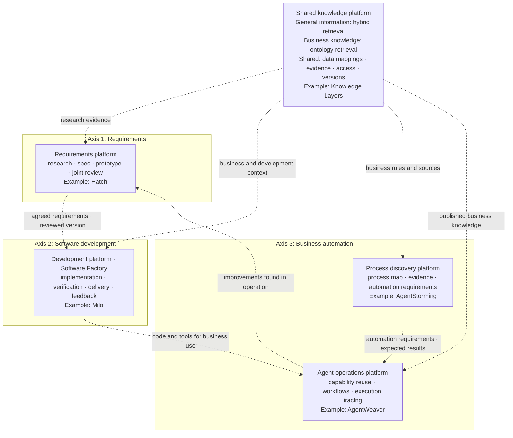
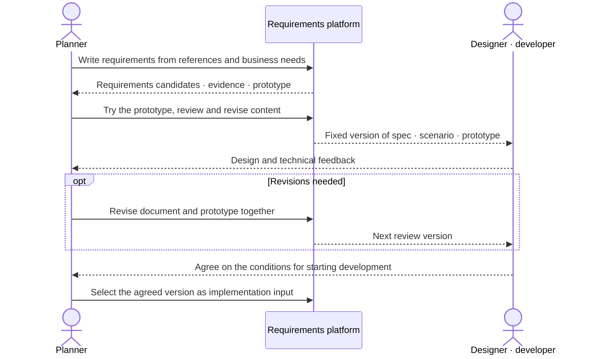
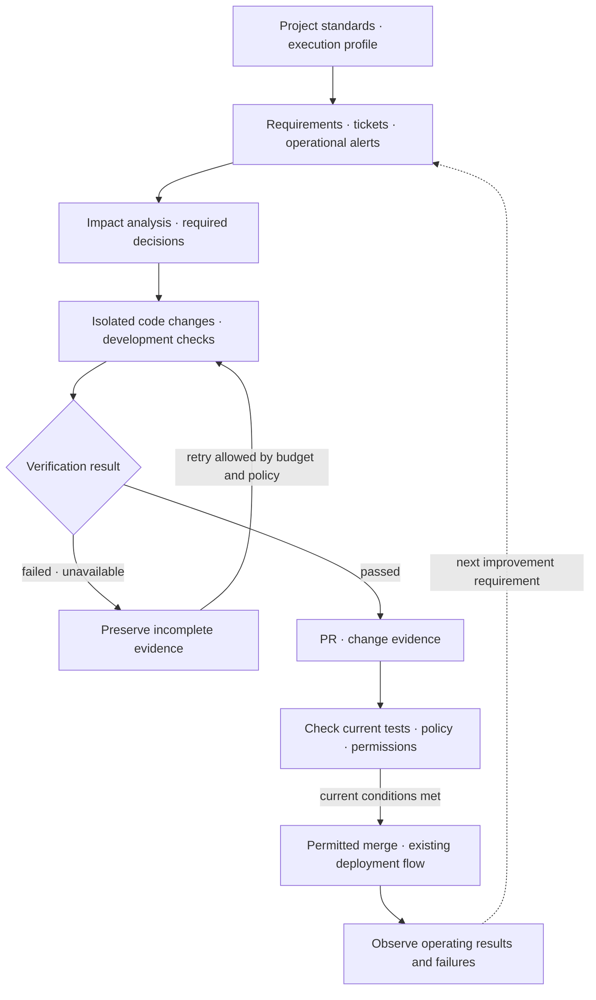
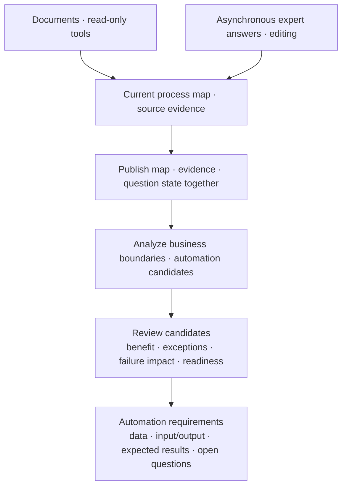
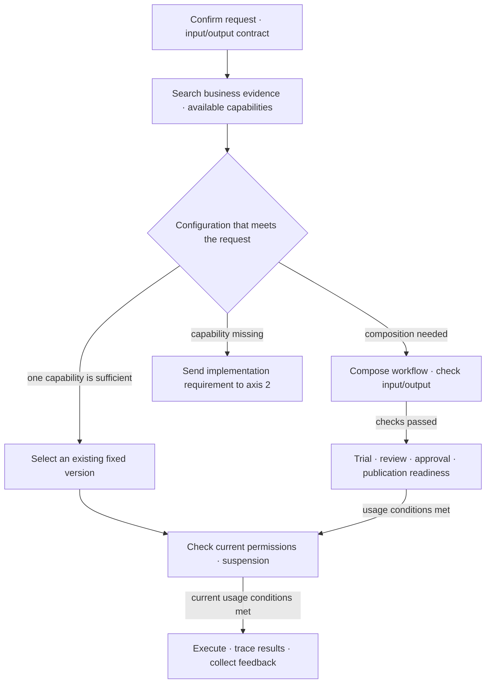
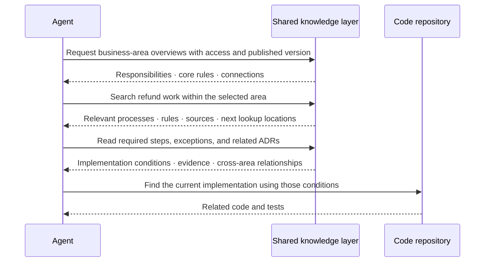

## TL;DR

- Company-wide AX needs platforms for requirements, development, and business automation.
- Each platform's output must become the next stage's input.
- Teams need shared knowledge and operating infrastructure.

## Introduction

Writing about harness engineering, the cognitive load of reviewing AI-generated code, internal FDEs—engineers working on automation with business teams—and Software Factories has led me to think about how a company should approach AX as a whole.

By AX (Agentic Transformation), I mean automating business processes by removing human intervention, and eventually allowing those processes to improve themselves based on operating results.

If one team automates a task with an agent, another team can try something similar. But if every team has to prepare its own data connections, agent environment, review and approval process, and result tracking, the work of setting up and maintaining automation grows along with the number of tasks.

I think **company-wide AX requires platforms that help teams define requirements, develop software, and automate business work**. Teams need to reuse common capabilities and working procedures while adapting them to their own business rules and systems.

This post uses these three roles as the axes of company-wide AX and describes the capabilities they need, along with a knowledge layer shared across them. Hatch, Milo, AgentStorming, AgentWeaver, and Knowledge Layers are projects I am working on that help make these requirements concrete.[^7]

## 1. Platforms for three axes and shared knowledge

Creating a new capability in a company involves defining a business requirement, implementing it in code, and applying the resulting system to real work. Problems found in operation become new requirements.

Platforms for company-wide AX can be organized around that flow.

| Area | What the platform does | What it passes to the next stage |
| --- | --- | --- |
| Axis 1 · Requirements | Research, specification and prototype creation, joint review | A version of agreed requirements, prototype, and success criteria |
| Axis 2 · Software development | Impact analysis, code changes and checks, review, merge, and deployment automation | Verified code, validation evidence, and operating results |
| Axis 3 · Business automation | Discover current work, select automation candidates, configure and operate agents | Process maps, automation requirements, and execution records |
| Shared · Knowledge | Hybrid retrieval for general information, ontology retrieval for business knowledge, data mappings, evidence, access, and versions | Sources and business knowledge shared across platforms |

Axis 3 must connect **understanding the work and choosing what to automate** with **executing the selected work**. These responsibilities can be handled by a process discovery platform and an agent operations platform.

The diagram below shows the platform structure I have in mind. Dashed lines represent the artifacts and knowledge that need to pass between platforms. Each box names a current project as an implementation example.





Not every task starts on axis 1 and proceeds in order. Work that existing systems and tools can handle may begin directly on axis 3. When new functionality is needed, it can return to axes 1 and 2.

This division defines responsibilities and outputs. One product may cover several roles, but a late input or an output the next stage cannot use will hold up the overall flow.

## 2. Axis 1: a platform for developing and agreeing on requirements

Turning an idea into a prototype immediately does not settle the business rules and success criteria developers need. When the document and interface change separately, designers and developers have to reconcile what they are reviewing.

An axis 1 platform should let **planners develop an idea, try it themselves, and preserve the agreement needed to start development in one version**.

### Research and requirements authoring

Planners need to gather references and describe whose problem they are solving and which business rules apply. The platform should distinguish facts found in sources, AI suggestions, and unconfirmed assumptions, then incorporate content the planner has reviewed.

Internal sources need organization-approved connections. MCP (Model Context Protocol), a protocol connecting agents to external tools and data, can be used here. Establishing a connection does not grant access to every source.

### Working prototypes and review criteria

A planner should be able to generate, revise, and try a prototype without managing a development environment. A Demo Scenario describing what to check and in what order helps distinguish an interface that opens from one that supports the intended work.

New prototype generation should run separately from the version under review. If a failed candidate overwrites that version, it also removes the result other people were reviewing.

### Joint review and version handoff

The specification, Demo Scenario, and validated prototype should be bound to one version that designers and developers can review and comment on. When changes are needed, the document and prototype should be revised together for the next review.





Having a version to share is different from agreeing to start development. The platform should record the conditions agreed upon and the questions still open, not just the date a link was shared.

Hatch makes these requirements concrete. Planners work with AI to write a PRD (Product Requirements Document), generate and revise a prototype, then publish the PRD, Demo Scenario, and validated prototype as one Version. Organization-level access and sharing are also part of making this work reusable across teams.

## 3. Axis 2: a development platform that connects implementation and verification

Once requirements are agreed on axis 1, axis 2 needs to turn them into verified code and deliver them to the actual service. A coding agent can implement quickly while disconnected review, checks, and deployment still limit company-wide delivery speed.

Faros AI's 2025 report used data from more than 10,000 developers to compare periods of lower and higher AI adoption within teams. Merged PRs increased by 98%, but review time also rose by 91%, with no significant correlation between AI adoption and performance improvements at the company level.[^1] A PR (Pull Request) is a request to review a code change and merge it into the existing code.

This was an observational analysis as of June 2025, when most usage was autocomplete. It does not establish the same result for today's agents, but it does show that later stages can fail to keep up with increased implementation throughput.

That is why I think axis 2 needs **a development platform connecting request intake, impact analysis, isolated implementation, checks, and delivery**.

### Project-specific standards and execution environments

The platform should connect existing repositories, tickets, operational alerts, and CI. CI (Continuous Integration) automatically builds and checks code changes. Connecting agent work to a team's current development flow is easier to adopt than replacing all of its tools.

Project-specific design standards, task instructions, and check commands need to be registered, with the version used for each run recorded. Work needs coordination so that agents do not overwrite one another's changes in the same repository. Execution time, cost, and retry budgets also need management.

### Changes and verification evidence

Code changes should run in an environment separate from existing work, with real builds, tests, and business scenarios checking whether the requirements are met. Failed or unavailable checks need to remain visible, and their results should not be delivered as if the change had succeeded.

Along with code, the agent should leave **evidence of what changed and which conditions were checked**. As discussed in [my post on AI code review's cognitive load](/en/2026/08/18/ai-coding-review-cognitive-load.html), review remains a bottleneck when people have to reconstruct the implementation's intent and impact from scratch.

### Review and merge policies, and operating feedback

Smaller changes, AI review and approval, and risk-based handling can all reduce review work.[^2][^3] The platform should apply the company's adopted policies and manage which changes can be handled automatically and which need human review.

Classifying a change as suitable for automatic merging is not sufficient to merge it. The actual checks, repository protection rules, permissions, and change version must still be valid at merge time. Incidents and change requests after deployment also need to return as new work.





Milo is a Software Factory solution for this role. It is a self-hosted base project that connects existing repositories, tickets, alerts, and CI, and manages project baselines, requirements decisions, isolated Codex changes and checks, PRs, and automation policies. Policies are built from real PR examples and evaluated on separate cases, while classification is kept distinct from actual merge authority.

A Software Factory should carry requirements through implementation, verification, delivery, and fixes for problems found in operation. StrongDM's scenario-based verification[^4] and [my post on Software Factory evals](/en/2026/10/05/software-factory-evals-and-tension-metrics.html) both address how to define success and judge the next change.

## 4. Axis 3: platforms connecting process discovery and agent operations

Automating development does not decide which business work to change first. The company needs to understand work scattered across departments, select the scope of automation, and connect it to executable capabilities and operating ownership.

### Process discovery: building a map with evidence

For example, in a refund process, support receives the request, the order team checks delivery status, and finance approves it depending on the amount. Workshops such as [Event Storming](/2020/12/10/demystifying-event-storming.html) (Korean) collect these events and rules into a view of the whole flow.

Across a company, gathering every expert at the same time is difficult. If one department is missing, its approval rules may be missing too. After the workshop, people may have to reconstruct who supplied each explanation behind the map.

A process discovery platform should draft the map from internal documents and read-only tools, then let people answer questions asynchronously or edit it directly. Events, rules, and exceptions need source references, source versions, and confirmation states. Conflicting accounts and unanswered questions must remain visible.

Publication should fix the reviewed map together with its evidence and question state. An unfinished map may be shared, but publication must not be treated as proof that discovery is complete.

### Automation candidates and implementation requirements

The map should help identify frequent requests and long waits, considered alongside exception frequency and the impact of failure. Access to the required data and tools capable of executing the work must also be checked.

For refunds, small cases with clear rules could be considered first. But if every case waits for a person's approval, reducing that wait requires agreeing with finance on the conditions and limits within which the agent can act. Cases involving frequent judgment calls, such as disputes, can remain with people.

The platform should help distinguish agent judgment, deterministic rules, human work, and insufficient evidence. Selected candidates need requirements the next stage can implement.

| What to preserve | Refund example |
| --- | --- |
| Goal and automation scope | Reduce small-refund handling time while passing disputes to support |
| Data and usage conditions | Owners, permissions, freshness, and retrieval-failure handling for delivery status and refund policy |
| Inputs and outputs | Receive a refund request and return approve, reject, or human review, with the reason |
| Representative cases and success criteria | Expected results for an allowed cancellation, a policy rejection, and a request above the approval limit |

AgentStorming is an example of this process discovery platform. It analyzes business boundaries and automation candidates against the same published snapshot, then exports goals, data, input/output contracts, and three distinct examples as Lite ALPS requirements and JSON. Links to the original process map and unresolved questions remain in the document.





### Agent operations: finding and executing the needed capabilities

Once work has been selected, the agent operations platform should clarify its inputs and expected outputs, then find and connect available agents and tools. A catalog for registration, discovery, and sharing helps departments avoid rebuilding the same capabilities.

If one existing agent supplies the required input/output contract, its version should be reusable directly. Multiple capabilities can be assembled into a workflow, with checks on data types and required values between steps. A missing capability should remain an implementation requirement for axis 2.

The refund example still needs capabilities for checking delivery, checking policy, and processing refunds. Generating a workflow does not itself prepare those capabilities or grant permission to run them.

The operating platform also needs the following capabilities:

- **Trials, review, and sharing:** test new versions, complete required security review and approval, and make them available to permitted users.
- **Version and execution controls:** fix approved versions and check current access and suspension at execution time.
- **Tracing and evaluation:** connect inputs, step-level tool calls, results, failures, and costs.
- **Feedback and improvement:** incorporate failures into evaluations and procedures, then review the improved version.





AgentWeaver fills this role. It registers departmental agents, MCP services, and workflows, then finds and connects approved capabilities matching the input/output contract confirmed through conversation. It distinguishes direct agent selection from workflow composition and rechecks usage conditions during execution.

Someone also needs to use operating results to improve procedures and evaluation cases. The FDE (Forward Deployed Engineer) in [my post on internal FDEs](/en/2026/09/03/developers-to-internal-fde.html) is an engineer working close to business teams on this implementation and improvement. Execution records alone do not sustain improvement if no one owns the work of changing the process.

## 5. Shared knowledge: understanding work with consistent meaning and evidence

All three axes need internal knowledge. The requirements platform researches business rules, the development platform implements them in code, and the agent operations platform uses them during execution.

Separate preparation repeats work and can leave platforms reading different versions of a rule. That calls for **a shared knowledge platform managing business definitions, evidence, and data mappings together**.

The shared knowledge layer needs **hybrid retrieval for general information** and **ontology retrieval for business processes and rules**. Finding similar support cases and understanding the sequence and conditions for handling a refund call for different forms of knowledge.

### General information: hybrid retrieval combining similarity and BM25

For documents, meeting notes, and support records, it helps to combine similarity search, which finds passages close in meaning to the question, with BM25 search, which checks how well the actual words match. BM25 ranks documents using factors such as term frequency, rarity, and document length.

For example, similarity search can connect a customer's ‘I want my money back’ with ‘refund request’ in an internal document. For a specific product code or error message, searching for the actual string is useful. Hybrid retrieval combines and ranks the two sets of results to cover these different needs.

Results should include relevant passages, source locations, and revision versions. An agent using them to answer a question or support a requirement needs a way to check the original explanation and its conditions.

### Business knowledge: ontology retrieval through abstraction layers

A few relevant passages may be insufficient to understand the refund sequence, approval conditions, and effects on other work. An ontology explicitly records business concepts, relationships, processes, and rules, helping the agent navigate while keeping track of which business activity and condition it is reading.

**Ontology retrieval does not require a graph database or a graph traversal engine.** Business processes can be written in Turtle, a text format for recording concepts and relationships, and organized into abstraction layers that an agent can search and follow into detail. Here, layers separate different levels of detail: a business area's responsibilities and core rules, its internal processes, and the conditions its implementation must satisfy.

For example, an agent changing refund functionality can first read the ordering and payment overviews and choose the area responsible for refunds. It can then search that area's refund processes, approval rules, and exceptions, read the related ADRs (Architecture Decision Records), and find the current implementation. When a rule from another area is needed, the agent can follow a recorded connection to that area.





Today's agents are quite good at reading an overview and deciding which area and item to examine next. I think giving them the necessary explanations at each layer and paths into the next one is often enough to handle business knowledge at a substantial scale.

That abstraction design matters more as the scope grows toward an enterprise. Searching one enormous data lake and returning detailed material from many business areas leaves the agent to sort out the conditions relevant to its current task. Narrowing the scope at the upper layer and searching within each layer reduces the unrelated detail brought into context.

Centrally stored data can still support retrieval by layer. The efficiency I mean is **how little context an agent needs to receive the relevant information**, rather than how quickly the storage is read. This depends on overviews that help the agent select the right area and preserve the rules and connections it must not miss.

### Separate business meaning from data mappings

Finding the meaning of a completed refund in the ontology does not calculate last month's refund rate; that requires querying actual data. The definition of a completed refund is distinct from the system status that represents it. Business meaning should survive a source-column change, while a change in the business rule should trigger a review of the queries and implementations that use it.

Knowledge Layers separates these responsibilities into business knowledge (K), mappings to actual fields and values (S), and prepared queryable data (D). As a platform requirement, this means **data mappings must be replaceable without tying business definitions to a source's physical shape**. Metric queries use those definitions and mappings to calculate values, preserving the data and definition versions used.

The shared platform should preserve originals, provenance, and cleaned data for reuse across retrieval and queries. A new retrieval method may require more extraction or indexing, but repeated collection and cleaning can be reduced.

### Shared management of adoption, publication, and access

AI-extracted candidates need to remain distinct from definitions adopted by business owners. The platform must manage which published version is used in ordinary work. Source changes and revoked access must also affect the paths that use that knowledge.

Current access must be checked both when retrieving information and when returning it. If access is revoked after a search begins, material already retrieved must not simply be returned.

Knowledge Layers' queries, document retrieval, and context navigation make these requirements concrete. Exposing them through an open standard such as MCP allows platforms to reuse the same capabilities.[^5] Connections need to carry the requester's permissions and the published version as well as the authentication method.

## 6. Handoffs and company-wide operation

Even with the platforms in place, people explaining everything again and moving data at each transition creates another bottleneck. Each platform therefore needs **an output that lets the next platform retain the agreed conditions and their evidence**.

The requirements platform should pass the specification, prototype, and success criteria as one version. The process discovery platform should attach the original map and open questions to automation requirements. Execution results should identify the requirements and knowledge versions used, so they can support the next change.

Implementing a Hatch review version in Milo, or continuing AgentStorming requirements in AgentWeaver, requires those details to travel together. Similar file formats or MCP support alone do not complete an automatic integration.

### Shared operation and business-specific customization

Company-wide platforms need owners for organization and project access, usage and cost, versions and security patches, and incident response. Each business team needs someone responsible for its rules, exceptions, and evaluation cases.

I think a common platform organization should work alongside teams that customize and operate what it provides. If the central organization has to build every business-specific feature too, teams will end up waiting on it as requests grow.

Teams also need a harness combining task instructions, tools, checks, and evaluation criteria so they can customize with agents.[^6] Configuration and extension points, along with reviews of changes and their effects, help teams keep receiving security patches and improvements without separately modifying every copy of the common code.

Commercial services can be used where their capabilities are sufficient. Custom development can start from a shared base. Either way, an internal team still needs to own business configuration, evaluation, and improvement.

### Measure adoption speed separately from business outcomes

More teams using a platform or a faster first prototype does not establish the effect of company-wide AX. Faster preparation and better business outcomes need separate measurement.

| Area | What to check |
| --- | --- |
| Requirements | Time from organizing an idea until planners, designers, and developers agree to start |
| Software development | Time from confirmed requirements to stable delivery, failed checks, and rework |
| Business automation | Time from request to completion, human intervention, incorrect handling and reprocessing, total cost per case |
| Platform operation | Teams independently operating and improving work, and the effort and cost of adopting common changes |

Process maps need checks for omitted items, incorrect additions, and items with unconfirmed evidence as well as creation time. A map containing every confirmed rule can still be poor if it also adds many incorrect rules.

Capture a baseline for the existing approach and compare similar scope and exception mix. Include the time experts spend answering questions and reviewing results, so moving manual work to someone else is not counted as an automation gain.

## Conclusion

If I were pursuing company-wide AX, I would start by defining the requirements for each platform. Reaching agreement on requirements, implementing and verifying software, and discovering and operating business work need different capabilities and responsibilities.

The shared knowledge layer also needs both general-information retrieval and navigation through business meaning and processes. For business knowledge in particular, I think agents should be able to read an overview and descend into the details they need.

To apply this approach to development, I also implemented `ontology-writer` in [ALPS Writer Plugins](https://github.com/haandol/alps-writer-plugins). It lets users model processes, steps, events, and rules in Turtle, then move from a business-area overview to searches within that area and on to related ADRs.[^8]

The screenshot below shows the ontology built for EncBird, an English learning service, in its actual UI. A bounded context (BC) is a scope within which business terms and responsibilities have a consistent meaning. Selecting the ‘Expression dictionary’ BC exposes its registration and expansion processes and steps for search and further inspection. The screenshot's Korean text has been translated into English for this version of the article.

Teams can avoid repeating the same preparation when each platform's output is usable by the next stage and they share business knowledge and operating infrastructure like this. Adapting business rules and exceptions on top of that foundation is how I think AX can expand across a company.

---

[^1]: Faros AI, [The AI Productivity Paradox Report 2025](https://www.faros.ai/blog/ai-software-engineering). Observational analysis as of June 2025 of AI adoption, PR throughput, review time, and company-level performance.
[^2]: Google, [Small CLs](https://google.github.io/eng-practices/review/developer/small-cls.html). The practice of keeping changes small enough to review easily.
[^3]: GitHub, [Copilot code review](https://github.blog/changelog/2026-10-28-copilot-code-review-merge-with-confidence-with-max-and-approvals); Meta Engineering, [Diff Risk Score](https://engineering.fb.com/2025/08/06/developer-tools/diff-risk-score-drs-ai-risk-aware-software-development-meta/). Examples of AI review and approval, and risk-based deployment controls, respectively.
[^4]: StrongDM, [Software Factories and the Agentic Moment](https://factory.strongdm.ai/). Software development using specifications and scenario-based verification without human code review.
[^5]: Anthropic, [Donating the Model Context Protocol and establishing the Agentic AI Foundation](https://www.anthropic.com/news/donating-the-model-context-protocol-and-establishing-of-the-agentic-ai-foundation).
[^6]: [My post on harness engineering](/en/2026/03/15/harness-engineering-beyond-context-engineering.html), covering task instructions, tools, execution environments, verification, and recovery.
[^7]: Based on documentation and key implementation paths in Hatch, Milo, AgentStorming, AgentWeaver, and Knowledge Layers as of November 6, 2026. The product name in the AgentStorming repository is AgentStorm. Inspection of individual capabilities does not establish integrated execution across all five projects or measured company-wide results.
[^8]: [ontology-writer](https://github.com/haandol/alps-writer-plugins/tree/main/plugins/ontology-writer), including its business knowledge layers and navigation. The view was generated from EncBird's `docs/ontology/` on November 9, 2026. The file-based implementation reads the Turtle model on each query but returns only knowledge from the selected layer to the agent. The screenshot illustrates the organization of business knowledge, not measured enterprise-scale retrieval performance.
