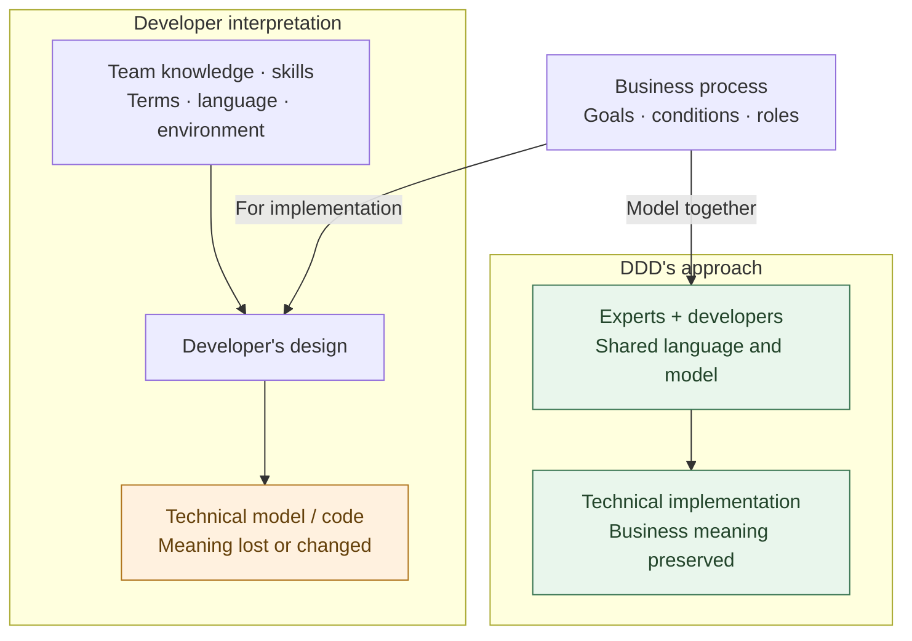
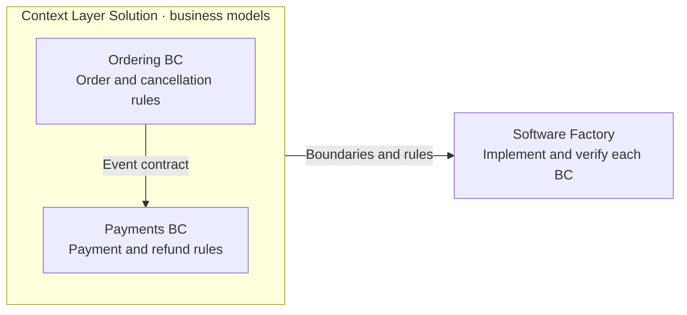
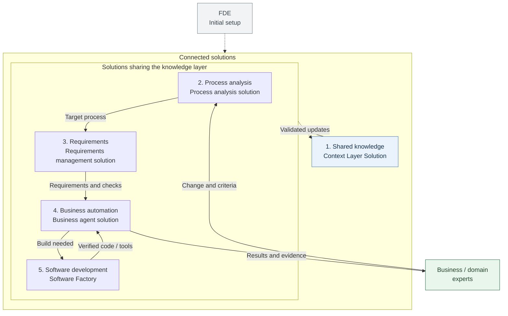
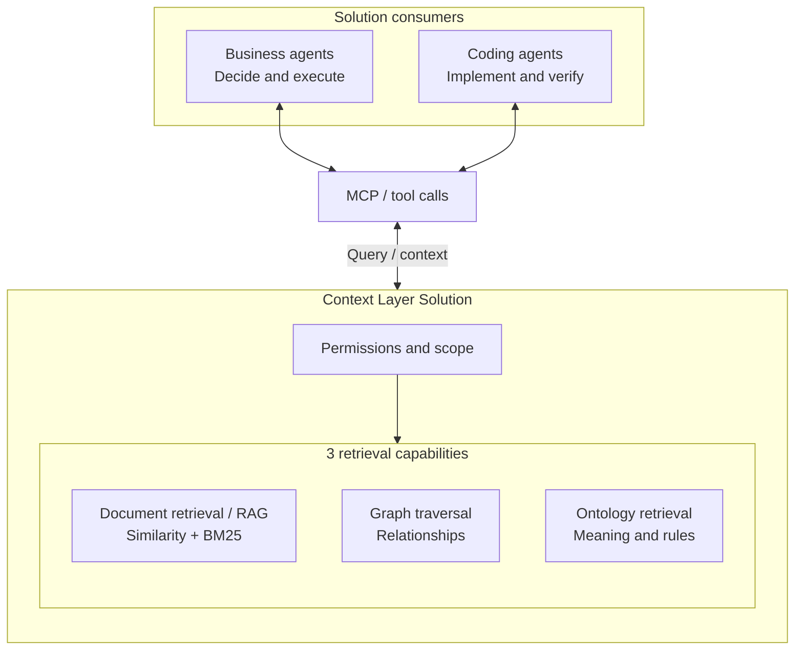
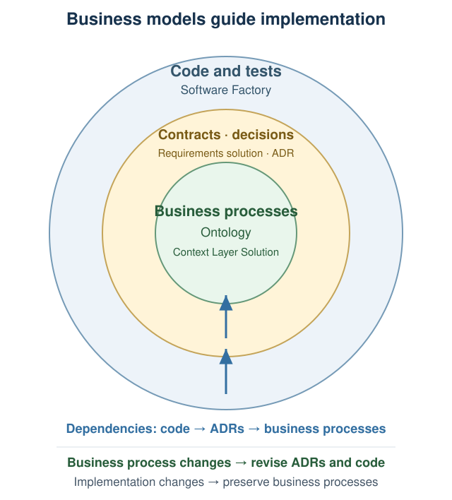
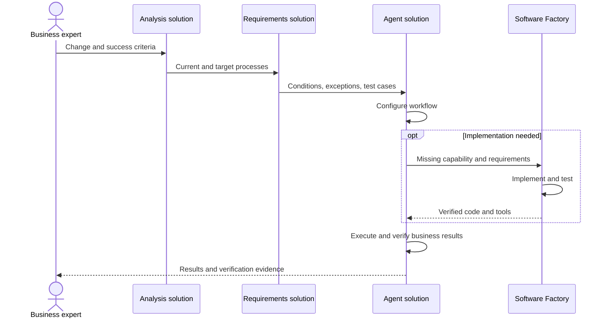
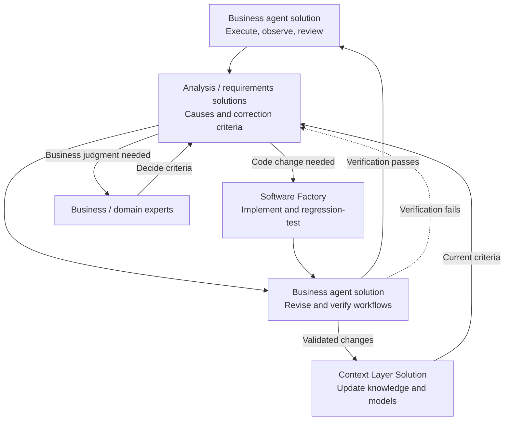

## TL;DR

- Enterprise AX should be built on reusable solutions.
- Business models keep business language and implementation consistent.
- Solutions at each stage should implement, verify, and improve the work.

## Introduction

AX (Agentic Transformation)—moving business work to agent-based systems—requires data connections, access controls, business knowledge, evaluation, and ongoing operations. When each team builds these capabilities from scratch, it repeats the setup work, and later changes can remain dependent on the technical specialists who built the first version.

**Enterprise AX should be built by providing and connecting reusable solutions at each stage.** Establish solutions for shared knowledge, process analysis, requirements, business automation, and software development, then configure the customer's business rules and processes on that foundation.

The solutions need to own change analysis, requirements updates, implementation, and verification so business requests can become operational changes without waiting for manual development.

In traditional software development, business processes were often recast to fit resource limits or technologies and structures familiar to the development team. If this changed their meaning or flow, business teams discussed the original work while developers answered in terms of the implemented system. Different interpretations of the same work made recurring conflicts likely.

Reducing this conflict requires the business language and rules agreed by business and development teams to remain intact in the implementation. **Keeping business models and implementation aligned in meaning**, a core principle of DDD (Domain-Driven Design), fits AX's aim of connecting business experts' intent to agent execution.

Agent-based business automation and self-improving agents can help put this model into practice and maintain it. When a domain expert who understands the rules and exceptions recognizes a business change and requests an update, agents should revise the workflow against the same business model. A Software Factory is the software development solution that carries the necessary code through implementation, verification, and delivery.

## 1. Business meaning and bounded contexts

Connect a Context Layer Solution that maintains business rules and boundaries with a Software Factory that implements and verifies those criteria in code.

### When technical structure changes the business process

Business processes are described through the goals, conditions, and responsibilities of customers and business teams. To turn them into software, developers translate the work into methods, data structures, and API calls. This introduces **a layer of developer interpretation and technical design** between the business and its code.

That interpretation is shaped by the team's domain understanding, skills, familiar terminology and programming languages, existing systems, and implementation environment. When technical structure is chosen without a shared business model to preserve, concepts and responsibilities may be regrouped, and important conditions or exceptions may disappear from the code.

For example, “refund approval” includes who may decide to return money and under which conditions. If that decision is spread across UI checks, generic status-update code, and database writes, understanding how the original process is implemented requires reconstructing its business meaning from those technical pieces.

DDD reduces this gap by having business experts and developers establish **a shared language with consistent meanings—Ubiquitous Language**, use it to build a business model, and keep design and code aligned with that model. The concept and conditions of “refund approval” retain the same meaning in business discussions, models, and code.





Developers still choose implementations suited to their language and execution environment, using the model agreed with business experts to check that concepts, conditions, and responsibilities remain intact in code.

### Defining boundaries of business meaning

A shared language also needs a defined scope. The same word, such as “complete,” can refer to different criteria in ordering and payments.

**A bounded context (BC) is the scope within which a business model's terms and rules have consistent meanings.** Ordering and payments have separate boundaries, with business meaning and implementation kept aligned inside each.





The payments BC handles an order-cancellation event according to its own approval and refund rules. Contracts between BCs define what information is exchanged and what it means, keeping order cancellation distinct from refund completion.

Organizational responsibilities and software components should reflect these boundaries. Several applications may implement one BC; the BC defines a boundary of business meaning. For more on terminology and context boundaries, see [Notes for DDD beginners](/2021/10/11/thoughts-for-ddd-starters.html) (Korean).

## 2. Connecting solutions to introduce AX

Enterprise AX should be built by providing and connecting a solution for each of the five stages below. An FDE (Forward Deployed Engineer) works with business teams to establish this foundation. **After the FDE leaves, business and domain experts should be able to maintain and improve their workflows on their own through these connected solutions.**





| Stage | Supporting solution | Information read and passed on |
| --- | --- | --- |
| 1. Shared knowledge | Context Layer Solution | Supplies business and implementation knowledge to every solution and incorporates validated changes |
| 2. Process analysis | Process analysis solution | Reads current work and passes target processes and affected areas to requirements management |
| 3. Requirements | Requirements management solution | Reads business rules and exceptions and passes requirements and verification criteria to automation and development |
| 4. Business automation | Business agent solution | Executes against business criteria, requests missing capabilities from development, and returns results to experts |
| 5. Software development | Software Factory | Reads business models and relationships among repositories and applications; supplies verified code and tools to automation |

Experts decide what work to change and how success will be judged. The connected solutions carry that decision through analysis, requirements, execution, and implementation. Business rules, implementation relationships, and verification evidence validated through execution and review return to shared knowledge as the basis for subsequent work.

For example, when refund approval conditions change, the analysis and requirements solutions read the current rules and ordering/payment relationships from shared knowledge to determine impact and verification criteria. Business agents and the Software Factory use those criteria to revise the workflow and any required code, then return results to experts. The confirmed rules and implementation relationships remain in shared knowledge so the next change starts from the same criteria.

A team that has already mapped processes with business experts can use that work to identify the data it needs. Automating process analysis itself requires readable sources and access first. Either way, shared knowledge is difficult to postpone.

### How AWS and Palantir FDEs build on reusable solutions

Public AWS and Palantir materials describe how customer-specific work is implemented on shared technical foundations.

AWS describes deploying a semantic layer connecting business meaning to data in the customer's account and letting agents use a governed, versioned knowledge graph. The graph, runbooks, and architecture documentation remain with the customer, with customer engineers progressing from co-builders to independent operators.[^1]

Its partner guidance identifies a reusable **harness** of business knowledge, tools, and checks. Partners accumulate ontologies, evaluation frameworks, external-tool connections, agent operations capabilities, and design records for use in later engagements.[^2]

Palantir provides Foundry for data and business models, AIP for agents and AI workflows, and Apollo for deployment and infrastructure. FDEs work with customers to build capabilities on this foundation.[^3] The Ontology at its center connects business objects and relationships with actions and functions, carrying business meaning into executable logic.[^4]

The common pattern is **combining a reusable technical foundation with each customer's business model**. Using shared capabilities still requires a design that preserves the meaning of customer-specific rules in both the model and implementation.

## 3. Shared knowledge for business and coding agents

AX requires agents to find business documents, relationships between processes, and implementation knowledge spread across repositories and applications. **A Context Layer Solution is needed to manage this knowledge and supply the context each task needs.**

The solution contains document retrieval for RAG (Retrieval-Augmented Generation), graph traversal for relationships, and ontology retrieval for business concepts and rules. Business and coding agents access it through MCP or tool calls. MCP (Model Context Protocol) connects agents to external data and tools.





The solution applies the caller's permissions and business scope before retrieval, then returns context with provenance and version information. **Solutions at every stage use this interface to read the same business criteria and contribute validated changes.**

### Three ways to retrieve knowledge

**Document retrieval and RAG** find evidence in business documents, meeting notes, and design records and use it in a task. Hybrid retrieval combines similarity search with BM25, which ranks documents by matching terms. This covers both different expressions of the same meaning, such as “I want my money back” and “refund request,” and exact terms such as product codes.

**Graph traversal** follows recorded relationships to find connected entities. Following events passed between refund processes, API calls made by a payment application, or dependencies between repositories helps identify where a change may have an effect.

**Ontology retrieval** finds the business meaning of concepts and relationships, along with applicable rules and exceptions. It makes explicit what “cancellation completed” in ordering and “refund completed” in payments mean and when each holds, so agents do not have to reconstruct the business criteria from document fragments each time.

These capabilities work together. Graph traversal provides a way to follow connections, while an ontology defines what those connections and concepts mean. Information retrieved from a graph or ontology can also feed RAG.

### Serving two types of agents

**Business agents** primarily need business knowledge and rules. To handle a refund request, they must read customer and order state, approval conditions, processing steps, and exceptions to determine which actions the business permits.

**Coding agents** need those same business criteria plus the knowledge required to implement them. They need to know which project's repositories to change, how applications connect through APIs and events, and which contracts and tests must hold.

Both types of agents should share business concepts and rules while retrieving the scope relevant to their work. Business agents may need application relationships, and coding agents must also consult the ontology for business meaning.

The Context Layer Solution manages ownership, provenance, versions, and permitted use, applying role- and business-scope access controls before retrieval. Business teams decide the meaning and permitted use of rules; platform teams ensure those decisions govern actual access by agents and external solutions.

### Navigating business knowledge in layers

Ontology retrieval does not require a graph database. Business knowledge can be written in a text format such as Turtle, with routes from an overview into the required detail.

First show each BC's responsibilities and core work. Agents can then find rules and exceptions inside relevant BCs.

When agents can read an overview and decide where to look next, they can narrow the scope before reading details instead of taking in material from across the enterprise at once. Retrieving details only from relevant areas reduces unrelated context as business knowledge grows.

For this to work, each overview must be accurate enough to guide the next retrieval step. Exceptions omitted from an overview must still be available in detailed rules and original sources.

This 3D view in the [ontology tool](https://github.com/haandol/alps-writer-plugins) shows the “Expression dictionary” BC of [EncBird](https://www.encbird.com), an English learning app. It shows how expression registration, expansion, and dictionary management relate to conversations, podcasts, and review.[^5]

This information provides **a bird's-eye view of where the current work sits in the overall learning process and how it connects to other work**. Just as a person explores relationships in the 3D view, an agent can read the processes and conditions in the same model to understand what comes before and after.

Suppose the request is, “Make it easier to register expressions from a podcast.” The agent can follow the relationships from collecting suggested expressions through learner selection and registration checks to review and learning-activity records.

That reveals concrete considerations: whether registration still requires the learner's approval, whether an already registered expression is charged again, and whether successful registration feeds review and learning records. Starting with the overall relationships narrows the scope before the agent reads each process's rules and exceptions, making the relevant conditions easier to identify.

### Separating business meaning from implementation responsibilities

**Place business processes at the highest level of abstraction, with the feature contracts and code that realize them below.** The ontology expresses business flow, responsibilities, and hand-off rules. ADRs (Architecture Decision Records) capture the contracts and design decisions each feature must follow to realize that work. Code and tests implement and verify those contracts.[^6]

The Context Layer Solution supplies the business model. The requirements management solution turns it into feature-level inputs, outputs, conditions, exceptions, and verification criteria. The Software Factory uses those contracts to produce code and tests and check that actual results satisfy the business criteria.

{: .diagram-image }

Just as [Clean and Hexagonal Architecture](/2022/02/13/demystifying-hexgagonal-architecture.html) (Korean) protect domain logic from implementation details, this structure protects the layer that expresses business processes. Keep code paths, class names, and libraries out of the ontology, and link lower-level features to the business steps they realize. Code can then be reorganized without requiring changes to the business model.

For example, replacing a separate payout operator with automatic payment after refund approval changes the responsibilities and hand-offs in the ontology. The requirements management solution updates the affected feature contracts and verification criteria, and the Software Factory must revise the payment code and tests.

By contrast, replacing database storage or an API client library while preserving the same refund process calls for the Software Factory to change the implementation and verify the existing contracts. **A code change alone does not require changing the higher-level business process.** The business model remains in the expert's language, while solutions improve the implementation within those criteria.

## 4. Solutions that turn business changes into execution

Process analysis, requirements management, business agents, and the Software Factory each own a part of the work below. Every solution reads the same business criteria from the Context Layer Solution and passes its results to the next stage.





### Process analysis solution: finding current and target work

The process analysis solution uses shared knowledge and business-expert explanations to describe the current process (As-Is) and design the target process for agents (To-Be). It gathers events, rules, exceptions, and responsibilities, as in agent storming or [Event Storming](/2020/12/10/demystifying-event-storming.html) (Korean), and proposes what to automate and which connections to change.

For refunds, it analyzes how support intake, order-team shipping checks, and finance approval connect. Experts decide the conditions and authority for agents to act and the exceptions people retain. The result becomes input to the requirements management solution.

### Requirements management solution: defining change and verification criteria

Given “Refund orders canceled before shipping without separate approval,” the requirements management solution checks the shared meanings of shipping, cancellation, approval, and refund. It defines the necessary data, inputs and outputs, allowed conditions, exceptions, and cases with expected results, then passes them to execution and development solutions.

Experts judge business meaning and success criteria. The solution maintains those decisions as implementation contracts and verification cases, updating affected requirements and cases when the business criteria change.

### Business agent solution: configuring, executing, observing, and improving work

The business agent solution connects agents, tools, and permissions into workflows that satisfy the requirements. It executes them, checks inputs, outputs, business rules, failure handling, and results, and records execution. Missing capabilities are requested from the Software Factory with their business criteria.

Self-improving agents use execution and review findings to change the order of steps, revise instructions, and adjust tool use, then verify the changes. The solution needs this capability to turn operational findings into improvements to subsequent runs.

### Software Factory: implementing and integrating missing capabilities

The Software Factory reads business models, implementation contracts, and repository and application relationships to produce code, tools, and tests. It integrates them for use by the business agent solution and returns **evidence of which business conditions were implemented and what was verified**.

[Software Factory evaluations](/en/2026/10/05/software-factory-evals-and-tension-metrics.html) must check business conditions as well as code generation. The solution must own implementation, verification, and integration so subsequent business changes can proceed without waiting for manual development work.

## 5. Solutions that turn operational results into improvements

The business agent solution collects execution and session records and evaluates results. Analysis and requirements solutions use that evidence to identify causes and define correction criteria. The business agent solution revises and verifies workflows; the Software Factory handles code and tools.

Where business criteria are established, the solutions continue improving against them. When a new policy judgment is needed, they return the evidence to experts. Business meaning and verification criteria must not be changed merely to accommodate the code.





Both final results and stored knowledge need checking. Source retrieval may produce a correct answer while an incorrect ontology rule remains available to the next run. Reflecting verified business rules, implementation relationships, and execution evidence in the Context Layer Solution gives every solution an updated basis for its work.

### Moving decision authority and verification responsibility together

This flow also requires organizational change. Domain experts accountable for the business model and its outcomes need authority over changes and responsibility for verification. Platform and technical teams should own the shared execution foundation and its access, verification, and recovery standards.

| Role | Responsibility |
| --- | --- |
| Domain experts | Recognize business changes, decide rules and outcome criteria, verify results |
| Platform and technical teams | Operate reusable execution, access, verification, and recovery capabilities |
| FDEs | Establish initial models and adoption; enable business teams to change and verify their work |

When several departments participate in one process, they need shared completion criteria and agreement on change ownership. Moving people without changing decision authority or evaluation criteria leaves teams waiting for one another's judgments.

If the common platform team builds every business-specific feature, growing demand puts teams back in its queue. [Internal FDEs](/en/2026/09/03/developers-to-internal-fde.html) can help establish the system, but should enable business teams to continue changing and verifying their work afterward.

### Checking with one business change

Use an actual business change to check whether the system can handle it without technical specialists reinterpreting the request. When a refund policy changes, check whether the domain expert can request the new conditions in business terms and verify the system's changes through business scenarios.

Include the time experts spend explaining and checking results alongside processing time, failures, and rework. If every change still requires an FDE or developer to reinterpret the request, some execution may have been automated while the dependency for changes and maintenance remains.

## Conclusion

The ideal outcome of AX is **a system whose business processes, organizational responsibilities, and implementation follow the same business model, with implementation details managed autonomously within those criteria**.

If business experts must learn the solution's technical interpretation after an FDE finishes the build and leaves, they have inherited work previously handled by developers. They need to be able to request changes and judge results in their own business terms.

**Provide and connect solutions for knowledge, analysis, requirements, automation, and development.** Experts judge business direction and results; solutions carry those decisions into implementation, verification, and improvement. Organizational authority and responsibilities should enable experts to lead this flow.

[^1]: AWS, [AWS invests $1 billion to embed AI forward deployed engineers with customers](https://www.aboutamazon.com/news/aws/aws-1-billion-forward-deployed-ai-engineers), June 30, 2026. Describes the customer-account semantic layer, knowledge graph, and customer engineers' progression toward independent operation.
[^2]: AWS Partner Network Blog, [Introducing Forward Deployed Engineering for Partners](https://aws.amazon.com/blogs/apn/introducing-forward-deployed-engineering-for-partners-winning-the-future-of-enterprise-ai/). Describes the partner-owned, reusable harness of ontologies, evaluation, tool connections, and agent operations.
[^3]: Palantir, [Integrated platforms: AIP, Foundry, and Apollo](https://www.palantir.com/docs/foundry/architecture-center/platforms). Describes the standard platforms, customer-specific customization, and FDEs.
[^4]: Palantir, [Ontology building](https://www.palantir.com/docs/foundry/ontology/overview). Describes the operational layer combining business objects and relationships with actions and functions.
[^5]: [3D view in the business ontology tool](https://github.com/haandol/alps-writer-plugins/tree/main/plugins/ontology-writer). The “Expression dictionary” BC generated from EncBird's business model. Screenshot labels were translated into English for this version.
[^6]: [Ontology layer responsibilities and change direction](https://github.com/haandol/alps-writer-plugins/blob/main/plugins/ontology-writer/references/ontology.md). Defines separate responsibilities for business ontology, ADRs, and code: business changes propagate to implementation, while code refactoring leaves the business model unchanged.
