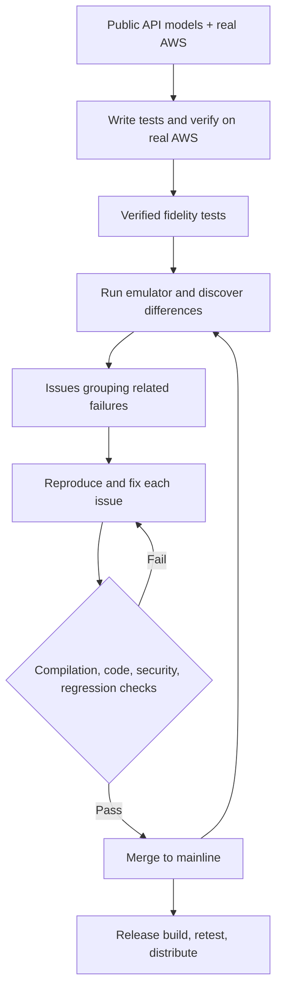

## TL;DR

- Find product-market fit at L2 before expanding automation.
- Turn verified failures into the next development tasks.
- Package execution, evaluation, and recovery as a reusable solution.

## Introduction

AI already writes most of the code in many products. But if a person still has to find and assign every problem worth fixing, the product does not keep improving while that person is away.

In [an earlier post](/en/2026/10/05/software-factory-evals-and-tension-metrics.html), I described a Software Factory as a system that connects implementation, verification, and operational results to the next improvement. It needs evaluations that distinguish better results from different ones, along with tension metrics that reveal whether other aspects of quality deteriorate as the target metric rises.

What order should we build such a system in? I think we should **start with people choosing problems and success conditions while AI implements and verifies them, then expand automation after establishing the product's value**.

AWS Emulator is a useful example. It reproduces AWS APIs locally for development and testing, and grew from a small prototype into an automated development system connecting test creation, issue discovery, and fixes.[^1] This post examines that published structure and turns it into a runbook for building a factory around our own products.

## 1. Decide what to automate

The percentage of AI-written code says little about the scope of automation. Executing a task, discovering the next problem, and improving the development system itself are different responsibilities.

L1 through L5 below are informal categories for this article. They describe the decisions and actions delegated to AI, rather than performance grades assigned to products or companies.

| Level | Scope of automation | What people prepare or decide |
| --- | --- | --- |
| L1 · Coding assistance | Writing requested code | Task breakdown, execution, checking results |
| L2 · Autonomous task execution | Designing, implementing, testing, and fixing toward a given goal | The problem, success conditions, execution environment, outcome judgment |
| L3 · Development pipeline | Taking work from a queue through verification and merge | Work selection rules, execution and merge policies, exception handling |
| L4 · Product improvement loop | Discovering problems through evaluation, creating tasks, fixing, and reevaluating | Product purpose, evaluation criteria, permitted scope, operational accountability |
| L5 · Recursive improvement of the development system | Autonomously choosing goals, methods, and verification for improving the AI's own development capabilities | Higher-level purpose, control boundaries, independent verification, accountability |

Automating production deployment does not by itself make a system L5. L4 improves a product within a defined purpose. L5 also makes the capabilities of the AI system building that product a target for improvement. In “When AI builds itself,” Anthropic explains that AI has not yet reached the point of fully autonomously designing and developing its own successor.[^2]

**Increasing autonomy requires substantial human time and effort outside the development loop to find and correct its failures.** A loop built from agents is effectively a black box if we see only its inputs and final outputs. Those endpoints do not reveal what information it read, which tools it ran, or where an incorrect result was passed to the next stage.

For example, when an agent reports that tests passed, we need to distinguish between a required test being skipped and a failed result being treated as success. If the same fix keeps repeating, the cause may lie in the loop itself: it may lose the previous execution's results or interpret an unchanged state as progress. These are failure modes to investigate alongside defects in the product code.

Doing so requires connecting each stage's inputs, tool calls and responses, state changes, evaluation results, and termination reasons into a single execution record. The model, instruction, and code versions must also be recorded so the failed path can be traced. Building observability—the ability to understand internal behavior through such records—with this level of detail is itself necessary work.

People then use those records to narrow down the cause, preserve the reproduced situation as an evaluation case, and change the loop's instructions, tools, verification, or stopping conditions. They must rerun the situation to check that the revised loop behaves correctly. As more stages are automated and runs grow longer, combinations of failures and handoffs between stages also need investigation. The system for observing and repairing the loop therefore needs further investment.

This foundation needs to become reliable before it can reduce repetitive human work. Attempting full automation before knowing whether customers want the product means spending time debugging the development loop before testing the product hypothesis. That is why I would establish the product's value at L2 first, then expand automation around recurring work while building the observation, evaluation, and recovery it needs.

## 2. What loop did AWS Emulator build?

### It started by testing the usefulness of a small implementation

AWS's Matthew Goldberg began by asking Kiro to do three things: write tests based on the AWS CLI, refine them until they passed against real AWS, and build an in-memory implementation that passed those same tests.[^1]

According to the official account, a first implementation of Amazon SQS, a service for sending and receiving queued messages, arrived in about 15 minutes. Goldberg expanded the scope over the weekend, and the team began using it for testing on Monday. The author also explains that turning it into a product suitable for customers required substantial further engineering.

I think that sequence matters. A small product proved useful before the team invested in a system for improving it repeatedly.

### There was somewhere to check the correct behavior

AWS Emulator had public API models describing inputs, outputs, and errors, as well as live AWS services against which to check behavior. The team could derive test scenarios from the models and compare the emulator against results verified on real AWS.[^1][^3]

This behavioral agreement is called fidelity. For example, SQS has a visibility timeout that temporarily hides received messages from other receivers. A test needs to check this state transition, not just that a message was sent.[^3]

Automation benefits from being able to ask **whether the same scenario behaves like the reference system**, instead of whether the agent produced something plausible.

### It connected three roles through a merge gate

AWS divided the work among three teams of agents.[^1]

| Role | Work | Output for the next stage |
| --- | --- | --- |
| Test writing | Derive scenarios from API models and verify them against real AWS | Fidelity tests grounded in observed AWS behavior |
| Issue discovery | Replay tests against the emulator and group failures by likely cause | Issues containing related failures and a cause hypothesis |
| Issue fixing | Reproduce one issue and change the code | A change ready for merge checks |

Changes go through compilation, coding-standard checks, security review, and fidelity regression checks. A failed check sends the change back to the fixing agent. Passing all checks allows it to merge into mainline, the development baseline. Merged changes are built and tested again in the release pipeline before distribution.





The GitHub repository records open problems in `issues/things-that-do-not-work` and resolved ones in `issues/things-that-now-work`. The agents' primary repository, however, is in CodeCommit. Code is published to GitHub at the end of the release process. Cloning the public repository does not reproduce the entire development system.[^1]

The idea to carry forward is **a structure in which verified differences become the next fix tasks**. The following sections propose a way to build that structure for a product.

## 3. Start at L2: implement one product hypothesis

The first input is the job a user needs to finish. Product-market fit, or PMF, means the product fits market demand well enough to be chosen repeatedly. While searching for it, we need to change what we build quickly and inspect actual usage.

An AWS Emulator-style starting point could be “let a team developing an SQS worker run message-processing tests without a cloud deployment.” A factory supporting every AWS service is unnecessary at this point.

Before assigning the task, write a one-page brief.

```text
User: A team developing an SQS-based worker
Problem: Checking a small change requires preparing a cloud environment.
Initial scope: Create queue → send message → receive → delete
Success: The team's representative test runs locally.
Required condition: State does not leak between tests.
Demand to check: Does the team use this tool again for its next development task?
Excluded for now: Other AWS services, automatic issue discovery
```

Give the agent this goal, the relevant code, execution instructions, and success conditions. Delegate implementation, testing, and fixes. People judge whether the result is useful in real work and what to tackle next, rather than continually steering each implementation step.

Even at this stage, basic tests, restricted access, and a way to undo changes are necessary. What L2 postpones is the infrastructure for large-scale autonomous operations.

**The evidence for moving forward is repeated use and repeated work.** Check whether the same users return and have a reason to pay for the product or incorporate it into their workflow. Repeated fixes and verification tasks then reveal concrete opportunities for automation. If the product hypothesis keeps changing, it is better to continue exploring at L2.

The outputs are a working product, real usage feedback, and a list of recurring development tasks. Generated code volume or PR counts cannot substitute for these without a connection to product usage.

## 4. Build the evaluation foundation: make improvement observable

To fix a problem automatically, we need to reproduce it under the same conditions. A small evaluation system belongs at L2; its coverage expands toward L3 and L4.

Borrowing the AWS Emulator approach gives us this sequence:

1. Choose a scenario that users actually perform.
2. Use API models and documentation to define inputs, outputs, and exceptions.
3. Run it against the reference system to establish the expected result.
4. Make the same scenario repeatable against the product.
5. Record both the product version and the evaluation version.

For example, choose an SQS FIFO queue, which preserves ordering, and send messages A and B in order within the same message group. Configure each receive to return at most one message. After receiving A, check that B is not returned while A remains undeleted and its visibility timeout has not expired. After deleting A, B should become receivable.[^10]

Since results depend on time, the test must define its waiting conditions and treatment of timing tolerance. Preserve the queue type, message group, and receive batch size in the reproduction inputs too. Standard queues can deliver duplicates, so the same delivery guarantees must not be assumed for every queue type.[^10]

For values that change on every run, such as request IDs or resource names, define what meaningful comparison looks like. Do not exclude message bodies, error types, or state transitions that determine user-visible behavior. Preserve the original results alongside comparison rules so that disappearing failures can be explained.

When establishing the baseline on real AWS, use a separate test account, permitted services, a spending limit, and a process for cleaning up created resources. Making verified tests locally repeatable, as AWS describes, avoids cloud calls and their associated cost and delay on every fix iteration.[^1]

If there is no reference system, start with business rules and expert-checked examples. An English-correction product, for instance, should check execution success separately from meaning preservation: “I might visit Busan” must not become “I visited Busan.” If contextual judgments use a model grader, compare it with human judgments and retain separate examples that were not used to develop the fix.[^4]

This stage is complete when **the same failure can be reproduced and the baseline and candidate can be compared under the same criteria**. Tests sometimes need correction too, but that change path must be separate so a product-fixing task cannot quietly lower the standard.

## 5. Expand to L3: finish one task end to end

Once recurring work and verification methods exist, build the path that completes one human-selected task. Automating discovery comes afterward.

### Hand over an executable task

An issue needs more than a title: it must explain what to reproduce and how far the fix may go. Continuing the SQS example:

```yaml
id: sqs-visibility-001
goal: "Do not deliver the next message in a FIFO group while its predecessor is being processed."
evidence:
  scenario: "Send A and B in one group → receive only A → receive again before deleting A or timeout expiry"
  expected: "B is not returned yet."
  actual: "B is returned prematurely."
  attachments: "Reproduction inputs, logs, product and test versions"
scope: "SQS message receiving and visibility state handling"
acceptance:
  - "The failure reproduced before the fix is resolved afterward."
  - "Deleting A makes the next message, B, receivable."
  - "Existing required tests pass."
protected: "Evaluation criteria, merge policy, credentials, other services"
on_blocked: "Preserve execution records and the blocker, then return to the owner."
```

This illustrates the task handoff format. A working solution must store concrete evidence locations, the baseline commit, and the evaluation version.

### Provide an execution environment and termination conditions

Give each task its own code workspace and test data. Let the agent run the product and read its logs without mixing files or state with another task.

OpenAI invested heavily in this in its Harness Engineering case. Each task could run an isolated application, with UI, logs, and metrics accessible to the agent. That foundation enabled delegation from bug reproduction through implementation, verification, PR creation, review responses, and merge. The case concerns a separate internal product developed with Codex.[^5]

The solution also needs to manage task states and their transition conditions.

| Current state | Condition to check | Next state |
| --- | --- | --- |
| Ready | Reproduction evidence, success conditions, and edit permissions are available | Running |
| Running | The change and local verification are complete | Verifying |
| Verifying | Separate verification confirms the original failure is fixed and checks regressions | Awaiting merge |
| Awaiting merge | Checks and approvals are valid for the current change, and integration with the latest baseline passes verification | Merged |
| Any active state | Budget exhaustion, repeated lack of progress, missing permission, or conflicting criteria | Stopped |

Completion is recorded from results confirmed by a separate verification process. The fixing agent's report alone cannot set it. Missing or timed-out required checks block merging. Keep evaluation criteria and merge policy outside the fixing agent's write permissions, and enforce required checks and approvals through repository protection rules.

Failed verification returns the work for another fix within the remaining budget. Reaching a budget or retry limit stops execution with the failure evidence preserved. Exhausting the limit never counts as passing.

An orchestrator such as Symphony can coordinate the work. An orchestrator assigns pending tasks and manages execution state. Symphony connects Linear issues to isolated workspaces, restarts stalled execution, and respects dependencies between tasks.[^6]

Resuming must begin by checking the last execution record and current state. Link task IDs to change IDs so a restart does not create duplicate PRs or attempt to merge completed work again. If parallel tasks change the same files, verify their combined result against the latest code.

Start with one task. Increase concurrency only after demonstrating that stopping and resuming does not duplicate changes and that failed verification cannot mark a task complete. **The output of L3 is completed work with verification evidence.**

## 6. Expand to L4: let evaluation failures create work

Some issues that people used to write can now be generated from evaluation results. This is the role of AWS Emulator's issue-discovery team.

I would connect a discovery component in this order:

1. Run verified scenarios against a specific product version.
2. Separate product defects, test defects, and execution-environment failures.
3. Reproduce product defects and group failures that share a cause.
4. Deduplicate them against existing issues.
5. Route them to the automatic work queue or request judgment based on impact and permitted scope.

If one visibility-timeout defect breaks several tests, do not send each failure to a separate fixing agent. That could produce competing changes to the same code. Conversely, missing permissions in the test account are no reason to change the product code.

Nor does every discovery need to become an automatic fix immediately. Initially, the queue might accept only reproducible differences in SQS behaviors already committed for support. People can still decide whether to add a new service or change product policy. Within the permitted scope, the system can choose work using usage frequency, failure impact, and recurrence.

First run discovery alone and have people assess its proposed issues. Check the share of real defects, duplicate work, and missed failures before enabling limited automatic fixes. If the queue later grows faster than work is completed, reduce new assignments and investigate why existing work is stuck.

The key performance indicator, or KPI, should focus on fewer failures in user scenarios rather than the number of issues closed. For an emulator, track behavioral agreement on the same evaluation set, alongside regressions in previously passing behavior and the cost of fixes. Record the effects of expanding test coverage separately from improvements to existing behavior.

**The condition for reaching L4 is that a discovered failure proceeds through fixing and verification without another human instruction.** Evaluation criteria and required product conditions must remain intact, and unresolved problems must retain their evidence.

## 7. Connect production: verify merging and releasing separately

Even when the code-improvement loop works, delivering changes to users requires its own verification path. AWS Emulator itself builds and retests accumulated changes in a release stage after mainline merging.[^1]

AWS Emulator is a development and testing tool, with explicit restrictions against using it for production workloads or security testing.[^7] Passing emulator tests therefore cannot establish that our product's real cloud permissions, networking, or performance have been verified.

Connect the following to the release path:

| Preparation | Procedure | On failure |
| --- | --- | --- |
| Change risk and approval policy | Classify defined high-risk areas, including permissions, payments, and data changes | Wait for required expert judgment before release |
| Real-environment verification | Check permissions, integrations, and key user journeys in staging | Return reproducible evidence to the fix queue |
| Limited rollout | Start with internal users or a subset of traffic | Stop expansion when criteria are violated |
| Observability and recovery | Compare errors, latency, and business outcomes with the previous version | Disable the feature, restore a prior version, and notify the owner |

Assign an owner, a baseline version, an observation window, and an allowed deterioration threshold to each relevant check. For example, a service might stop rollout expansion when its response-time commitment is violated, and immediately disable a feature after even one unacceptable event such as a duplicate charge. Do not start automatic releases with these criteria unspecified.

Recovery may require more than restoring an old code version. Messages already sent to external systems and changes already made to data remain. Include these operations in the automation scope only after practicing duplicate prevention and data recovery or corrective procedures.

The Claude Code team at Anthropic combines risk-based human approvals with a merge queue that checks integration against the latest main, gradual releases, and fast recovery. Past incidents become expert-verified evaluation cases used to test the reviewer again.[^8] It is a useful example of investing in detection and recovery before reducing approvals.

Failures found after release return to the discovery path in Section 6. During an incident that continues to affect users, however, recovery comes first. Do not delay recovery while waiting for an automatically generated fix.

## 8. Improve development methods: separate the loop that changes the factory

Repeated product development also accumulates failures in the development process. Agents may keep skipping a particular test, reviewers may label correct code as defective, or retry costs may keep rising for the same kind of task.

The harness—the instructions, tools, execution environment, and verification procedures used by the agents—can now become an improvement target too. This is a bounded practice in the direction of L5. A few automatic harness changes do not establish that an AI can autonomously develop its own successor.

I would operate the product-fixing loop separately from the loop that changes development methods:

1. Collect failed development tasks and correctly completed tasks into an evaluation set.
2. Propose instruction or tool changes based on missed checks or mistaken reviews.
3. Run the baseline and candidate harnesses on the same task set.
4. Compare success rates, missed defects, false findings, cost, and human intervention.
5. Version verified candidates and apply them to a limited set of tasks first.

If SQS fixes repeatedly skip the visibility-timeout test, propose an instruction requiring that test when receiving logic changes. Also check whether the new instruction makes unrelated service tasks run unnecessary full test suites and raises their cost. Successful tasks belong in the evaluation set so changes that break previously reliable work can be detected.

Treat proposed evaluation changes more strictly. Reevaluate the baseline product and harness under the new criteria, and check that historical failure cases have not disappeared. The fixing agent must not change the criteria judging its work or the approval policy as part of the same task.

Keep higher-level product purpose, required conditions, and permission expansion on a separate decision path. Progressively automating metric selection and target adjustment also requires a way to verify that those decisions reflect the purpose. The KPI-management automation discussed in the earlier article requires these additional loops.

This stage is worth starting when recurring product demand and the volume of development work justify its cost. An eventual L5 ambition does not require building the entire evaluation and control system before finding PMF.

## 9. Package the process as a reusable solution

If one developer has to coordinate these procedures manually in a terminal, every new team will depend on that person. **A Software Factory should be delivered as a solution that accepts work, executes it, evaluates and recovers as needed, and returns evidence.**

In the [enterprise AX article](/en/2026/11/05/enterprise-wide-ax-essentials.html), I argued for reusing common technical foundations and configuring business experts' rules and processes on top. The same boundary works for a Software Factory.

| Reusable solution capability | Product- or business-specific input |
| --- | --- |
| Task intake, state, deduplication, and retries | Which problems may be handled automatically, and their priority |
| Isolated agent execution, permissions, and budgets | Repositories, execution instructions, accessible data |
| Evaluation execution, comparison, and evidence storage | Business rules, scenarios, required conditions |
| Merging, releasing, observation, and recovery | Risk policy, real-environment checks, recovery criteria |
| Versioning and comparison of development methods | Product-specific failure cases and permitted improvement scope |

These capabilities do not need to be five separate products. Initially, connect existing coding agents, issue tracking, CI, and deployment tools to deliver one task's complete workflow. Keep shared capabilities in that integration so the next product can adopt it by changing business criteria and execution settings.

### The three companies offer different lessons

Their published cases become easier to compare when placed along this construction sequence.

| Published case | Where it invested as automation expanded | When to borrow the approach |
| --- | --- | --- |
| AWS Emulator | Tests verified on real AWS, issue discovery and fixing, merge checks | When continually reducing differences from reference behavior |
| OpenAI's internal product and Symphony | An environment agents can inspect and execute, issue-based work orchestration | When people are overwhelmed by managing development sessions |
| Anthropic's Claude Code team | Feedback use, risk-based review, staged releases and recovery, reviewer evaluation | When verifying and shipping generated changes becomes the bottleneck |

OpenAI also runs recurring cleanup tasks that discover code problems, and Symphony agents can create follow-up issues.[^5][^6] Anthropic automates customer-feedback summaries and puts prototypes in front of internal users before acting on feedback.[^9] Issue discovery is not unique to AWS.

The AWS case clearly documents a loop that turns differences from a reference system into development work. OpenAI and Anthropic offer concrete ways to remove bottlenecks in task execution and organizational verification. Turning those distinctions into fixed company-wide L2, L3, or L4 grades obscures what we can actually reuse.

Choose components by the same logic. If the product problem is unclear, spend more time learning from users at L2. If execution repeatedly stalls, improve the harness and orchestration first. If verification and release are backing up, strengthen review and recovery, then connect discovery for failure types that can already be handled reliably.

Finally, have another owner execute the same work. They should be able to diagnose failures, resume interrupted tasks, and undo a bad release without the original builder. Business experts should be able to change their rules and judge the results without having to reinterpret the technical integration.

## Conclusion

EncBird and PixelBank, the services I run, operate primarily at L3 under this article's definitions, with some workflows at L4. Incident response is one of them.

When an incident alarm arrives from CloudWatch, Amazon Bedrock AgentCore Runtime provides the environment for running Codex. A single Codex session analyzes the incident, changes the code, reviews the change, and creates a PR. Simple bugs or bugs requiring urgent fixes are deployed right away.

Running this workflow in the default Lambda execution environment would mean accounting for the 15-minute maximum duration of a single invocation.[^11] If incident analysis, code changes, review, and PR creation take longer, the work needs to be split and intermediate state carried forward. At the current scale of these two services, a single Codex session on AgentCore Runtime can handle the workflow without dividing it into smaller stages.

This incident-response workflow connects the step where a person would otherwise read the alarm and separately assign a fix. It is an L4 flow in which operational results generate the next development task. Just as AWS Emulator turns observed differences in behavior into fix tasks, operational alarms start the improvement loop here.

**I think a Software Factory should fit the current product and the scale of its recurring work.** Build the product and find PMF at L2, then expand automation around actual needs while establishing observation, evaluation, and recovery. Preserve the verified execution foundation as a reusable solution so the next product does not have to repeat the same setup.

[^1]: Matthew Goldberg, [How we built the agents that built AWS Emulator](https://www.aboutamazon.com/news/aws/how-autonomous-ai-agents-built-aws-emulator), November 11, 2026. Describes the initial experiment, three agent teams, merge checks, and release structure.
[^2]: Anthropic, [When AI builds itself](https://www.anthropic.com/institute/recursive-self-improvement). Distinguishes automation in AI development, limitations in goal selection, and recursive self-improvement.
[^3]: Swami Sivasubramanian, [AWS Emulator and the engineer's job when agents write the code](https://www.allthingsdistributed.com/2026/11/aws-emulator-and-the-engineers-job-when-agents-write-the-code.html), November 11, 2026. Explains the use of API models and real AWS as references, and the engineer's role.
[^4]: [How Do You Evaluate an AI That Remembers Users? — EncBird's Memory and Conversation Evaluations](/en/2026/10/05/evaluating-new-agent-applications.html). Covers comparing evaluation inputs and expected conditions with actual execution results.
[^5]: Ryan Lopopolo, OpenAI, [Harness engineering: leveraging Codex in an agent-first world](https://openai.com/index/harness-engineering/), February 11, 2026. An internal product built with Codex, including its execution environment and verification and maintenance automation.
[^6]: OpenAI, [An open-source spec for Codex orchestration: Symphony](https://openai.com/index/open-source-codex-orchestration-symphony/), April 27, 2026. See also the [public repository](https://github.com/openai/symphony).
[^7]: AWS, [AWS Emulator README](https://github.com/aws/aws-emulator). Defines its development and testing purpose and restrictions on production and security-test use.
[^8]: Addy Osmani, Morgan Westlee Lunt, Qing Wang, [How the Claude Code team does code review](https://claude.dev/blog/solving-code-review-at-anthropic/), October 15, 2026. My [earlier summary](/en/2026/10/19/how-anthropic-reviews-ai-generated-code.html) examines review, approvals, recovery, and evaluation in more detail.
[^9]: Fiona Fung, [Running an AI-native engineering org](https://claude.com/resources/articles/running-an-ai-native-engineering-org). Covers prototype-driven planning, feedback summaries, and human expertise.
[^10]: AWS, [Amazon SQS visibility timeout](https://docs.aws.amazon.com/AWSSimpleQueueService/latest/SQSDeveloperGuide/sqs-visibility-timeout.html). Explains possible duplicate delivery in standard queues and the processing conditions for FIFO message groups.
[^11]: AWS, [Configure Lambda function timeout](https://docs.aws.amazon.com/lambda/latest/dg/configuration-timeout.html). Invocations in the default execution environment have a 900-second maximum. Other execution options, including some invocations on Managed Instances, have different limits.
