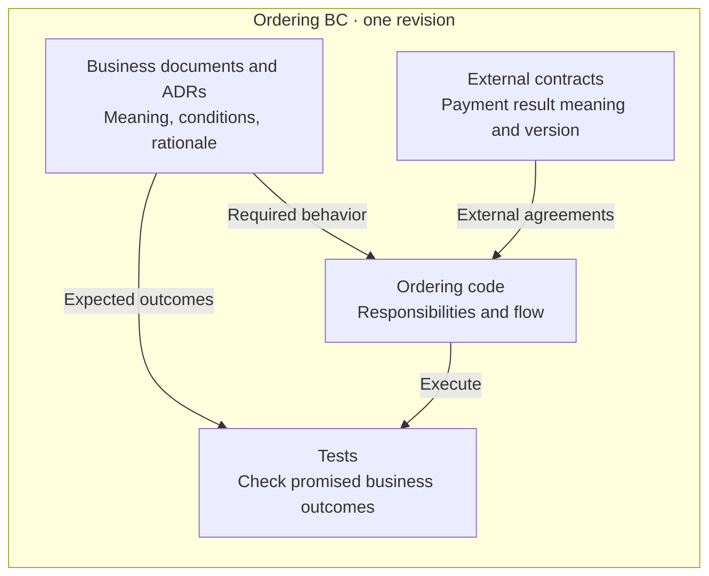
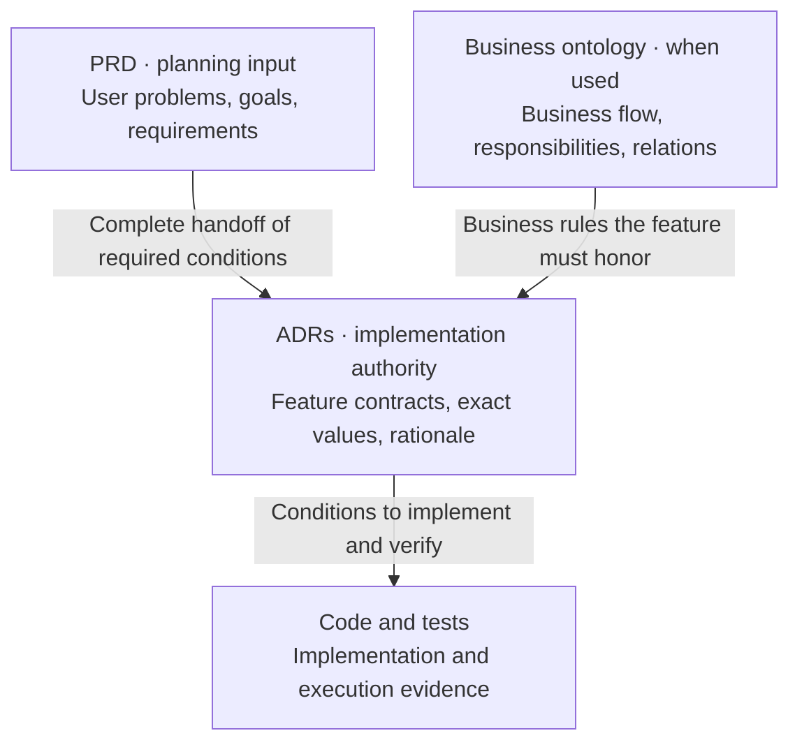
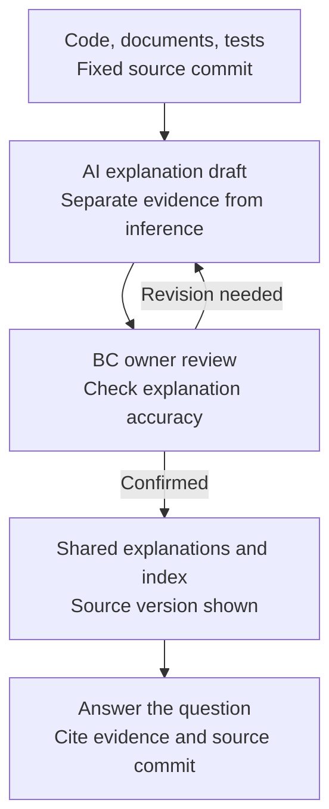
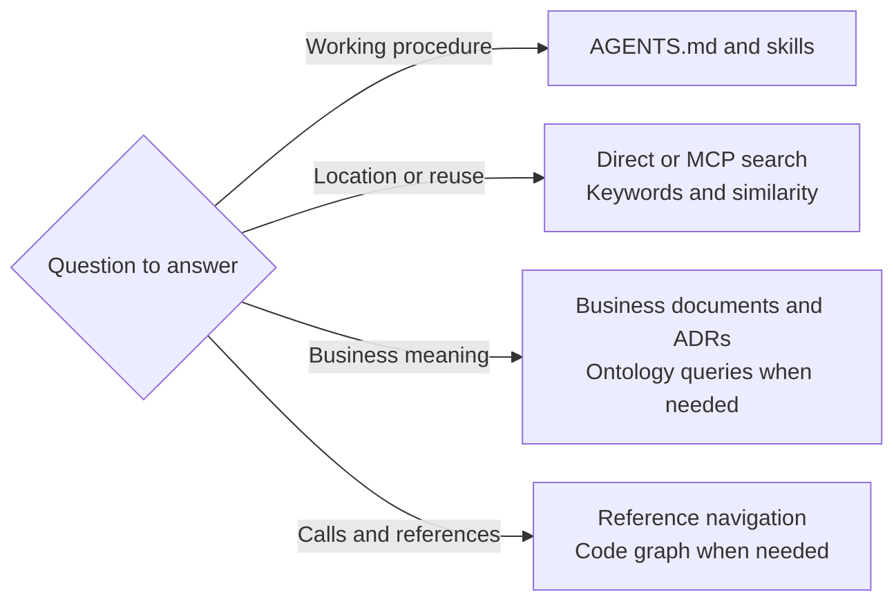
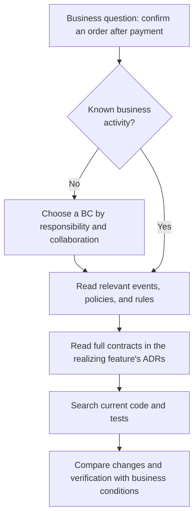
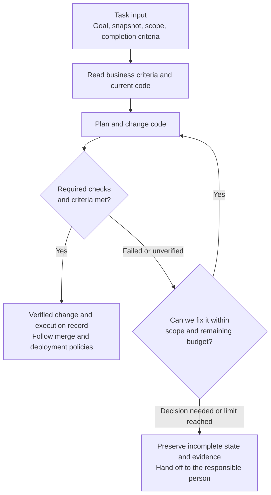
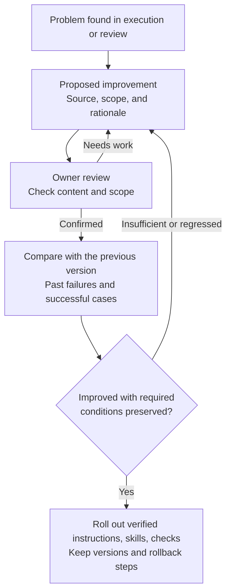

## TL;DR

- A BC's code and documents at one point in time should explain its business and implementation.
- Use different tools to retrieve business context and explore code.
- Expand automation from work you have repeatedly verified.

## Introduction

A software factory is a system in which AI agents implement and verify requirements, then use execution results to find and pursue the next improvement. Even with the examples being published recently, I think this approach will remain the practice of a few frontier teams experimenting ahead of the field for some time.

Over time, I expect every development team to want to work this way, but the scope an ordinary enterprise team can adopt today is limited. Existing systems and organizational verification and operations practices need to change together. I think it is more realistic to prepare incrementally, starting with tasks the team can delegate now. In the AWS Emulator article[^1], I described expanding automation from execution, evaluation, and recovery for small tasks.

Applying this to development teams requires distinguishing two aspects of AX, or Agentic Transformation. One is adopting agents to automate business work. The other is adopting agentic engineering: carrying out design, coding, testing, and revision with agents. Part 1 of this series[^10] addressed the former; this second article addresses the latter.

Most current AX discussions focus on automating work done by people outside software development. They use internal and external business information and rules to improve internal workflows. Development automation adds product plans, internal code and designs, external library and API documentation, tests, and execution records to that information, producing code that will be delivered to end users.

Even when business rules stay the same, code changes alter dependencies and the implementation that needs verification. Development teams therefore handle a wider range of context that changes more frequently than in typical business automation. **Producing code that continues to work reliably after a change** is central. That is why they need tools for exploring current code, executing it, and verifying results in addition to business information access.

This article lays out how an enterprise development team just adopting AI can build and maintain that foundation in stages. If requirements live in a wiki, exceptions in an old conversation, and code differs from both, developers have to explain the background for every task. Start by reducing that dependency, then delegate work whose results have been verified.

My ALPS Writer Plugins[^2] address this problem too. They organize product requirements, preserve business flows in a model, record the decisions an implementation must honor in architecture decision records (ADRs), and connect those decisions to code and verification. What matters to me throughout that process is **making each layer's responsibility for explaining the system explicit**.

I think DDD provides an important starting point for assigning those responsibilities. Before giving AI more material, a team should establish which business responsibilities its code and documents explain completely.

## 0. The basic principle: the explanation must fit inside a BC snapshot

Domain-Driven Design, or DDD, brings business concepts and rules into software design. A bounded context, or BC, is the scope within which terms and rules have consistent meanings.[^3] An order being “confirmed” and a payment being “completed” are related, but the two business responsibilities own different outcomes.

I want to make this perspective more concrete as a rule for managing development work.

**Even when a BC is isolated at a particular point in time, its code and documents should completely explain its business and implementation.** In a monorepo, that unit is the relevant BC portion. In a multirepo arrangement organized by BC, it is the corresponding repository.

A snapshot here means code and documents fixed to the same point in time. Combining current code with a wiki explanation from another period does not make a complete snapshot.

### Readers should be able to move between documents and code

Documents should explain what must be built and which outcomes are correct. Code should reveal the responsibilities and flow that implement that business, while tests show what is being checked.

Suppose a rule says, “Confirm an order when its payment is complete.” The documents must explain which payment qualifies and how duplicates and failures are handled. The code should expose the responsibilities for checking the payment result and confirming the order. Tests should check the promised behavior when a payment belongs to another order or a notification arrives twice.

The reason for choosing that policy is difficult to reconstruct from code alone. Documents own that reason and the required conditions; code owns the implementation. It should be possible to rebuild an implementation that satisfies the same business conditions from the documents, and to explain how the current code realizes them.[^4]

### Include agreements with external systems in the snapshot

If the ordering BC collaborates with the payment BC, ordering needs the meaning of the payment result it receives, how to identify it, and its failure and duplicate-handling requirements. If understanding ordering requires reading payment's internal implementation first, the ordering BC is missing part of its explanation.

I use “contract” here to mean an agreement about accepted inputs and guaranteed behavior. Keep the necessary API and event contracts, applicable versions, and tests that check those promises or substitutes for local verification together. Even when a common policy is centrally managed, preserve the applicable content and version in the BC snapshot. External links can establish provenance, but they should not be the only place to learn a required rule.

BCs and repositories are not always one-to-one. If one BC spans repositories, each repository needs to state its responsibility and the contracts it relies on, while the version combination that makes up the whole BC must also be recorded. When isolating a BC from a monorepo, include the shared configuration and documents it needs from the same revision.

The information needed to understand ordering in isolation should sit inside one snapshot, as shown here.





This principle requires a complete explanation of the business and implementation. It does not mean reproducing production outcomes without connecting to a real payment network. Live system state and incident causes still require execution records, but the contracts needed to interpret those records should be in the repository.

## 1. Separate business knowledge, implementation contracts, and code

Collecting material does not give every document the same role. In ALPS Writer Plugins, I divide responsibilities as follows.[^2][^5]

| Layer | Question it must answer | What it preserves |
| --- | --- | --- |
| Product requirements document, or PRD | Whose problem are we solving? | User problems, expected outcomes, product scope, and requirements |
| Business ontology | How does work flow, and who owns it? | BCs, business flows, events, policies, rules across activities, and terms |
| Architecture decision record, or ADR | What must this feature guarantee, and why was it designed this way? | Inputs, outcomes, permissions, failure conditions, exact requirement values, rationale, and alternatives |
| Code and tests | How are those conditions implemented and checked? | Functions, data structures, libraries, execution settings, and verification code |

An ontology is a model of concepts and relationships that can be queried. Here I use it to find the business context needed for development, rather than to build an exhaustive knowledge system for the company. A small team can begin by explaining its business in documents and add this model when navigating relationships becomes repeated work.

An ALPS PRD is planning input. Once every implementation-relevant condition has been handed over to ADRs, those ADRs own the implementation contract, and the PRD remains a planning record. A later PRD edit does not automatically change that contract. The team must compare it with the current ADRs and decide which obligations should change.[^5]





### Abstraction must preserve requirements

Consider a refund workflow. The ontology can express that the refund window starts at delivery. The requirement that the window lasts 30 days belongs in an ADR; the date calculation function and its library belong in code. An exact value shared by several features can be owned by an ADR at BC scope.

Removing “30 days” from the documents because it already appears in the code erases a condition the next implementation must honor. Copying the usage instructions for a replaceable date library into an ADR creates the opposite problem: an implementation change then requires editing the higher-level document too.

ALPS Writer Plugins therefore preserve requirements first, then remove implementation facts that can be read from code. **Abstraction means assigning a fact to the place responsible for it, not deleting detail indiscriminately.**

### Follow meaning between layers, and locate files when needed

The plugins' ADR index connects business steps to the features that realize them, but stores no code paths. ADR bodies do not list functions and line numbers, and code does not embed ADR numbers. An agent reads the business meaning in an ADR and finds the implementation in the current repository.[^5]

A business change flows from the ontology through ADR contracts into code. A code refactor alone does not rewrite the business model. When code and documents disagree, record the difference between observed behavior and the approved requirement, then distinguish fixing a bug from changing a requirement. Updating the document simply because the code behaves that way can turn a bug into policy.

Now we can apply these distinctions to a team's tooling. The stages below are readiness checks for delegating more work, rather than a calendar schedule.

## 2. First step: establish a shared working environment for one BC

Choose one BC that changes regularly and has a clear owner. Instead of reorganizing every repository at once, make its common explanation, change, and testing tasks work in a shared environment.

**A responsible developer owns the code and documentation baseline, while the team lead defines which tasks can be delegated automatically and which conditions need human judgment.** In a small team, one person can fill both roles.

1. Make current code, business conditions, and execution instructions readable at the same revision. Verify rules held only in someone's memory and record them in documents or tests.
2. Put common working instructions and verification commands in the root `AGENTS.md`. Put constraints and known pitfalls in instructions scoped to the BC. Do not summarize every source file.
3. Separate repeated procedures with several steps into skills loaded when needed. Connect activities such as builds and tests to actual executable commands.
4. Run the same tasks before and after the change. Record correctness, omitted checks, explanations supplied by people, elapsed time, and cost.

A skill is a procedure an agent reads for a particular task. Separating short instructions needed every time from occasional procedures such as incident analysis avoids repeatedly loading irrelevant explanations.

Do not stop at documenting rules that can be checked automatically. For example, verify “Do not directly reference another BC's internal modules” with a dependency check, and block merging when it fails. For business conditions requiring judgment, record who decides and which evidence they need.[^6]

Check completion in a fresh conversation. Ask an agent or colleague to make a small change from the BC snapshot without earlier conversations or an external wiki. They should be able to find the business rules, explain the relevant code, run the required checks, and leave unresolved decisions as questions.

If the task succeeds only because the owner explains something alongside it, identify the missing information. Add the necessary conditions to the repository and repeat the task. The deliverable is **a working environment someone else can take over**.

## 3. Help newcomers with code explanations and Q&A

Even a repository that explains itself can be difficult to approach for the first time. Asking developers unfamiliar with AI tools to choose search terms and file paths immediately can make adoption harder.

A system that analyzes code in advance, generates explanations, and answers questions can help here. Organize the repository's purpose, major business flows, execution instructions, and common questions so someone can begin with, “Where should I look when payment is complete but the order is still unconfirmed?”

Generated explanations are guides to reading a particular code version. They serve a different purpose from working instructions in `AGENTS.md` or approved business rules. Retrieve the relevant explanation and evidence for the question instead of loading the entire code guide into every session.

### Own the lifecycle from generation to updates

The developer responsible for this system should establish the following flow.

1. Select a repository, BC, and commit, then generate draft explanations from its code, documents, and tests. Preserve evidence locations and the source revision for each explanation.
2. Have the BC owner review major flows and business interpretations. Distinguish facts observed in code, documented requirements, and AI inferences, leaving unverified points visible.
3. Include evidence and the baseline commit with each answer. If the question concerns another version, check that version or explain the difference.
4. Refresh affected explanations after code changes and replace their index. If refresh fails, label the material as outdated and direct the reader to current source.

Review separates generating a draft from sharing an explanation with the team. When code changes, use the same path to check the affected explanations again.





For example, “Are duplicate payment notifications safe?” should not receive a confident “yes” based only on a code summary. Show which duplicate conditions the implementation handles, whether those conditions were tested, and whether that coverage matches the current ADR.

Business requirements needed over time must not exist only in the Q&A system. Review them and incorporate them into the BC's documents and tests so the snapshot remains complete without the system. Generated documentation should be reproducible from those sources.

Ask new team members to use it for real onboarding questions. Check time to a correct answer and its evidence, confidently wrong answers, answers based on outdated versions, and questions that still require the owner. Also verify that summaries and answers do not expose repositories the user cannot otherwise read.

Add this stage when onboarding is a bottleneck. If a few documents and direct searches already let teammates understand the system, there is no need to operate a separate Q&A service.

## 4. Expand discovery with direct search, MCP, and selected code graphs

Code changes require checking the current implementation. Choose a discovery method according to how specific the question already is.

| What is known | Start with | Then check |
| --- | --- | --- |
| A function name, error message, or business term | Local keyword or symbol search | Definitions, callers, and relevant tests |
| A need to locate another repository or a similar implementation | Internal keyword or similarity search | Repository and commit, followed by the source itself |
| A chain of calls or references | IDE reference navigation, then a code graph if needed | The actual change path and the impact to verify |

For example, start a local search for order confirmation with business terms and likely identifiers.

```bash
rg -n 'confirmOrder|PaymentCompleted|order confirmation' src tests docs
```

Use the resulting names to narrow down definitions and references. Expand to internal code search when looking for an example implementation or a shared library outside the current repository. Similarity search can help locate candidates that implement the same behavior under different names.

Model Context Protocol, or MCP, connects these search tools to an agent. Search quality depends on the indexed code, retrieval method, versions, and access controls more than on whether an MCP connection exists.

The internal search owner should make results include the repository, BC scope, file, evidence excerpt, commit, and index status. The agent checks the candidate's source and any differences from its working version before using it. Results should also distinguish excluded repositories from stale indexes, so an empty search is not mistaken for proof that no implementation exists.

Searching other repositories may reveal an implementation worth reusing. If it becomes a new dependency, record the applicable version and necessary contract in the current repository. Discovery tools do not replace the snapshot principle.

### Add a code graph when missed relationships become a problem

A code graph connects functions, classes, and packages through calls and references. It can be worth adding when a question such as “What calls this?” requires following many steps, or when impact analysis repeatedly misses relationships across repositories.

First collect changes that failed because a relationship was missed, then compare the scope found through existing search with the scope found using a graph. Decide whether to maintain it by examining additional impacts found, incorrect relationships, analysis time, and refresh cost.

Static analysis may not fully expose dynamic calls, dependencies injected at runtime, or message-based communication. State which languages and relationships the graph supports, and supplement it with contract tests and execution records where needed. Even if a graph is used internally to generate onboarding documentation, every development task need not begin with a graph query.

**A code graph explains implementation connections; a business ontology explains business meaning and responsibility.** The selection criterion is whether a tool finds the right facts for a question, rather than whether both kinds of information can fit in one graph.

Distinguishing the questions also shows which information and tools to consult first.





## 5. As the business grows more complex, retrieve only the context needed

Finding the code may still leave a long investigation into why it exists and which business rules it must honor. Repeated searches for rules spanning features and handoffs between BCs are a reason to add a business ontology.

Business owners and developers should establish the actual starting conditions, outcomes, actors, events, and exceptions together. AI can extract candidates from existing documents and code, but the current code structure should not automatically become the business boundary. Neither the organization chart nor ADR folders define a BC for you.

ALPS Writer Plugins organize business knowledge at two levels of detail. A small upper layer contains BC responsibilities, core business logic, and collaborations. The detail inside each BC contains processes, steps, events, policies, and rules. The upper explanations are knowledge written and confirmed in advance, rather than summaries generated at query time and treated as established facts.[^7]

### Start at the top only when the target is unknown

The plugins' public order-payment learning example contains ordering and payment BCs. “Confirm the order after payment completes” is represented by a payment-completed event, a policy checking that the payment belongs to that order, and an order-confirmation step.[^8]

The example provides business material and a model. Once a team also has ADRs and an implementation for this work, the following path can retrieve the information needed for development.





If the order-confirmation step is already known, read its detail directly. Stop exploring when you have found the responsibilities, rules, handoffs, and ADRs relevant to the question. There is no need to read every unrelated BC, but cross-BC conditions must not be cut off just to shorten a search result.

The example also leaves paths such as duplicate payment notifications unresolved. Finding the normal flow in the ontology does not establish a duplicate-handling policy. Before implementation, the responsible person must decide those conditions and preserve the concrete inputs, outcomes, and failure behavior in the relevant ADR.

The business model does not need the library that delivers payment events or the location of an order-confirmation function. Read exact required values and state transitions in the ADRs, and find current files through search. This distinction lets the ontology serve business retrieval without needing an update for every code change.

Even if the query system is central, preserve a versioned copy of the model that explains the BC and the necessary external business handoffs alongside the code. Query results are working material; do not keep only those results and discard the original model.

Completion is not measured by graph size. Real change questions must lead the team to the necessary business context and ADRs, with unresolved details, missing facts, and broken links distinguishable. Check that a business model edit also identifies the implementation contracts that need reconsideration. Faster retrieval that misses an important condition is not ready to support more automation.

## 6. Delegate work by connecting discovery to verification

The agent can now read the business baseline and find the current implementation. A harness connects that information to execution, verification, and failure handling.[^6] Begin with one small task selected by a person and let the system carry it through.

The team should provide the following inputs.

| Task input | What to record |
| --- | --- |
| Goal and evidence | The business outcome to change, the current problem, and reproduction material |
| Baseline snapshot | Code and documentation revision, applicable external contract versions |
| Authorized scope | BC and workspace to change, tools and permissions available |
| Completion conditions | Observable outcomes, mandatory checks, required approvals |
| Stop and recovery conditions | Time, cost, and retry limits; the person receiving an interrupted task |

The agent reads the necessary business context and ADRs, finds the code, makes a plan, and implements it. Checks verify the original business conditions, rather than merely confirming that the implementation changed. Failures feed another correction; missing policy decisions or permissions lead to a handoff with evidence and an explicit incomplete state.





Separate each workspace and its test data from other runs. Connect code and business-document revisions, AI model, instruction, and tool versions, evidence read, checks executed, and the termination reason in the task record. That makes it possible to distinguish an outdated explanation from a search omission, an implementation error, or a missed check.

The implementation agent must not be able to weaken mandatory checks and merge policies within the same task. Missing checks and timeouts must not become successful completion. Merge only with valid checks and approvals for the current change, and connect deployment only within the scope verified against real integrations and recovery procedures.[^1]

Interrupt and resume this path to verify that it neither executes work twice nor records failed work as successful. Once another teammate can continue from the same inputs, expand to a work queue and parallel execution.

Next, evaluations or operational records can produce reproducible failures that become tasks. Distinguish product defects from environment problems, remove duplicates, and send only authorized categories through the repair path. Execution results now feed the next development task, creating the software factory loop.

## 7. After adoption, manage the development environment as a product

A team's working behavior is not determined by a model alone. Instructions, skills, search indexes, Q&A material, business models, checks, and deployment policies jointly shape the result. This configuration also needs owners, versions, change verification, and a way to roll back.

The following is a starting division of responsibility. Organizations without a platform team can assign these roles within their existing development teams.

| Managed asset | Responsible role | What to check when it changes |
| --- | --- | --- |
| Business model and requirements | Business owner and BC developer | Changed meaning, affected contracts, unresolved conditions |
| ADRs, code, tests, and BC instructions | BC developer | Agreement within the snapshot and business verification results |
| Search, code explanations, and Q&A | Developer tooling owner | Source versions, omissions, refresh failures, access controls |
| Shared skills, MCP tools, and verification environment | Platform or shared tooling owner | Necessary tool scope, task success, cost, and regressions |

Review BC instructions with their associated code changes, and distribute shared skills and tool configurations as versioned packages. Keep track of which teams use which versions and provide a path back to a previous version. Offer tool groups suited to activities such as discovery, implementation, and operations rather than enabling every MCP tool by default.

### Decide where each failure should lead to a change

Adding every recurring error to `AGENTS.md` only makes the instructions grow. Choose the repair according to where the failure occurred.

| Problem found | Improvement to preserve |
| --- | --- |
| Nobody can explain a business condition clearly | Make the business decision, then update the model and ADR |
| Names and responsibilities do not match, making code hard to find | Improve code naming and responsibility boundaries |
| Search or generated explanations point to old code | Fix index and documentation refresh and stale-result handling |
| The same procedure keeps omitting a check | Update the skill and add executable checks and blocking conditions |
| Checks pass, but users still experience the problem | Add an evaluation case that checks the business outcome |

Record newly discovered knowledge as a candidate with its source and scope. Promote only rules confirmed by the BC owner into shared guidance. A one-time workaround or model inference should not become an approved policy.

Changes to development instructions and tools go through candidate review and execution-based evaluation before rollout.





When changing tools or instructions, rerun both previous failures and successfully handled cases. Check whether time to a verified change and human intervention decrease, and whether missed defects, rework, or execution costs increase. This helps reject changes that improve processing speed while degrading results.[^9]

Generated code volume and tool call counts are poor substitutes for that judgment. What matters is whether search found the necessary evidence and whether completed work was actually correct.

## 8. Where a team should start

The preparation sequence can be summarized as follows. Start with the first row, and choose additional tools when the corresponding problem exists.

| Current obstacle | What to prepare now | Readiness for the next step |
| --- | --- | --- |
| Background must be explained to AI every time | One BC's code and documentation snapshot, short instructions, executable checks | A fresh conversation can read the rules and verify a small change |
| Newcomers do not know where to begin | Versioned code explanations and evidence-based Q&A | Real questions lead to correct evidence, with unknowns visible |
| Implementations and reuse candidates are hard to locate | Direct search and internal keyword or similarity search | The agent reaches source applicable to the working version |
| Business rules and BC handoffs require repeated investigation | A layered business ontology connected to ADRs | Required conditions reach the implementation contract without omissions |
| Calls and references are repeatedly missed | A code graph covering the necessary scope | Fewer impacts are missed at a sustainable refresh cost |
| A person must prompt every execution step | An isolated work path connecting checks, stopping, and handoff | Failures remain visible and another owner can resume work |
| People keep discovering and assigning the same failures | Evaluation and operational failures connected to the work queue | Authorized failure types lead to reproduction, repair, and re-verification |

Some teams do not need onboarding Q&A or a code graph. Instead of counting tools as maturity stages, identify the gaps people currently fill and make that work repeatable.

## Conclusion

I think a team preparing for a software factory should first develop **the ability to explain the business it owns completely through code and documents**. DDD's bounded contexts provide a useful unit for that responsibility.

On that foundation, provide code explanations to newcomers, search to agents locating implementations, and an ontology and ADRs to work that requires business understanding. As verification and feedback turn failures into the next improvement, the scope of delegated work can grow.

If I were starting next week, I would choose one BC and one common change. I would check whether someone could understand the business, change the code, and verify it from that snapshot without earlier conversations. Whatever a person still had to explain or do along the way would tell us which documents and tools to improve next.

[^1]: [Building a Software Factory with AWS Emulator](/en/2026/11/16/building-software-factory-with-aws-emulator.html). Expanding automation from task execution to evaluation, problem discovery, and recovery.
[^2]: [ALPS Writer Plugins](https://github.com/haandol/alps-writer-plugins/tree/c187eca43ba0fc245fdcfae83a7a385510099362). A public project separating product requirements, business models, ADRs, implementation, and verification. This article uses its documentation as of November 17, 2026.
[^3]: [Thoughts for DDD Starters](/2021/10/11/thoughts-for-ddd-starters.html) (Korean). Ubiquitous language and bounded contexts. The snapshot management principle in this article is my proposal for applying that perspective to team operations.
[^4]: [Code That Reveals Business Intent to the Next Agent](/en/2026/03/13/agentic-dev-business-aligned-code.html) and [Context Engineering](/en/2026/03/11/context-engineering-static-vs-dynamic.html). The roles of business-expressive code and lasting decision criteria.
[^5]: ALPS Writer Plugins' [dependency and handoff model](https://github.com/haandol/alps-writer-plugins/blob/c187eca43ba0fc245fdcfae83a7a385510099362/docs/dependency-model.md) and [business ontology responsibilities](https://github.com/haandol/alps-writer-plugins/blob/c187eca43ba0fc245fdcfae83a7a385510099362/plugins/ontology-writer/references/ontology.md).
[^6]: [Harness Engineering Explained](/en/2026/03/15/harness-engineering-beyond-context-engineering.html). Connecting instructions to tool execution, verification, and failure handling.
[^7]: ALPS Writer Plugins' [business knowledge layers and retrieval rules](https://github.com/haandol/alps-writer-plugins/blob/c187eca43ba0fc245fdcfae83a7a385510099362/plugins/ontology-writer/references/knowledge-layers.md). The current implementation uses local text and relationship queries.
[^8]: [Order-payment learning example](https://github.com/haandol/alps-writer-plugins/blob/c187eca43ba0fc245fdcfae83a7a385510099362/plugins/ontology-writer/docs/order-payment-example.md). Business material and a model for learning, not a working order service or measured verification results.
[^9]: [Software Factory Evaluations, KPIs, and Tension Metrics](/en/2026/10/05/software-factory-evals-and-tension-metrics.html). Checking desired outcomes alongside quality that could deteriorate while pursuing them.
[^10]: [The Two Sides of AX, Part 1: Business Automation](/en/2026/11/05/enterprise-wide-ax-essentials.html). Enabling business experts to change and improve their work through agents and connected solutions.
