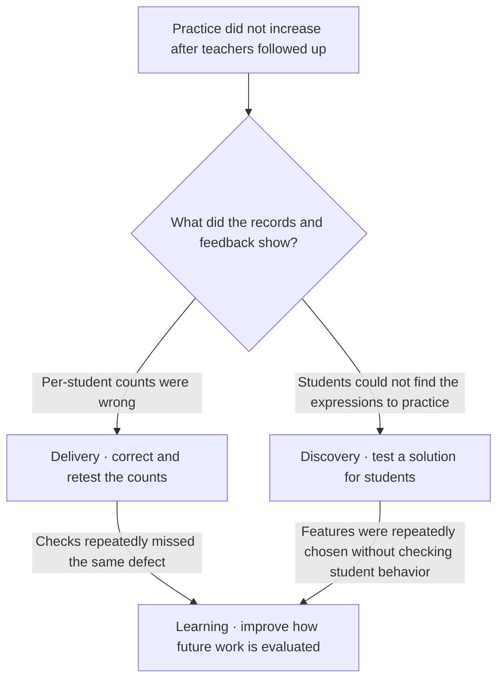

## TL;DR

- The agent revises its task list as it sees the results of its work.
- The team defines what should change for users and which constraints matter.
- Evidence from a release determines the next development assignment.

## Introduction

In 2025, I set out to find what worked best when developing software with a coding agent. My conclusion at the time was to turn requirements into features, break each feature into tasks small enough to hand to the agent, and reflect on the result once the code was written. I called those five steps **RFTCR (Requirement → Feature → Task → Code → Reflect)**. The name reminded me of “refactoring,” which made the sequence easier to remember.[^1]

I was struck by how quickly coding agents improved after I wrote that post. Back then I planned the implementation myself and kept a task list outside the agent. Each time a task finished, I checked the result, revised the list, and handed over the next item. Now the agent does most of that on its own, from reading the code and making a plan to reordering the work when a test turns up something unexpected.

When CloudWatch raises an alarm for EncBird or PixelBank, two products I run, Codex can investigate the cause, fix the code, review the change, and open a pull request in one session.[^2] I step in less often now to tell the agent what to do next. In particular, **I no longer need to create a separate task list for the agent and keep it up to date.**

The development process has changed too. In a **software factory**, agents build the product, and what happens in use feeds back into planning and development. Suppose a language school using EncBird, my English practice app, asks for a weekly report for teachers. If the report ships and a teacher who reads it still can't tell which students need help or what to suggest they practice, the next step is to take another look at how teachers prepare their lessons.

That's why I think the development approach I described as RFTCR in 2025 now looks more like **RLO (Requirement → Loop → Outcome)**. The team defines what needs to change for users. Agents try possible solutions and iterate on the implementation and its checks. What changes for users after release gives the team evidence for choosing the next problem to work on.

## 1. Who owns the task list?

A developer planning the weekly report might start with a task list covering per-student practice counts, an API for retrieving them, and a report screen. Suppose the agent opens the repository and finds that the practice history in the student app already includes weekly totals. The next useful step is to check whether those totals measure what a teacher needs to see. The task list can change before anyone writes a line of code.

**When I say that tasks have moved inside the coding agent, I mean that ownership of the plan has changed.** The same agent investigates the code, breaks down the work, and revises the order when a test fails. It can record unfinished tasks if the run has to resume later. Next month, when the report needs another change, the agent can make a fresh plan from the requirements and the code it finds then.[^3]

A similar shift showed up in an Anthropic experiment on building applications. With Opus 4.5, the researcher divided development into sprints, and the builder and evaluator agreed on completion criteria for each one. With Opus 4.6, the researcher kept the planner, removed the sprints, and moved evaluation to the end of the run. A separate evaluator still helped on parts of the build the model struggled to finish reliably on its own.[^4]

## 2. Write the requirement in terms of the teacher's work

Picture the teacher who requested the weekly report preparing for the next lesson. Perhaps they want to find students who skipped practice without asking each one individually, then point them to an expression worth rehearsing. That gives the team a requirement it can hand to the factory.

> Help students practice expressions from class again before their next lesson without increasing the time teachers spend checking who has practiced.

The requirement identifies **whose behavior should change and which constraint matters**. A weekly report is one way to meet it. If students stop because they can't find the expressions, sending them something to practice right after class might be more useful.

The two sides of agentic transformation (AX), business automation and software development automation, depend on the same rule here.[^5][^6] An agent helping the teacher can read class assignments and practice records to identify who needs help. The development agent can inspect the code to find out what creates a record. Suppose the teacher counts a student as having practiced when they rehearse an expression from class, but the app counts a visit to the practice screen. Perfectly accurate totals could send the teacher to the wrong student. **The teacher decides what counts as practice. The development team checks that the product can record that activity.** The same definition will matter when the team asks whether practice increased.

## 3. Hand over the behavior you agreed to build

When I started my English-learning side project, I drew screens on paper and turned them into a clickable mockup to try out an idea.[^7] A school could test the proposed feature in much the same way. An agent could make a dashboard and a weekly report from the same practice records, then ask teachers to prepare their next lesson with each prototype.

Compare lesson preparation with each prototype against the teachers’ usual routine. How long does it take, and which students who skipped practice do the teachers miss? If neither prototype helps, the team can shelve the feature and investigate why students stop practicing. Using what happens when people try a prototype to decide what to test or build next is the **Discovery Loop**.

If the team chooses to pilot the report, two things are worth recording. “Teachers can see weekly practice records for students in the classes they currently teach” is **behavior the product must guarantee**. “After seeing the records, teachers will follow up and their students will resume practice” is **a hypothesis for the pilot**. We can check permissions before release. Finding out whether students resume practice requires teachers and students to use the product.

The specification itself needs a check before handoff. Suppose it says that only assigned teachers can see the report and also says to send it to substitute teachers every Monday. Someone has to decide who may see which students' records during a substitution. A planning agent can flag the conflict and ask the question. The product owner decides the scope of access. Kiro offers a similar check before design, looking across feature requirements for contradictions and missing conditions and raising questions about them.[^8]

In ALPS Writer, the planning tool I use, the product requirements document (PRD) records the user problem, the feature chosen, and the reasons for the choice. At handoff, we transfer the requirements the implementation must meet, including permissions and exceptions, and the reasons for the decisions into architecture decision records (ADRs). **After handoff, the ADR governs implementation.** The PRD preserves the planning decision.[^9] If the pilot reveals a need to change the access policy, review the proposed conditions and update the current ADR.

## 4. Check the report's accuracy and its effect on students separately

One assignment can give the development agent a goal, a scope, and clear conditions for finishing or stopping.

| What to specify | Example for the weekly report |
| --- | --- |
| Goal and contract | Let teachers see last week's practice for their own classes. Specify the ADR version that applies to this run. |
| Scope of changes | The agent may change how the report is calculated, retrieved, and displayed. Changing who can read student records requires a decision from the product owner. |
| Evidence of completion | Check that the counts match the practice records for the assigned class and that records from other classes are inaccessible. |
| When to stop | If the run reaches its budget, record the last check and any outstanding failures, then stop. |

Within those bounds the agent breaks down the work, fixes discrepancies, and checks again. This is the **Delivery Loop**. The factory keeps the version of the contract, the inputs and results of the checks, and the time and cost of the run. The next person to pick it up can see which conditions have already been verified.

For example, give two classes practice records for last week and assign only one class to teacher A. Sign in as A and check the counts for the assigned class. Then try opening the other class's report from the same account. An implementation that merely hides the second class's name can pass the first check and still expose student records on the second. The agent can reproduce that failure and fix it. A typo in the report can go straight to a fix and a check. A change affecting access is worth checking again on a combination of teachers and classes held back during implementation.

Suppose the report passes those checks and goes live. **The question now is whether the report helped more students practice without adding to teachers’ workload.** Measure the share of students who practice between lessons before and after the pilot, using the same definition throughout. Record the time teachers spend checking the records and preparing to follow up. If scheduling matters, as it might during exams, consider introducing the report to comparable classes at different times. Report opens alone can't tell us whether students practiced more.

## 5. Let the outcome determine what to fix next

Many teachers might read the report even as the share of students who practice between lessons stays the same. If the totals were wrong and teachers contacted the wrong students, the implementation needs a fix. If the totals were right, teachers followed up, and students still couldn't find the expressions to practice, it's time to return to discovery and try putting the expressions directly in students' hands.





When the factory repeatedly misses something, the team can change how the factory works. I call this the **Learning Loop**. Suppose the pre-release check has repeatedly missed a defect that exposes another class’s records. If the logs show that every check used data from a single class, add a case with records from two classes. Before adopting the revised check, compare it with the old one on the same inputs. Does it catch the defect it missed before and still allow the assigned teacher's legitimate request?[^10]

The same reasoning applies to discovery. If teachers keep saying “I'd use that” in interviews, but the resulting features go unused during lesson preparation, try watching teachers prepare a lesson with a prototype before committing to the next build. Then look at whether features selected that way actually see more use and at the extra time the experiments ask of teachers. Both affect whether the new method is worth keeping.

## Closing thoughts

A software factory needs to connect planning, development, and testing with operations and outcome measurement after release. I think a shared solution makes sense for that workflow, with each organization defining its own business rules and metrics.

[^1]: [RFTCR, a framework for agent-driven software development](/en/2025/05/11/rftcr-framework-for-agentic-dev.html)
[^2]: [Building a software factory with AWS Emulator](/en/2026/11/16/building-software-factory-with-aws-emulator.html)
[^3]: [The development context people need to maintain](/en/2026/03/11/context-engineering-static-vs-dynamic.html)
[^4]: Prithvi Rajasekaran, Anthropic. [Harness design for long-running application development](https://www.anthropic.com/research/harness-design-long-running-apps)
[^5]: [The two sides of AX, part 1 on business automation](/en/2026/11/05/enterprise-wide-ax-essentials.html)
[^6]: [The two sides of AX, part 2 on agentic engineering](/en/2026/11/17/software-factory-team-tooling-runbook.html)
[^7]: [Trying Lean Startup on a side project (in Korean)](/2024/01/13/lean-startup-in-action-with-side-project.html)
[^8]: Kiro, [Analyze Requirements](https://kiro.dev/docs/specs/analyze-requirements/)
[^9]: [Why separate PRDs, ADRs, and code?](/en/2026/07/25/alps-adr-abstraction-boundaries.html)
[^10]: [How a software factory can improve itself](/en/2026/10/05/software-factory-evals-and-tension-metrics.html)
