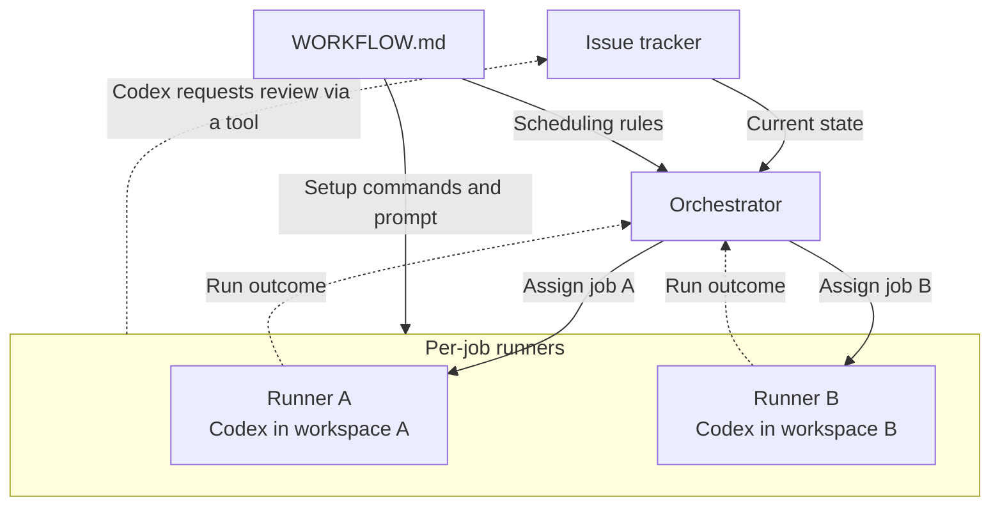
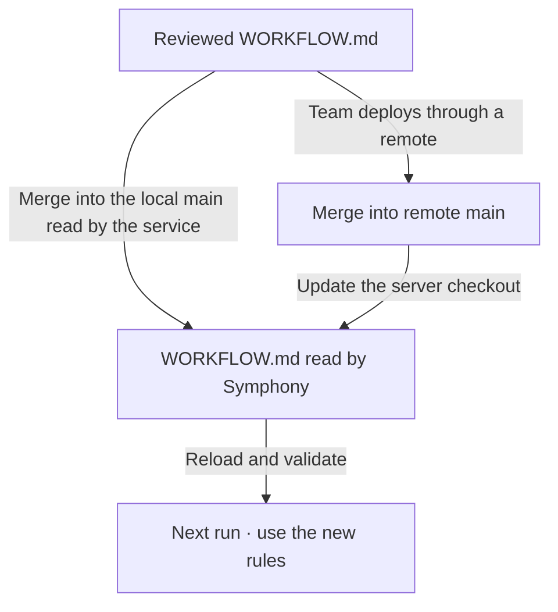

## TL;DR

- Symphony assigns work from a team’s project board to coding agents.
- OpenAI distilled its internal approach into a standalone specification.
- Teams define their own checks and handoff rules in `WORKFLOW.md`.

## Introduction

**OpenAI Symphony is an open-source project that connects a team’s project board to coding agents.** Say a developer files a bug in Linear, a project management tool, and marks it ready for work. Symphony prepares a directory for the job and launches Codex there. The developer can follow the link to the code changes and read the test results on the board, then request another pass or approve the change.[^1]

In an earlier article about software factories, I mentioned Symphony as a way to distribute work across agents.[^2] At OpenAI, engineers had to open Codex conversations one by one just to find out which jobs had finished and which had stalled. The team built Symphony to take that work off their hands.[^1]

## 1. From an internal experiment to an open specification

In late August 2025, a team at OpenAI made the first commit to an internal productivity tool. They had decided that Codex would write every line of code in the repository. The engineers organized the repository so Codex could find the documentation and tools it needed, and set up automated checks so it could tell when a change was wrong.[^3][^1]

The team found that most engineers could comfortably keep track of three to five Codex sessions at a time. Beyond that, they lost track of which window held which task or discovered too late that a job had stalled. They decided to try letting agents pick up work from the Linear board the team already used.[^1]

The first version was a single Codex session running inside `tmux`, a tool that keeps terminal sessions alive. The session polled Linear and spawned subagents for new tasks. The idea worked, but the setup was unreliable. The team built the second version inside its internal product repository, where the agents already had tools and tests. Once the basics worked, **the team used Symphony to build Symphony itself.**[^1]

At an internal demo, the team showed agents handling work and attaching a video of the finished feature in action to its ticket. The project channel grew, and other teams started using the system on their own. That adoption convinced the team to share Symphony outside OpenAI.[^1]

The team removed dependencies on its internal repository and described the core behavior in a standalone **specification**, `SPEC.md`. They gave that document to Codex and asked it to build the service in Elixir. That program is the **reference implementation** available in the public repository.[^1]

## 2. One long-running service, one Codex session per active job

Symphony reads the work a team has assigned and its current status from an **issue tracker** such as Linear or GitHub Issues. The team specifies how many jobs can run at once and what the agent should do in a repository file called **`WORKFLOW.md`**. The service reads the file at the path selected at startup and validates the settings.[^4]

Inside the service, the **orchestrator** decides what to start and stop. A tracker adapter translates each provider’s issues into a common format. When the orchestrator assigns work, an **agent runner** prepares the workspace and starts a conversation with Codex there. Give it two jobs at the same time and two Codex sessions follow the same team rules, each editing files in its own directory.[^4][^6]





The **tracker** holds the status the team sees, the **orchestrator’s memory** holds active runs and scheduled retries, and the **workspace** holds the files the agent edited. If someone cancels a job on the tracker, the orchestrator reads the change and stops the run. When Codex finishes implementing a change, it requests review through a tracker tool. The tool records the result using credentials on the Symphony host. The reviewer and the orchestrator can then read the same status.[^4][^7]

## 3. How WORKFLOW.md expresses a team’s development process

In this excerpt from OpenAI’s `WORKFLOW.md`, the YAML settings at the top list four Linear states that make work eligible for Codex and allow up to ten jobs to run at once.[^5]


```markdown
---
tracker:
  active_states: [Todo, In Progress, Merging, Rework]
agent:
  max_concurrent_agents: 10
---
You are working on a Linear ticket `{{ issue.identifier }}`
```


The runner fills in the issue identifier on the last line before sending it to Codex. It also includes the title, current state, and description from the tracker in the same prompt, so Codex knows what behavior to change. The rest of the prompt tells the agent to reproduce the problem, keep the plan and check results in a single issue comment, and open a pull request (PR). After running the checks and addressing the review feedback, Codex moves the issue to `Human Review`.[^5]

**`Human Review` is absent from the list of active states.** When Codex follows the prompt and moves the issue there, the orchestrator stops the run. If a reviewer requests changes and moves the issue to `Rework`, Codex can pick it up again. If the reviewer approves the merge and selects `Merging`, Codex follows the merge procedure for that state.

## 4. Running sessions in parallel and recovering interrupted work

The Elixir `Orchestrator` maintains one in-memory record of its scheduling decisions. On each poll, it checks running jobs against the tracker before assigning new work to free slots. Among jobs of equal priority, it takes the oldest first. A job that is running or waiting for a retry is already claimed, so a second runner can’t pick it up. The specification’s default polling interval is 30 seconds. OpenAI’s example workflow sets it to five.[^4][^5][^6]

Once assigned, the runner creates or reopens the directory for the job’s identifier. The team supplies an `after_create` hook, a command to run when a directory is first created, if it wants to populate that directory. OpenAI’s example uses the hook to clone the Symphony repository itself. Commands that need to run before every attempt go in `before_run`. With the directory ready, the runner launches `codex app-server`, the mode that lets Symphony send requests and receive responses and execution events from Codex.[^5][^6]

When a test fails, **Codex** reads the output. It can find where the code diverges from the expected behavior, edit it, and rerun the check. When Codex finishes a turn, the runner decides whether to continue the conversation. When the runner itself exits, **the orchestrator** checks the exit reason and the last session event to decide whether to retry.[^4][^6][^8]

| What finished | How Symphony continues |
| --- | --- |
| Codex finished working on one request and responded | If the work is still eligible and there are turns left, the runner sends the next request in the same conversation. One such request and response is a turn. |
| The runner exited normally with no outstanding request for input or approval | Symphony checks the issue one second later. If it is still eligible and a slot is free, a **new session** opens in the same directory. |
| An execution error stopped the runner | Unless the run is waiting for a person to respond, Symphony schedules a retry. Successive failures increase the delay, starting at 10, 20, and 40 seconds. |
| The runner exited with a recorded request for input or approval | The orchestrator records the reason and marks the job as blocked. It does not start a retry timer for that job. |
| The Symphony service restarted | In-memory sessions and timers don’t carry over. The service reads the tracker, cleans up workspaces for terminal issues, and can start eligible jobs again in their surviving directories. |

To investigate a stalled job, an operator can follow its issue and session identifiers through the logs. The reference implementation also shows the latest event and token usage for active sessions and which jobs are waiting for a retry.[^6][^8]

## 5. What Symphony would do in EncBird

In EncBird, the English-learning app I develop, verified changes are first integrated into the primary checkout’s local `main` branch. Pushing them to the remote repository or deploying the app requires a separate request.

Suppose EncBird adopted Symphony and a learner filed GitHub issue 600 asking to rename a saved English conversation practice session. The GitHub adapter recognizes open and closed issues, so this team could make open issues with a `symphony` label eligible for work. The team could use `after_create` to clone the local `main` from EncBird’s primary repository into `GH-600` and create a working branch. The runner would start Codex in that directory with the latest local code, including changes that haven’t been pushed.[^9]

The reviewer would inspect **a local commit in the workspace**. The prompt would tell Codex to run the web app’s type checks, tests, and build, then record the results and commit ID on the issue. As its last action, Codex would replace `symphony` with `human-review`. The job would become ineligible, and the directory would remain. The reviewer could inspect the code there, leave a comment, and switch the labels back to request changes. On approval, they would integrate the change into the primary checkout outside `GH-600` before closing the issue, since Symphony cleans up workspaces for terminal issues.[^4][^9]

## 6. When Symphony picks up a new team rule

If the reviewer keeps asking “Is the new title still there when you reopen the screen?”, the team could add that check to `WORKFLOW.md` and ask the agent to record the result. An agent can prepare that change and send it for review too.

Codex edits the file in its workspace. Symphony reads **the file at the path selected at startup**. In the EncBird example, if that path points to `WORKFLOW.md` in the primary checkout, merging the reviewed change into the local `main` branch updates the file Symphony reads. A team that deploys through a remote repository to a separate server would merge into the remote `main` branch and then update the checkout on the server.[^10]





When the file on the host changes, Symphony reloads the configuration and prompt without restarting. A prompt edit changes the instructions for future runs. A new concurrency limit affects subsequent scheduling decisions. An edit to `after_create` changes which commands the host executes when it next creates a workspace. Sessions already in flight don’t need to restart. If the reload fails, the service keeps its last good configuration and reports the error to the operator.[^10]

Product code reaches users through the product’s release process. Changing the orchestrator’s scheduling algorithm calls for deploying a new version of the Symphony service. The team can change its verification and handoff rules independently of either release.

## Closing thoughts

What stood out to me in OpenAI’s account was how the team’s product manager and designer use Symphony. They can request a feature on the board and receive a video showing it working in the actual product.[^1] The person who asked for the change can say “That’s what I meant” or “This part needs another pass” without having to open a Codex session.

[^1]: Alex Kotliarskyi, Victor Zhu, Zach Brock, OpenAI. [An open-source spec for Codex orchestration: Symphony](https://openai.com/index/open-source-codex-orchestration-symphony/), 2026-04-27.
[^2]: [Building a Software Factory: Lessons from AWS Emulator](/en/2026/11/16/building-software-factory-with-aws-emulator.html)
[^3]: Ryan Lopopolo, OpenAI. [Harness engineering: leveraging Codex in an agent-first world](https://openai.com/index/harness-engineering/), 2026-02-11.
[^4]: OpenAI Symphony, Draft v1 specification and Elixir reference implementation (`be10a1b`). [Architecture and design goals](https://github.com/openai/symphony/blob/be10a1b79df723d6d7612b5651c8522704dafb2e/SPEC.md#3-system-overview), [Scheduling and reconciliation](https://github.com/openai/symphony/blob/be10a1b79df723d6d7612b5651c8522704dafb2e/SPEC.md#8-polling-scheduling-and-reconciliation)
[^5]: OpenAI Symphony. [The Elixir reference workflow](https://github.com/openai/symphony/blob/be10a1b79df723d6d7612b5651c8522704dafb2e/elixir/WORKFLOW.md)
[^6]: OpenAI Symphony. [Orchestrator](https://github.com/openai/symphony/blob/be10a1b79df723d6d7612b5651c8522704dafb2e/elixir/lib/symphony_elixir/orchestrator.ex), [AgentRunner](https://github.com/openai/symphony/blob/be10a1b79df723d6d7612b5651c8522704dafb2e/elixir/lib/symphony_elixir/agent_runner.ex), [Workspace](https://github.com/openai/symphony/blob/be10a1b79df723d6d7612b5651c8522704dafb2e/elixir/lib/symphony_elixir/workspace.ex)
[^7]: OpenAI Symphony. [Tracker tools and authentication](https://github.com/openai/symphony/blob/be10a1b79df723d6d7612b5651c8522704dafb2e/SPEC.md#105-approval-tool-calls-and-user-input-policy)
[^8]: OpenAI Symphony. [Runtime logs and observability](https://github.com/openai/symphony/blob/be10a1b79df723d6d7612b5651c8522704dafb2e/SPEC.md#13-logging-status-and-observability), [Recovery after a restart](https://github.com/openai/symphony/blob/be10a1b79df723d6d7612b5651c8522704dafb2e/SPEC.md#143-partial-state-recovery-restart)
[^9]: OpenAI Symphony. [GitHub Issues adapter](https://github.com/openai/symphony/blob/be10a1b79df723d6d7612b5651c8522704dafb2e/elixir/lib/symphony_elixir/github/adapter.ex), [Issue identifiers and labels](https://github.com/openai/symphony/blob/be10a1b79df723d6d7612b5651c8522704dafb2e/elixir/lib/symphony_elixir/github/client.ex)
[^10]: OpenAI Symphony. [Workflow path](https://github.com/openai/symphony/blob/be10a1b79df723d6d7612b5651c8522704dafb2e/SPEC.md#51-file-discovery-and-path-resolution), [Dynamic reload](https://github.com/openai/symphony/blob/be10a1b79df723d6d7612b5651c8522704dafb2e/SPEC.md#62-dynamic-reload-semantics), [WorkflowStore](https://github.com/openai/symphony/blob/be10a1b79df723d6d7612b5651c8522704dafb2e/elixir/lib/symphony_elixir/workflow_store.ex)
