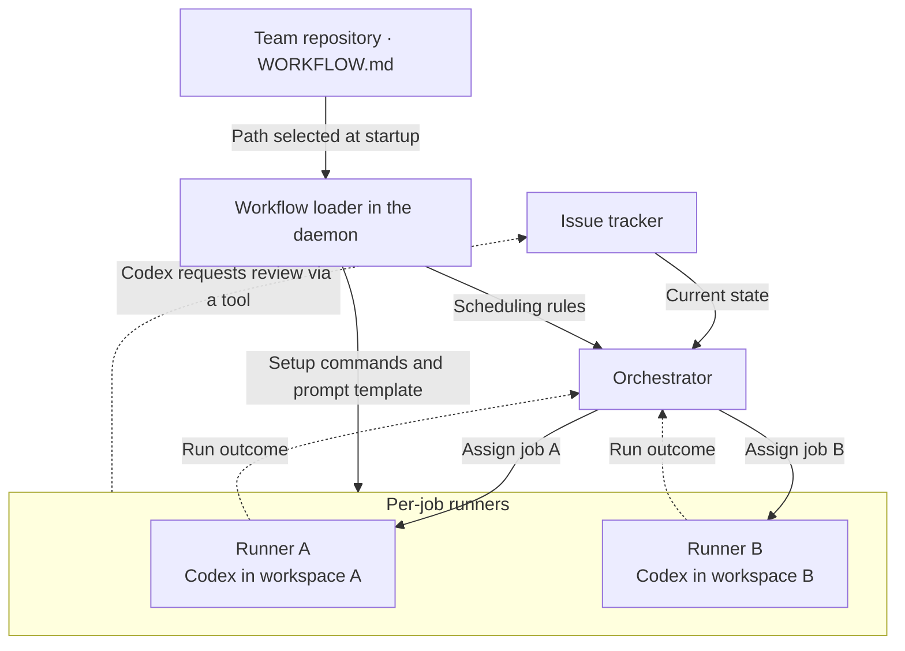
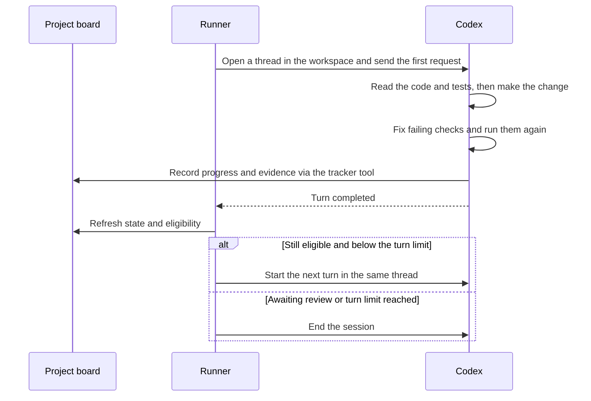
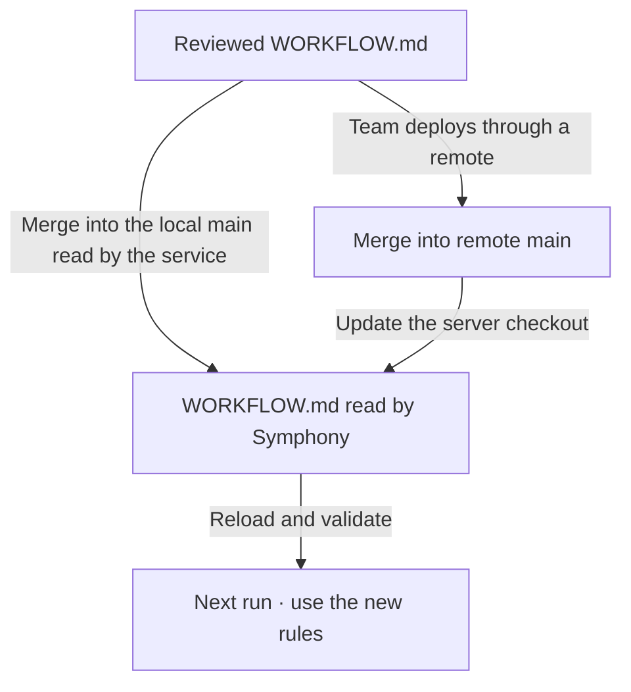

## TL;DR

- Symphony assigns work from a team’s project board to coding agents.
- OpenAI distilled its internal approach into a standalone specification.
- Teams define their own checks and handoff rules in `WORKFLOW.md`.

## Introduction

**OpenAI Symphony is an open-source project that connects a team’s project board to coding agents.** Say a developer files a bug in Linear, a project management tool, and marks it ready for work. Symphony prepares a directory for the job and launches Codex there. The developer can follow the link to the code changes and read the test results on the board, then request another pass or approve the change.[^1]

In an earlier article about software factories, I mentioned Symphony as a way to distribute work across agents.[^2] Before building Symphony, OpenAI’s engineers had to open Codex conversations one by one to find out which jobs had finished and which had stalled.[^1]

## 1. From an internal experiment to an open specification

In late August 2025, a team at OpenAI made the first commit to an internal productivity tool. They had decided that Codex would write every line of code in the repository. The engineers organized the repository so Codex could find the documentation and tools it needed, and set up automated checks so it could tell when a change was wrong.[^3][^1]

The team found that most engineers could comfortably keep track of three to five Codex sessions at a time. Beyond that, they lost track of which window held which task or discovered too late that a job had stalled. They decided to try letting agents pick up work from the Linear board the team already used.[^1]

The first version of Symphony was a single Codex session running inside `tmux`, a tool that keeps terminal sessions alive. The session polled Linear and spawned subagents for new tasks. It could assign work, but the team found it hard to keep that setup running reliably. The team built the second version inside its internal product repository, where the agents already had tools and tests. Once the basics worked, **the team used Symphony to build Symphony itself.**[^1]

At an internal demo, an agent completed a task and attached a video of the working feature to its ticket. Other teams began using Symphony on their own, convincing the developers to share it outside OpenAI.[^1]

The team removed dependencies on its internal repository and described the core behavior in a standalone **specification**, `SPEC.md`. They gave that document to Codex and asked it to build the **Elixir reference implementation** now available in the public repository. Other teams can use the same specification to build a service suited to their own environment.[^1]

## 2. One long-running service, one Codex session per active job

The Elixir reference implementation runs as a **daemon**, a service that stays up between jobs. When a developer files work in an issue tracker such as Linear or GitHub Issues, the already-running daemon picks it up by polling the board.[^4]

Before starting the daemon, the development team prepares **`WORKFLOW.md`** in the project repository. OpenAI suggests copying its example and adapting it to the team’s board, source repository, checks, and review process. If an operator has checked out the project at `/srv/encbird` on the host, for instance, they pass `/srv/encbird/WORKFLOW.md` as the workflow path at startup. If they omit the path, Symphony uses `WORKFLOW.md` in the directory from which it was launched.[^10][^13]

**That one file is the daemon’s workflow source.** The loader separates the YAML settings at the top from the Markdown body below. The daemon validates the settings before polling the board and keeps the body as a template for the instructions it will send on each assignment.[^4][^10]

Inside the service, the **orchestrator** decides what to start and stop. A tracker adapter translates each provider’s issues into a common format. When the orchestrator assigns work, an **agent runner** asks the workspace manager for that issue’s directory and starts a conversation with Codex there. Give it two jobs at the same time and two Codex sessions follow the same team rules, each editing files in its own directory.[^4][^6]





The **tracker** holds the status the team sees, the **orchestrator’s memory** holds active runs and scheduled retries, and the **workspace** holds the files the agent edited. If someone cancels a job on the tracker, the orchestrator reads the change and stops the run. When Codex finishes implementing a change, it requests review through a tracker tool. The tool records the result using credentials on the Symphony host. The reviewer and the orchestrator can then read the same status.[^4][^7]

## 3. How WORKFLOW.md becomes runtime settings and a first prompt

This excerpt comes from OpenAI’s example for working on the Symphony repository itself. The settings say when to launch runners, how many can run, and what code goes into a new workspace. The text below them is addressed to Codex.[^5]


```markdown
---
tracker:
  active_states: [Todo, In Progress, Merging, Rework]
polling:
  interval_ms: 5000
hooks:
  after_create: |
    git clone --depth 1 https://github.com/openai/symphony .
agent:
  max_concurrent_agents: 10
---
You are working on a Linear ticket `{{ issue.identifier }}`
Title: {{ issue.title }}
```


**When selecting work**, the orchestrator polls Linear every five seconds for issues in `active_states`. This workflow allows ten concurrent runs. If all ten slots are taken, a new candidate waits. When an assignment needs a new directory, the workspace manager runs the `after_create` command in it. This example clones Symphony itself, so a team adapting the file would change the clone URL to its own repository.[^5][^6]

**At the start of the first turn**, the runner takes the body template the daemon loaded and fills it with the assigned issue. If Linear issue `ENG-42` is titled “Weekly learning report,” the first message to Codex contains “You are working on a Linear ticket `ENG-42`” and “Title: Weekly learning report.” The full example’s body also has placeholders for the issue description and current state. The runner sends the completed message to `codex app-server` to start the first turn. Later turns in the same thread get a short prompt to continue, since the original instructions are already in the conversation.[^5][^12][^14]

Following those instructions, Codex moves a new `Todo` issue to `In Progress` and keeps its plan, acceptance criteria, and checks in **one issue comment called the Codex Workpad**. It includes any test plan specified on the issue and updates the same comment as work progresses.[^5]

Codex links its pull request (PR) to the issue, checks the results for the latest commit, and reads the review feedback. If a comment calls for a change, Codex makes it and runs the checks again. Once the checks pass and the feedback has been addressed, it moves the issue to `Human Review`. **That state is missing from the active list above**, so the orchestrator stops the run while a person reviews the result.[^5]

If the reviewer approves the change and moves the issue to `Merging`, Codex follows the example’s merge procedure and moves the issue to `Done` once the PR lands. If the reviewer requests changes and moves it to `Rework`, Codex rereads the issue and feedback, then closes the old PR. In this workflow it starts a new branch from the latest `main` and writes a fresh plan in a new Workpad comment.[^5]

## 4. Running sessions in parallel and recovering interrupted work

### Choosing what can start

On each poll, the orchestrator checks running jobs against the tracker first. It stops any that have become ineligible. Then it considers candidates with the required state and labels in priority order, oldest first within a priority. It skips jobs already running or reserved for a retry, and starts a runner only when the overall limit and the limit for that state both allow it. When a team leaves the polling interval unspecified, the default is 30 seconds.[^4][^5][^6]

For example, OpenAI’s team marked its Vite migration as a prerequisite for a React upgrade in Linear. The Elixir Linear adapter marks a `Todo` issue as ineligible while a prerequisite is still open. The orchestrator can skip the upgrade and assign other work that can already start.[^1][^11]

### While Codex is editing the code

The runner creates or reopens a directory named for the issue. If two jobs edit the same file, their separate copies let each agent test its own changes without picking up the other agent’s unfinished edits. The `after_create` hook runs only when a directory is new. OpenAI’s example uses it to clone the Symphony repository. Setup that must also run on later attempts in the same directory belongs in `before_run`. Separate sandbox settings control where Codex can write outside that directory and what network access it has.[^5][^6]

The runner launches `codex app-server` in that directory. The Elixir implementation initializes the connection, opens a conversation with `thread/start`, and sends the issue details and team instructions with `turn/start`. The work Codex does between that request and its response is one **turn**.[^12]





When a check fails, **Codex** reads the output and chooses what to fix. It can edit and test several times within a turn. Meanwhile, the runner forwards progress events to the orchestrator. **After the turn, the runner reads the tracker again.** If the issue is still eligible and there are turns left (20 per run by default), the runner continues the same conversation.[^4][^6][^12]

### What survives an interruption

When a runner stops, the orchestrator checks the reason and the last event Codex sent. It also stops a live runner if no new event arrives within the configured timeout (five minutes by default). Whether it retries then depends on whether Codex was waiting for someone to respond.[^4][^6]

| Why the run stopped | What the orchestrator does next |
| --- | --- |
| The runner exited normally with no outstanding request for input or approval | Symphony checks the issue one second later. If it is still eligible and a slot is free, a **new session** opens in the same directory. |
| The runner failed or stalled without an outstanding request for input or approval | Symphony schedules a retry. Successive failures increase the delay, starting at 10, 20, and 40 seconds. |
| The runner exited with a recorded request for input or approval | The orchestrator records the reason and marks the job as blocked. It does not start a retry timer for that job. |
| The Symphony service restarted | In-memory sessions and timers don’t carry over. The service reads the tracker, cleans up workspaces for terminal issues, and can start eligible jobs again in their surviving directories. |

A fresh session doesn’t inherit the previous conversation. In the example workflow, Codex checks **the remaining items in the Workpad, the changes in the workspace, and any PR already linked to the issue**. For example, if the connection dropped while Codex was opening a PR, the next session checks whether a PR already exists for that branch before going any further. Operators can use the issue and session identifiers in the logs to find the last event and the reason for a retry.[^5][^6][^8]

## 5. What Symphony would do in EncBird

In EncBird, the English-learning app I develop, verified changes are first integrated into the primary checkout’s local `main` branch. Pushing them to the remote repository or deploying the app requires a separate request.

Suppose EncBird adopted Symphony and GitHub issue 600 requested a **weekly learning report**. The issue could say, “Show total study time for the last seven days, the five expressions the learner most often got wrong, and expressions to practice next week. All three must be readable on mobile.”

EncBird could make open issues with the `symphony` label eligible for work. If a slot is free at the next poll, the runner prepares a directory called `GH-600`. An `after_create` hook could clone the local `main` from EncBird’s primary repository into it and create a working branch. The working branch would include changes on local `main` even if they hadn’t been pushed yet. Once the runner starts Codex in that directory, Codex copies the criteria from the issue into its Workpad checklist.[^9]

Give the learner 20 minutes of study today, 10 minutes six days ago, and five minutes seven days ago. A seven-day report that includes today should show 30 minutes. If it shows 35, it counted the five minutes outside the window. Codex fixes the date filter and reruns the check.

What if the session stops after verifying the total but before checking the mobile screen? The Workpad says “seven-day total verified, mobile check pending,” and the edited code is still in the workspace. The next session can compare the two and pick up the mobile check.

The team reviews a local commit in the workspace. Once Codex has checked the weekly total, the lists of expressions, and the mobile screen, it records the web app’s type-check, test, and build results plus the commit ID on the issue. **Its last action** is to replace `symphony` with `human-review`. Removing the required label earlier could let the next poll stop the runner before it saved the commit or recorded the checks.[^4][^9]

To request changes, the reviewer leaves a comment and switches the labels back. A new session can read the feedback and continue with the code in the same directory. On approval, the reviewer integrates the changes into the primary checkout outside `GH-600` before closing the issue, since Symphony cleans up workspaces for terminal issues.[^4][^9]

### When several teams share a board

OpenAI describes the Elixir reference implementation as an evaluation prototype. In the default local setup, the daemon keeps assignments and retry state in memory, and runners launch Codex processes on the host. If two such daemons poll the same board, neither sees the other’s assignments. Both could launch a runner for the same issue.[^8][^13] One way to run jobs for several teams in the cloud is to elect one daemon at a time to assign work and scale the workers separately in per-job containers.

What happens if the server is replaced just after the report passes the seven-day total check? The new daemon can find the issue on the board and assign it again. But if the edited code existed only on the old server’s temporary disk, all the new worker gets is the note saying “mobile check pending.” Keeping each issue’s workspace on a persistent volume would let the new worker mount the same directory and run the mobile check against the code that passed the total check.

## 6. When Symphony picks up a new team rule

If the reviewer keeps asking “Did you include a record just outside the seven-day window?”, the team could add an instruction to `WORKFLOW.md` to check the date boundaries and record the results whenever the report changes. An agent can prepare that change and send it for review too.

Codex edits the file in its workspace. Symphony reads **the file at the path selected at startup**. In the EncBird example, if that path points to `WORKFLOW.md` in the primary checkout, merging the reviewed change into the local `main` branch updates the file Symphony reads. A team that deploys through a remote repository to a separate server would merge into the remote `main` branch and then update the checkout on the server.[^10]





In the reference implementation, `WorkflowStore` periodically checks the selected file for changes. When it changes, the store rereads the file, validates its settings, and keeps the valid settings and prompt template together. The next job can receive the new instructions without restarting the service or any running session. A new concurrency limit affects subsequent scheduling decisions. An edit to `after_create` changes which commands the host executes when it next creates a workspace. If the reload fails, the service keeps its last good configuration and reports the error to the operator.[^10]

Learners see changes to the report screen when EncBird ships the app. Changing the scheduling algorithm requires deploying a new version of Symphony. To change how the report is checked and handed over, the team updates `WORKFLOW.md`.

## 7. How Performance Factory uses telemetry to investigate a regression

In OpenAI’s Symphony example, Codex merges the PR after a reviewer approves it, then moves the issue to `Done`. But if the reason for changing the code was that ChatGPT had slowed down, when is the job done? OpenAI’s performance team described **Performance Factory** on November 19. I see it as an example of **AIOps**, the use of AI to automate service operations.[^15]

When a performance alert fires, a dedicated task service opens an investigation. A dispatcher periodically checks which tasks are ready for their next step and starts Codex turns in the cloud. An agent can query metrics, logs, and traces that follow a request across services, then record its findings on the task. While a PR awaits review, the session can end. When a review comment matches the task’s subscription, the task becomes ready again and the dispatcher can assign the next turn.[^15]

In one investigation, an agent traced failing ChatGPT conversations to image download errors and recorded that it had found the cause. A separate Codex session reviewing the diagnosis noticed that **image requests were still failing after the internal service responsible for locating files had recovered**. The first diagnosis couldn’t account for those later failures, so the reviewer reopened the investigation.[^15]

In this workflow, once an engineer reviews and deploys a fix, recovery still has to be verified. Another agent compares production performance with its earlier baseline and closes the task if performance has recovered. If there’s no improvement, the task goes back to investigation. If recovery is partial, the agent closes the original task and opens a new one for the remaining slowdown.[^15]

In my earlier article on observability, I argued that diagnosing a failure takes metrics and logs from across the services a request passes through. In the software factory article, I argued that an agent can decide what to do next only if it can see whether the same failures decline after deployment.[^16][^17] Performance Factory puts that idea into practice. **An agent can look beyond the service that raised the alert and check whether requests actually recover after a fix.**

## Closing thoughts

What stayed with me was that OpenAI’s product manager and designer get a video of the feature they asked for.[^1] Running Symphony across teams would take more work, but I like that the person who requested a change can judge whether it does what they wanted without following every Codex session.

[^1]: Alex Kotliarskyi, Victor Zhu, Zach Brock, OpenAI. [An open-source spec for Codex orchestration: Symphony](https://openai.com/index/open-source-codex-orchestration-symphony/), 2026-04-27.
[^2]: [Building a Software Factory: Lessons from AWS Emulator](/en/2026/11/16/building-software-factory-with-aws-emulator.html)
[^3]: Ryan Lopopolo, OpenAI. [Harness engineering: leveraging Codex in an agent-first world](https://openai.com/index/harness-engineering/), 2026-02-11.
[^4]: OpenAI Symphony, Draft v1 specification and Elixir reference implementation (`be10a1b`). [Architecture and design goals](https://github.com/openai/symphony/blob/be10a1b79df723d6d7612b5651c8522704dafb2e/SPEC.md#3-system-overview), [Scheduling and reconciliation](https://github.com/openai/symphony/blob/be10a1b79df723d6d7612b5651c8522704dafb2e/SPEC.md#8-polling-scheduling-and-reconciliation)
[^5]: OpenAI Symphony. [The Elixir reference workflow](https://github.com/openai/symphony/blob/be10a1b79df723d6d7612b5651c8522704dafb2e/elixir/WORKFLOW.md)
[^6]: OpenAI Symphony. [Orchestrator](https://github.com/openai/symphony/blob/be10a1b79df723d6d7612b5651c8522704dafb2e/elixir/lib/symphony_elixir/orchestrator.ex), [AgentRunner](https://github.com/openai/symphony/blob/be10a1b79df723d6d7612b5651c8522704dafb2e/elixir/lib/symphony_elixir/agent_runner.ex), [Workspace](https://github.com/openai/symphony/blob/be10a1b79df723d6d7612b5651c8522704dafb2e/elixir/lib/symphony_elixir/workspace.ex)
[^7]: OpenAI Symphony. [Tracker tools and authentication](https://github.com/openai/symphony/blob/be10a1b79df723d6d7612b5651c8522704dafb2e/SPEC.md#105-approval-tool-calls-and-user-input-policy)
[^8]: OpenAI Symphony. [Runtime logs and observability](https://github.com/openai/symphony/blob/be10a1b79df723d6d7612b5651c8522704dafb2e/SPEC.md#13-logging-status-and-observability), [Recovery after a restart](https://github.com/openai/symphony/blob/be10a1b79df723d6d7612b5651c8522704dafb2e/SPEC.md#143-partial-state-recovery-restart)
[^9]: OpenAI Symphony. [GitHub Issues adapter](https://github.com/openai/symphony/blob/be10a1b79df723d6d7612b5651c8522704dafb2e/elixir/lib/symphony_elixir/github/adapter.ex), [Issue identifiers and labels](https://github.com/openai/symphony/blob/be10a1b79df723d6d7612b5651c8522704dafb2e/elixir/lib/symphony_elixir/github/client.ex)
[^10]: OpenAI Symphony. [Workflow path](https://github.com/openai/symphony/blob/be10a1b79df723d6d7612b5651c8522704dafb2e/SPEC.md#51-file-discovery-and-path-resolution), [Dynamic reload](https://github.com/openai/symphony/blob/be10a1b79df723d6d7612b5651c8522704dafb2e/SPEC.md#62-dynamic-reload-semantics), [WorkflowStore](https://github.com/openai/symphony/blob/be10a1b79df723d6d7612b5651c8522704dafb2e/elixir/lib/symphony_elixir/workflow_store.ex)
[^11]: OpenAI Symphony. [Checking prerequisites in the Linear adapter](https://github.com/openai/symphony/blob/be10a1b79df723d6d7612b5651c8522704dafb2e/elixir/lib/symphony_elixir/linear/client.ex)
[^12]: OpenAI Symphony. [Starting sessions and continuing turns](https://github.com/openai/symphony/blob/be10a1b79df723d6d7612b5651c8522704dafb2e/SPEC.md#102-session-startup-responsibilities), [Codex App Server client](https://github.com/openai/symphony/blob/be10a1b79df723d6d7612b5651c8522704dafb2e/elixir/lib/symphony_elixir/codex/app_server.ex)
[^13]: OpenAI Symphony, [Elixir reference implementation, intended use and per-project setup](https://github.com/openai/symphony/blob/be10a1b79df723d6d7612b5651c8522704dafb2e/elixir/README.md), [CLI workflow path handling](https://github.com/openai/symphony/blob/be10a1b79df723d6d7612b5651c8522704dafb2e/elixir/lib/symphony_elixir/cli.ex)
[^14]: OpenAI Symphony, [PromptBuilder for issue and attempt data](https://github.com/openai/symphony/blob/be10a1b79df723d6d7612b5651c8522704dafb2e/elixir/lib/symphony_elixir/prompt_builder.ex), [AgentRunner handling of first and continuation turns](https://github.com/openai/symphony/blob/be10a1b79df723d6d7612b5651c8522704dafb2e/elixir/lib/symphony_elixir/agent_runner.ex)
[^15]: Okay Zed, Cyrus Forbes, OpenAI. [How OpenAI’s Performance Factory keeps ChatGPT fast](https://openai.com/index/how-openai-performance-factory-keeps-chatgpt-fast/), 2026-11-19.
[^16]: [Observability and OpenTelemetry, Part 1 (in Korean)](/2021/11/30/demystifying-observability-and-opentelemetry-1.html)
[^17]: [How a Software Factory Can Improve Itself — Evals, KPIs, and Tension Metrics](/en/2026/10/05/software-factory-evals-and-tension-metrics.html)
