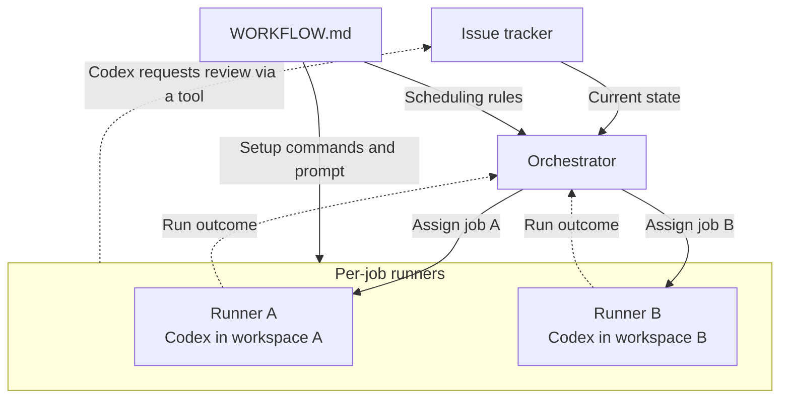
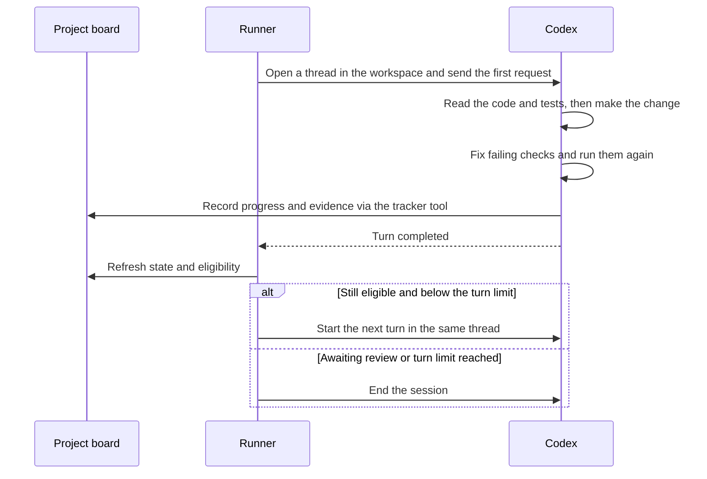
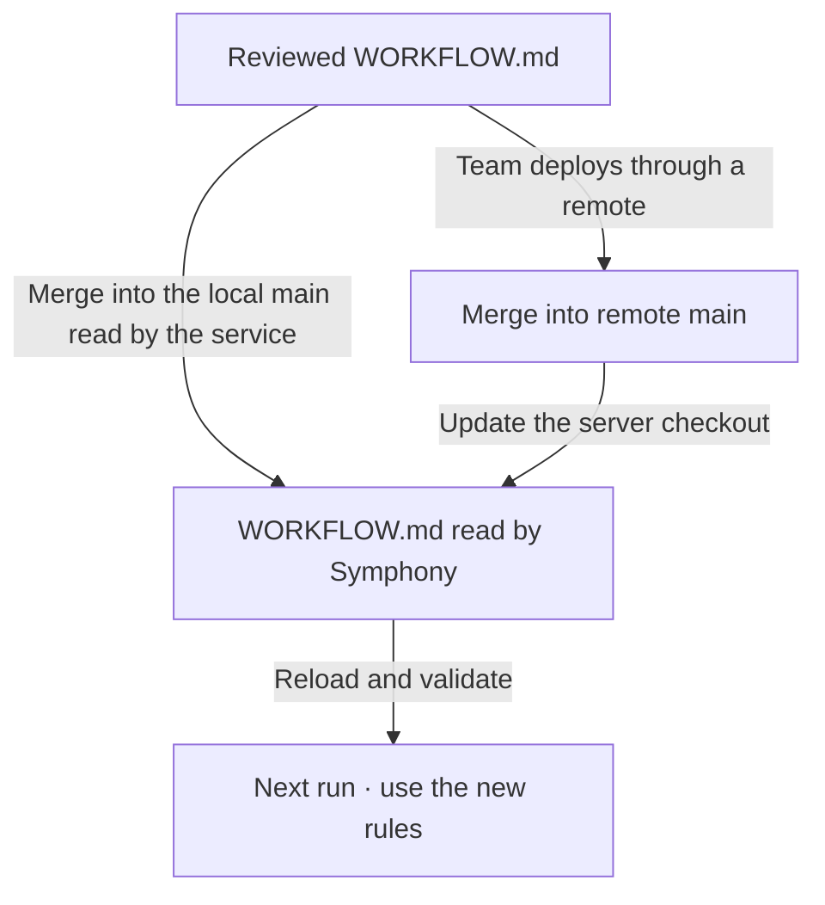

## TL;DR

- Symphony assigns work from a team’s project board to coding agents.
- OpenAI distilled its internal approach into a standalone specification.
- Teams define their own checks and handoff rules in `WORKFLOW.md`.

## Introduction

**OpenAI Symphony is an open-source project that connects a team’s project board to coding agents.** Say a developer files a bug in Linear, a project management tool, and marks it ready for work. Symphony prepares a directory for the job and launches Codex there. The developer can follow the link to the code changes and read the test results on the board, then request another pass or approve the change.[^1]

In an earlier article about software factories, I mentioned Symphony as a way to distribute work across agents.[^2] At OpenAI, engineers had to open Codex conversations one by one just to find out which jobs had finished and which had stalled. The team built Symphony to take that work off their hands.[^1]

## 1. From an internal experiment to an open specification

In late August 2025, a team at OpenAI made the first commit to an internal productivity tool. They had decided that Codex would write every line of code in the repository. The engineers organized the repository so Codex could find the documentation and tools it needed, and set up automated checks so it could tell when a change was wrong.[^3][^1]

The team found that most engineers could comfortably keep track of three to five Codex sessions at a time. Beyond that, they lost track of which window held which task or discovered too late that a job had stalled. They decided to try letting agents pick up work from the Linear board the team already used.[^1]

The first version was a single Codex session running inside `tmux`, a tool that keeps terminal sessions alive. The session polled Linear and spawned subagents for new tasks. The idea worked, but the setup was unreliable. The team built the second version inside its internal product repository, where the agents already had tools and tests. Once the basics worked, **the team used Symphony to build Symphony itself.**[^1]

At an internal demo, the team showed agents handling work and attaching a video of the finished feature in action to its ticket. The project channel grew, and other teams started using the system on their own. That adoption convinced the team to share Symphony outside OpenAI.[^1]

The team removed dependencies on its internal repository and described the core behavior in a standalone **specification**, `SPEC.md`. They gave that document to Codex and asked it to build the service in Elixir. That program is the **reference implementation** available in the public repository. Other teams can use the same specification to build a service suited to their own environment.[^1]

## 2. One long-running service, one Codex session per active job

Symphony reads the work a team has assigned and its current status from an **issue tracker** such as Linear or GitHub Issues. The team specifies how many jobs can run at once and what the agent should do in a repository file called **`WORKFLOW.md`**. At startup, the workflow loader reads this file and separates the settings at the top from the prompt template below. The service validates the settings before polling the board.[^4]

Inside the service, the **orchestrator** decides what to start and stop. A tracker adapter translates each provider’s issues into a common format. When the orchestrator assigns work, an **agent runner** asks the workspace manager for that issue’s directory and starts a conversation with Codex there. Give it two jobs at the same time and two Codex sessions follow the same team rules, each editing files in its own directory.[^4][^6]





The **tracker** holds the status the team sees, the **orchestrator’s memory** holds active runs and scheduled retries, and the **workspace** holds the files the agent edited. If someone cancels a job on the tracker, the orchestrator reads the change and stops the run. When Codex finishes implementing a change, it requests review through a tracker tool. The tool records the result using credentials on the Symphony host. The reviewer and the orchestrator can then read the same status.[^4][^7]

## 3. How WORKFLOW.md expresses a team’s development process

In this excerpt from OpenAI’s `WORKFLOW.md`, the YAML settings at the top list four Linear states that make work eligible for Codex and allow up to ten jobs to run at once.[^5]


```markdown
---
tracker:
  active_states: [Todo, In Progress, Merging, Rework]
agent:
  max_concurrent_agents: 10
---
You are working on a Linear ticket `{{ issue.identifier }}`
```


The runner fills in the issue identifier on the last line. The first request also includes the title, current state, and description from the tracker. In the example workflow, Codex moves a new `Todo` issue to `In Progress` and creates or opens **one issue comment called the Codex Workpad**. It keeps the plan, acceptance criteria, and checks in that comment, updating it as work progresses. Any test plan specified on the issue goes on the checklist.[^5]

Codex links its pull request (PR) to the issue, checks the results for the latest commit, and reads the review feedback. If a comment calls for a change, Codex makes it and runs the checks again. Once that work is complete, it moves the issue to `Human Review`. **That state is missing from the active list above**, so the orchestrator stops the run while a person reviews the result.[^5]

Approval moves the issue to `Merging`, making it eligible again. The example tells Codex to follow the team’s merge procedure and move the issue to `Done` once the PR has landed. A request for changes that sends the issue to `Rework` has a different effect. This particular workflow tells Codex to reread the issue and feedback, then close the old PR. It starts a fresh branch from the latest `main` and writes a new Workpad comment on the issue with a revised plan. The team gets to decide how much work a review decision reopens.[^5]

## 4. Running sessions in parallel and recovering interrupted work

### Choosing what can start

On each poll, the orchestrator checks running jobs against the tracker first. It stops jobs that have become ineligible and leaves the others running. Then it considers candidates with the required state and labels in priority order, oldest first within a priority. It skips jobs already running or reserved for a retry, and starts a runner only when the overall limit and the limit for that state both allow it. The specification defaults to a 30-second polling interval. OpenAI’s full example `WORKFLOW.md` sets it to five seconds.[^4][^5][^6]

A free slot alone may not be enough. OpenAI’s team recorded in Linear that a React upgrade depended on a Vite migration. The Elixir Linear adapter marks a `Todo` issue as ineligible while a prerequisite is still open. The orchestrator can skip the upgrade and assign other work that can already start.[^1][^11]

### While Codex is editing the code

The runner creates or reopens a directory named for the issue. If two jobs edit the same file, their separate copies let each agent test its own changes without picking up the other agent’s unfinished edits. The `after_create` hook runs only when a directory is new. OpenAI’s example uses it to clone the Symphony repository. Setup that must also run on later attempts in the same directory belongs in `before_run`. Separate sandbox settings control where Codex can write outside that directory and what network access it has.[^5][^6]

The runner launches `codex app-server` in that directory. The Elixir implementation initializes the connection, opens a conversation with `thread/start`, and sends the issue details and team instructions with `turn/start`. The work Codex does between that request and its response is one **turn**.[^12]





When a check fails, **Codex** reads the output and chooses what to fix. It can edit and test several times within a turn. Meanwhile, the runner forwards progress events to the orchestrator. **After the turn, the runner reads the tracker again.** If the issue still calls for work, the runner can ask Codex to continue in the same thread without resending the entire first prompt. The default limit is 20 turns per run.[^4][^6][^12]

### What survives an interruption

When the runner itself exits, the orchestrator checks the reason and the last session event. A process can also be alive but stalled. If the time since the last Codex event exceeds the configured timeout (five minutes by default), the orchestrator stops the worker. It marks the job as blocked if the session was waiting for input or approval. Otherwise, it schedules a retry.[^4][^6]

| What finished | How Symphony continues |
| --- | --- |
| Codex finished working on one request and responded | If the work is still eligible and there are turns left, the runner sends the next request in the same conversation. The thread still holds the earlier requests and check results. |
| The runner exited normally with no outstanding request for input or approval | Symphony checks the issue one second later. If it is still eligible and a slot is free, a **new session** opens in the same directory. |
| An execution error stopped the runner | Unless the run is waiting for a person to respond, Symphony schedules a retry. Successive failures increase the delay, starting at 10, 20, and 40 seconds. |
| The runner exited with a recorded request for input or approval | The orchestrator records the reason and marks the job as blocked. It does not start a retry timer for that job. |
| The Symphony service restarted | In-memory sessions and timers don’t carry over. The service reads the tracker, cleans up workspaces for terminal issues, and can start eligible jobs again in their surviving directories. |

A fresh session doesn’t inherit the previous conversation. In the example workflow, Codex checks **the remaining items in the Workpad, the changes in the workspace, and any PR already linked to the issue**. If a session was interrupted just after opening a PR, the next one checks that PR’s status first. The board and the files preserve progress. The next session still has to inspect them to see which actions actually succeeded. Operators can use the issue and session identifiers in the logs to find the last event and the reason for a retry.[^5][^6][^8]

## 5. What Symphony would do in EncBird

In EncBird, the English-learning app I develop, verified changes are first integrated into the primary checkout’s local `main` branch. Pushing them to the remote repository or deploying the app requires a separate request.

Suppose EncBird adopted Symphony and GitHub issue 600 requested a **weekly learning report**. The issue could say, “Show total study time for the last seven days, the five expressions the learner most often got wrong, and expressions to practice next week. All three must be readable on mobile.” Suppose the team also asks Codex to copy these criteria into its Workpad checklist.

EncBird could make open issues with the `symphony` label eligible for work. If a slot is free at the next poll, the runner prepares a directory called `GH-600`. An `after_create` hook could clone the local `main` from EncBird’s primary repository into it and create a working branch. The agent would get changes on local `main` even if they hadn’t been pushed yet.[^9]

Three study records are enough to catch a one-day error in that total. Give the learner 20 minutes of study today, 10 minutes six days ago, and five minutes seven days ago. A seven-day report that includes today should show 30 minutes. If it shows 35, Codex fixes the date filter and reruns the same check. Suppose the sum now passes but the session stops before the mobile check. With “seven-day total verified, mobile check pending” in the Workpad and the edited files in the workspace, the next session can compare the note with the current code and pick up the remaining check.

The team reviews a local commit in the workspace. Once Codex has checked the weekly total, the lists of expressions, and the mobile screen, it records the web app’s type-check, test, and build results plus the commit ID on the issue. **Its last action** is to replace `symphony` with `human-review`. Removing the required label earlier could let the next poll stop the runner before it saved the commit or recorded the checks.[^4][^9]

To request changes, the reviewer leaves a comment and switches the labels back. A new session can read the feedback and continue with the code in the same directory. On approval, the reviewer integrates the changes into the primary checkout outside `GH-600` before closing the issue, since Symphony cleans up workspaces for terminal issues.[^4][^9]

## 6. When Symphony picks up a new team rule

If the reviewer keeps asking “Did you include a record just outside the seven-day window?”, the team could add an instruction to `WORKFLOW.md` to check the date boundaries and record the results whenever the report changes. An agent can prepare that change and send it for review too.

Codex edits the file in its workspace. Symphony reads **the file at the path selected at startup**. In the EncBird example, if that path points to `WORKFLOW.md` in the primary checkout, merging the reviewed change into the local `main` branch updates the file Symphony reads. A team that deploys through a remote repository to a separate server would merge into the remote `main` branch and then update the checkout on the server.[^10]





When the file on the host changes, Symphony reloads the configuration and prompt without restarting. A prompt edit changes the instructions for future runs. A new concurrency limit affects subsequent scheduling decisions. An edit to `after_create` changes which commands the host executes when it next creates a workspace. Sessions already in flight don’t need to restart. If the reload fails, the service keeps its last good configuration and reports the error to the operator.[^10]

Product code reaches users through the product’s release process. Changing the orchestrator’s scheduling algorithm calls for deploying a new version of the Symphony service. The team can change its verification and handoff rules independently of either release.

## Closing thoughts

What stood out to me in OpenAI’s account was how the team’s product manager and designer use Symphony. They can request a feature on the board and receive a video showing it working in the actual product.[^1] The person who asked for the change can say “That’s what I meant” or “This part needs another pass” without having to open a Codex session.

[^1]: Alex Kotliarskyi, Victor Zhu, Zach Brock, OpenAI. [An open-source spec for Codex orchestration: Symphony](https://openai.com/index/open-source-codex-orchestration-symphony/), 2026-04-27.
[^2]: [Building a Software Factory: Lessons from AWS Emulator](/en/2026/11/16/building-software-factory-with-aws-emulator.html)
[^3]: Ryan Lopopolo, OpenAI. [Harness engineering: leveraging Codex in an agent-first world](https://openai.com/index/harness-engineering/), 2026-02-11.
[^4]: OpenAI Symphony, Draft v1 specification and Elixir reference implementation (`be10a1b`). [Architecture and design goals](https://github.com/openai/symphony/blob/be10a1b79df723d6d7612b5651c8522704dafb2e/SPEC.md#3-system-overview), [Scheduling and reconciliation](https://github.com/openai/symphony/blob/be10a1b79df723d6d7612b5651c8522704dafb2e/SPEC.md#8-polling-scheduling-and-reconciliation)
[^5]: OpenAI Symphony. [The Elixir reference workflow](https://github.com/openai/symphony/blob/be10a1b79df723d6d7612b5651c8522704dafb2e/elixir/WORKFLOW.md)
[^6]: OpenAI Symphony. [Orchestrator](https://github.com/openai/symphony/blob/be10a1b79df723d6d7612b5651c8522704dafb2e/elixir/lib/symphony_elixir/orchestrator.ex), [AgentRunner](https://github.com/openai/symphony/blob/be10a1b79df723d6d7612b5651c8522704dafb2e/elixir/lib/symphony_elixir/agent_runner.ex), [Workspace](https://github.com/openai/symphony/blob/be10a1b79df723d6d7612b5651c8522704dafb2e/elixir/lib/symphony_elixir/workspace.ex)
[^7]: OpenAI Symphony. [Tracker tools and authentication](https://github.com/openai/symphony/blob/be10a1b79df723d6d7612b5651c8522704dafb2e/SPEC.md#105-approval-tool-calls-and-user-input-policy)
[^8]: OpenAI Symphony. [Runtime logs and observability](https://github.com/openai/symphony/blob/be10a1b79df723d6d7612b5651c8522704dafb2e/SPEC.md#13-logging-status-and-observability), [Recovery after a restart](https://github.com/openai/symphony/blob/be10a1b79df723d6d7612b5651c8522704dafb2e/SPEC.md#143-partial-state-recovery-restart)
[^9]: OpenAI Symphony. [GitHub Issues adapter](https://github.com/openai/symphony/blob/be10a1b79df723d6d7612b5651c8522704dafb2e/elixir/lib/symphony_elixir/github/adapter.ex), [Issue identifiers and labels](https://github.com/openai/symphony/blob/be10a1b79df723d6d7612b5651c8522704dafb2e/elixir/lib/symphony_elixir/github/client.ex)
[^10]: OpenAI Symphony. [Workflow path](https://github.com/openai/symphony/blob/be10a1b79df723d6d7612b5651c8522704dafb2e/SPEC.md#51-file-discovery-and-path-resolution), [Dynamic reload](https://github.com/openai/symphony/blob/be10a1b79df723d6d7612b5651c8522704dafb2e/SPEC.md#62-dynamic-reload-semantics), [WorkflowStore](https://github.com/openai/symphony/blob/be10a1b79df723d6d7612b5651c8522704dafb2e/elixir/lib/symphony_elixir/workflow_store.ex)
[^11]: OpenAI Symphony. [Checking prerequisites in the Linear adapter](https://github.com/openai/symphony/blob/be10a1b79df723d6d7612b5651c8522704dafb2e/elixir/lib/symphony_elixir/linear/client.ex)
[^12]: OpenAI Symphony. [Starting sessions and continuing turns](https://github.com/openai/symphony/blob/be10a1b79df723d6d7612b5651c8522704dafb2e/SPEC.md#102-session-startup-responsibilities), [Codex App Server client](https://github.com/openai/symphony/blob/be10a1b79df723d6d7612b5651c8522704dafb2e/elixir/lib/symphony_elixir/codex/app_server.ex)
