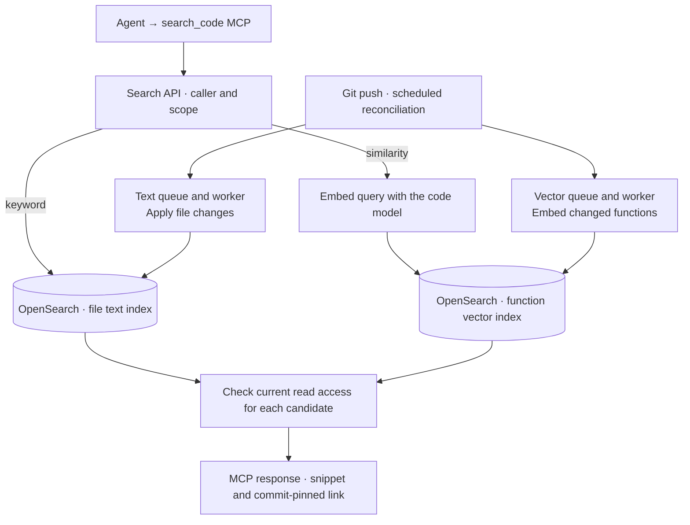
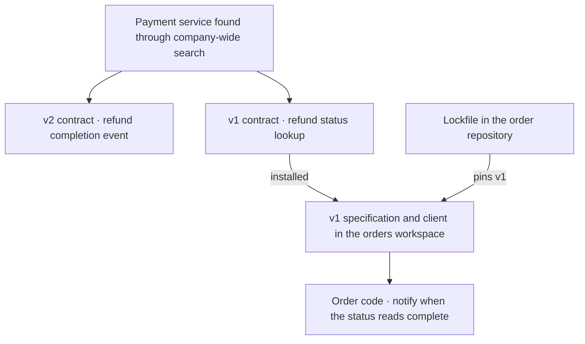
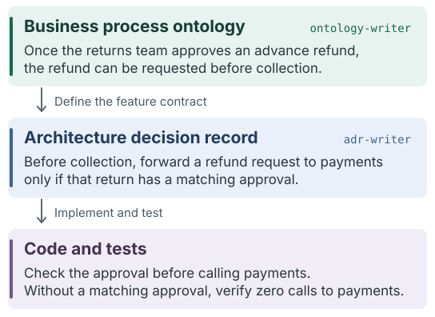

## TL;DR

- Give agents full-text search across code and documents in all repositories.
- Implement against the contract version your repository has adopted.
- Model business processes in the language people use at work.

## Introduction

In May 2026, Anthropic merged about 2,500 changes a day into its monorepo on average. By September it was merging more than 30,000 a day. CI alone was checking out code for builds and tests around 25 million times a day. Even hundreds of Git mirrors struggled to keep up. Anthropic built its own version control system and migrated the monorepo from Git to Scion in five months.[^1]

In a software factory, agents take requirements through implementation and testing. As they write code faster, the speed of development also depends on how quickly changes can be merged and the source delivered to the systems that test them. When teams work in separate repositories, they also have to decide **which version of the code the agent should receive**.

My team at Amazon keeps several components in one repository. The code for other teams' services that we depend on changes independently in their repositories. Our team works in a monorepo, while the organization managing these services works across multiple repositories. For example, to change how the order service calls payments, you need to know which API version the orders team uses.

Domain-driven design (DDD) draws boundaries around business models and makes explicit what information crosses those boundaries. Applied to microservices, this lets one team change its implementation without forcing another to change its code, as long as the behavior promised to consumers holds.[^2]

For a coding agent, the same principle translates to **discover globally, understand locally**. Here, *discover globally* means running a text search over the contents of code and documents in every company repository. Finding where a term occurs requires no embeddings, the numerical representations used to search by meaning. To *understand locally*, read the version of the contract and code your repository has adopted before deciding how to use the service you found.

## 1. Spotify finds consumers across the company and proposes changes in their repositories

In a migration Spotify described in 2026, new versions of two user datasets affected about 1,800 pipelines that read the old datasets directly. The data team used Backstage, Spotify's internal developer portal, to identify downstream consumers, then searched the code to select the repositories to change.[^3]

Finding those repositories didn't tell Honk, Spotify's coding agent, how to edit them. When the team adapted a migration guide written for engineers, Honk sometimes guessed incorrectly which field in the new dataset corresponded to one in the old. The team supplied a table of field mappings. Where a change called for a decision by the consuming team, Honk left the field alone and added a comment pointing the reviewer to the guide.[^3]

Spotify opened 240 automated pull requests (PRs) for its SQL-based pipelines. The team left Scala-based pipelines out of the automated rollout because implementations varied considerably between repositories. Company-wide search answered **where to make the changes**. The data team's field mappings supplied the information the agent needed to implement them in each repository.[^3]

## 2. How we find a service at Amazon and choose a version

In a microservices architecture, a team owns a service and other teams use it through a published interface. That lets the service team change its implementation without coordinating a deployment with every consumer.[^4]

In my work at Amazon, that division of responsibility carries over to the repositories. The team providing a service versions the code and contracts it shares, and my team's repository records the dependency version we've adopted. When the provider ships a new release, we can keep developing against the existing contract for as long as it's supported.

At Amazon I use MCP (Model Context Protocol) tools to search internal code and unstructured documents such as wiki pages. The internal code search service offers both text matching and semantic search using embeddings of the code itself. An agent might start by searching the docs for “refund complete” and learn the name the payments team uses for the event. Searching the code for that name can lead it to the event definition and to tests in services that already handle it. The agent can start without knowing a repository or function name.

I think **a single company-wide tool that searches the full text of code and documents across all repositories would put most development problems within an agent's reach**. The agent can refine its search as it reads the original files, then check its working repository for the version to use. For a new integration, it can choose and record a version. For an existing one, it can read the contract and code for the version already installed.

### An MCP tool for keyword and similarity search with OpenSearch

One idea worth borrowing from Builder MCP is that the agent chooses how to search while a service behind the tool queries the indexes. I recommend exposing a single tool, `search_code`. The agent selects `keyword` when it knows a function name or error string and `similarity` when it can only describe the behavior. Search defaults to each repository's default branch. An agent can narrow the search by repository (`repo`), supported branch (`ref`), or path pattern (`path_glob`).[^5]

Keyword mode queries an OpenSearch inverted index that records which source files and documents contain each word or identifier. Similarity mode uses a separate vector index built directly from function bodies. At query time, the service embeds the question with the same model and retrieves the nearest functions as candidates. Both paths check the caller's access and return **the repository, branch, indexed commit, file and line range, a short snippet, and a link to the source at that commit**.





#### Finding a function, then tracing its uses

Suppose an agent needs to find the function that publishes an event when a refund completes. It knows the repository is `payments` but doesn't know the function name. Here are the parameters for the first MCP `tools/call` request.

```json
{
  "name": "search_code",
  "arguments": {
    "mode": "similarity",
    "query": "publish an event when a refund has completed",
    "repo": "payments"
  }
}
```

Suppose one result points to `payments@8e2b61a · src/refunds/complete.ts:41–48` and shows `emit(RefundCompleted)`. The agent now has an exact event name. It drops the repository restriction and searches test files for uses of that name.

```json
{
  "name": "search_code",
  "arguments": {
    "mode": "keyword",
    "query": "RefundCompleted",
    "path_glob": "**/*.test.ts"
  }
}
```

Cap the number of hits and the lines per snippet, and include a cursor for the next page. The agent can open just the files it needs. The returned commit identifies **the source of the search hit**. Before changing the order code, the agent checks which version of the payments contract the order repository has adopted.

#### Keeping up with commits and permission changes

A search for a newly added symbol that returns zero hits can easily mislead an agent. The symbol may be absent, the branch may be outside the index, or the workers may be catching up. Here's how I recommend handling those cases.

| Situation | Proposed behavior |
| --- | --- |
| New repository or routine push | Bulk-index the default branch and supported release branches once. On each push, queue the diff from the last applied commit. The text worker updates changed files. The vector worker embeds new functions and functions whose bodies have changed. |
| Moves, deletions, or shifted line numbers | Reuse the vector when the embedding input and model version match. If a file moves or an earlier edit shifts a function, update its result to point to the new commit, path, and line range. Remove entries for old paths and deleted files or functions from the corresponding indexes. |
| Missed, duplicate, or out-of-order events | Track the last successful commit per branch for each index. For example, reconcile against the actual Git branch tips nightly to catch missed updates and deletions. Replaying an event must give the same result, and an older job finishing late must not overwrite newer data. |
| Access revoked | Consume permission-change events separately to update candidate filters. Before returning results, recheck current read access to each source repository. Omit candidates the caller cannot read. If the authorization service is unavailable, return an error and withhold the results. Bind each pagination cursor to the caller and query. |
| Lag or partial failure | Give text and vector updates separate queues and worker capacity so keyword search keeps working when embeddings fall behind. For a branch-scoped query, show that mode's last indexed commit and time. Mark timeouts as partial and distinguish an unindexed branch from a genuine empty result. |

Retry transient indexing failures with backoff. Move repeated failures to a separate queue for investigation and replay. When replacing the embedding model, keep serving the old model while populating a new vector index, then switch the query model and index together.

A possible pilot target is **95% of supported-branch pushes visible in keyword search within two minutes**. Measure from receipt of the push until a search returns an added line or stops returning a deleted one. Track that delay and the age of the oldest queued job separately for similarity search. Use real queries that keyword search missed to measure how often similarity search finds the needed function before investing more capacity in it.

#### How the choice of embedding changes maintenance cost

A refactoring makes the cost difference concrete. Suppose the payments team rewrites the calculation inside `calculateRefund()` and preserves its return values. With embeddings of function bodies, it updates the vector for the changed body.

Now consider a system that follows calls, asks an LLM to describe what each function does for the business, and embeds that description. The order cancellation function that calls `calculateRefund()` can become a candidate for reanalysis even if its own code hasn't changed, because its description drew on the refund calculation. One incremental implementation rebuilds the call graph and selects the changed functions and affected callers within a configured depth to refresh their descriptions and vectors.[^6]

The more callers share a function, the more model calls a single commit can trigger. If a software factory merges changes faster than the workers can process them, a function whose behavior really has changed can still be found by its old description while it waits in the queue. **Time from commit to searchable result** shows whether indexing is keeping up. **Functions reanalyzed per changed function** shows how widely the work spreads. I see little reason to keep paying that cost to maintain a precomputed interpretation of the whole company's code.

### What the agent can read in its workspace

An OpenAI team building a product with Codex also keeps the material its agent needs in the repository. A short `AGENTS.md` points to the relevant documents. Design decisions, database schemas, and reference material for external tools are versioned alongside the code. When a decision made in chat affects implementation, the team brings it into the repository. An agent opening that revision can read the decision and the code it applies to together.[^7]

Today's coding agents can locate and read source in the working directory. Cursor has retired embedding-based semantic code search. Instant Grep builds a **local text index** for names and patterns, and the agent opens the original files it finds.[^8] Codex CLI favors `rg` for finding text and files. Claude Code likewise narrows its search with file patterns and content searches. Neither workflow needs a code embedding index for basic local exploration.[^9]

## 3. Five principles for applying microservice design across repositories

For the orders team, a completed cancellation might mean an item will no longer ship. For the payments team, a refund is complete once the money has been returned to the customer. In DDD, the scope within which terms and rules have consistent meanings is a *bounded context*. When two such models exchange information, their teams can document a shared language for that exchange. DDD calls this pattern *Published Language*.[^2][^10]

A specification that says which event means “refund complete” serves that purpose for these teams. Payments can split an internal state into several finer-grained ones. As long as the event still means what its contract promises, the notification code in the order service keeps working.

Microservices work together through APIs. The knowledge agents need when they work across repositories can follow the same boundaries. For orders and payments, that gives us five principles.

1. **Each bounded context owns its domain knowledge.** The orders team defines and maintains the rules for when an order is canceled. The payments team defines what makes a refund complete.
2. **Developers should be able to understand and change a service in its own repository.** With the right version of the payments contract installed, an orders developer can change and test the notification rules without setting up the payments team's development environment.
3. **Expose only what other repositories need, through an explicit interface.** Payments documents the meaning of refund statuses and events in its API specification. Its team can change the internal database tables independently.
4. **The central catalog records where knowledge lives, who owns it, and how services relate.** Making catalog entries searchable with the same tool lets an agent look up refunds, locate the specification owned by payments, and identify orders as a consumer. Payments maintains the definitions of the refund statuses in the original specification.
5. **When work begins, the agent fetches the original material for the version it needs.** It installs and reads the payments specification and client pinned in the order repository's lockfile. If the specification isn't packaged, the agent fetches the original from the commit recorded in the order repository.

Suppose a company-wide search finds a refund completion event in payments v2. The order service uses v1, where a status lookup is the only way to confirm that a refund is complete. If the agent writes code that waits for the v2 event, the customer will never get a notification. Even a freshly updated index would return the same result. That's why I see no value in embedding the company's code ahead of time for this task. With the local v1 specification, the team can write and test code that waits while a refund is “accepted” and sends the notification only when it's “complete.”





## 4. Model business processes in the language of the people who run them

The payments specification tells you how to request a refund. Who decides whether it's acceptable to return the money before the item has been collected? Finding a code path that issues a refund before collection doesn't tell you whether the business approved an exception or someone missed the collection check.

That's why I think a rule that spans several steps, such as advance refund approval, is worth agreeing on with the people who run the process. An ontology is a model of business concepts and their relationships. If the returns team calls the decision “advance refund approval,” the model can use that name and record who makes the decision and what it permits. With DDD's **ubiquitous language**, an agent can search for the exact words in the requirement and read the rule. I see no need to embed a model that already distinguishes an advance refund request from its approval.

### Three layers from business process to code

In the knowledge structure I use, the business process sits at the top, expressed as an ontology. One layer down, an architecture decision record (ADR) describes the design chosen to uphold a business rule, the reason for that choice, and the behavior the feature must guarantee. At the bottom, code implements that behavior and tests check it.

{: .diagram-image }

For example, an approval for a different return must never authorize a refund before collection. Once that condition is in an ADR, the same test can check it after a change to the library that looks up approvals. If the returns team decides to end advance refunds altogether, the change starts with the business rule in the ontology and carries through to the affected ADRs and code.

### Sharing the business model and choosing the level of detail

The returns team can version its business ontology in a Turtle file (`.ttl`) in its own repository. That format is enough to express the business concepts and their relationships as text.[^11]

Even if several teams keep their ontologies in a shared company repository, **the returns team still sets the conditions for advance refunds and approves changes to that rule**. A team that uses the rule can find the original through company-wide search and implement against the revision recorded in its own repository.

When processes get complex, I find it useful to borrow the C4 model's idea of **viewing the same subject at different levels of zoom**. Just as C4 moves from a whole system to its components, a business overview can show where returns, logistics, and payments hand work to one another. Someone changing advance refunds can then zoom into the returns process to see who approves one and when it can be issued before collection. Both views belong to the top layer, the business ontology.[^12]

I built two plugins around this structure, `ontology-writer` and `adr-writer`. The first stores the business model as Turtle under `docs/ontology/` in the project and connects the steps that require software to the ADRs for the features that carry them out. The second records feature guarantees and design rationale in `docs/adr/`. Its `/adr-impl` workflow implements and tests those guarantees. Back in `ontology-writer`, `/ontology-align` checks that the features work together to carry out the business process.[^13]

## Closing thoughts

The payments team can publish a new event well before the orders team chooses to use it. Payments documents what the event means and which contract versions support it. Orders records the change that adopts that contract in its own repository. In my work at Amazon, that kind of boundary gives each team room to change its code independently. An agent can discover a new capability through company-wide search and still implement the change against the contract the orders team has adopted.

For a software factory that merges changes frequently, the time and expense of refreshing descriptions derived from the call graph and their embeddings make the approach AWS Labs explored in CodeKB a poor default for company-wide code search.[^14]

[^1]: Anthropic, [Redesigning source control at Anthropic](https://www.anthropic.com/research/redesigning-source-control).
[^2]: Microsoft Azure Architecture Center, [Use domain analysis to model microservices](https://learn.microsoft.com/en-us/azure/architecture/microservices/model/domain-analysis).
[^3]: Spotify Engineering, [Background Coding Agents: Supercharging Downstream Consumer Dataset Migrations](https://engineering.atspotify.com/2026/4/background-coding-agents-dataset-migrations-honk-part-4).
[^4]: AWS, [Microservices, independent deployment, and APIs](https://aws.amazon.com/microservices/) and [service ownership on Amazon teams](https://aws.amazon.com/executive-insights/content/amazon-two-pizza-team/).
[^5]: MCP, [Tool calls](https://modelcontextprotocol.io/specification/2025-11-25/server/tools). OpenSearch, [full-text queries](https://docs.opensearch.org/latest/query-dsl/full-text/index/), [nearest-neighbor search](https://docs.opensearch.org/latest/query-dsl/specialized/k-nn/index/), [bulk writes](https://docs.opensearch.org/latest/api-reference/document-apis/bulk/), and [when writes become searchable](https://docs.opensearch.org/latest/api-reference/index-apis/refresh/).
[^6]: AWS Labs implementation, [selecting targets by source hash and call depth](https://github.com/awslabs/codekb/blob/abcf774772e07660d04b78c74aff4da91586038e/backend/src/analysis/refresh_orchestrator.py#L1341-L1409) and [rebuilding the call graph](https://github.com/awslabs/codekb/blob/abcf774772e07660d04b78c74aff4da91586038e/backend/src/analysis/refresh_orchestrator.py#L1532-L1567).
[^7]: OpenAI, [Harness engineering: leveraging Codex in an agent-first world](https://openai.com/index/harness-engineering/).
[^8]: [The Cursor team's explanation of the change](https://forum.cursor.com/t/codebase-indexing-not-working-in-v-3-12-onwards/167527/7) and [Cursor's current search documentation](https://cursor.com/docs/agent/tools/search).
[^9]: OpenAI, [Codex CLI base instructions](https://github.com/openai/codex/blob/main/codex-rs/protocol/src/prompts/base_instructions/default.md). Anthropic, [How Claude Code works](https://code.claude.com/docs/en/how-claude-code-works).
[^10]: [Adopting agentic engineering in a development team](/en/2026/11/17/software-factory-team-tooling-runbook.html).
[^11]: W3C, [RDF 1.1 Turtle](https://www.w3.org/TR/turtle/).
[^12]: [My C4 model walkthrough (in Korean)](/2022/12/17/demystifying-c4model.html) and Simon Brown, [Diagrams and levels of zoom in the C4 model](https://c4model.com/diagrams).
[^13]: My [ontology-writer](https://github.com/haandol/alps-writer-plugins/blob/757049099990adfb4418238711d22dbe19bcbf22/plugins/ontology-writer/README.md) and [adr-writer](https://github.com/haandol/alps-writer-plugins/blob/757049099990adfb4418238711d22dbe19bcbf22/plugins/adr-writer/README.md) plugins.
[^14]: [AWS Labs project repository](https://github.com/awslabs/codekb).
