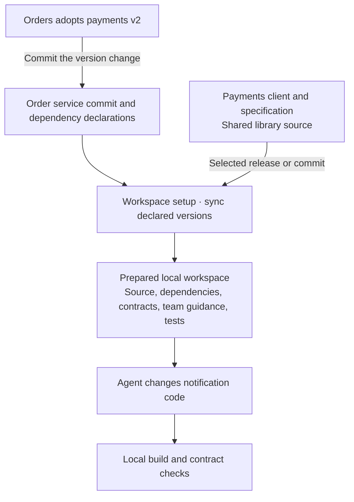
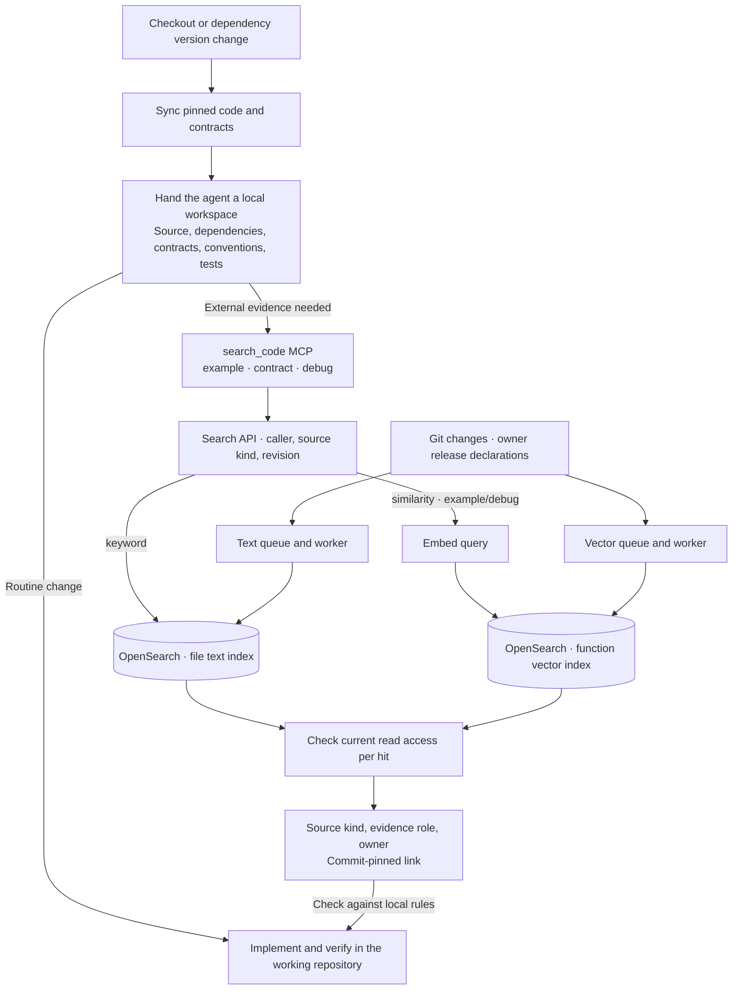

## TL;DR

- Sync the required code and contracts to pinned versions before handing work to the agent.
- Make and verify routine changes in the prepared local workspace.
- Use company-wide search for examples, contract changes, and incident investigations.

## Introduction

Suppose an agent working on refund notifications opens the payments repository and fetches the latest client code every time it gets a task. Check out yesterday’s order commit again today and the agent can end up reading different code simply because payments has shipped a new release. **The version the agent builds against should be settled before it starts the task.**

My team at Amazon keeps several components in one repository, while the services we depend on change independently in other teams’ repositories. In [The Two Sides of AX, Part 2](/en/2026/11/17/software-factory-team-tooling-runbook.html), I described how a team prepares its code and tests and starts delegating work it can verify. Here the question is how a team with dependencies across repositories can give an agent **a local workspace that already contains the code it needs**.

Delivering that code fast enough also matters in a software factory. Anthropic reported that merges into its monorepo rose from about 2,500 changes a day on average in May 2026 to more than 30,000 a day by September. CI alone was checking out code around 25 million times a day. Anthropic built its own version control system and migrated the monorepo from Git to Scion in five months to handle the load.[^1] When teams release independently, they also have to decide which revisions go into a given workspace.

## 0. Prepare the workspace before handing it to the agent

In domain-driven design (DDD), a bounded context (BC) is the scope within which a business model and its terms have consistent meanings. As long as the behavior promised across that boundary holds, a provider can change and deploy its implementation independently.[^2] I think the same principle applies to the development environment. **Once a snapshot of the BC has been checked out and prepared, its code, team conventions, adopted external contracts, and tests should be sufficient to explain and verify a routine change.** This holds whether a repository contains several contexts or a context draws code from several packages.

Start by checking out the consumer’s commit. Use its lockfile or dependency manifest to install the selected releases and fetch source dependencies at their pinned commits. If the order code calls a shared money calculation library directly, the version of its code needed to understand the calculation and verify a change should be available locally. For a payment service called over the network, prepare its published client, API specification, and matching contract tests or test doubles.[^16]

The open-source Chromium browser project offers a concrete example of workspace setup. Its `DEPS` file records repository URLs and commit hashes for Git dependencies such as V8. Running `gclient sync` brings those source revisions into the working directory.[^19] Doing this when creating a workspace or upgrading a dependency lets the agent read successive files without querying a remote repository each time.

Suppose orders uses payments v1 and v2 introduces a refund completion event. The version that enters the workspace below is the one orders selected. A new deployment by payments alone does not change that input.





A simple way to check is to turn off company-wide search once setup is complete and ask the agent to change the refund notification text. It should be able to open the definition of the payments client method it calls, edit the order code, and build locally. With the payments v1 test double it can check that it waits while the status is “accepted” and sends the notification only when it is “complete.” If each task requires another fetch of the client source or specification, include that material in workspace setup. Whether the services work together in an actual deployment is a separate integration check.

## 1. Spotify finds consumers across the company and proposes changes in their repositories

In a migration Spotify described in 2026, new versions of two user datasets affected about 1,800 pipelines that read the old datasets directly. The data team used Backstage, Spotify's internal developer portal, to identify downstream consumers, then searched the code to select the repositories to change.[^3]

Finding those repositories didn't tell Honk, Spotify's coding agent, how to edit them. When the team adapted a migration guide written for engineers, Honk sometimes guessed incorrectly which field in the new dataset corresponded to one in the old. The team supplied a table of field mappings. Where a change called for a decision by the consuming team, Honk left the field alone and added a comment pointing the reviewer to the guide.[^3]

Spotify opened 240 automated pull requests (PRs) for its SQL-based pipelines. The team left Scala-based pipelines out of the automated rollout because implementations varied considerably between repositories. Company-wide search answered **where to make the changes**. The data team's field mappings supplied the information the agent needed to implement them in each repository.[^3]

## 2. How we find a service at Amazon and choose a version

In a microservices architecture, a team owns a service and other teams use it through a published interface. That lets the service team change its implementation without coordinating a deployment with every consumer.[^4]

In my work at Amazon, that division of responsibility carries over to the repositories. The team providing a service versions the code and contracts it shares, and my team's repository records the dependency version we've adopted. When the provider ships a new release, we can keep developing against the existing contract for as long as it's supported.

At Amazon I use MCP (Model Context Protocol) tools to search internal code and unstructured documents such as wiki pages. The internal code search service offers both text matching and semantic search using embeddings of the code itself. An agent might start by searching the docs for “refund complete” and learn the name the payments team uses for the event. Searching the code for that name can lead it to the event definition and to tests in services that already handle it. The agent can start without knowing a repository or function name.

In **discover globally, understand locally**, discovery is for questions the workspace leaves open. If the local test guide says how to wait for asynchronous work, use it. When choosing a new test pattern, look at examples from other teams. Once the team adopts a pattern, record it in its own guide or linter so the next task can use it directly.

Google reports that about a third of its human developers’ code searches were for examples of how others had done something. It also explains why a production investigation needs code from the time of the incident.[^17] I want that kind of search to be easy to reach in a software factory. If routine edits to the same feature repeatedly require another team’s source, first check for dependency code or contracts missing from the workspace.

### What the agent can read in its workspace

An OpenAI team building a product with Codex also keeps the material its agent needs in the repository. A short `AGENTS.md` points to the relevant documents. Design decisions, database schemas, and reference material for external tools are versioned alongside the code. When a decision made in chat affects implementation, the team brings it into the repository. An agent opening that revision can read the decision and the code it applies to together.[^7]

The Claude Code team describes a deliberate choice to let the agent **find its own context**. An early internal version indexed the codebase in a vector database and handed Claude relevant snippets before each response. Giving Claude a `Grep` tool let it choose what to search for and read the matching files to gather the context it needed.[^9]

OpenAI's *Codex Prompting Guide* shows a similar choice in the agent's instructions. Its recommended starter prompt, refined through internal evaluations, tells the model to prefer `rg` (ripgrep) when searching text and `rg --files` when listing files. When adding a separate semantic search tool, OpenAI even suggests making its results look different from the ripgrep output the model is accustomed to.[^14]

What stands out to me in both cases is that **the agent can use a clue in the working repository to choose its next search**. To add a refund notification to the order service, it can read the payments version from the lockfile, then search for callers and tests using the name in the local specification.

#### Why Cursor moved from codebase embeddings to local grep

Cursor stopped precomputing embeddings of the repository for agent code search. The Cursor team says that as models got better at finding code with grep, a separate semantic search tool offered little additional benefit. The agent now uses Instant Grep to search the working directory when it needs context, then opens the matching files to read the source.[^8]

Instant Grep builds a **local text index** to cut the time the agent spends waiting for a scan. The Cursor team reports routinely seeing individual `ripgrep` calls take more than 15 seconds in large monorepos. For example, every match for `Refund(Completed|Failed)` must contain `Refund`. Instant Grep looks up character sequences (sparse n-grams) from the pattern in its local index to narrow the candidate files, then checks their contents with the regex.[^18]

Cursor builds the index against a Git commit and tracks edits by the user and the agent in a layer on top. An agent can therefore find `RefundCompleted` in a test it just edited, even before committing the change.[^18]

## 3. Five principles for applying microservice design across repositories

For the orders team, a completed cancellation might mean an item will no longer ship. For the payments team, a refund is complete once the money has been returned to the customer. In DDD, the scope within which terms and rules have consistent meanings is a *bounded context*. When two such models exchange information, their teams can document a shared language for that exchange. DDD calls this pattern *Published Language*.[^2][^10]

A specification that says which event means “refund complete” serves that purpose for these teams. Payments can split an internal state into several finer-grained ones. As long as the event still means what its contract promises, the notification code in the order service keeps working.

Microservices work together through APIs. The knowledge agents need when they work across repositories can follow the same boundaries. For orders and payments, that gives us five principles.

1. **Each bounded context owns its domain knowledge.** The orders team defines and maintains the rules for when an order is canceled. The payments team defines what makes a refund complete.
2. **Developers should be able to understand and change a service in its own repository.** With the right version of the payments contract installed, an orders developer can change and test the notification rules without setting up the payments team's development environment.
3. **Expose only what other repositories need, through an explicit interface.** Payments documents the meaning of refund statuses and events in its API specification. Its team can change the internal database tables independently.
4. **The central catalog records where knowledge lives, who owns it, and how services relate.** Making catalog entries searchable with the same tool lets an agent look up refunds, locate the specification owned by payments, and identify orders as a consumer. Payments maintains the definitions of the refund statuses in the original specification.
5. **Sync the required versions during workspace setup.** Orders pins its client and shared libraries in its lockfile. It pins a commit for any specification or source that isn't packaged. The agent reads those prepared files locally.

An agent may discover a payments v2 refund event in company-wide search, but customers will get no notification if order code integrated with v1 waits for it. When orders chooses to adopt v2, it checks that payments supports the new contract in the target environment, updates its version declaration, syncs the new client and specification, then changes the notification code and tests together.

## 4. Model business processes in the language of the people who run them

The payments specification tells you how to request a refund. Who decides whether it's acceptable to return the money before the item has been collected? Finding a code path that issues a refund before collection doesn't tell you whether the business approved an exception or someone missed the collection check.

That's why I think a rule that spans several steps, such as advance refund approval, is worth agreeing on with the people who run the process. An ontology is a model of business concepts and their relationships. If the returns team calls the decision “advance refund approval,” the model can use that name and record who makes the decision and what it permits. With DDD's **ubiquitous language**, an agent can search for the exact words in the requirement and read the rule. I see no need to embed a model that already distinguishes an advance refund request from its approval.

### Three layers from business process to code

In the knowledge structure I use, the business process sits at the top, expressed as an ontology. One layer down, an architecture decision record (ADR) describes the design chosen to uphold a business rule, the reason for that choice, and the behavior the feature must guarantee. At the bottom, code implements that behavior and tests check it.

{: .diagram-image }

For example, an approval for a different return must never authorize a refund before collection. Once that condition is in an ADR, the same test can check it after a change to the library that looks up approvals. If the returns team decides to end advance refunds altogether, the change starts with the business rule in the ontology and carries through to the affected ADRs and code.

### Sharing the business model and choosing the level of detail

The returns team can version its business ontology in a Turtle file (`.ttl`) in its own repository. That format is enough to express the business concepts and their relationships as text.[^11]

Even if several teams keep their ontologies in a shared company repository, **the returns team still sets the conditions for advance refunds and approves changes to that rule**. A team adopting the rule can look up the original at first integration or when the rule changes. For routine work it uses the revision recorded in its own repository.

When processes get complex, I find it useful to borrow the C4 model's idea of **viewing the same subject at different levels of zoom**. Just as C4 moves from a whole system to its components, a business overview can show where returns, logistics, and payments hand work to one another. Someone changing advance refunds can then zoom into the returns process to see who approves one and when it can be issued before collection. Both views belong to the top layer, the business ontology.[^12]

I built two plugins around this structure, `ontology-writer` and `adr-writer`. The first stores the business model as Turtle under `docs/ontology/` in the project and connects the steps that require software to the ADRs for the features that carry them out. The second records feature guarantees and design rationale in `docs/adr/`. Its `/adr-impl` workflow implements and tests those guarantees. Back in `ontology-writer`, `/ontology-align` checks that the features work together to carry out the business process.[^13]

## 5. Company-wide search for questions the workspace cannot settle

Adopting a new or changed contract calls for the owner's published specification. Checking a convention calls for examples, and investigating an incident calls for the code at the deployed commit. A single tool can serve these three purposes.

### Why GitHub estimated the cost of a full scan

If an agent can find a string with `ripgrep` in its working directory, could a company-wide search just run the same command in every repository? GitHub worked through that question in its 2023 code search beta. On an eight-core Intel machine, ripgrep took 2.769 seconds to run an exhaustive regular expression search on a 13 GB file cached in memory, about 0.6 GB per second per core.[^15]

GitHub extrapolated that measurement to the 115 TB in its search corpus. Even with all the code in memory and work divided perfectly among 32 servers with 64 cores each, GitHub estimated that one query would occupy **all 2,048 cores for about 96 seconds**. At roughly 0.01 queries per second for the cluster, everyone else would have to wait.[^15]

GitHub's own code search engine, Blackbird, selects character sequences called n-grams to index and records which files contain each one. Intersecting the lists for the grams in a query narrows the set of files whose contents need checking.[^15] The same principle applies to internal search. A company-wide text index narrows the candidate files, and the agent can search the source directly in the version pinned by the working repository. This keyword path needs no embeddings.

### An MCP tool for keyword and similarity search with OpenSearch

One idea worth borrowing from Amazon’s internal Builder MCP is to give the agent a single tool, `search_code`, and let a search service query OpenSearch behind it. Whether to call it depends on what the agent can establish locally. If the order code, adopted payments contract, team guidance, and tests settle the question, the change can be completed without a search call. For questions that do cross a repository boundary, the proposed tool takes both a **search mode** and a **purpose**.[^5]

| `purpose` | When a cross-repository search helps | How to use the result |
| --- | --- | --- |
| `example` | Find how another team tests duplicate notifications or uses a shared library. | Code, tests, and guides supply examples. The local team's guidance, linter, and tests determine whether the pattern fits. |
| `contract` | Discover a new service or upgrade a dependency from v1 to v2. | For a new integration, choose a supported version from the owner's published specifications. For an upgrade, compare the local specification with the target version and its change notes. Run contract tests against the chosen version in either case. |
| `debug` | A call conforms to the v1 contract, yet its response or event differs from expectations and local logs and tests don't explain why. | Read the implementation at the commit identified in the actual deployment or installed package. If it diverges from the specification, take a reproduction to the owning team. Adopting that behavior as a requirement calls for a contract change. |

`mode=keyword` looks up words or identifiers in an OpenSearch inverted index of source files and documents. `mode=similarity` finds functions by comparing a description of the desired behavior with vectors of function bodies. Contract searches use `keyword`. The index records the owning team's release declarations for specifications and change notes. A test in another team's repository mentioning the same field can't qualify as a published contract.





#### Choosing a purpose and calling the tool

The payments v2 specification that orders has adopted names the event `RefundCompleted`. The orders team’s architecture decision record (ADR) says the customer should get one notification even if the event arrives twice. Suppose the local tests have no example of simulating duplicate delivery and the team wants to see how others test it. Here are the parameters for two MCP `tools/call` requests.

```json
{
  "name": "search_code",
  "arguments": {
    "purpose": "example",
    "mode": "similarity",
    "query": "send a customer notification only once when the same event arrives twice"
  }
}
```

Suppose the first search finds a function named `notifyOnce` in the notifications team's repository. The agent can now search that team's test files for the name. How those tests simulate duplicate delivery is a useful example. The orders ADR still determines what the order code must guarantee.

```json
{
  "name": "search_code",
  "arguments": {
    "purpose": "example",
    "mode": "keyword",
    "query": "notifyOnce",
    "repo": "notifications",
    "path_glob": "**/*.test.ts"
  }
}
```

Even when the identifier is the same, the purpose determines which artifact to read. A team upgrading from v1 uses `purpose=contract` with the `repo` and `revision` of the payments team's v2 release. For an incident, `purpose=debug` requires **both** the repository and the commit actually running. The consumer's pinned API version and the provider's deployed commit can differ.

Use `ref` for a supported branch or `revision` for an exact Git commit. The two are mutually exclusive. Omitting both searches default branches in the authorized scope. A contract search without a commit returns discovery candidates only. A contract query pinned to a commit returns only specifications and change notes published by the owner at that revision. Change notes point to what changed. The published specification defines the behavior a consumer can depend on.

For each repository and commit, the service checks that indexing finished for the material the purpose and mode require. Suppose it retained only the API specification for an old deployment. A contract search can succeed at that commit, but a `debug` search for the implementation must return `revision_not_indexed` with no hits. The agent can then check out that commit directly. Return `ok` with no hits only after searching the full authorized scope and finding no matches.

Each hit carries the file, line range, snippet, and commit-pinned source link, along with `owner`, `source_kind`, and `evidence_role`. A line of code can be an example in one search and diagnostic evidence about a particular deployment in another. Cap hits and snippet length and use a cursor for pagination. The [MCP tool definition (JSON)](/assets/specs/enterprise-code-search-mcp.json) specifies the required arguments and response shape.

#### Keeping up with commits and permission changes

A search for a newly added symbol that returns zero hits can easily mislead an agent. The symbol may be absent, the branch may be outside the index, or the workers may be catching up. Here's how I recommend handling those cases.

| Situation | Proposed behavior |
| --- | --- |
| Release by the owning team | Record the version, source commit, and contract files declared by the owner. Keep the specifications and change notes for deployed or supported releases searchable by commit. |
| New repository or routine push | Bulk-index the default branch and supported release branches once. On each push, queue the diff from the last applied commit. The text worker updates changed files. The vector worker embeds new functions and functions whose bodies have changed. |
| Moves, deletions, or shifted line numbers | Reuse the vector when the embedding input and model version match. If a file moves or an earlier edit shifts a function, update its result to point to the new commit, path, and line range. Remove entries for old paths and deleted files or functions from the corresponding indexes. |
| Missed, duplicate, or out-of-order events | Track the last successful commit per branch and record coverage separately for each commit, mode, and corpus (release artifacts or source). For example, reconcile against the actual Git branch tips nightly to catch missed updates and deletions. Replaying an event must give the same result, and an older job finishing late must not overwrite newer data. |
| Access revoked | Consume permission-change events separately to update candidate filters. Before returning results, recheck current read access to each source repository. Omit candidates the caller cannot read. If the authorization service is unavailable, return an error and withhold the results. Bind each pagination cursor to the caller and query. |
| Lag or partial failure | Give text and vector updates separate queues and worker capacity so keyword search keeps working when embeddings fall behind. For a branch-scoped query, show that mode's last indexed commit and time. Mark timeouts as partial and distinguish an unindexed branch from a genuine empty result. |

Retry transient indexing failures with backoff. Move repeated failures to a separate queue for investigation and replay. When replacing the embedding model, keep serving the old model while populating a new vector index, then switch the query model and index together.

A possible pilot target is **95% of supported-branch pushes visible in keyword search within two minutes**. Measure from receipt of the push until a search returns an added line or stops returning a deleted one. Track that delay and the age of the oldest queued job separately for similarity search. Use real keyword misses to measure how often similarity search finds the needed function before investing more capacity in it. If several tasks keep searching for the same contract version the team has already adopted, check whether its specification was left out of the workspace setup.

## Closing thoughts

My first question about a software factory is **whether rebuilding a workspace from the same commit gives the agent the same code to build and the same tests to run**. If orders has pinned payments v1, tomorrow’s order build should still use v1 even if payments ships v2 today.

Routine development should finish in that prepared workspace. When a team needs to compare conventions, adopt a new contract, or investigate the implementation that was running during an incident, make the source easy to reach through company-wide search. If every task starts with an external lookup, check which code the workspace is missing.

[^1]: Anthropic, [Redesigning source control at Anthropic](https://www.anthropic.com/research/redesigning-source-control).
[^2]: Microsoft Azure Architecture Center, [Use domain analysis to model microservices](https://learn.microsoft.com/en-us/azure/architecture/microservices/model/domain-analysis).
[^3]: Spotify Engineering, [Background Coding Agents: Supercharging Downstream Consumer Dataset Migrations](https://engineering.atspotify.com/2026/4/background-coding-agents-dataset-migrations-honk-part-4).
[^4]: AWS, [Microservices, independent deployment, and APIs](https://aws.amazon.com/microservices/) and [service ownership on Amazon teams](https://aws.amazon.com/executive-insights/content/amazon-two-pizza-team/).
[^5]: MCP, [Tool calls](https://modelcontextprotocol.io/specification/2025-11-25/server/tools). OpenSearch, [full-text queries](https://docs.opensearch.org/latest/query-dsl/full-text/index/), [nearest-neighbor search](https://docs.opensearch.org/latest/query-dsl/specialized/k-nn/index/), [bulk writes](https://docs.opensearch.org/latest/api-reference/document-apis/bulk/), and [when writes become searchable](https://docs.opensearch.org/latest/api-reference/index-apis/refresh/).
[^7]: OpenAI, [Harness engineering: leveraging Codex in an agent-first world](https://openai.com/index/harness-engineering/).
[^8]: [The Cursor team's explanation of the change](https://forum.cursor.com/t/codebase-indexing-not-working-in-v-3-12-onwards/167527/7) and [Cursor's current search documentation](https://cursor.com/docs/agent/tools/search).
[^9]: Anthropic, [Seeing like an agent: how we design tools in Claude Code](https://claude.dev/blog/seeing-like-an-agent/), “Designing a search interface”.
[^10]: [Adopting agentic engineering in a development team](/en/2026/11/17/software-factory-team-tooling-runbook.html).
[^11]: W3C, [RDF 1.1 Turtle](https://www.w3.org/TR/turtle/).
[^12]: [My C4 model walkthrough (in Korean)](/2022/12/17/demystifying-c4model.html) and Simon Brown, [Diagrams and levels of zoom in the C4 model](https://c4model.com/diagrams).
[^13]: My [ontology-writer](https://github.com/haandol/alps-writer-plugins/blob/757049099990adfb4418238711d22dbe19bcbf22/plugins/ontology-writer/README.md) and [adr-writer](https://github.com/haandol/alps-writer-plugins/blob/757049099990adfb4418238711d22dbe19bcbf22/plugins/adr-writer/README.md) plugins.
[^14]: OpenAI, [Codex Prompting Guide](https://developers.openai.com/cookbook/examples/gpt-5/codex_prompting_guide), “Recommended Starter Prompt” and “Other Custom Tools”.

[^15]: Timothy Clem, [The technology behind GitHub’s new code search](https://github.blog/engineering/architecture-optimization/the-technology-behind-githubs-new-code-search/), GitHub Engineering (2023).
[^16]: Pact, [Contract testing for consumer and provider interactions](https://docs.pact.io/).
[^17]: Google, [Software Engineering at Google, Code Search](https://abseil.io/resources/swe-book/html/ch17.html).
[^18]: Cursor, [Fast regex search: indexing text for agent tools](https://cursor.com/blog/fast-regex-search).
[^19]: Chromium, [Managing Chromium dependencies](https://chromium.googlesource.com/chromium/src/+/main/docs/dependencies.md).
