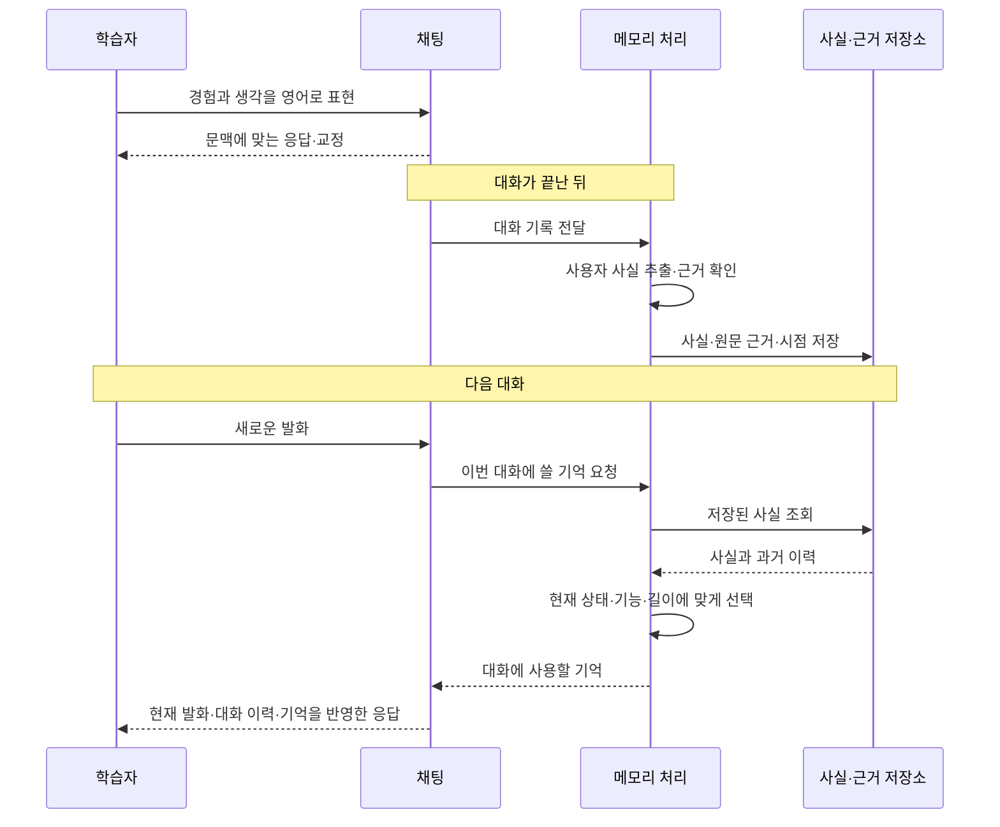

## TL;DR

- 기억의 오류는 다음 대화까지 이어진다.
- 실패한 동작을 재현할 사례와 기준을 남겼다.
- 단계별 근거로 수정할 곳을 찾았다.

## 시작하며

내가 만들고 운영하는 [잉크버드(EncBird)](https://encbird.com)는 자신의 생각을 영어로 표현하는 연습을 돕는 서비스다. 배우고 싶은 표현을 사전에 모으고, 일기나 사진, 역할극을 소재로 대화하면서 그 표현을 사용한다.[^1]

이런 앱을 만들면 영어 문장이 자연스럽게 나오는지부터 확인하게 된다. 그런데 사용자가 했던 말을 기억하고 다음 대화에 활용하기 시작하면, 답변 한 문장만 읽어서는 알기 어려운 문제가 생긴다. 역할극에서 말한 직업을 실제 직업으로 기억할 수도 있고, 이직했다고 말했는데 계속 예전 회사 이야기를 꺼낼 수도 있다.

기억이 정확해도 대화가 연습의 목적에서 벗어날 수 있다. 사용자가 이미 자신의 선택과 이유를 설명했는데도 주변의 사소한 정보만 계속 물으면, 문법적으로는 자연스럽지만 별로 하고 싶지 않은 대화가 된다.

그래서 잉크버드에는 메모리와 대화의 동작을 반복해서 확인하는 평가 체계를 만들었다. 여기서 평가(eval)는 **같은 대화와 기억을 입력으로 주고, 기대한 동작이 나오는지 확인하는 과정**이다. 이 글에서는 어떤 문제가 평가를 필요하게 했고, 그 문제를 확인할 수 있도록 평가를 어떻게 구성했는지 정리해보려고 한다.

## 1. 잉크버드는 대화를 어떻게 기억할까

잉크버드의 다이어리챗은 하루의 경험을 영어로 이야기하는 기능이고, 픽토챗은 사진에서 대화를 시작하는 기능이다. 프리챗에서는 주어진 상황 속 상대역과 대화한다. 소재는 다르지만, 사용자의 수준과 상황에 맞게 영어를 꺼내 쓰도록 돕는다는 목적은 같다.

대화 모델에는 현재 발화와 앞선 대화, 학습자 정보, 해당 기능에 필요한 기억을 함께 전달한다. 이때 기억은 과거 대화 전체를 그대로 붙이는 방식이 아니다. 대화가 끝나면 사용자 발화에서 기억할 사실을 추출하고, 다음 요청에서 쓸 문맥을 따로 만든다.[^2]





예를 들어 사용자가 회사와 출퇴근 방법을 이야기했다면 각각 별개의 사실로 남긴다. 나중에 회사를 옮겼다고 말했을 때 직장 정보만 바뀌어야 하기 때문이다. 사실에는 어떤 발화에서 알게 됐는지와 그 발화의 시점도 함께 보존한다.

다음 대화에서는 같은 정보에 대한 여러 기록 중 현재 상태를 고르고, 기능에서 사용할 수 있는 내용을 정해진 길이 안에 담는다. 예전 직장을 현재 문맥에서 제외하더라도 과거 기록 자체를 지우지는 않는다.

이 구조에서 잘못된 기억은 한 번의 어색한 답변으로 끝나지 않는다. 다음 대화의 입력이 되어 같은 오해를 반복하게 만들 수 있다. 그래서 응답을 읽는 것과 함께 **무엇을 저장했고, 그중 무엇이 다음 대화에 전달됐는지**도 확인해야 했다.

## 2. 자연스러운 답변만으로는 잡히지 않는 문제들

잉크버드 저장소에는 이런 동작을 확인하기 위한 합성 평가 사례들이 있다. 아래의 역할극과 이직 사례는 확인하려는 조건을 담은 테스트 대화이고, 카페 사례에는 이전 모델이 실제로 생성한 응답도 함께 남아 있다.[^3][^4]

### 2-1. 역할극을 사용자의 실제 신상으로 기억하기

역할극 사례는 다음 대화로 시작한다.

> 코치: 로마에 사는 항공기 기장이라고 가정하고 자기소개를 해보세요.
>
> 학습자: I am an airline captain and I live in Rome.
>
> 코치: 그러면 로마에 사는 거군요?
>
> 학습자: Yes.

사용자가 직접 말했고 다시 확인도 했다. 하지만 대화 전체를 읽으면 역할극의 설정이다. 이 대화에서 사용자의 실제 직업이나 거주지를 추출하면 안 된다.

원문에 같은 문장이 있는지만 검사해서는 이 문제를 찾을 수 없다. **그 문장이 누구에 대해, 어떤 상황에서 나온 말인지**까지 판단해야 한다. 이 사례에서는 직업·거주지에 관한 개인 기억을 남기지 않는 것이 기대 결과다.

반대로 병원 역할극 도중 “실제 직업은 자전거 수리”라고 밝히는 사례도 있다. 역할극이라는 이유로 모든 발화를 버리면 실제로 알려준 정보까지 놓친다. 기억할 내용과 제외할 내용을 함께 준비해야 하는 이유다.

### 2-2. 늦게 처리된 기록이 현재 정보를 되돌리기

이직 사례에는 다음 세 기록이 순서대로 입력된다. 회사 이름은 합성 사례의 이름이다.

| 대화가 기록된 날 | 발화의 내용 | 처리 순서 |
| --- | --- | --- |
| 9월 1일 | Harbor Robotics에 다닌다 | 먼저 처리 |
| 9월 12일 | Meadow Systems에 다닌다 | 다음으로 처리 |
| 9월 5일 | Harbor Robotics에 다닌다 | 늦게 도착해 마지막에 처리 |

각 문장에서 직장을 정확히 추출해도, 마지막에 처리한 값을 현재 직장으로 삼으면 틀린다. 9월 5일 기록이 늦게 들어왔을 뿐, 가장 최근의 발언은 9월 12일의 Meadow Systems다.

따라서 이 사례는 추출한 회사 이름뿐 아니라 **여러 기록을 저장한 뒤 다음 대화에 어떤 직장을 전달하는지**까지 확인한다. 한 세션씩만 평가하면 통과하고도 세션을 연결했을 때 실패할 수 있는 부분이다.

### 2-3. 문맥에는 맞지만 연습에는 도움이 안 되는 질문

다이어리챗의 카페 사례에서 학습자는 아내와 카페에 갔고, 아이스 라테를 주문했다고 말했다. 코치가 이유를 묻자 다음처럼 답했다.

> It was hot, and I wanted something cold without much sweetness.

이어서 나온 모델 응답에는 이런 질문이 있었다.

> 아내분은 카페에서 무엇을 주문하셨는지 영어로 적어볼까요?

앞의 이야기와 관련된 질문이다. 하지만 학습자는 이미 자신이 한 일과 선택한 이유를 설명했다. 여기서 다른 사람의 주문 내역을 더 모으는 식으로 대화가 이어지면, 학습자가 자신의 생각을 영어로 풀어낼 기회는 줄어든다.

이 사례의 기준에는 이미 설명한 내용을 되묻지 않고, 한 활동을 충분히 이야기했으면 하루의 다른 활동이나 학습자가 고른 주제로 넘어가도록 적었다. 필요한 확인 질문과 학습자가 더 이야기하고 싶어 하는 경우는 허용했다.

메모리 사례가 사실과 시점의 보존을 다룬다면, 이 사례는 **우리 서비스에서 어떤 대화를 좋은 대화로 볼 것인가**를 다룬다. 모델의 일반적인 언어 능력만으로는 이 기준을 대신할 수 없었다.

## 3. 문제를 반복해서 확인할 수 있도록 평가 만들기

### 3-1. 실패를 확인할 범위부터 나눴다

다이어리챗에서는 앞선 대화를 고정하고 다음 응답 하나를 생성하도록 했다. 카페 사례라면 라테를 고른 이유까지 같은 입력으로 주고, 그다음 질문이 어떻게 달라지는지 비교하는 식이다.

메모리에서는 추출, 저장, 현재 정보 선택, 응답에서의 사용을 나눠 확인했다. 각 단계의 입력을 고정하면 어느 부분이 잘못됐는지 좁힐 수 있고, 추출한 결과를 실제 저장·조회 코드에 이어 넣으면 단계 사이에서 생기는 문제도 확인할 수 있다.[^5]

예를 들어 다음 대화에 예전 직장이 등장했다면, 추출 단계부터 틀렸는지, 현재 직장을 고르는 과정에서 뒤집혔는지, 올바른 문맥을 받은 응답 모델이 잘못 사용했는지를 구분해야 한다. 고칠 대상이 서로 다르기 때문이다.

*잉크버드의 실제 평가 UI에 합성 사례를 넣은 화면이다. 각 처리 단계를 선택하면 관련 평가 사례를 볼 수 있다. 화면의 건수는 촬영용 자료의 건수이며, 모델 성능을 측정한 결과는 아니다.*

이 맵에는 대화가 끝난 뒤의 추출·저장과, 이후 요청에서의 조회·응답이 나뉘어 있다. 평가 항목을 최종 답변 아래에만 모아두지 않고, 확인하려는 동작이 일어나는 곳에 연결했다.

### 3-2. 원문 옆에 기대하는 사실과 행동을 적었다

평가 사례에는 확인할 동작 직전의 입력을 남겼다. 대화 이력, 기존 기억, 학습자 수준과 시점처럼 결과를 바꾸는 문맥도 포함했다. 입력과 별도로 기대하는 결과, 금지할 행동, 판단의 근거를 적었다.

메모리에는 한 문장의 정답 요약보다 개별 사실이 적합했다. “커피는 좋아하지 않고 페퍼민트 차를 좋아한다”는 발화라면, 커피에 대한 부정과 차에 대한 선호를 각각 보존했는지 확인한다. 차 선호만 남기면 누락이고, 커피도 좋아한다고 쓰면 의미가 바뀐 것이다.

*합성 사례를 띄운 실제 편집 화면에서 원문·기대 사실·근거 선택 영역을 발췌해 이어 붙였다.*

대화의 다음 질문은 적절한 답이 여러 개일 수 있다. 그래서 카페 사례에는 정답 문장 하나를 강제하지 않고, 이미 설명한 내용을 반복시키지 않는지와 수준에 맞는 표현 기회를 주는지를 기준으로 남겼다.

실패 사례만 모으지도 않았다. 짧지만 의미 있는 답변, 정말 확인이 필요한 모호한 답변, 주제를 바꾸려는 의사, 마지막 턴의 종료를 함께 넣었다. 반복 질문을 줄이려고 고쳤다가 필요한 질문까지 사라지는지 확인하기 위해서다.

### 3-3. 코드로 확인할 조건과 의미를 읽어야 할 조건을 나눴다

인용한 발화가 실제로 존재하는지, 저장한 사실이 다시 조회되는지는 코드로 확인할 수 있다. 반면 역할극을 실제 신상으로 해석했는지, 질문이 이미 한 설명을 반복시키는지는 문맥을 읽어야 한다.

이런 의미 판정에는 언어 모델을 평가자로 쓰는 **LLM-as-a-Judge**를 사용했다. 원문과 모델 출력, 기대 조건을 함께 주고 조건을 어긴 부분과 이유를 남기도록 했다. 정답과 평가 기준은 답변을 만드는 모델의 입력에는 넣지 않았다.[^5]

평가에서는 서비스가 사용하는 프롬프트와 처리 코드를 재사용했다. 평가용으로 별도의 간단한 프롬프트를 만들면, 서비스와 다른 동작을 검사하게 될 수 있기 때문이다. 다만 메모리의 후속 응답 검사는 텍스트에서 기억을 사용하는 범위이며, 음성 통화 전체를 재현하는 평가는 아니다.

판정 결과와 함께 단계별 입력과 출력도 남겼다. 이렇게 한 실행의 과정을 연결한 기록을 트레이스(trace)라고 한다. 실패한 응답에서 출발해 그 응답에 들어간 기억과 원문을 거슬러 읽을 수 있게 한 것이다.

평가자도 틀릴 수 있다. 같은 뜻을 다른 문장으로 썼다는 이유만으로 실패시키거나, 역할극에 허용된 가상의 설정을 근거 없는 개인 기억으로 판단할 수 있다. 그래서 실패한 응답을 고치기 전에 **실제로 동작이 틀렸는지, 기대 조건이나 판정이 틀렸는지**부터 대조하도록 했다.[^6]

근거가 없어서 판단할 수 없는 결과는 미확정으로 남겼다. 모델 호출이 끝났다는 사실이나 일부 항목의 높은 점수로 나머지 조건까지 통과했다고 처리하지 않았다.

### 3-4. 수정 전후의 차이를 같은 사례에서 읽었다

비교할 때는 입력과 기준을 유지하고, 바꾸려는 프롬프트나 모델만 달리했다. 문제가 있는 사례가 좋아졌는지와 함께 이전에 정상적으로 처리하던 사례가 나빠졌는지도 확인하도록 했다.

메모리에서는 필요한 사실을 얼마나 남겼는지와 잘못된 사실을 얼마나 추가했는지를 함께 본다. 아무것도 기억하지 않으면 거짓 기억은 줄겠지만, 다음 대화에 쓸 정보도 사라진다. 대화에서도 반복 질문이 줄었다는 이유만으로 좋아졌다고 판단하면 질문을 아예 없애는 변경을 통과시킬 수 있다.

이처럼 개선하려는 품질과 함께 확인할 부작용을 정해두는 것이 좋다. [Software Factory 글](/2026/10/05/software-factory-evals-and-tension-metrics.html)에서 다룬 텐션 메트릭도 한 지표를 높이는 동안 다른 품질이 나빠지는지 살피기 위한 것이다.

새로운 실패를 확인하면 그 입력과 어긴 조건을 다음 평가에 남긴다. 이후 수정에서 같은 문제가 다시 생겼는지 확인하는 회귀 사례가 된다. 기준 자체를 바꿨다면 기존 결과와 점수만 비교하지 않고, 기존 버전도 새 기준으로 다시 평가해야 한다.

## 4. 다른 에이전트 앱에 적용한다면

잉크버드에서는 메모리와 영어 대화를 다뤘지만, 평가를 구성하는 순서는 다른 앱에도 적용할 수 있다고 생각한다. 시작할 때 필요한 것은 자기 앱에서 실패라고 설명할 수 있는 사례와 그 판단의 근거다.

| 순서 | 남길 것 | 잉크버드에서의 예 |
| --- | --- | --- |
| 사용자가 기대한 결과를 정한다 | 성공 조건과 허용할 예외 | 역할극의 직업은 개인 신상으로 기억하지 않되, 실제 정보라고 밝힌 내용은 보존 |
| 실패를 다시 만들 입력을 고정한다 | 대화·기존 상태·시점과 원문 근거 | 이직 전후 기록과 뒤늦게 처리되는 과거 대화 |
| 결과를 만드는 단계에 검사를 붙인다 | 중간 출력과 코드·의미 판정 | 사실 추출, 저장, 현재 직장 선택, 후속 대화 사용 |
| 같은 사례로 수정 전후를 비교한다 | 개선된 사례·새 실패·판정 이유 | 반복 질문을 줄이면서 필요한 확인 질문과 종료 조건도 유지 |

처음부터 모든 단계를 정교하게 만들 필요는 없다. 문제가 드러난 결과에서 시작해, 원인을 구분할 수 있을 만큼 입력과 중간 기록을 보강하면 된다. 사람이 사례를 읽으며 하는 판단이 구체적일수록 자동 평가에 옮길 조건도 분명해진다.

다만 수정하면서 계속 들여다본 사례에만 맞출 수 있으므로, 마지막 확인에 쓸 사례는 따로 남기는 편이 좋다. 같은 대화에서 파생된 사례는 한쪽에 묶고, 자동으로 통과한 표본도 일부 읽어 기준이 놓친 실패를 찾아야 한다.

## 마치며

잉크버드에 평가를 붙이면서 정리해야 했던 것은 어떤 기억을 남기고 어떤 대화를 이어가야 하는지였다. 역할극의 설정을 기억하지 않는 것, 늦게 들어온 기록 때문에 현재 직장이 바뀌지 않는 것, 이미 설명을 마친 학습자에게 다른 이야기를 할 여지를 주는 것처럼 서비스의 목적을 구체적인 조건으로 적는 일이었다.

이 조건과 원문이 남아 있어야 다음 변경을 판단할 수 있다. 나는 에이전트 앱을 만들 때 **마음에 들지 않는 결과를 발견한 순간, 그 이유를 다시 확인할 수 있는 사례로 남기는 것**부터 시작하면 좋겠다고 생각한다. 그렇게 모은 사례가 프롬프트나 모델을 바꿀 때 무엇이 나아졌고 무엇을 놓쳤는지 알려준다.

---

[^1]: 잉크버드 제품 의도 문서와 [사이드 프로젝트로 시작한 배경](/2024/01/13/lean-startup-in-action-with-side-project.html). 표현 사전과 실제 사용 연습을 중심으로 한다.
[^2]: 잉크버드의 메모리 설계·구현 자료. 사용자 발화에서 개별 사실과 근거를 보존하고, 다음 요청에서 현재 상태와 기능별 문맥을 선택한다.
[^3]: 잉크버드 메모리 회귀 데이터의 역할극 신상, 역할극 중 실제 정보 공개, 처리 순서가 뒤바뀐 이직, 부정과 선호 사례. 모두 합성 대화이며 운영 장애의 발생 빈도를 보여주는 자료는 아니다.
[^4]: 잉크버드 다이어리챗의 생각 표현 평가 데이터. 카페 대화는 합성 입력이고, 아내의 주문을 묻는 응답은 이전 모델 출력으로 보존되어 있다. 기대 조건의 검토 기록과 사람의 정답 판정은 구분한다.
[^5]: 잉크버드의 기능별 대화·메모리 평가 구현과 로컬 평가 UI. 고정 입력, 서비스 요청 조립, 단계별 검사, 의미 판정, 실행 기록과 전후 비교를 연결한다. 화면 촬영에는 합성 자료만 사용했고 새 모델 추론은 실행하지 않았다.
[^6]: 잉크버드의 메모리 평가 근거 설계. 확정 가능한 구조 조건과 자연어 의미를 구분하고, 허용된 역할극 내용·충실한 교정과 실제 개인 기억의 오류를 따로 판정한다. 개발 에이전트의 실행 환경을 구성한 과정은 [하네스 구축 글](/2026/06/16/harness-engineering-in-practice.html)에 정리했다.
