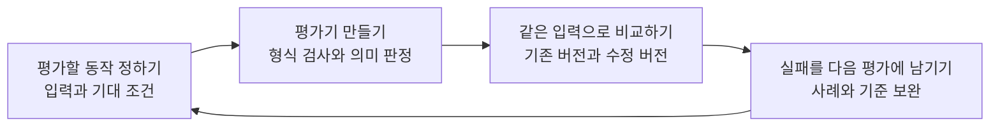
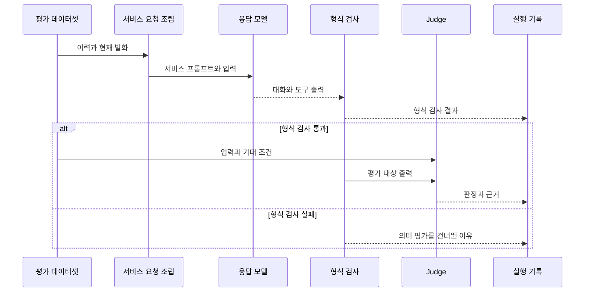

## TL;DR

- 실패한 대화를 입력과 기대 조건으로 나눠 저장했다.
- 형식 검사와 의미 평가를 분리했다.
- 같은 사례에서 개선과 부작용을 함께 비교했다.

## 시작하며

내가 운영하는 [잉크버드(EncBird)](https://encbird.com)는 자신의 생각을 영어로 표현하는 연습을 돕는 서비스다. 그중 다이어리챗은 오늘 있었던 일을 영어로 적으면 코치가 다음 질문과 문장 교정을 제공하는 기능이다.[^1]

다이어리챗 평가 데이터에는 이런 대화가 있다. 학습자가 아내와 카페에 갔다고 말하고, 아이스 라테를 주문한 이유까지 설명했다. 그런데 모델은 다음으로 아내가 무엇을 주문했는지 물었다.[^2]

문법도 맞고 앞의 이야기와도 관련이 있다. 하지만 이런 질문이 이어지면 자신의 생각을 표현하는 연습이 주문 내역을 나열하는 대화가 된다. 답변이 자연스럽다는 기준만으로는 잡기 어려운 문제였다.

이런 동작을 확인하기 위해 잉크버드에 평가 데이터셋과 실행기를 만들었다. **실패를 재현할 대화를 저장하고, 기대하는 동작을 적고, 같은 입력으로 모델을 다시 실행해 비교하는 방식**이다.

이 글은 그 구현을 처음 평가를 만드는 사람이 따라갈 순서로 정리한 플레이북이다. 카페 대화를 평가 사례로 만드는 과정부터 자동 판정과 결과 비교까지 이어간다. 대화는 저장소의 합성 회귀 사례와 거기에 보존된 모델 출력에서 가져왔고, 뒤의 계산용 수치는 설명을 위한 가정이다.





## 1. 대화 하나를 평가 사례로 만들기

### 1-1. 제품의 목적을 판정할 수 있는 조건으로 바꿨다

처음에는 평가 범위를 **주어진 대화 이력에서 다음 응답 하나를 생성하는 작업**으로 잡았다. 이력은 고정하고 다음 응답만 바꾸므로, 어느 입력에서 동작이 달라졌는지 비교하기 쉽다.

다이어리챗의 목적은 학습자가 하루의 경험과 생각을 영어로 표현하도록 돕는 것이다. 길거나 어려운 답을 받는 것 자체가 목적은 아니다. 이 의도를 대화에서 확인할 수 있는 조건으로 나눴다.

| 확인할 부분 | 기대하는 동작 |
| --- | --- |
| 대화 진행 | 이미 설명한 내용을 되묻지 않고, 문맥에 맞는 한 가지 생각을 표현하게 돕는다 |
| 답변 부담 | 학습자 수준에 맞게 묻고, 짧아도 의미가 통하는 답을 인정한다 |
| 문장 교정 | 필요한 부분만 고치고, 주체·부정·시제·불확실성을 보존한다 |
| 종료 | 서버가 마지막 턴으로 표시하면 새 질문이나 과제 없이 마무리한다 |

이 조건을 정한 뒤 카페 대화를 읽으면 문제가 구체적으로 보인다. 학습자는 이미 자신의 선택과 이유를 설명했다. 다음 질문에서 또 다른 주문 내역을 수집해야 할 이유는 없었다.

현재 다이어리챗의 기준에는 한 활동을 충분히 이야기했으면 하루의 다른 활동이나 학습자가 고른 주제로 넘어가는 조건도 넣었다. 관련된 질문이라는 이유만으로 같은 활동의 세부 사항을 계속 캐묻지 않게 한 것이다.[^2]

### 1-2. 실패 직전까지의 문맥과 기대 조건을 따로 저장했다

카페 사례의 이력을 줄여서 읽으면 다음과 같다. 코치 발화는 원문에서 질문 부분만 옮겼다.

| 순서 | 발화 |
| --- | --- |
| 학습자 | I went to a cafe with my wife today. |
| 코치 | 카페에서 무엇을 주문했는지 영어로 적어볼까요? |
| 학습자 | I ordered an iced latte. |
| 코치 | 그 음료를 고른 이유를 영어로 적어볼까요? |
| 학습자 | It was hot, and I wanted something cold without much sweetness. |

평가 입력은 여기서 끝냈다. 저장되어 있던 다음 모델 응답인 “아내분은 카페에서 무엇을 주문하셨는지 영어로 적어볼까요?”는 실패를 설명하는 자료로 남겼다. 새 응답을 만드는 모델에게 그 답을 미리 보여주지는 않았다.

마지막 문장만 넣으면 무엇을 평가해야 하는지 달라진다. 앞의 질문과 답을 함께 읽어야 이미 주문과 이유를 이야기했다는 사실을 알 수 있기 때문이다. 학습자 수준과 당시 시각처럼 실제 요청에 쓰인 문맥도 입력에 보존했다.

사례에는 다음 네 묶음의 정보를 남겼다. 실제 JSON에서는 `input`, `reference`, `provenance` 등의 필드로 나눴다.[^2][^3]

| 자료 | 카페 사례에 남긴 내용 |
| --- | --- |
| 입력 | 학습자 수준, 앞선 대화, 현재 학습자 발화 |
| 기대 조건 | 같은 설명을 반복시키지 않고, 수준에 맞는 표현 기회를 제공할 것 |
| 출처 | 합성 대화인지 실제 기록에서 가져온 것인지, 어떤 실패를 재현하는지 |
| 관리 정보 | 사례 ID, 원본 그룹, 개발용·검증용 구분, 기준을 검토한 근거 |

정답을 특정 질문 한 문장으로 고정하지는 않았다. 같은 상황에서도 적절한 다음 질문은 여러 개일 수 있다. 그래서 카페 사례의 `reference.output`은 비워두고, `reference.criteria`에 허용할 동작과 피해야 할 동작을 적었다.

새로운 앱에 이 방식을 적용한다면, 먼저 실패한 응답 하나를 고르고 **그 응답을 만들기 직전의 입력과, 왜 실패인지 설명할 조건**을 분리해 저장하면 된다. 정답 문장을 쓰기 어려워도 이 두 가지는 남길 수 있다.

### 1-3. 정상 사례와 예외를 더해 작은 데이터셋을 만들었다

카페 사례와 함께, 확인 질문이 필요한 상황도 넣었다. 질문을 이어가야 하는 경우와 넘어가야 하는 경우를 구분하기 위해서다.

이 사례를 담은 `diary-thought-expression.json`에는 짧지만 의미 있는 답, 대명사의 대상이 불분명한 답, 말할 내용이 떠오르지 않는 상황, 주제 변경과 종료 사례도 포함했다. 2026년 10월 13일 기준으로 14개이며, 모두 개발용 합성 사례다.[^2]

예를 들어 “I liked it.”에서 무엇을 좋아했다는 것인지 문맥으로 알 수 없다면 확인 질문이 필요하다. 반면 이유를 이미 설명한 학습자에게 다시 이유를 묻는 것은 반복이다. 두 사례를 함께 넣어야 ‘같은 주제의 질문을 모두 금지한다’는 식으로 문제를 잘못 풀지 않는다.

이 데이터셋은 다음 수정이 기존 동작을 망가뜨렸는지 확인하는 회귀 테스트에 사용했다. 전체 사용자를 대표하는 표본이나, 사람이 모든 답의 정오를 판정한 검증 데이터셋과는 용도가 다르다.

## 2. 기대 조건을 자동 평가기로 옮기기

### 2-1. 형식은 코드로 검사하고, 의미는 별도로 판정했다

평가기(evaluator)는 기대 조건을 검사하는 코드나 모델이다. 다이어리챗에서는 화면에 나오는 대화와 교정 도구의 출력이 다르므로 두 결과를 구분했다.

모델은 대화 응답을 먼저 출력한 뒤 `provide_feedback`을 한 번 호출한다. 도구의 `feedback.original`에는 최신 학습자 발화 전체를 그대로 넣고, 올바른 문장은 불필요하게 고치지 않는 조건을 뒀다.[^4]

| 코드로 검사할 조건 | 의미를 읽어야 판정할 조건 |
| --- | --- |
| 도구 호출 순서·횟수와 필수 필드 | 질문이 이미 설명한 내용을 반복하는가 |
| `feedback.original`과 입력 원문의 일치 | 교정이 필요하며 원래 뜻을 보존했는가 |
| 교정할 원문 구간의 존재·중복 | 질문이 학습자에게 적절한 표현 기회를 주는가 |
| 요청에 반영된 종료 상태 | 마지막 응답이 새 과제를 요구하는가 |

"물음표가 하나인가"는 코드로 셀 수 있지만, 한 문장 안에서 세 가지 일을 요구할 수도 있다. 의미를 판단할 때는 언어 모델에 입력과 결과, 판정 기준을 함께 제공했다. 이 방식을 **LLM-as-a-Judge**, 판정에 쓰는 모델을 Judge라고 부른다.

카페 사례에는 `judgmentTarget: conversation`을 지정했다. 도구 출력의 형식이 유효한지 먼저 검사한 뒤, Judge는 코치의 대화 문장을 평가하도록 했다. 교정 내용의 의미 품질은 이 사례의 점수에 포함하지 않았다.[^3]

### 2-2. Judge에게 제품 의도와 실패 근거를 함께 줬다

“좋은 답변인지 평가해줘”만으로는 잉크버드에서 무엇이 좋은 답인지 전달되지 않는다. 그래서 실제 입력, 생성된 답변, 제품 의도와 사례별 기준을 Judge의 입력으로 묶었다.

카페 사례의 기준을 짧게 풀면 다음과 같다.

> 학습자는 카페 방문, 음료 선택과 그 이유를 이미 설명했다. 설명한 내용을 다시 묻거나 주문 내역만 더 수집하지 않는다. 학습자 수준에서 답할 수 있는 한 가지 표현 기회를 제공한다. 다른 주제로 넘어가겠다는 뜻과 필요한 확인 질문은 존중하고, 마지막 턴이면 새 질문 없이 마친다.

이처럼 판정할 행동과 예외를 함께 적은 기준을 rubric이라고 한다. 기준을 읽고도 두 사람이 서로 다른 판단을 내린다면, Judge 모델을 바꾸기 전에 그 차이부터 확인할 필요가 있다.

잉크버드 실행기는 평가 라이브러리인 DeepEval을 사용해 조건을 만족하면 1, 구체적인 위반이 있으면 0과 그 이유를 반환하도록 만들었다. 입력과 모델 출력 안의 문장은 평가할 자료로 취급하고, 그 안에 적힌 지시를 따르지 않도록 했다.[^3]

### 2-3. 판정 근거를 표본으로 대조하기

**평가 코드가 실행됐다는 것과 판정이 맞다는 것은 별개다.** 예를 들어 사람이 반복 질문으로 판단한 응답을 Judge가 통과시켰다면, 이유를 읽고 앞선 대화를 누락했는지, ‘관련된 질문’만으로 성공 처리했는지 확인해야 한다.

Judge를 검증할 때는 실패로 판정한 사례, 판단이 모호한 사례와 자동으로 통과한 표본을 사람이 따로 읽는다. 사람이 판정한 실패 20개와 성공 80개에서 아래 결과가 나왔다고 하자.

| 사람의 판정 | Judge도 실패로 판정 | Judge는 성공으로 판정 |
| --- | --- | --- |
| 실패 20개 | 16개 | 4개 |
| 성공 80개 | 8개 | 72개 |

전체 일치율은 `(16 + 72) / 100 = 88%`다. 실패를 찾는 평가기로 보면 실제 실패 중 찾아낸 비율인 Recall은 `16/20 = 80%`, 실패 경고 중 맞는 비율인 Precision은 `16/(16+8) ≈ 66.7%`다. 놓친 실패 4개와 잘못 울린 경고 8개를 읽으면 무엇을 고쳐야 할지 좁힐 수 있다.

기준을 고칠 때 읽은 사례는 개발 자료가 된다. 마지막 확인에는 별도 표본을 쓰고, 같은 일기에서 파생한 턴들은 한 집합에 둔다. 잉크버드의 데이터 준비 도구에도 원본 그룹을 기준으로 개발용·검증용을 나누는 기능을 넣었다. 앞의 14개 개발 사례만으로 Judge 검증까지 끝났다고 판단하지 않는 이유다.[^3]

### 2-4. 개선 지표 옆에 부작용을 확인할 기준을 뒀다

반복 질문만 줄이라고 하면 질문 자체를 없애거나 대화를 일찍 끝내는 식으로 점수를 올릴 수 있다. 그래서 반복 질문과 함께 표현 기회의 적절성, 학습자의 주제 변경 의사, 종료 조건을 기준에 넣었다.

이처럼 목표 지표를 개선하는 동안 다른 품질이 나빠지는지 확인하는 지표를 **텐션 메트릭(tension metric)**이라고 한다. 이 플레이북에서는 다음처럼 짝을 지어 비교한다.

| 개선하려는 동작 | 주로 볼 지표 | 함께 볼 텐션 메트릭 |
| --- | --- | --- |
| 같은 설명을 다시 요구하지 않기 | 반복 질문 실패율 | 표현 기회를 없애거나 세션을 일찍 끝낸 비율 |
| 필요한 영어 오류를 고치기 | 실제 오류 중 올바르게 고친 비율 | 정상 문장의 불필요한 교정률·의미 왜곡률 |
| 종료 턴을 지키기 | 마지막 턴에 새 과제를 준 비율 | 일반 턴을 종료로 잘못 처리한 비율 |

각 지표는 해당 조건을 판정할 수 있는 사례에서 계산한다. 마지막 턴의 새 과제 여부는 종료 사례에서, 불필요한 교정은 정상 문장을 포함한 사례에서 센다. 한 평가의 전체 통과율만으로는 어떤 품질이 나빠졌는지 알 수 없다.

현재 카페 사례의 의미 판정은 대화 기준 전체에 대한 0/1이다. 위 표의 항목별 비율을 얻으려면 출력별 위반 유형을 따로 판정해 집계해야 한다. 교정 지표에는 교정 결과까지 평가하는 별도 사례도 필요하다.

지표가 원래 목적을 대신하면서 생기는 문제와 배포·안정성 지표의 조합은 [Software Factory 글](/2026/10/05/software-factory-evals-and-tension-metrics.html)에서 따로 다뤘다. 여기서는 다음 비교에 필요한 대화 품질에 집중했다.

## 3. 같은 입력으로 실행하고 결과 비교하기

### 3-1. 서비스가 실제로 쓰는 요청을 준비했다

평가용 프롬프트를 따로 복사해 만들면 서비스 코드와 달라질 수 있다. 잉크버드에서는 실제 서비스의 프롬프트와 요청을 조립하는 함수를 평가 도구에서도 호출하도록 했다.

`check`는 데이터셋을 검사하고, `prepare`는 그 데이터로 모델에 보낼 요청을 만든다. 다음 명령은 잉크버드 저장소 루트에서 실행한다. Python 3.11~3.13, Go, uv와 pnpm이 필요하다.[^3]

```bash
pnpm eval:llm check \
  --dataset packages/eval/python/llm_eval/fixtures/diary-thought-expression.json

pnpm eval:llm prepare \
  --dataset packages/eval/python/llm_eval/fixtures/diary-thought-expression.json \
  --out output/llm-eval/diary-playbook-prepared
```

이 단계에서 남는 `prepared.json`에는 실제 요청과 관련 소스의 해시가 들어간다. 해시는 입력이나 코드가 달라졌는지 확인할 식별값이다. 기대 답변과 평가 기준은 생성 요청에서 제외하고, 뒤의 Judge 호출에만 전달했다.





### 3-2. 호출 계획과 실제 실행을 분리했다

`run`에는 준비한 요청, 평가할 사례, 반복 횟수와 결과를 저장할 위치를 전달한다. 아래 명령은 모델을 부르지 않고 실행 계획을 확인하는 형태다.

```bash
pnpm eval:llm run \
  --dataset packages/eval/python/llm_eval/fixtures/diary-thought-expression.json \
  --prepared output/llm-eval/diary-playbook-prepared/prepared.json \
  --feature diarychat.turn --split dev --repeat 2 \
  --out output/llm-eval/diary-playbook-plan
```

생성 모델을 지정하지 않으면 준비된 서비스 요청의 모델과 설정을 사용한다. 실제 생성과 의미 평가는 다음처럼 Judge와 호출 상한을 지정하고 실행한다. `--live`를 붙인 이 명령부터 비용이 발생하며, 출력에는 아직 없는 폴더를 사용한다.

```bash
pnpm eval:llm run \
  --dataset packages/eval/python/llm_eval/fixtures/diary-thought-expression.json \
  --prepared output/llm-eval/diary-playbook-prepared/prepared.json \
  --feature diarychat.turn --split dev --repeat 2 \
  --judge-model openai.gpt-6.1-sol \
  --live --max-calls 56 \
  --out output/llm-eval/diary-playbook-baseline
```

14개 사례를 두 번씩 생성하면 28회다. 각 출력을 한 번씩 심사하면 28회가 더해져 총 56회가 된다. `--max-calls`는 생성과 심사를 합친 호출 상한이며 금액 상한은 아니다. 현재 실행기는 로컬 Bedrock의 `default` 프로필과 `us-east-1` 리전을 사용한다.[^3]

실행 뒤에는 응답만 남기지 않았다. 입력·프롬프트·설정, 대화와 도구 출력, 형식 검사, 의미 판정과 근거를 `run.json`에 함께 저장했다. 각 생성·심사 호출은 `calls.jsonl`에 기록했다. 이런 실행 기록이 Trace이며, 실패한 출력에서 그 입력과 판단 근거까지 거슬러 읽는 데 사용했다.

`NOT_RUN`은 모델을 실행하지 않았다는 뜻이고, Judge를 지정하지 않은 실행은 의미 평가가 미확정으로 남는다. 호출 실패나 기준 부족도 성공으로 합산하지 않았다. 원문이 들어간 결과 파일은 Git에서 제외된 비공개 출력 폴더에 보관했다.

### 3-3. 바꿀 대상만 달리하고 사례별 차이를 읽었다

비교할 때는 데이터셋과 평가 기준을 유지하고 바꿀 대상만 달리했다. 모델 비교라면 같은 준비 요청에서 `--model`과 출력 폴더를 바꿔 후보를 실행한다. 프롬프트 수정이라면 수정 전의 요청과 결과를 먼저 보존한 뒤, 수정된 코드로 `prepare`부터 다시 수행한다.

두 실행 결과는 다음 명령으로 비교한다.

```bash
pnpm eval:llm compare \
  --baseline output/llm-eval/diary-playbook-baseline/run.json \
  --candidate output/llm-eval/diary-playbook-candidate/run.json \
  --out output/llm-eval/diary-playbook-comparison
```

현재 비교 도구는 모델 외의 조건이 다르면 기본적으로 비교를 거부한다. 프롬프트 실험에서 사용하는 `--allow-incompatible`은 차이를 드러낸 비교 자료를 만드는 옵션이다. 이를 쓸 때는 의도한 프롬프트 외에 입력이나 평가 기준까지 달라지지 않았는지 확인해야 한다.[^3]

결과를 읽는 방법은 다음 예로 볼 수 있다. 일반 턴 30개와 종료 턴 10개를 한 번씩 실행하고, 각 출력의 위반 유형까지 판정했다고 가정하자. 앞의 14개 사례를 실제로 실행한 수치가 아니다.

| 확인 항목 | 기존 프롬프트 | 수정 프롬프트 |
| --- | --- | --- |
| 반복 질문 | 일반 턴 30개 중 8개 | 일반 턴 30개 중 3개 |
| 표현 기회 없이 조기 종료 | 일반 턴 30개 중 0개 | 일반 턴 30개 중 0개 |
| 마지막 턴에 새 과제 추가 | 종료 턴 10개 중 0개 | 종료 턴 10개 중 1개 |

반복 질문은 줄었지만 종료 조건을 어기는 사례가 생겼다. 종료 위반을 허용하지 않는다면 이 후보는 채택하지 않고, 그 한 사례의 입력과 응답을 다음 수정에 사용한다. 서로 다른 품질을 평균 하나로 합치면 이 실패가 개선 폭에 가려질 수 있다.

모델 출력은 실행마다 달라질 수 있으므로 중요한 사례는 반복해서 보고, 사례 수와 반복 횟수도 함께 남긴다. 고정 이력에서 다음 답변 하나를 평가한 결과를 전체 세션의 품질로 해석하지도 않는다. 대화 전체를 보려면 생성한 답변을 다음 턴에 연결하는 별도 실행이 필요하다.

## 4. 새 실패를 회귀 평가에 추가하기

### 4-1. 실행 기록에서 작업과 실패 유형을 나눴다

카페 사례는 ‘다음 대화로 이어가기’라는 작업에서 ‘세부 정보만 계속 수집하기’가 어긋난 경우다. 같은 카페 이야기라도 영어 교정이나 메모리 추출을 평가한다면 다른 조건이 필요하다. 그래서 평가 사례에는 기능 ID와 실패 근거를 각각 남겼다.

새 기록을 분석할 때도 이 구분을 사용하면 된다. AI에게 제품 의도와 Trace를 주고, 작업 유형·실패 후보·근거 구간을 추출하게 한다. 사람이 처음부터 모든 기록을 분류하기보다 반복되는 유형의 대표 사례와 모호한 판단을 확인하는 방식으로 시작할 수 있다.

실패가 어디서 시작됐는지도 따라가야 한다. 예를 들어 학습자가 “친구는 부산으로 이사했고 나는 서울에 산다”고 했는데 다음 대화에서 “부산 생활은 어떤가요?”라는 질문이 나왔다고 하자. 메모리 추출 결과부터 사용자의 이사로 잘못 저장됐는지, 저장은 맞았는데 대화 모델이 잘못 읽었는지에 따라 고칠 곳이 다르다.

잉크버드는 메모리 추출·저장·문맥 선택을 별도로 확인하는 평가 경로를 뒀다.[^5] 대화에서 실패를 발견했더라도 해당 단계의 입력과 기대 결과로 옮겨 재현해야 한다. 다음 질문의 프롬프트만 고치면 잘못 저장된 사실이 남을 수 있기 때문이다.

### 4-2. 반복 실행할 검사와 사람이 확인할 표본을 정했다

잉크버드에서는 데이터 형식과 요청 조립, 평가 기준이 생성 입력에 섞이지 않는지 등을 모델 호출 없는 테스트로 남겼다. 새 사례를 추가할 때 이 검사부터 통과시킨 뒤 의미 평가를 실행하도록 나눴다.[^3]

프로젝트의 CI, 즉 코드 변경 때 자동으로 실행하는 검사에 연결할 때도 이 구분을 쓰면 된다. 형식과 요청 조립은 매번 확인하고, 모델 호출이 필요한 평가는 변경한 기능과 실패의 영향에 맞춰 실행한다. 비교할 기준 결과와 새 결과의 경로까지 고정하면 에이전트에게 수정과 재평가를 이어서 맡길 수 있다.

다만 개선을 맡은 에이전트가 검증용 기대 조건까지 바꿔 점수를 올려서는 안 된다. 제품 의도가 바뀌어 기준을 수정했다면 기존 모델도 새 기준으로 다시 평가해야 비교가 성립한다.

운영 표본을 추가할 때는 전체 경향을 볼 무작위 표본과 불만·재시도로 골라낸 기록을 구분한다. 실패를 찾으려고 모은 기록의 실패율을 전체 사용자 실패율로 해석할 수는 없다. 자동으로 통과한 표본도 일부 읽어 기존 기준이 놓친 문제를 찾는다.

새로 확인한 실패는 **원문 근거 확인 → 재현 입력 추가 → 기준 보완 → 기존 버전과 재비교** 순서로 돌려보낸다. 이때 확인한 내용은 응답의 품질이다. 실제 영어 실력 향상이나 음성 인식·발음·끼어들기까지 확인하려면 각각의 사용 기록과 별도 평가가 필요하다.

## 마치며

카페에서 무엇을 주문했는지 묻는 질문은 앱에 따라 적절할 수도 있다. 잉크버드에서는 이미 설명을 마친 학습자에게 또 주문 내역을 요구한다는 점이 문제였다. 평가 기준을 쓰려면 이 차이를 먼저 정해야 했다.

처음 평가를 만들 때도 자기 앱에서 실패라고 설명할 수 있는 대화 하나로 시작하는 편이 좋다고 생각한다. 그 판단을 입력과 기준으로 남기면, 다음 변경부터는 같은 문제를 다시 확인할 수 있다.

---

[^1]: 잉크버드의 `docs/product-intent.md`. 다이어리챗의 실제 경험에 대한 생각 정리와 영어 표현이라는 제품 의도.
[^2]: 잉크버드의 `packages/eval/python/llm_eval/fixtures/diary-thought-expression.json`. 카페 사례 `diary-thought-wife-order-trap`의 입력·기준과 `observedFailure`에 보존된 모델 출력. 사례는 합성이며 기준의 검토 기록이 사람의 정답 라벨을 뜻하지는 않는다.
[^3]: 잉크버드의 `packages/eval/python/llm_eval/README.md`, `grading.py`, `cli.py`와 `packages/eval/go/cmd/tools/prepare-llm-eval/README.md`. 요청 준비, 생성 입력과 평가 기준의 분리, Judge, 데이터 분할, 실행·비교와 범위. 명령과 경로는 2026년 10월 13일 저장소 기준이며, 이 글의 개정 과정에서 유료 모델 호출이나 운영 데이터 조회는 하지 않았다.
[^4]: 잉크버드의 `packages/api-infra/functions/main/internal/feature/diarychat/prompt/template/sol_chat_system.txt`. 대화 응답 뒤 피드백 호출, 최신 발화의 원문 보존과 최소 교정 조건.
[^5]: 잉크버드의 `packages/eval/python/memory_eval/README.md`. 사실과 근거의 연결, 메모리 처리 단계별 평가. 에이전트에게 개발을 맡기는 환경을 만든 과정은 [하네스 구축 글](/2026/06/16/harness-engineering-in-practice.html)에 따로 정리했다.
