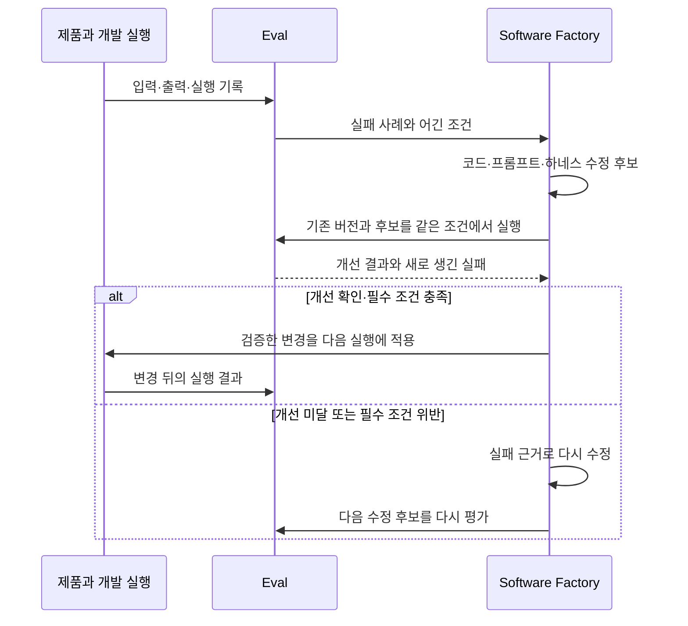

## TL;DR

- Eval은 Software Factory의 자기 개선을 이끈다.
- 완전 자동화를 위해서는 KPI 관리도 Software Factory가 맡아야 한다.
- KPI와 텐션 메트릭을 함께 봐야 숫자만 좋아지는 변경을 걸러낼 수 있다.

## 시작하며

개발 에이전트가 코드를 고치고 테스트를 실행할 수 있어도, 수정안이 나올 때마다 사람이 결과를 읽고 다음 작업을 지시해야 한다면 개선 속도는 사람이 판단할 수 있는 속도에 묶인다. 실패를 찾고, 고칠 일을 정하고, 수정 결과를 확인하는 과정까지 연결해야 사람이 자리를 비운 동안에도 개발을 이어갈 수 있다.

Software Factory는 이렇게 AI 에이전트가 소프트웨어를 만들고 운영하며, 그 결과로 제품과 개발 방식까지 개선하는 시스템이다. 나는 여기서 **self-improvement, 즉 자기 개선을 가능하게 하는 중심이 Eval**이라고 생각한다. 무엇이 실패했고 어떤 변경이 더 나은지 판단할 수 있어야 다음 개선도 정할 수 있기 때문이다.

그런데 개선을 에이전트에게 맡겨도, 무엇을 성과로 볼지와 다음 목표를 사람이 매번 정한다면 그 부분에는 여전히 사람의 개입이 남는다. 나는 향후 완전 자동화를 위해서는 성과를 판단하는 핵심 지표인 **KPI(Key Performance Indicator)의 관리도 Software Factory가 맡아야 한다**고 생각한다.

이때 KPI만 올리도록 두면 사용자에게 도움이 되지 않는 변경도 좋은 성과로 받아들일 수 있다. 그래서 목표 지표가 오르는 동안 다른 품질이 나빠지는지 보여주는 **텐션 메트릭(tension metric)**을 함께 봐야 한다.

## 1. Software Factory는 무엇을 하는가

Software Factory는 요구사항을 구현하는 단계부터 검증, 배포, 운영 중 발견한 문제의 수정까지 연결한다. 개발 에이전트 Droid를 만드는 Factory도 지속적인 학습과 자기 개선을 Software Factory의 핵심 요건으로 설명한다.[^1]

예를 들어 사용자가 가입 과정에서 계속 실패한다는 피드백이 들어왔다고 하자. Software Factory는 관련 실행 기록을 찾고, 실패를 재현할 사례를 만들고, 코드를 수정한 뒤 실제 가입이 되는지 확인한다. 배포한 뒤에도 같은 실패가 줄었는지 살피고, 남은 문제를 다음 작업으로 돌려보낸다.

개선할 대상에는 **제품을 만드는 에이전트의 작업 방식도 포함된다**. 가입 관련 테스트를 계속 빠뜨렸다면, 제품 코드를 고치는 것과 함께 테스트 실행 절차나 작업 지침을 바꿔 이후 작업에서도 같은 누락을 줄여야 한다.

이런 작업 지침, 도구, 실행 환경과 검증·복구 절차를 묶어 하네스(harness)라고 부르겠다. 예전에 EncBird의 하네스를 쌓아온 과정을 정리하면서 반복된 실패를 `AGENTS.md`의 규칙, 도구와 테스트에 남기는 방식을 설명했다.[^3] Software Factory에서는 이 하네스를 고치는 일까지 실행 결과와 연결하고 싶은 것이다.

한 번의 작업에서 오류를 고쳤어도 다음 실행이 같은 오류를 반복한다면 개발 방식이 개선됐다고 하기는 어렵다. 검증한 수정이 코드·테스트·작업 지침에 남아 이후 실행을 바꿔야 한다. 모델 가중치를 다시 학습하지 않아도, 모델이 사용하는 지침과 도구를 바꾸어 이런 자기 개선을 할 수 있다.

## 2. 자기 개선에서 Eval이 핵심인 이유

수정안을 많이 만드는 것만으로는 어느 변경을 남겨야 하는지 알 수 없다. **Eval은 입력과 기대하는 결과를 정해 실행하고, 실제 결과가 그 조건을 만족하는지 확인하는 과정**이다. 같은 기준으로 기존 버전과 수정 버전을 비교하면 무엇이 나아졌고 무엇이 나빠졌는지 판단할 수 있다.

Factory의 Missions는 구현할 기능을 나누기 전에 Validation Contract를 작성한다. 어떤 동작이 관찰되어야 작업을 완료했다고 인정할지 정한 검증 조건이다. 구현과 별도의 검증 에이전트가 실제 사용자처럼 시스템을 사용해 조건을 확인하고, 발견한 문제는 다시 수정 작업으로 돌아간다.[^2]

이처럼 **Eval이 실패의 발견, 수정할 대상의 선택, 개선안의 채택을 연결한다**. 평가 없이 수정만 반복하면, 에이전트는 이전과 달라졌다는 사실을 더 좋아졌다는 근거로 삼을 수 있다.

### 2.1. 실행 기록이 다음 수정으로 이어져야 한다

평가하려면 먼저 실제로 무슨 일이 일어났는지 알아야 한다. 요청 하나가 어떤 입력과 도구 호출, 중간 결과를 거쳐 끝났는지 연결한 기록이 트레이스(trace)다. 이런 기록으로 실행을 이해할 수 있게 하는 것이 observability다.

관측할 대상은 제품과 개발 과정 모두다. 가입 실패의 트레이스에서는 제품의 문제를 찾고, 그 코드를 수정한 개발 에이전트의 기록에서는 테스트 누락을 찾을 수 있다. 어느 버전에서 어떤 입력으로 실패했는지가 남아 있어야 같은 조건으로 수정을 확인할 수 있다.

Software Factory는 이 기록에서 실패 사례를 만들고, 코드나 프롬프트, 하네스의 수정 후보를 실행한다. 평가에서 문제가 해결됐는지와 다른 동작이 나빠지지 않았는지를 확인한 뒤 변경을 남긴다. 내가 생각하는 자기 개선의 흐름은 다음과 같다.





### 2.2. 무엇이 좋은 결과인지 평가에 담기

내가 운영하는 잉크버드(EncBird)는 사용자가 영어로 자신의 경험을 말하면 AI가 대화를 이어가고 문장 교정을 제공하는 영어 연습 앱이다. 이 기능에서는 필요한 영어 오류를 고치면서도 사용자가 말한 뜻을 유지해야 한다.[^4]

예를 들어 사용자가 `I might visit Busan, but I haven't decided yet.`라고 했는데 앱이 `I visited Busan.`으로 교정했다고 하자. “부산에 갈 수도 있지만 아직 결정하지 않았다”는 계획이 “부산에 다녀왔다”는 과거 사실로 바뀌었다. 교정 결과를 화면에 전달했다는 검사는 통과해도 의미 보존에는 실패한 것이다.

이 문제를 고치려면 원문과 잘못된 교정문, “방문 가능성과 미결정 상태를 유지해야 한다”는 조건을 평가 사례로 남겨야 한다. 프롬프트나 처리 코드를 수정한 뒤 같은 입력으로 기존 버전과 비교하면, 단순히 다른 문장이 나왔는지를 넘어 원래 문제를 해결했는지 확인할 수 있다.

피드백이 실제 화면에 전달됐는지는 코드로 검사할 수 있다. 원문의 의미가 유지됐는지처럼 문맥을 읽어야 하는 부분에는 언어 모델을 평가자로 사용할 수 있다. 평가 모델도 틀릴 수 있으므로, 사람이 판단해둔 사례와 대조해 실제 오류를 놓치거나 정상 결과를 막는지 점검해야 한다.[^5]

수정에 사용하지 않은 별도 사례도 평가해야 특정 문장에만 맞춘 변경을 걸러낼 수 있다. 모델 응답이 달라지는 부분은 같은 조건에서 여러 번 실행해 실패 비율을 비교한다. 이렇게 모은 근거가 다음 수정의 입력이 되어야 Eval이 자기 개선을 이끈다고 할 수 있다.

## 3. 완전 자동화를 위해서는 KPI 관리도 맡겨야 한다

Eval이 개별 변경을 검증한다면, KPI는 여러 실행의 결과를 모아 무엇을 얼마나 개선할지 정하는 데 쓰인다. 예를 들어 교정 기능의 KPI를 “실제 오류를 고친 비율”로 잡으면, 평가 결과를 모아 현재 수준을 계산하고 어떤 종류의 오류부터 줄일지 정할 수 있다.

여기까지 자동화해도 사람이 KPI를 고르고, 집계 방법을 정하고, 목표치를 바꾸며 다음 개선을 지시한다면 Software Factory는 그 판단을 기다려야 한다. **완전 자동화를 지향한다면 KPI의 선택·정의·측정·목표 조정도 Software Factory의 일이어야 한다**고 생각한다.

내가 생각하는 KPI 관리는 숫자를 주기적으로 읽는 데서 더 나아간다. 제품의 목적에 맞는 지표를 고르고, 측정에 필요한 기록과 평가를 만들고, 결과에 따라 개선 우선순위를 바꾸는 일이다. 기존 지표로는 중요한 실패를 볼 수 없다면 지표 자체도 보완하거나 교체해야 한다.

예를 들어 교정 기능을 처음 붙일 때는 피드백이 누락 없이 전달되는지를 KPI로 볼 수 있다. 전달이 안정된 뒤에도 이 지표만 유지하면, 틀린 교정문을 빠짐없이 보여주는 제품도 좋은 성과를 얻는다. 그때는 실제 오류를 올바르게 고쳤는지로 개선의 초점을 옮기되, 전달 누락은 계속 확인해야 한다.

이 과정까지 Software Factory가 맡으면, 제품을 수정하는 것과 함께 **무엇을 개선으로 판단할지도 운영 결과에 맞춰 갱신**하게 된다. 사람이 정한 제품의 목적과 필수 조건을 기준으로, 그 목적을 더 잘 드러내는 KPI를 찾아가는 것이다.

내가 만드는 ALPS Writer Plugins에서도 처음 기능을 받아들일 수용 조건과 이후 개선을 판단할 지표를 구분해두었다. ALPS는 제품 요구사항을 정리하는 포맷이며, 0.9.6 업데이트에서 상세한 Full ALPS와 간소한 Lite ALPS 모두에 결과를 확인할 근거와 텐션 메트릭을 고려하도록 반영했다.[^7]

교정 기능이라면 “사용자의 뜻을 보존한 교정을 전달한다”는 조건과 “실제 오류를 고친 비율”이라는 KPI를 구분하는 식이다. 지금은 이런 기준을 기획과 구현 지침에 연결한 단계다. 내가 기대하는 Software Factory는 이 기준을 운영에서 측정하고, 다음 목표를 정하고, 지표가 목적을 제대로 반영하는지 점검하는 일까지 맡는다.

## 4. KPI와 텐션 메트릭을 함께 봐야 하는 이유

Software Factory가 KPI를 관리하고 그 KPI로 자신의 변경을 평가한다면, 숫자만 올리는 방법도 찾을 수 있다. 배포 횟수를 높이려고 의미 없는 변경을 잘게 나누거나, 테스트 통과율을 높이려고 실패하는 테스트를 빼는 경우다. 사용자에게 돌아가는 결과는 그대로이거나 나빠져도 지표는 좋아진다. 이런 동작을 지표를 게임하는 것, 즉 metric gaming이라고 부른다.

그래서 KPI를 정할 때 **그 지표만 올리면 무엇이 나빠질 수 있는지**도 함께 정해야 한다. 그 부작용을 측정하는 텐션 메트릭이 있어야 Software Factory가 KPI 상승을 그대로 개선으로 받아들이는 일을 막을 수 있다.

### 4.1. 교정률이 올라도 더 좋은 교정은 아닐 수 있다

가상의 평가 문장 100개 중 오류 문장은 40개, 정상 문장은 60개이고, 오류 문장에는 각각 평가할 오류가 하나씩 있다고 하자. KPI는 오류를 고친 비율로, 텐션 메트릭은 정상 문장을 불필요하게 바꾼 비율로 잡는다.

| 버전 | 오류 교정률 | 불필요한 교정률 |
| --- | --- | --- |
| 기존 버전 | 30 / 40 = 75% | 3 / 60 = 5% |
| 수정 버전 | 36 / 40 = 90% | 18 / 60 = 30% |

수정 버전은 오류를 더 많이 고쳤지만 정상 문장도 훨씬 많이 바꿨다. 교정률만 보고 채택하면 Software Factory는 더 적극적으로 문장을 바꾸는 방향을 성공으로 학습한다. 두 비율을 함께 평가하면 교정률 상승만으로 변경을 채택하지 않고, 불필요한 교정을 줄이는 수정 후보를 다시 만들 수 있다.

같은 원리는 제품을 만드는 개발 과정에도 적용할 수 있다.

| 개선할 KPI | 함께 볼 텐션 메트릭 | 확인할 부작용 |
| --- | --- | --- |
| 변경을 전달하는 속도 | 변경 실패율, 재작업 비율 | 검증을 생략해 배포 뒤의 수정만 늘어나는가 |
| 작업당 개발 비용 | 완료 조건 미충족 비율, 재시도 비용 | 일을 덜 끝내거나 후속 재시도 비용을 빼서 저렴해 보이게 하는가 |
| 실제 영어 오류 교정률 | 불필요한 교정률, 의미 왜곡률 | 정상 문장이나 사용자의 뜻까지 바꾸는가 |

이 지표들이 반드시 반대로 움직여야 하는 것은 아니다. 원하는 결과는 교정률이 높아지면서 불필요한 교정도 줄어드는 것이다. 소프트웨어 전달 성과를 연구하는 DORA 역시 단일 지표에 집중할 때의 gaming 위험을 지적하며, 서로 긴장 관계가 있는 여러 지표를 함께 보도록 권한다.[^6]

### 4.2. 지표를 바꾸는 일도 평가해야 한다

KPI에 텐션 메트릭을 하나 붙였다고 모든 gaming을 막을 수는 없다. 어려운 사례를 평가 대상에서 빼거나, 같은 작업을 여러 개로 쪼개 분모를 바꾸면 두 지표가 동시에 좋아 보일 수도 있다.

그래서 Software Factory가 KPI를 관리할 때는 계산식, 평가 대상, 집계 기간과 제외 조건도 함께 관리해야 한다. 비교 중에는 같은 기준을 사용하고, 지표 정의를 바꿨다면 기존 버전도 새 기준으로 다시 평가해야 한다. 이전 기준의 기록도 남겨야 제품이 좋아진 것과 계산 방식만 바뀐 것을 구분할 수 있다.

관찰할 지표와 반드시 지킬 조건도 구분해야 한다. 재작업 시간이 조금 늘었다는 이유만으로 모든 변경을 버릴 필요는 없다. 반면 사용자의 뜻을 보존해야 한다는 조건을 어겼다면 교정률 상승으로 그 실패를 상쇄할 수 없다. 여러 지표를 하나의 가중 점수로 합쳐 이 차이를 가려서도 안 된다.

Software Factory는 KPI를 바꿀 때 그 지표에 대응하는 텐션 메트릭도 다시 검토하고, 이전에 드러난 실패 사례를 새 평가에서도 확인해야 한다. 지표가 놓치는 실패는 별도 사례와 운영 결과에서 찾아 보완한다.

---

[^1]: Matan Grinberg, Eno Reyes, [Factory 2.0: From coding agents to software factories](https://factory.com/news/software-factory). Software Factory의 범위와 지속적인 학습·자기 개선을 설명한다.
[^2]: Theo Luan, Factory, [How Missions Work](https://factory.com/news/missions-architecture). 구현 전 완료 조건을 정하고, 구현과 별도의 에이전트가 검증하는 구조를 설명한다.
[^3]: [EncBird에 하네스를 한 겹씩 씌워온 과정 — 실전 하네스 엔지니어링](/2026/06/16/harness-engineering-in-practice.html). 반복된 실패를 지침·도구·검증으로 옮긴 과정이다.
[^4]: [사용자를 기억하는 AI는 어떻게 평가할까 — EncBird의 메모리와 대화 평가](/2026/10/05/evaluating-new-agent-applications.html). 원문과 기대 조건을 보존하고, 단계별 동작과 의미를 평가하는 방법을 다룬다.
[^5]: Anthropic, [Demystifying evals for AI agents](https://www.anthropic.com/engineering/demystifying-evals-for-ai-agents). 코드·모델 평가, 반복 실행, 별도 평가 사례와 평가자 점검을 설명한다.
[^6]: DORA, [DORA’s software delivery performance metrics](https://dora.dev/guides/dora-metrics/). 단일 지표 최적화와 metric gaming의 위험, 긴장 관계가 있는 지표들의 사용을 설명한다.
[^7]: [ALPS Writer Plugins](https://github.com/haandol/alps-writer-plugins). 기능의 수용 조건과 개선 지표, 텐션 메트릭을 기획·구현 지침에 연결한다.
