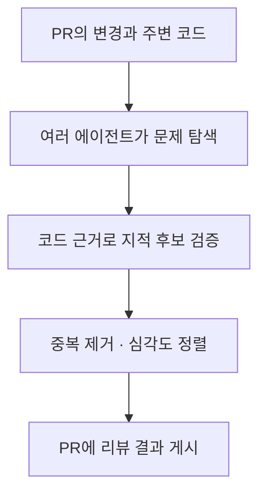

## TL;DR

- 자동 리뷰의 지적에도 검증 근거가 필요하다.
- 리뷰 지침에는 구체적인 실패 조건을 적는다.
- 검토 시간을 줄인 효과는 품질과 함께 확인한다.

## 시작하며

AI가 코드를 빠르게 만들어도 사람이 모든 변경을 이해하고 검토해야 한다면, 다음 병목은 리뷰에 생긴다. 예전에 리뷰의 인지부하를 정리하면서 사람이 맥락을 이해하는 비용을 낮추고 반복 판단을 자동화해야 한다고 썼다.[^2]

Anthropic이 공개한 Claude Code 팀의 코드 리뷰 글을 읽었다.[^1] 이번에는 이 글의 주요 내용을 정리하고, 공개 문서에 나온 도구의 동작을 덧붙여 실제로 무엇을 자동화할 수 있는지 살펴보려고 한다.

## 1. 리뷰 시간과 변경 실패를 함께 본다

Claude Code 팀은 6~9월에 병합한 PR이 2배 이상 늘었고, 변경을 되돌린 비율은 40% 넘게 줄었다고 보고했다. 목표는 장애와 되돌리기를 늘리지 않으면서 사람이 쓰는 시간을 줄이는 것이다.[^1]

PR(Pull Request)은 코드 변경을 검토하고 저장소에 합치는 요청이다. 이 팀은 여러 검사에 단계적 배포와 빠른 복구를 함께 사용한다.[^1] 위 수치는 그 운영 결과이므로, 자동 리뷰 하나의 효과를 분리해 측정한 것으로 읽어서는 안 된다.

나는 이 기준이 리뷰 자동화를 평가하는 데 유용하다고 생각한다. 검토 시간이 줄어도 출시 뒤 수정하는 시간이 늘면, 개발자가 감당하는 일은 줄지 않을 수 있기 때문이다. 예를 들어 리뷰에 하루 한 시간을 덜 쓰게 됐는데 장애 대응에 두 시간을 더 쓴다면, 승인 속도가 빨라졌다는 사실만으로 개선이라고 하기 어렵다.

## 2. 자동 리뷰도 실행과 검증으로 나눈다

### 2.1. 작성한 코드부터 확인하기

Claude Code의 Best practices는 에이전트에게 테스트, 빌드, 화면 비교처럼 직접 실행할 검증 수단을 주도록 권한다. 실행 결과를 읽고 수정할 수 있어야 사람의 다음 지시를 기다리지 않고 작업을 이어갈 수 있다. 작성과 별도의 맥락에서 검증하는 에이전트를 사용하는 방법도 소개한다.[^3]

예를 들어 예약 취소 기능을 맡긴다면, ‘취소 버튼을 만들었다’는 설명만으로는 부족하다. 취소한 예약이 목록에 어떻게 표시되는지, 같은 요청을 다시 보내도 상태가 유지되는지처럼 기대 동작을 정하고 실행 결과와 대조해야 한다.

### 2.2. 리뷰가 찾은 문제도 확인하기

공개된 Code Review 서비스에서는 여러 에이전트가 변경과 주변 코드를 읽는다. 이후 검증 단계가 지적 후보를 코드와 대조하고, 남은 항목의 중복을 제거해 심각도순으로 PR에 남긴다.[^4]





이 서비스는 PR을 승인하거나 차단하지 않는다. **문제를 찾는 도구와 변경을 받아들이는 정책은 별개다.** 보안 검토에는 별도의 `/security-review` 명령이나 PR에서 실행하는 GitHub Action도 사용할 수 있다.[^4][^5]

어떤 검사가 실패했을 때 병합을 막을지, 누가 남은 지적을 판단할지는 저장소의 규칙으로 연결해야 한다. 리뷰 댓글이 존재하는 것만으로 그 문제가 해결됐다고 볼 수는 없다.

## 3. REVIEW.md에는 무엇이 실패인지 적는다

도구를 붙인 다음에는 팀이 어떤 문제를 중요하게 보는지 알려줘야 한다. 공개 문서는 `CLAUDE.md`를 프로젝트 공통 지침으로, `REVIEW.md`를 리뷰 전용 지침으로 구분한다. 리뷰할 항목, 심각도와 제외할 대상을 `REVIEW.md`에 적을 수 있다.[^6]

주의할 차이도 있다. Code Review 서비스는 두 파일을 읽지만, 로컬 `/code-review` 명령은 `CLAUDE.md`만 읽는다. 두 경로에 공통으로 적용할 기준이라면 `CLAUDE.md`에 있어야 한다.[^6]

지침을 작성할 때는 ‘보안을 잘 확인하라’보다 실패할 상황을 적는 편이 낫다고 생각한다. 앞의 예약 취소 기능이라면 다음과 같이 쓸 수 있다.

```text
예약 취소 리뷰 기준

- 예약 소유자가 아닌 사용자가 취소할 수 있는지 확인한다.
- 이미 취소한 예약에 같은 요청을 보냈을 때의 동작을 확인한다.
- 문제를 지적할 때는 발생 조건과 관련 파일·줄을 함께 적는다.
```

이렇게 적으면 ‘취소가 된다’는 정상 동작에서 권한과 반복 요청까지 검토 범위가 구체화된다. 파일 이름에 `secure`가 없다는 추측과, 다른 사용자의 예약을 바꿀 수 있는 코드 경로를 찾았다는 지적도 구분하기 쉬워진다.

기준을 적었다고 검증이 끝난 것은 아니다. 다른 사람의 예약 취소 요청이 실제로 거부되는 테스트가 있어야 지침을 구현 결과와 연결할 수 있다. 문서는 확인할 질문을 남기고, 테스트는 이후 변경에서도 같은 조건을 실행해 확인하게 한다.

## 4. 사람의 판단과 리뷰 반복을 관리한다

Claude Code 팀에서는 신뢰 목록의 작성자가 낸 저위험 변경을 자동 검사만으로 병합할 수 있다. 위험이 높아지면 사람이 승인하며, 에이전트 승인으로 대체할 수 없다.[^1]

이 기준을 다른 팀에 적용하려면 먼저 어떤 변경의 실패 비용이 큰지 정해야 한다. 예약 버튼의 문구와 취소 권한을 바꾸는 코드는 같은 화면에 있어도 잘못됐을 때의 영향이 다르다. 나는 이런 차이를 리뷰 정책에 담고, 해당 조건을 자동 검증이 어디까지 확인하는지에 따라 사람 검토 범위를 조정하는 편이 낫다고 생각한다.

사람 검토를 줄여도 자동 리뷰가 계속 수정을 요구한다면 변경을 끝낼 수 없다. 원문에서는 세 차례 리뷰 뒤 접근을 재고하도록 한다.[^1]

여기서 세 차례는 문제가 남아도 통과시키는 기준으로 이해하면 안 된다. 리뷰가 끝나지 않을 때는 같은 방식으로 한 번 더 실행하기보다 남은 지적이 실제 결함인지, 서로 충돌하는 요구인지 살펴볼 필요가 있다.

예를 들어 예약 취소를 반복해도 성공 응답을 돌려주는 것이 합의된 동작인데 리뷰어가 계속 오류를 반환하라고 요구한다면, 수정 횟수를 늘려도 해결되지 않는다. 기대 동작을 리뷰 지침과 테스트에 함께 남기고, 그 지적이 다시 나오는지 확인해야 한다.

리뷰어가 실제 문제를 찾는지도 확인해야 한다. Claude Code 팀은 과거 장애 사례로 리뷰어를 매일 평가한다.[^1]

예전에 Software Factory의 평가를 정리하면서 목표 지표가 좋아지는 동안 다른 품질이 나빠지는지 보는 텐션 메트릭을 설명했다.[^7] 리뷰에도 같은 관점을 적용할 수 있다. 리뷰를 빨리 끝냈는지와 실제 결함을 놓쳤는지를 함께 봐야, 댓글을 덜 남기기만 하는 리뷰어를 더 좋은 리뷰어로 받아들이지 않을 수 있다.

## 마치며

나는 리뷰 자동화를 시작할 때, 반복해서 받는 지적 하나를 구체적인 검증 조건으로 바꾸는 것부터 해보면 좋겠다고 생각한다. 어떤 상황에서 실패하는지 적고, 관련 코드를 찾고, 실행해 확인할 수 있게 만드는 것이다.

그 조건을 자동으로 확인할 수 있게 됐다면 같은 내용을 사람이 매번 다시 읽을 필요도 줄어든다. 이렇게 확보한 시간을 아직 검증하지 못한 동작과 제품의 의도를 판단하는 데 쓸 수 있어야 리뷰 자동화가 개발에 도움이 된다.

---

[^1]: Anthropic, [How the Claude Code team does code review](https://claude.dev/blog/solving-code-review-at-anthropic/).
[^2]: [AI 코드 리뷰가 버거운 이유 — 컨텍스트에 익숙해질 시간과 인지부채](/2026/08/18/ai-coding-review-cognitive-load.html).
[^3]: Anthropic, [Best practices for Claude Code](https://code.claude.com/docs/en/best-practices).
[^4]: Anthropic, [Code Review](https://code.claude.com/docs/en/code-review).
[^5]: Anthropic, [Automated Security Reviews in Claude Code](https://support.claude.com/en/articles/11932705-automated-security-reviews-in-claude-code).
[^6]: Anthropic, [Customize Code Review](https://code.claude.com/docs/en/code-review-customize).
[^7]: [Software Factory가 스스로 개선하려면 — Eval과 KPI, 텐션 메트릭](/2026/10/05/software-factory-evals-and-tension-metrics.html).
