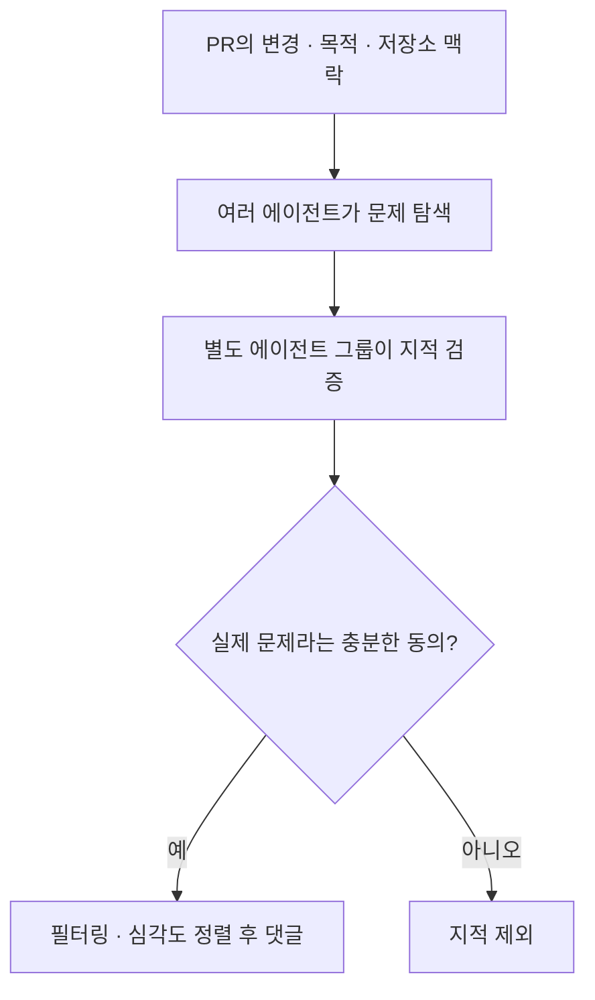
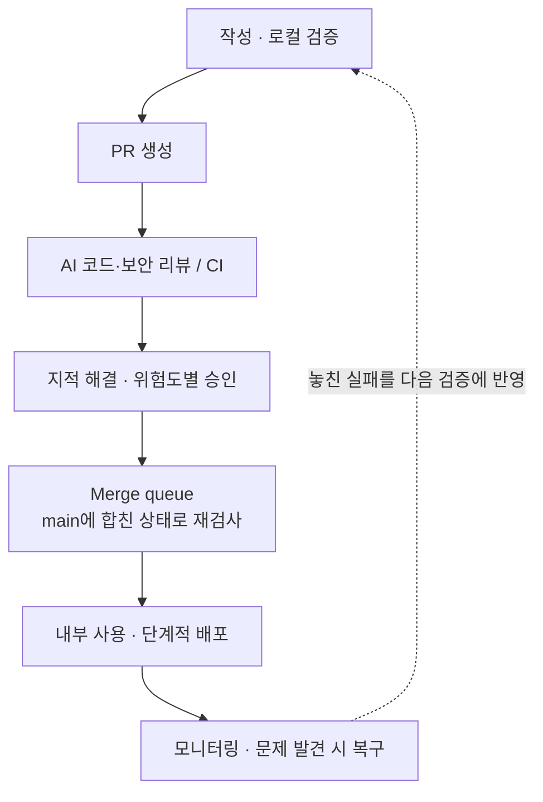
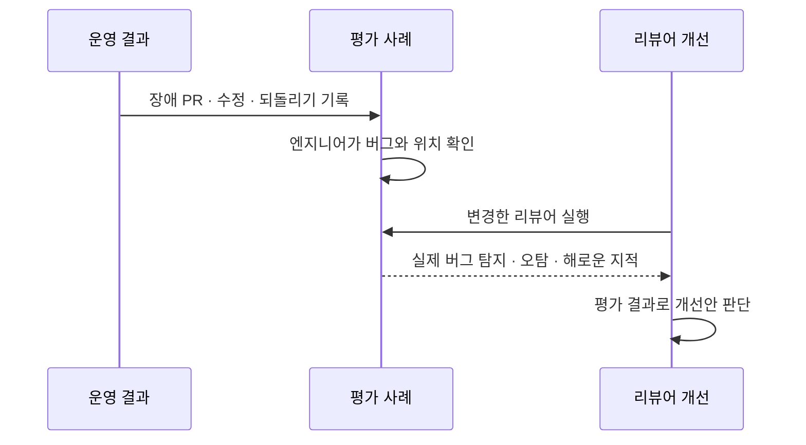

## TL;DR

- Claude Code 팀은 변경 위험도에 따라 사람의 리뷰를 배분한다.
- Scion 사례는 코드 생성 이후의 인프라 병목을 보여준다.
- 리뷰 자동화의 효과는 운영 품질과 함께 평가한다.

## 시작하며

AI가 코드를 빠르게 만들어도 사람이 모든 변경을 읽고, 검증하고, 저장소에 합치는 과정이 따라가지 못하면 출시까지 걸리는 시간은 그만큼 줄지 않는다. Anthropic이 공개한 코드 리뷰와 소스 관리 글은 이 문제를 서로 다른 범위에서 다룬다.

10월 15일의 「How the Claude Code team does code review」는 Claude Code 팀이 리뷰를 어떻게 운영하는지 설명한다.[^1] 10월 13일의 「Redesigning source control at Anthropic」은 Scion이라는 소스 관리 시스템을 다룬다.[^2] **Claude Code는 별도 저장소를 쓰므로, 두 글을 하나의 저장소에 적용한 절차로 읽으면 안 된다.**

이번 글에서는 두 사례를 정리하고, 예전에 쓴 인지부하와 Software Factory 글이 어디에서 연결되는지 덧붙이려고 한다. 사람이 무엇을 이해하고 판단해야 하는지, 자동 검증은 어떻게 개선하는지를 함께 볼 수 있는 사례라고 생각한다.

## 1. Claude Code 팀은 무엇을 자동으로 검증하는가

### 1.1. 리뷰를 줄인 효과는 변경 실패와 함께 본다

PR(Pull Request)은 코드 변경을 검토하고 저장소에 합치는 요청이다. Claude Code 팀은 2026년 6~9월 병합한 PR이 2배 이상 늘었고, 병합한 변경을 되돌린 비율은 40% 넘게 줄었다고 보고했다.[^1]

원문에는 범위가 다른 수치도 나온다. AI 리뷰 도입 전후 실질적인 리뷰 댓글이 달린 내부 PR 비율은 16%에서 54%로 늘었다. Anthropic 전체 모노레포, 즉 여러 프로젝트를 함께 관리하는 저장소의 일일 병합량은 5월 약 2,500건에서 9월 30,000건 이상으로 늘었다. 이 둘을 Claude Code 저장소의 같은 기간 성과로 묶어서는 안 된다.[^1]

목표는 작성자를 포함해 최대 한 명의 사람만 관여하는 PR을 대부분으로 만들면서, 변경을 되돌리는 비율과 장애 비율을 늘리지 않는 것이다. 앞의 성과에는 여러 검사와 단계적 배포, 빠른 복구가 함께 작용하므로 AI 리뷰 하나의 효과를 분리한 수치로 볼 수는 없다.

### 1.2. PR을 만들기 전부터 검증한다

Claude가 코드를 수정하면 테스트와 빌드를 실행하고 결과를 확인한다. UI 변경은 화면을 디자인과 비교하고, 구현 세션과 별도의 맥락을 가진 서브에이전트가 변경 내용을 리뷰한다. 버그 탐지, 코드 단순화, 처음부터 끝까지 사용자 동작을 확인하는 검증에도 별도 Skill을 사용한다.[^1]

반복되는 지적은 작업 지침이나 자동 검사로 옮긴다. `CLAUDE.md`에는 기술 스택과 개발 규칙, 목표를 적고, `REVIEW.md`에는 해당 코드에서 어떤 실패를 찾아야 하는지 적는다. 리뷰 지침을 실제로 따르는지도 따로 확인한다.

예를 들어 예약 취소 기능이라면 다음처럼 검토할 조건을 정할 수 있다.

```text
예약 취소 리뷰 기준

- 예약 소유자가 아닌 사용자가 취소할 수 있는지 확인한다.
- 이미 취소한 예약에 같은 요청을 보냈을 때의 동작을 확인한다.
- 문제를 지적할 때는 발생 조건과 관련 파일·줄을 함께 적는다.
```

같은 권한 문제가 반복되면 지침에 남기는 데서 그치지 않고, 다른 사용자의 예약 취소 요청이 거부되는 테스트로 확인할 수 있다. 이렇게 해야 다음 변경에서도 같은 실패 조건을 검사할 수 있다.

### 1.3. 리뷰어가 찾은 문제도 다른 에이전트가 확인한다

모든 PR에는 AI 코드 리뷰가 붙는다. 리뷰어는 변경 내용뿐 아니라 저장소의 주변 코드와 PR의 목적을 읽고, 원래 문제를 해결했는지와 다른 동작을 망가뜨렸는지를 확인한다. 여러 에이전트가 동시에 문제를 찾고, 별도의 에이전트 그룹이 각 지적의 타당성을 판단한다.[^1]





이는 실제 문제가 아닌 것을 버그라고 지적하는 오탐(False Positive)을 줄이기 위한 구조다. 그림은 원문의 탐지·검증 관계를 단순화했으며, 구체적인 에이전트 수와 동의 기준은 공개하지 않았다.

원래 있던 문제는 `Pre-existing`으로 구분한다. 모든 지적은 수정하거나, 수정하지 않을 이유를 남기고 스레드를 해결해야 한다. 보안 리뷰도 별도로 실행하며, 버그·보안 리뷰의 열린 지적이 남아 있으면 병합할 수 없다.[^1]

여기서 지적을 게시하는 공개 Code Review 제품과 Claude Code 팀의 병합 정책은 구분해야 한다. 제품은 승인 자체를 대신하지 않으며, 열린 지적을 병합 차단 조건으로 삼는 것은 팀의 운영 규칙이다.

### 1.4. 자동 검사와 배포 후 복구를 연결한다

AI 리뷰와 함께 CI(Continuous Integration), 즉 변경을 합칠 때 실행하는 자동 검사도 유지한다. 코드 규칙과 타입을 검사하고, 플랫폼별 테스트와 빌드를 실행한다. PR에는 테스트 방법과 변경을 되돌릴 방법을 적으며, Claude가 작성했더라도 작업을 지시한 사람이 확인한다.[^1]

아래는 Claude Code 팀의 흐름이다. 사람의 승인 범위는 다음 절에서 설명한다.





Merge queue는 병합할 변경을 대기열에 넣고 최신 `main`에 합친 상태로 다시 검사한다. 각각 통과한 PR도 함께 합치면 문제가 생길 수 있기 때문이다. 새로운 동작은 기능을 켜고 끄는 Feature Flag 뒤에서 내부 직원이 먼저 사용하고, 공개 배포도 단계적으로 진행한다.[^1]

배포 뒤 문제가 드러나면 Flag를 끄거나 변경을 되돌린다. 장애를 검토할 때는 어느 검증 단계가 놓쳤는지도 확인한다. 원문은 이런 복구 절차를 자동 리뷰를 확대하기 위한 조건으로 함께 설명한다.

## 2. 사람의 승인과 리뷰 반복을 어떻게 관리하는가

### 2.1. 변경의 위험도가 필요한 승인을 정한다

Claude Code 팀은 작성자의 경력 대신 변경 내용으로 위험도를 분류한다.[^1]

| 위험도 | 변경 예시 | 필요한 사람 승인 |
| --- | --- | --- |
| Low | 문서, 문구, 내부 기능, Flag 뒤의 추가 기능 | 자동 검사 통과 등 조건을 충족하면 0명 가능 |
| Medium | 일반 제품 기능, 캐싱, 자동 업데이트, 시스템 프롬프트 | 1명 |
| High | 가장 위험한 코드, 항상 두 명의 승인이 필요한 경로 | 2명 |

첫 번째 AI 분류기가 위험도를 정하고, 두 번째 분류기는 해당 변경에 사람이 추가로 필요한지 판단한다. CI 설정과 소유자가 민감하다고 지정한 경로는 항상 사람 검토를 요구한다.

승인을 줄이는 경로는 저장소의 신뢰 목록에 있는 작성자에게만 적용한다. 에이전트가 작성한 PR도 지시한 사람이 책임지며, 그 사람은 필요한 검토 인원에 포함될 수 있다. 에이전트의 승인은 사람의 승인 자리를 채우지 못한다.

승인은 특정 커밋에 대한 것이다. 이후 에이전트가 수정하거나 사람이 충돌을 해결하는 등 시스템이 보증할 수 없는 변경이 들어오면 다시 승인해야 한다.[^1]

### 2.2. 리뷰가 끝나지 않는 문제도 관리한다

AI 작성자와 AI 리뷰어는 서로 일을 계속 만들어낼 수 있다. 실제로 Claude Code의 한 PR은 하룻밤 동안 리뷰와 수정을 50회 넘게 반복했다. 조사 결과 반복해서 지적한 코드의 약 59%는 첫 리뷰 때부터 존재했다. 수정이 새 버그를 만들었다기보다 기존 코드에서 다른 문제를 조금씩 더 찾는 상황이었다.[^1]

이에 팀은 다음과 같이 재리뷰 방식을 바꿨다.

| 변경한 규칙 | 목적 |
| --- | --- |
| 세 차례 후 작성자에게 접근 재검토 요청 | 같은 방식의 무한 반복 중단 |
| 초기 몇 차례 이후 새 변경분(Diff) 중심 검토 | 매번 기존 코드 전체로 범위가 번지는 문제 완화 |
| 한 줄 대신 버그 유형을 지적 | 같은 종류의 문제를 함께 수정 |
| 이미 게시한 지적은 반복하지 않음 | 중복 수정·리뷰 방지 |

세 차례는 결함이 남아도 통과시키는 기준이 아니다. 접근을 재검토하는 시점이다. 기존 코드의 문제는 야간 리뷰에서도 별도로 찾으므로, PR 재리뷰의 범위를 줄이는 것과 오래된 결함을 방치하는 것도 구분할 수 있다.[^1]

### 2.3. 사람이 맡는 판단과 지식 공유

사람은 기능을 만들어야 하는지, 어떤 위험을 감수할지, 다른 코드가 따라갈 아키텍처가 적절한지 판단한다. 테스트 결과와 리뷰 근거를 읽고, 그 검사가 무엇을 놓칠 수 있는지 확인하는 일도 남는다. 배포한 변경의 책임은 작업을 지시한 사람에게 있다.[^1]

코드 리뷰가 담당하던 지식 공유는 필요한 부분을 설명받는 방식으로 보완한다. 팀은 수정하려는 모듈을 Claude에게 설명하게 하거나 시각 자료로 살펴본다. 다만 원문은 이를 정형화된 지식 공유 절차로 운영한다고 주장하지 않는다.

## 3. Scion은 소스 관리의 병목을 다룬다

리뷰를 통과한 변경도 가져오고, 합치고, 테스트할 수 있어야 한다. Scion은 대규모 모노레포에서 온라인 에이전트와 작업을 전제로 만든 중앙 서비스다. 클라이언트는 필요한 파일만 받고 변경 내역과 이력을 API로 조회한다. 일반 저장소의 Git 대체재를 제안하는 글은 아니다.[^2]

병합 정책도 다르다. Claude Code 팀은 merge queue에서 검사하지만, 모노레포에서는 전체 대기열을 잠그는 방식이 어려워 병합 후·배포 전 자동 검사에 투자했다.[^1][^2]

두 사례를 함께 읽으면 리뷰 정책과 인프라의 처리 용량을 함께 봐야 한다는 생각이 든다. 사람이 빨리 승인해도 자동 검증이 밀리면 변경은 기다려야 한다. 반대로 검사를 빨리 실행할 수 있어도 사람이 모든 결과를 다시 읽어야 한다면 이해와 판단에 걸리는 시간은 그대로 남는다.

## 4. 인지부하와 Software Factory 글에 연결해 보기

### 4.1. 사람의 이해 비용과 검토 비율을 줄인다

예전에 인지부하 글에서, 직접 구현하는 동안 쌓이던 이해가 AI 개발에서는 결과를 받는 시점으로 몰릴 수 있다고 정리했다.[^3] 여기서 인지부하는 코드의 의도와 동작, 예외를 이해하고 판단하려고 정보를 머릿속에 유지하는 부담이다.

그 글에서 제안한 대응은 사람이 변경 하나를 이해하는 비용을 낮추거나, 반복 검증에서 사람을 빼내는 것이었다. Claude Code 팀의 모듈 설명과 검증 근거는 전자에, 위험도별 승인 정책은 후자에 연결된다.

이는 필요한 이해를 생략해도 된다는 뜻은 아니다. 무엇을 만들려는지, 어떤 실패가 위험한지, 자동 검사가 어디까지 확인하는지를 판단할 이해는 여전히 필요하다. 같은 내용을 사람이 매번 다시 읽는 일을 줄이되, 남은 판단을 할 수 있는 근거를 제공하는 방식이다.

### 4.2. 운영 실패를 리뷰어의 평가로 돌려보낸다

Software Factory 글에서는 AI가 구현·검증·운영을 이어가며 제품과 개발 방식까지 개선하는 시스템을 다뤘다.[^4] 그 과정에서 Eval, 즉 입력과 기대 결과를 정하고 실제 실행을 대조하는 평가가 다음 수정의 기준이 된다고 설명했다.

Claude Code 팀은 과거 장애를 일으킨 PR과 수정·되돌리기 기록을 모으고, 코드를 아는 엔지니어가 버그와 위치를 확인한다. 이 데이터셋으로 리뷰어를 매일 평가하며, 프롬프트·도구·모델을 바꿀 때도 다시 평가한다.[^1]





문제없는 PR에서도 리뷰어를 실행해, 정상 코드를 망가뜨릴 수 있는 지적을 하는지 확인한다. 실제 리뷰 댓글에 대해서는 사람이 수정했는지, 틀린 지적이라고 했는지, 의도한 동작이어서 수정하지 않았는지 등을 기록한다.[^1]

나는 제품에서 생긴 실패로 제품 코드를 고치는 데 더해, 그 실패를 놓친 리뷰어까지 평가하는 점이 Software Factory와 직접 연결된다고 생각한다. 반복되는 문제가 다음 작업의 테스트와 지침을 바꾸면 개발 방식에도 개선이 남는다.

### 4.3. 처리 속도와 품질을 함께 평가한다

Software Factory 글에서 텐션 메트릭은 목표 지표가 좋아지는 동안 다른 품질이 나빠지는지 확인하는 지표였다.[^4] 리뷰의 경우 댓글 수나 승인 속도만 최적화하면, 실제 결함을 놓치면서도 성과가 좋아 보일 수 있다.

Claude Code 팀은 다음 항목을 함께 본다.[^1]

| 평가할 대상 | 개선하려는 항목 | 함께 확인할 품질 |
| --- | --- | --- |
| 사람의 개입 | PR당 사람 승인 수의 중앙값·95백분위수, 댓글, 사람을 기다린 시간 | 변경을 되돌린 비율, 장애 비율 |
| 리뷰어 | 실제 버그 탐지, 통과까지의 리뷰 횟수 | 오탐, 정상 코드를 해칠 수 있는 지적 |

95백분위수는 PR의 95%가 그 값 이하의 승인을 받았다는 뜻으로, 승인이 많이 필요한 쪽도 살펴보는 지표다.

원문은 실제 버그를 잡는 것을 첫째, 리뷰 횟수를 줄이는 것을 둘째 우선순위로 둔다. 사람이 리뷰에서 아낀 시간을 장애 대응에 더 많이 쓰게 됐다면 개선이라고 볼 수 없기 때문이다.

다만 아직 장애·되돌리기 지표가 악화됐을 때 자동으로 승인 조건을 강화하는 장치는 없다고 밝힌다. 이 사례를 내가 Software Factory 글에서 제안한 KPI(Key Performance Indicator, 성과를 판단하는 핵심 지표)의 선택과 목표 조정까지 자동화한 구현으로 볼 수는 없다. 현재 확인할 수 있는 것은 운영 결과를 평가에 연결하고, 사람의 시간과 변경 실패를 함께 추적하는 방식이다.

## 마치며

두 사례를 읽고 나니 리뷰 자동화의 적용 범위를 코드 읽기에만 두면 부족하겠다는 생각이 든다. 지적을 검증하고, 반복을 끝내고, 합쳐진 변경을 검사하고, 운영 실패를 다음 평가에 남기는 과정까지 연결되어야 한다.

적용을 시작할 때는 원문의 제안처럼 저장소 하나에 AI 리뷰를 붙이고 지침을 조정하면서 범위를 넓히는 편이 좋겠다. 그 과정에서 사람이 무엇을 기다리는지와 배포 뒤 무엇이 실패하는지를 함께 기록하면, 다음에 고칠 대상이 리뷰 규칙인지 검증 환경인지 판단할 근거가 생긴다.

---

[^1]: Addy Osmani, Morgan Westlee Lunt, Qing Wang, [How the Claude Code team does code review](https://claude.dev/blog/solving-code-review-at-anthropic/) (2026-10-15).
[^2]: Anthropic, [Redesigning source control at Anthropic](https://www.anthropic.com/engineering/redesigning-source-control) (2026-10-13, 10월 15일 보완).
[^3]: [AI 코드 리뷰가 버거운 이유 — 컨텍스트에 익숙해질 시간과 인지부채](/2026/08/18/ai-coding-review-cognitive-load.html).
[^4]: [Software Factory가 스스로 개선하려면 — Eval과 KPI, 텐션 메트릭](/2026/10/05/software-factory-evals-and-tension-metrics.html).
