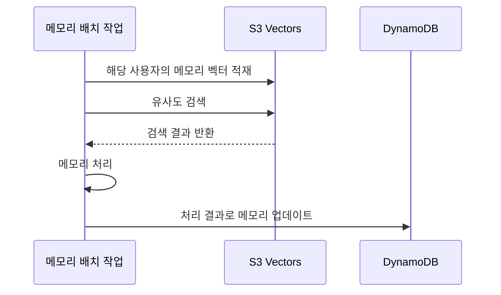

## TL;DR

- PMF를 찾을 때까지 운영 고정비를 낮게 유지한다.
- 애플리케이션 서버를 상시 켜두지 않는다.
- 결제와 보험 비용이 서버비보다 커질 수 있다.

## 시작하며

사이드 프로젝트나 1인 창업으로 제품을 만들 때, 출시하고 나서 바로 사용자가 모이면 좋겠지만 그렇게 되기는 쉽지 않다. 어떤 문제를 풀어야 하는지, 사람들이 어떤 기능을 계속 사용하는지 알아가는 동안에도 서비스는 운영해야 한다.

**PMF(Product-Market Fit), 제품이 시장의 수요에 맞아들어가는 지점을 찾을 때까지 버틸 수 있어야 한다고 생각한다.** 사용자 반응을 보며 기능을 고치는 시간이 필요한데, 서비스마다 고정비가 계속 쌓이면 그 시간을 확보하기 어려워진다.

나는 영어 학습 서비스 [잉크버드(Encbird)](https://www.encbird.com)와 AI 이미지 편집 서비스 [픽셀뱅크스튜디오(PixelbankStudio)](https://www.pixelbankstudio.com)를 만들고 운영하고 있다.

**두 서비스는 도메인이 다르지만 동일한 서버리스 아키텍처로 구성했다. 사용자가 쓰지 않을 때 애플리케이션 서버를 켜두기 위한 컴퓨트 비용은 발생하지 않는다.** 실제 작업을 실행하는 비용과 AI 모델 호출료, 파일 저장·전송료는 별도로 발생한다.

이 글에서는 1인 창업이나 사이드 프로젝트를 시작할 때 비용 효율적으로 서비스를 만들고 운영하는 방법을 공유하려고 한다.

## 1. 서비스를 켜두는 비용부터 낮추기

서버 한 대에 여러 서비스를 올리면 비용을 나눌 수 있다. 다만 서버를 켜둔 시간에 대한 비용은 사용자가 오지 않아도 계속 발생한다.

잉크버드와 픽셀뱅크스튜디오에서는 웹 화면을 정적 파일로 배포하고, 백엔드는 AWS Lambda로 실행한다. Lambda는 요청이나 이벤트가 들어왔을 때 코드를 실행해주는 서비스다. 이 구성에서는 서비스가 열려 있다고 해서 애플리케이션 서버를 한 대씩 계속 켜둘 필요가 없다.

프론트엔드의 앱 화면은 SPA(Single Page Application)로 만들었다. 브라우저가 JavaScript로 화면을 구성하는 CSR(Client-Side Rendering)을 사용해, 사용자 요청마다 서버에서 HTML을 만드는 SSR(Server-Side Rendering)의 실행 비용을 줄이려는 선택이었다.

배포할 HTML과 JavaScript 파일은 Amazon S3에 저장하고 Amazon CloudFront로 전달한다. S3는 파일 저장소이고, CloudFront는 파일을 사용자 가까운 곳에서 전달하고 캐시하는 CDN(Content Delivery Network)이다.

다만 CSR은 검색엔진이 본문을 읽으려면 JavaScript를 실행해야 하므로 SEO(Search Engine Optimization), 즉 검색엔진 최적화가 까다로운 편이다. 그래서 미리 만들 수 있는 공개 페이지는 빌드할 때 HTML로 렌더링해두는 방식으로 보완했다.[^1]

이렇게 만든 공개 페이지는 본문이 들어 있는 HTML 파일로 배포하므로, 사용자 요청을 받을 때마다 서버에서 다시 렌더링하지 않아도 된다.

데이터는 Amazon DynamoDB에 저장한다. 두 서비스 모두 읽기·쓰기 요청량에 따라 비용이 붙는 온디맨드 방식을 사용하므로, 애플리케이션용 DB 서버도 따로 띄워두지 않는다.[^2]

요청이 드문 기간에는 이 차이가 크다. 서비스를 열어둔 시간보다 실제로 들어온 요청과 실행한 작업이 컴퓨트 비용에 영향을 주게 된다.

| 맡기는 일 | 사용하는 구성 | 비용과 연결되는 부분 |
| --- | --- | --- |
| 웹 화면과 파일 전달 | S3 + CloudFront | 저장량·요청·전송량 |
| API 요청 처리 | API Gateway + Lambda | API 요청 수와 함수 실행량 |
| 데이터 보관과 조회 | DynamoDB 온디맨드 | 읽기·쓰기 요청과 저장량 |
| 뒤에서 처리할 작업 | SQS + Lambda | 큐 사용량과 작업 실행량 |

API Gateway는 외부 요청을 백엔드로 연결하고, SQS(Simple Queue Service)는 나중에 처리할 작업을 보관하는 큐다. 역할을 나눠도 각 역할마다 상시 서버를 추가하는 것은 아니다.

### 적절한 언어 선택으로 콜드스타트와 필요 메모리 줄이기

요청이 없을 때 컴퓨트 비용이 작아지는 대신, 새 실행 환경을 준비하는 시간이 생길 수 있다. 이를 콜드스타트라고 한다. 런타임을 시작하고 라이브러리와 초기화 코드를 읽는 INIT 단계도 비용에 포함된다. 2025년 8월 1일부터는 기존에 제외됐던 관리형 런타임의 ZIP 배포·온디맨드 실행에도 INIT 과금이 적용됐다.[^3]

그래서 **Python이나 TypeScript를 꼭 써야 하는 이유가 없다면 Go나 Rust도 검토할 만하다고 생각한다.** 컴파일한 바이너리로 실행하고 시작할 때 불러올 의존성을 작게 유지하면, 메모리 사용량과 콜드스타트를 줄이는 데 도움이 된다.

잉크버드는 처음부터 Go로 서버를 구성했다. 픽셀뱅크스튜디오는 로컬 모델을 불러와 테스트하던 부분 때문에 처음에는 Python으로 만들었다.

그런데 메모리를 적게 할당한 Lambda에서 확인하니, **Python 구현의 콜드스타트가 Go 구현보다 1초 넘게 더 걸렸다.** 이 차이 때문에 픽셀뱅크스튜디오의 백엔드 API와 워커를 모두 Go로 전환했다.

다만 Lambda 비용은 요청 수와 실행 시간, 할당한 메모리에 따라 달라진다. 함께 배포하는 라이브러리와 초기화 코드도 실행 시간에 영향을 주므로, 언어뿐 아니라 실행 구성 전체를 봐야 한다. 내 경우에는 Go로 실행 구성을 가볍게 만드는 것이 적은 메모리를 할당한 Lambda를 사용하는 데 도움이 됐다.

기존 코드나 필요한 라이브러리 때문에 비용을 조금 더 내더라도 Python이나 Java를 써야 한다면, **Lambda SnapStart도 검토할 수 있다.** 초기화가 끝난 실행 환경의 상태를 저장했다가 복원해 콜드스타트를 줄이는 기능으로, Java 11 이상과 Python 3.12 이상에서 사용할 수 있다. Python에는 저장한 상태를 유지하고 복원하는 비용이 추가되지만, Java 관리형 런타임에는 SnapStart의 별도 요금이 없다.[^13]

## 2. 실제로 사용하는 AWS 구성

**잉크버드와 픽셀뱅크스튜디오의 기본 아키텍처는 같다.** 정적 웹을 S3와 CloudFront로 전달하고, API와 후속 작업을 Lambda로 실행하며, 데이터는 DynamoDB와 S3에 저장한다.

아래 그림은 이 공통 구조에 예약 작업, 메일, 관측과 배포 지원을 더한 것이다. S3 Vectors는 잉크버드의 장기 메모리 처리에 사용하고, Step Functions는 여러 처리 단계를 연결할 때 사용한다. 기능별로 선택하는 구성도 함께 표시했고, 같은 역할의 여러 함수와 저장소는 하나로 묶었다.

### 잉크버드 — 요청과 후속 처리 나누기

잉크버드에서는 사용자 요청에 바로 필요한 처리와, 그 요청에서 생긴 데이터를 나중에 처리하는 작업을 나눴다. API Lambda는 요청에 응답하고, 오래 걸리는 후속 처리는 이벤트와 큐를 거쳐 별도 Lambda 워커에서 실행한다.

학습 데이터는 DynamoDB에 저장하고, 이미지 같은 파일은 S3에 둔다. 저장한 데이터는 이후의 요청과 후속 작업에서 다시 사용할 수 있다.[^4] AI 모델이 필요한 단계는 외부 모델 API를 호출하므로, 모델을 직접 서비스하기 위한 GPU 서버를 운영하지 않는다.

이벤트를 전달하는 SNS와 처리할 작업을 보관하는 SQS가 요청 처리와 후속 작업을 연결한다. 워커는 큐에 쌓인 작업을 실행하는 프로그램이고, 여기서는 Lambda로 실행한다. API가 전체 처리가 끝날 때까지 응답을 붙잡고 있지 않아도 되는 구조다.

예약 작업과 메일 발송, 로그 수집 같은 지원 기능도 관리형 서비스에 맡겨 이를 위한 상시 서버를 따로 두지 않았다. 사용하는 서비스는 구성도에 역할별로 정리했다.

파일을 전달할 때는 CloudFront Functions로 요청을 정리하고, 필요한 이미지 크기 변환은 Lambda@Edge가 처리한다. 변환 결과를 캐시하면 같은 파일을 보여줄 때마다 다시 계산하지 않아도 된다.

처리할 작업이 늘어나면 API와 워커도 늘어날 수 있다. 그래도 함수가 여러 개 있다는 이유만으로 각각의 서버를 하루 종일 켜두는 비용이 생기지는 않는다.

다만 사용자가 접속하지 않은 시간에도 예약 작업이나 후속 작업이 실행되면 비용은 발생한다. 내가 줄인 것은 서비스를 열어두기 위해 애플리케이션 서버를 상시 실행하는 비용이다.

### 픽셀뱅크스튜디오 — 파일 전송과 긴 작업 분리하기

픽셀뱅크스튜디오에서는 브라우저에서 끝낼 수 있는 화면 처리와, 서버에 맡길 파일 처리·생성 작업을 나눴다. 화면은 정적으로 배포하고, 서버 API는 Lambda로 실행한다.

이미지 업로드도 API Lambda가 파일 전체를 받아 S3로 다시 보내는 방식을 피했다. 서버가 특정 파일을 올릴 수 있는 임시 권한인 presigned URL을 발급하면, 브라우저가 그 주소로 S3에 직접 업로드한다. 서버는 후속 처리 전에 파일의 소유권과 용도 등을 확인한다.

이렇게 하면 용량이 큰 이미지 파일을 API Gateway와 Lambda가 중계하지 않아도 된다. Lambda는 업로드 권한을 발급하고 요청을 검증하는 일을 맡고, 파일 전송은 S3가 맡는다.

이미지 생성처럼 서버 응답에 30초 이상 걸릴 수 있는 작업은 일반 HTTP API 요청 안에서 완료를 기다리기 어렵다. 이 경로에서 사용하는 API Gateway HTTP API의 최대 통합 타임아웃은 30초다.[^5] 그래서 API는 SQS에 작업을 넣고 작업 식별자를 먼저 반환한다. 이후 Lambda 워커가 모델 API를 호출하고 결과를 S3에 저장하면, 브라우저가 상태를 조회하고 완성된 파일을 CloudFront에서 받는다.

모델은 외부 API로 호출하므로 직접 GPU 서버를 유지할 필요는 없다. 대신 생성할 때마다 모델 제공자의 사용료가 발생한다.

비동기 처리는 긴 작업을 요청의 시간 제한에서 분리하기 위한 선택이다. Lambda 워커가 모델 API의 응답을 기다리는 시간은 여전히 Lambda 실행 시간으로 과금된다.[^6]

파일은 사용자가 보관할 결과물과 처리 중간에 쓰는 임시 데이터로 나눠 관리한다. 임시 데이터에는 만료 정책을 두어, 작업이 끝난 뒤에도 불필요한 저장 비용이 쌓이는 일을 줄인다.

### 긴 작업은 단계로 나누고 컴퓨트는 Lambda로 통일하기

API 응답을 비동기로 바꿔도 Lambda 한 번의 실행 시간에는 최대 15분이라는 제한이 남는다.[^7] 여러 처리를 이어서 실행하는 작업 전체는 그보다 오래 걸릴 수 있다.

그래서 긴 작업은 여러 스테이지, 즉 처리 단계로 나눴다. 각 단계는 Lambda의 실행 제한 안에서 끝나게 하고, 단계 사이의 진행 상태와 결과를 저장한다. Step Functions는 다음에 실행할 단계를 연결한다. 전체 작업이 15분을 넘어도 하나의 Lambda를 15분 넘게 실행할 필요는 없다.

한 에이전트 실행을 길게 유지해야 한다면 Amazon Bedrock AgentCore Runtime도 좋은 선택지다. 서버리스 방식인 microVM 구성은 작은 가상 머신으로 실행 환경을 최대 8시간까지 유지할 수 있다.[^8] 사용량 기반 구성은 실제 CPU와 메모리 사용량에 따라 과금되며, CPU를 사용하지 않는 모델 응답 대기에 CPU 비용이 붙지 않는 이점도 있다.[^9]

**나는 관리할 실행 환경을 단순하게 유지하려고 컴퓨트를 Lambda로 통일했다.** 이미 사용하는 배포·권한·로그 관리 방식을 계속 활용할 수 있기 때문이다. AgentCore Runtime으로 반드시 옮겨야 하는 것이 아니라, 작업을 나눌 수 있는지와 운영할 실행 환경을 얼마나 단순하게 유지할지를 보고 선택한 것이다.

## 3. S3 Vectors로 잉크버드의 장기 메모리 관리하기

잉크버드의 장기 메모리를 처리할 때는 문장의 표현이 달라도 의미가 비슷한 내용을 찾아야 한다. 문장을 숫자 배열인 벡터로 바꿔 서로 가까운 벡터를 찾는 유사도 검색을 사용한다.

처음에는 유사도 검색에 Qdrant를 쓸지 Amazon OpenSearch Serverless를 쓸지 고민하다가 비용 때문에 Qdrant를 선택했다. Qdrant Cloud의 Free Tier로 작은 벡터 DB를 월 비용 없이 사용할 수 있었기 때문이다.[^17]

잉크버드는 메모리를 사용자별로 묶어 한 번에 처리하는 배치 방식을 사용한다. 필요한 사용자의 메모리를 벡터 DB에 일시적으로 적재해 처리하고, 결과로 DynamoDB의 메모리를 업데이트하면 된다. **이 작업을 위해 벡터 DB 서버를 상시 운영할 필요는 없다.**

그래서 Lambda 실행 환경 안에 작은 벡터 DB를 직접 올려 처리하는 방법도 써봤다. 여러 방법을 써보니 내 메모리 처리 방식에는 S3 Vectors의 속도와 가격이 모두 합리적이었다.

**지금은 S3 Vectors를 사용해 잉크버드의 장기 메모리를 관리하고 있다.** S3 Vectors는 벡터 전용 버킷과 인덱스로 저장·검색 기능을 제공하므로, 별도 벡터 DB의 컴퓨트 용량을 유지하지 않아도 된다.[^10] 현재 처리 흐름은 다음과 같다.





S3 Vectors의 저장·쓰기·검색 요금과, 원문을 벡터로 바꾸는 임베딩 생성 비용은 함께 봐야 한다.[^11]

## 4. 개발·배포 비용도 낮추기

### dev와 prod를 따로 구성해두기

기능을 고칠 때마다 운영 환경에서 바로 확인할 수는 없다. 개발용 dev 환경을 따로 두면 테스트용 데이터로 변경 사항을 확인한 뒤 운영용 prod에 반영할 수 있다.

이때도 서버리스의 과금 방식이 유용하다. 개발 환경은 테스트하는 동안에만 요청이 들어오는 경우가 많다. Lambda와 DynamoDB 온디맨드로 구성하면 개발 환경을 마련해뒀다는 이유만으로 애플리케이션 서버와 DB 서버를 계속 켜둘 필요가 없다.

인프라는 AWS CDK로 정의한다. CDK는 Lambda, 테이블, 큐 같은 자원을 코드로 만들고 연결하는 도구다. 같은 인프라 정의를 바탕으로 환경별 설정에서 API 주소, 테이블, 버킷, 큐, 인증 설정을 분리하면 dev와 prod를 각각 구성할 수 있다.

환경 이름만 바꾸고 같은 테이블이나 큐를 바라보게 해서는 분리가 되지 않는다. 개발 요청과 테스트 데이터가 개발 환경 안에서 처리되도록 연결까지 나누는 것이다.

**개발 환경도 운영 환경과 비슷한 구성으로 마련하되, 쓰지 않는 시간의 컴퓨트 비용은 낮게 유지할 수 있다.** 개발할 때마다 비용을 아끼려고 서버를 켰다 끄는 일을 줄일 수 있는 셈이다.

저장해둔 파일과 로그, 예약 작업의 비용은 남는다. Lambda를 미리 준비해두는 Provisioned Concurrency를 사용하면 그 용량을 유지하는 비용도 붙는다.[^6] 여기서 말하는 장점은 상시 용량을 확보하지 않는 온디맨드 구성을 전제로 한다.

### 배포에는 GitHub Actions의 무료 실행 시간 활용하기

배포 파이프라인에도 별도 빌드 서버를 두지 않고 GitHub Actions의 무료 실행 시간을 활용한다. 웹 코드를 검증하고 정적 파일을 빌드한 뒤, S3에 올리고 CloudFront 캐시를 갱신하는 흐름이다.

**GitHub Free는 비공개 저장소에 표준 Linux 러너 기준 월 2,000분의 실행 시간을 제공한다.** 러너는 빌드와 테스트를 실행하는 환경이다. 이 시간은 저장소마다 주어지는 것이 아니라, 저장소를 소유한 계정이나 조직의 여러 저장소가 함께 사용하는 한도다.[^12]

실제 워크플로도 Ubuntu 러너를 사용한다. 변경한 범위에 필요한 검사를 실행하고 의존성·빌드 캐시를 재사용해 불필요한 실행 시간을 줄인다. 픽셀뱅크스튜디오의 웹 배포는 검증 단계에서 만든 산출물을 그대로 받아 사용하므로 배포할 때 다시 빌드하지 않는다.

무료 시간 안에서 빌드와 배포를 처리하면, 서비스를 만드는 쪽에도 상시 서버 비용을 추가하지 않아도 된다. 빌드 산출물의 보관과 배포 대상인 AWS 사용료는 별도로 관리한다.

## 5. 에이전틱 엔지니어링 시대, 개발보다 높은 운영의 허들

잉크버드는 국내 사용자를, 픽셀뱅크스튜디오는 미국 사용자를 대상으로 한다. 시장은 다르지만 온라인 결제를 중계하고 판매대금을 정산해주는 결제대행사(PG)는 **토스페이먼츠** 하나만 쓴다. 토스페이먼츠는 해외 발급 카드 결제도 지원하지만, 이를 사용하려면 추가 계약과 카드사 심사를 거쳐야 한다.[^14]

**내 경우에는 서버비보다 결제를 위한 보증보험료 같은 비용이 더 많이 나온다.** 토스페이먼츠의 공식 안내에는 가입비 22만 원(최초 1회)과 연관리비 11만 원(연 1회)이 있으며, 실제 적용 조건은 계약 형태에 따라 달라진다.[^15]

보증보험은 판매자가 상품이나 서비스를 제공하지 못하는 등의 문제로 생길 정산 위험에 대비하는 보험이다. 토스페이먼츠는 월 정산한도 1,000만 원 이하에 보증보험을 면제하는 정책을 운영하지만, 업종과 취급 상품에 따라 적용되지 않을 수 있다.[^16]

AI 에이전트가 구현과 테스트를 도와주는 에이전틱 엔지니어링 시대에는, 나는 개발보다 운영이 더 큰 허들이라고 생각한다. 코드를 만드는 부담이 줄어도 결제 계약과 심사, 보험 갱신처럼 서비스를 실제로 판매하고 유지하기 위한 일과 비용은 남기 때문이다.

## 마치며

나는 PMF를 찾기 전의 사이드 프로젝트와 1인 창업에 이런 구성이 잘 맞는다고 생각한다. 사용자가 적은 기간의 컴퓨트 비용을 낮게 유지하고, 개발과 배포에 상시 서버를 추가하지 않아도 되기 때문이다.

서비스를 하나 더 시도할 때도 같은 원칙을 적용할 수 있다. 상시 서버부터 추가하기보다 실제로 실행할 일과 보관할 데이터를 기준으로 구성하고, 결제 계약과 보험료까지 함께 살피는 것이다. 어떤 서비스가 사용자에게 필요한지 알아가는 동안, 유지 비용 때문에 시도를 일찍 접지 않아도 되는 환경을 만들고 싶다.

---

[^1]: [Nuxt 렌더링 방식](https://github.com/nuxt/nuxt/blob/main/docs/3.guide/1.concepts/1.rendering.md) — CSR과 빌드 시 사전 렌더링을 통한 정적 배포.
[^2]: [Amazon DynamoDB 요금](https://aws.amazon.com/dynamodb/pricing/) — 온디맨드 읽기·쓰기와 저장 요금.
[^3]: [AWS Lambda INIT 과금 표준화](https://aws.amazon.com/blogs/compute/aws-lambda-standardizes-billing-for-init-phase/) — 2025년 8월 1일 적용. 사용자 지정 런타임과 컨테이너 이미지 등은 변경 전에도 INIT 시간이 과금됐다.
[^4]: [잉크버드의 대화 데이터를 복습 기능으로 이어가기](/2026/03/12/genai-flywheel-for-business.html)
[^5]: [API Gateway HTTP API 할당량](https://docs.aws.amazon.com/apigateway/latest/developerguide/http-api-quotas.html) — 최대 통합 타임아웃 30초. 본문의 30초는 이 일반 HTTP API 경로를 가리키며, 별도 REST API·응답 스트리밍 설정은 구분한다.
[^6]: [AWS Lambda 요금](https://aws.amazon.com/lambda/pricing/) — 요청·실행 시간·메모리 및 Provisioned Concurrency 과금. 구성도에는 [AWS Architecture Icons](https://aws.amazon.com/architecture/icons/)를 사용했다.
[^7]: [Lambda 실행 시간 제한](https://docs.aws.amazon.com/lambda/latest/dg/configuration-timeout.html) — 일반 Lambda 구성의 최대 실행 시간은 900초.
[^8]: [AgentCore Runtime 수명 설정](https://docs.aws.amazon.com/bedrock-agentcore/latest/devguide/runtime-lifecycle-settings.html) — microVM 실행 환경의 최대 수명과 유휴 시간 설정. [비동기 작업 상태 관리](https://github.com/aws/bedrock-agentcore-sdk-python/blob/main/tests_integ/async/README.md)도 참고.
[^9]: [Amazon Bedrock AgentCore 요금](https://aws.amazon.com/bedrock/agentcore/pricing/) — 사용량 기반 microVM의 CPU·메모리 과금.
[^10]: [Amazon S3 Vectors](https://docs.aws.amazon.com/AmazonS3/latest/userguide/s3-vectors.html) — 인프라를 별도 프로비저닝하지 않는 벡터 저장·검색.
[^11]: [Amazon S3 요금](https://aws.amazon.com/s3/pricing/) — S3 Vectors의 저장·쓰기·검색 과금.
[^12]: [GitHub Actions 요금](https://docs.github.com/en/billing/concepts/product-billing/github-actions) — GitHub Free 개인·조직의 비공개 저장소는 월 2,000분 포함. 공개 저장소의 표준 GitHub 호스팅 러너는 무료이며, 빌드 산출물 저장은 실행 시간과 별도로 계산한다.
[^13]: [Lambda SnapStart](https://docs.aws.amazon.com/lambda/latest/dg/snapstart.html) — 초기화한 실행 환경의 복원, 지원 런타임과 추가 요금.
[^14]: [토스페이먼츠 해외결제 연동 안내](https://docs.tosspayments.com/guides/v2/learn/foreign-payment) — 해외 발급 카드 지원, 추가 계약과 카드사 심사.
[^15]: [토스페이먼츠 이용요금](https://www.tosspayments.com/about/fee) — 가입비·연관리비와 계약 형태별 차이. 2026-10-30 확인.
[^16]: [토스페이먼츠 보증보험 가입·면제 기준](https://www.tosspayments.com/blog/articles/54333) — 보증보험의 역할과 업종·정산한도별 조건. [보증보험 갱신 안내](https://www.tosspayments.com/blog/articles/48553)도 참고.
[^17]: [Qdrant Cloud 요금](https://qdrant.tech/pricing/) — 작은 무료 클러스터를 제공하는 Free Tier. 무료 범위를 넘어서는 용량과 기능은 별도 요금제에 해당한다.
