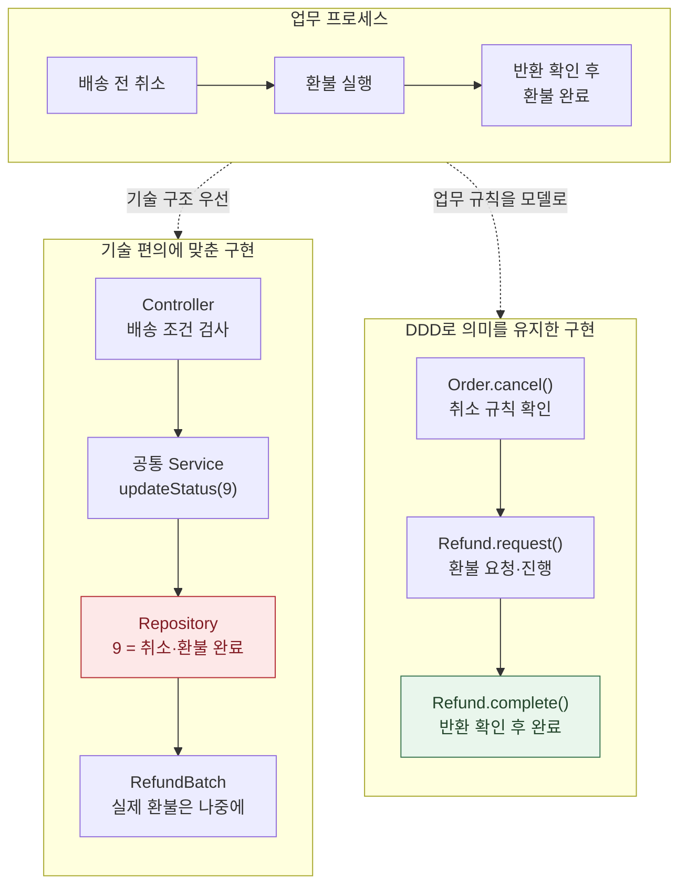
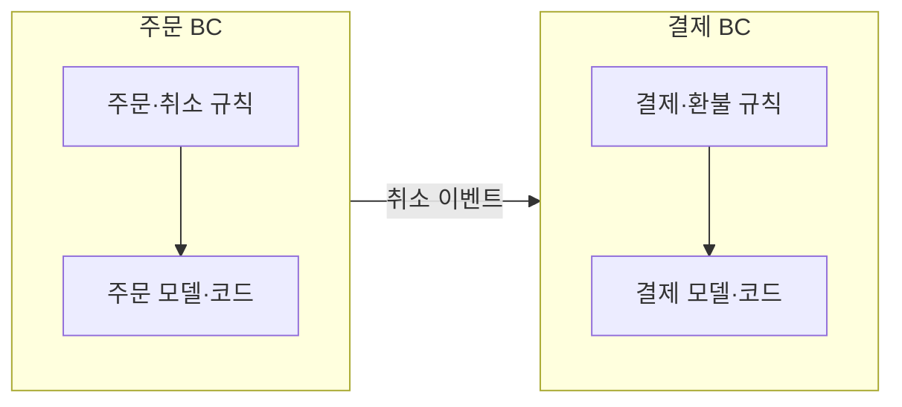
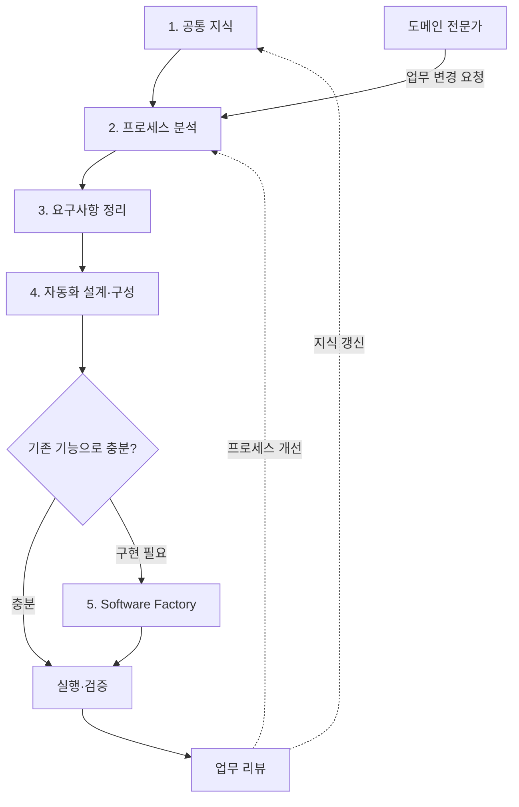
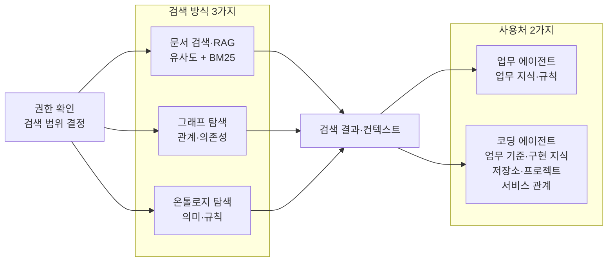
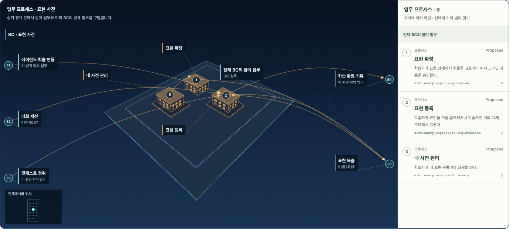
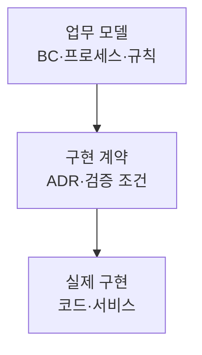
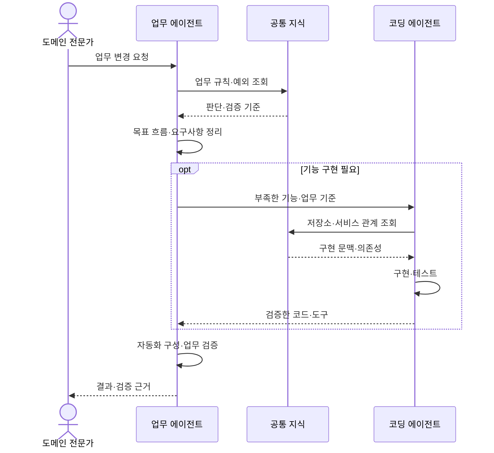
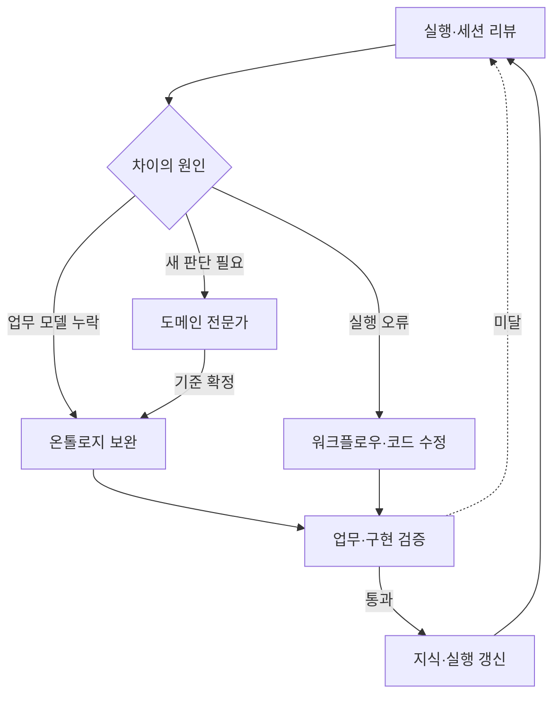

## TL;DR

- 엔터프라이즈 AX는 재사용 가능한 솔루션을 기반으로 구축해야 한다.
- DDD는 업무 언어·모델·구현의 의미를 일치시키는 기준이다.
- 업무 변경은 에이전트의 구현·검증·개선으로 이어져야 한다.

## 시작하며

기업의 업무를 에이전트 기반으로 전환하는 AX(Agentic Transformation)에는 데이터 연결, 접근권한, 업무 지식, 평가와 운영이 함께 필요하다. 팀마다 이를 새로 만들면 비슷한 준비를 반복하고, 이후의 변경도 처음 구축한 기술 전문가에게 의존하기 쉽다.

**엔터프라이즈 AX는 재사용 가능한 솔루션 위에 구축하되, 고객의 업무와 구현이 같은 의미로 연결되게 해야 한다.** 반복되는 기능은 제품이나 공통 플랫폼으로 제공하고, 고객별 업무 규칙과 프로세스를 그 위에 구성하는 방식이다.

기존 소프트웨어 개발에서는 비즈니스 프로세스를 제한된 리소스로 구현할 수 있는 형태나 개발팀에 익숙한 기술과 구조에 맞춰 코드로 옮기는 일이 많았다. 그 과정에서 업무의 뜻과 흐름이 달라지면, 비즈니스는 원래 업무를 기준으로 말하고 개발은 구현된 시스템을 기준으로 답하게 된다. 같은 업무를 두고도 해석이 달라 충돌이 반복되기 쉽다.

이 충돌을 줄이려면 비즈니스와 개발이 함께 정리한 업무의 언어와 규칙이 구현에서도 유지되어야 한다. **DDD(Domain-Driven Design, 도메인 주도 설계)는 그 공통의 업무 모델을 설계와 코드의 기준으로 삼는 접근**이다. 기술적 제약을 처리하더라도 업무의 뜻이 바뀌지 않도록 모델과 구현을 함께 다룬다.

에이전트 기반 업무 자동화와 자가 개선 에이전트는 이 모델을 구현에 반영하고 유지하는 수단이 될 수 있다. 업무 규칙과 예외를 아는 도메인 전문가가 변화를 발견하고 변경을 요청하면, 에이전트가 같은 업무 모델을 기준으로 처리 흐름을 고치도록 구성한다. 필요한 코드의 구현·검증·변경 전달은 Software Factory라는 개발 체계가 이어받는다.

이 글에서는 이 흐름을 만드는 솔루션의 역할과, 도메인 전문가가 변경을 이끌기 위해 필요한 조직의 책임을 정리한다.

## 1. DDD와 바운디드 컨텍스트

### 업무 프로세스가 기술 구조에 맞춰 바뀌는 경우

예를 들어 ‘배송 전 취소된 주문은 환불하고, 반환이 확인되면 환불 완료로 처리한다’는 업무 규칙을 구현한다고 하자. 요청 처리(Controller), 실행 조정(Service), 데이터 저장(Repository)으로 나누는 계층형 아키텍처를 사용할 수 있다.

그런데 일정과 공통 코드 재사용, 기존 DB 구조를 우선해 취소와 환불을 하나의 ‘완료’ 상태로 합치고, 실제 환불은 배치 작업으로 넘기면 문제가 생긴다. 코드는 상태 변경을 끝냈지만 고객에게 돈을 돌려주는 업무는 아직 끝나지 않았기 때문이다.





이 구조에서 ‘환불 완료’ 규칙을 바꾸려면 Controller의 검사, Service의 상태 변경, DB 값과 배치 시점을 다시 이어 읽어야 한다.

DDD에서는 ‘취소 확정’과 ‘환불 완료’를 업무 모델의 서로 다른 개념으로 두고, 코드에서도 각각의 조건을 지키게 한다. `Refund.complete()`는 반환 확인을 기준으로 완료를 판단해야 하므로, 공통 상태값을 갱신했다는 이유만으로 환불을 완료 처리할 수 없다.

계층형 아키텍처와 DDD는 함께 사용할 수 있다. **업무 의미와 규칙을 도메인 모델이 책임지고, API·DB·배치는 그 결정을 실행하는 기술적 역할을 맡게 하는 것**이 DDD가 이 간극을 줄이는 방법이다.

### 업무 의미의 경계를 정하기

취소와 환불의 규칙을 구분하려면 각 업무 모델의 책임 범위도 정해야 한다.

**바운디드 컨텍스트(BC, Bounded Context)는 한 업무 모델의 용어와 규칙이 일관된 뜻을 갖는 범위**다. 주문과 결제의 경계를 나누고, 각 BC 안에서는 업무에서 쓰는 의미와 실제 구현의 의미를 맞춘다.





주문 취소 이벤트를 받은 결제 BC는 자신의 승인·환불 규칙에 따라 처리한다. BC 사이에는 어떤 정보를 어떤 뜻으로 주고받는지 계약을 두어, 주문 취소와 환불 완료를 혼동하지 않게 한다.

이렇게 정한 책임을 담당 조직과 서비스에 반영한다. 하나의 BC를 여러 서비스가 구현할 수도 있으므로, BC는 업무 의미의 경계로 이해해야 한다. 용어와 경계에 관한 자세한 설명은 [처음 DDD를 공부할 때 알아두면 좋을 내용들](/2021/10/11/thoughts-for-ddd-starters.html)을 참고할 수 있다.

## 2. 솔루션을 연결해 AX를 도입하는 흐름

AX가 도입되지 않은 조직이라면 다음 다섯 단계로 시작할 수 있다. 최초 구축 뒤에는 도메인 전문가의 변경 요청이 같은 흐름으로 들어와 시스템의 개선으로 이어져야 한다.





각 단계의 공통 기능은 기존 솔루션으로 마련하고, 고객의 업무에 맞는 규칙과 연결을 구성한다. 자동화 설계에 필요한 기능이 부족하면 Software Factory에서 구현한 뒤 실행에 사용한다.

| 단계 | 맡을 역할 | 남길 결과 |
| --- | --- | --- |
| 1. 공통 지식 | 업무·구현 지식과 접근권한 준비 | 근거를 확인하며 읽을 수 있는 지식 |
| 2. 프로세스 분석 | 현재 업무와 전환할 업무, 책임 분석 | 목표 프로세스와 전환 후보 |
| 3. 요구사항 정리 | 업무 규칙과 성공 기준 합의 | 구현·검증에 사용할 기준 |
| 4. 업무 자동화 | 기존 에이전트·도구로 구성·시험 | 실행할 흐름과 부족한 기능 |
| 5. 소프트웨어 개발 | 부족한 기능의 구현·검증 | 자동화에 사용할 코드와 도구 |

업무 담당자와 프로세스를 먼저 그려본 조직은 그 결과로 필요한 데이터를 확보할 수도 있다. 다만 프로세스 분석 자체를 자동화하려면 읽을 자료와 권한이 먼저 있어야 한다. 어느 접근이든 공통 지식의 준비를 뒤로 미루기는 어렵다.

### AWS와 팔란티어 FDE의 솔루션 기반 접근

FDE(Forward Deployed Engineer)는 고객이나 현업 팀에 들어가 함께 시스템을 구현하는 엔지니어다. AWS와 팔란티어의 공개 자료에서도 고객별 업무를 공통 기술 기반 위에 구현하는 방식을 확인할 수 있다.

AWS는 고객 계정에 업무의 의미와 데이터를 연결하는 시맨틱 계층을 배치하고, 거버넌스와 버전 관리가 적용된 지식 그래프를 에이전트가 사용하게 한다고 설명한다. 지식 그래프·운영 절차·설계 문서를 고객에게 남기고, 고객 엔지니어가 공동 개발을 거쳐 독립 운영자로 성장하는 것을 목표로 한다.[^1]

파트너용 지침은 업무 지식·도구·검증 체계를 묶은 **하네스**를 재사용할 기반으로 제시한다. 온톨로지, 평가 체계, 외부 도구 연결, 에이전트 운영과 설계 기록을 파트너가 축적해 다음 고객의 구축에 활용하는 방식이다.[^2]

팔란티어는 데이터와 업무 모델을 다루는 Foundry, 에이전트와 AI 워크플로우를 만드는 AIP, 배포·인프라를 관리하는 Apollo를 공통 플랫폼으로 제공한다. FDE는 고객 현장에 들어가 이 기반 위에서 필요한 기능을 만든다.[^3] 중심에 있는 Ontology는 주문이나 설비 같은 업무 객체·관계와 액션·함수를 연결해 업무의 뜻을 실제 로직으로 이어준다.[^4]

이 사례들의 공통점은 **재사용 가능한 기술 기반과 고객 고유의 업무 모델을 결합한다는 것**이다. 공식 자료가 두 회사의 DDD 채택이나 모든 변경의 자율 처리를 확인해주는 것은 아니다. DDD는 이런 솔루션 위에서도 업무와 구현의 의미를 일치시켜야 한다는 이 글의 설계 관점이다.

## 3. 공통 지식과 DDD로 업무의 뜻을 유지하기

AX를 진행하면 업무 문서뿐 아니라 업무 간 관계, 여러 저장소와 서비스에 흩어진 구현 정보까지 에이전트가 찾아 읽어야 한다. 공통 지식은 이 정보를 필요한 범위로 모아 제공하는 컨텍스트 관리 기반이다.

문서 검색 결과를 모델의 답변이나 작업에 사용하는 RAG(Retrieval-Augmented Generation, 검색 증강 생성), 관계를 따라가는 그래프 탐색, 업무 개념과 규칙을 찾는 온톨로지 탐색이 필요하다. **이 세 가지 검색 기능을 업무 에이전트와 코딩 에이전트 모두 사용할 수 있어야 한다.**





### 세 가지 방식으로 지식을 찾기

**문서 검색·RAG**는 업무 문서, 회의록, 설계 기록 등에서 필요한 근거를 찾고 작업에 활용한다. 의미가 비슷한 구간을 찾는 유사도 검색과 단어의 일치를 기준으로 문서를 정렬하는 BM25를 결합한 하이브리드 검색이 필요하다. ‘돈을 돌려받고 싶다’와 ‘환불 요청’처럼 표현이 다른 경우와, 상품 코드처럼 정확한 단어를 찾아야 하는 경우를 함께 다루기 위해서다.

**그래프 탐색**은 기록된 연결을 따라 관련 대상을 찾는다. 환불 업무가 넘기는 이벤트, 결제 서비스가 호출하는 서비스, 저장소 사이의 의존 관계를 따라가면 한 곳의 변경이 어디까지 영향을 미치는지 살펴볼 수 있다.

**온톨로지 탐색**은 개념과 관계의 업무 의미, 적용할 규칙과 예외를 찾는다. 주문의 ‘취소 완료’와 결제의 ‘환불 완료’가 무엇을 뜻하고 어떤 조건에서 성립하는지를 명시해, 에이전트가 매번 문서 조각에서 업무 기준을 다시 추론하지 않게 한다.

세 기능은 조합해서 사용한다. 그래프가 연결을 따라가는 방법이라면 온톨로지는 그 연결과 개념의 의미를 정의하며, 그래프나 온톨로지에서 찾은 정보도 RAG의 입력으로 쓸 수 있다.

### 두 종류의 에이전트에 맞게 제공하기

**업무 에이전트**는 비즈니스 지식과 규칙을 주로 요구한다. 환불 요청을 처리한다면 고객과 주문의 상태, 승인 조건, 처리 순서와 예외를 함께 읽고 업무상 허용되는 행동을 판단해야 한다.

**코딩 에이전트**는 같은 업무 기준에 더해 이를 구현하기 위한 지식을 요구한다. 어느 프로젝트의 어떤 저장소를 고쳐야 하는지, 관련 서비스가 어떤 API와 이벤트로 연결되는지, 어떤 계약과 테스트를 지켜야 하는지를 알아야 한다. 하나의 저장소 안에서 코드를 찾는 기능만으로는 여러 프로젝트와 서비스에 걸친 변경을 처리하기 어렵다.

두 사용처를 별도 지식 체계로 단절시켜서는 안 된다. 같은 비즈니스 개념과 규칙을 공유하면서 각자의 작업에 필요한 범위를 조회하게 해야 한다. 업무 에이전트도 서비스 관계를 확인할 수 있고, 코딩 에이전트도 온톨로지에서 업무의 뜻을 확인해야 한다.

공통 지식 플랫폼은 소유자·출처·버전·허용 범위를 관리하고, 조회 전에 에이전트의 역할과 업무 범위에 맞는 접근권한을 적용한다. 업무 조직은 규칙의 뜻과 사용 범위를 결정하고, 플랫폼 조직은 그 결정이 에이전트와 외부 서비스의 실제 조회에 적용되도록 운영한다.

### 업무 지식을 계층으로 탐색하기

온톨로지 탐색에 반드시 그래프 데이터베이스가 필요한 것은 아니다. Turtle 같은 텍스트 형식으로 업무 지식을 정리하고, 개요에서 필요한 상세로 내려갈 수 있게 해줘도 된다.

각 BC의 책임과 핵심 업무를 먼저 보여주고, 에이전트가 관련 BC 안에서 규칙과 예외를 찾게 하는 방식이다. 모든 내부 관계를 미리 완성하지 않아도, BC 소속과 상세로 내려갈 경로가 정리되어 있으면 그 범위에서 검색할 수 있다.

에이전트가 개요를 읽고 다음 탐색 범위를 판단하게 하면, 기업 전체의 자료를 한꺼번에 읽히지 않고 필요한 영역부터 좁혀갈 수 있다. 업무 지식이 커져도 관련 영역의 상세만 가져오므로, 관계없는 내용을 컨텍스트에 넣는 일을 줄일 수 있다. 여기서 줄이는 것은 저장소의 검색 시간이 아니라 에이전트가 읽어야 할 정보의 양이다.

이를 위해서는 각 계층의 개요가 다음 탐색 범위를 고를 수 있을 만큼 정확해야 한다. 개요에서 빠진 예외도 상세 규칙과 원문에서는 찾아볼 수 있어야 한다.

아래는 [온톨로지 도구](https://github.com/haandol/alps-writer-plugins)로 영어 학습 서비스 [잉크버드(EncBird)](https://www.encbird.com)의 ‘표현 사전’ BC를 3D로 연 화면이다. 표현 등록·확장·사전 관리와 대화·팟캐스트·복습 사이의 관계를 보여준다.[^5]

표현 등록 방식을 바꾼다면 대화·팟캐스트에서 표현이 들어오는 경로와, 등록 결과가 복습·학습 기록에 미치는 영향을 함께 확인해야 한다. 온톨로지에 기록한 관계는 에이전트가 어느 프로세스의 조건과 예외를 읽어야 하는지 좁히는 기준이 된다.

### 업무 모델과 구현의 책임을 분리하기

업무 모델에는 프로세스의 목적·참여자·조건·예외를, ADR(Architecture Decision Record, 설계 결정 기록)에는 구현이 지켜야 할 결정과 조건을, 코드와 데이터 연결에는 구체적인 처리 방법을 둔다. 환불 상태 컬럼이 바뀌었다고 ‘환불 완료’의 뜻까지 바뀌어서는 안 된다. 반대로 완료 기준이 바뀌었다면 관련 구현과 검증도 함께 바뀌어야 한다.





이 경계는 에이전트의 실제 처리에도 적용되어야 한다. 어떤 BC의 규칙을 읽고 어떤 권한과 도구로 처리하는지, 다른 BC에 어떤 결과를 넘기는지가 실행 구성에 반영되어야 한다. 에이전트 하나가 여러 BC를 맡더라도 업무별 판단 기준은 구분해야 한다.

## 4. 프로세스 분석에서 자동화와 구현으로 이어가기

공통 지식을 준비한 뒤에는 업무 변경을 요구사항과 실행 가능한 흐름으로 구체화한다. 필요한 기능이 없으면 Software Factory의 코딩 에이전트가 구현을 이어받는다.





### 현재 업무와 전환할 업무 찾기

공통 지식에 준비한 자료와 업무 담당자의 설명으로 현재 프로세스(As-Is)를 파악하고, 에이전트가 처리할 목표 프로세스(To-Be)를 설계한다. 에이전트 스토밍이나 [이벤트 스토밍](/2020/12/10/demystifying-event-storming.html) 같은 방식으로 사건·규칙·예외를 모으고, 누가 결과와 변경을 책임질지도 정리한다.

환불이라면 상담팀의 요청 접수, 주문팀의 배송 확인, 재무팀의 승인이 어떻게 연결되는지부터 봐야 한다. 모든 건이 사람의 승인을 기다린다면 처리 도구만 빨라져도 대기는 남는다. 목표 프로세스에는 에이전트가 처리할 조건과 권한, 사람이 맡을 예외 판단까지 함께 담아야 한다.

### 변경 요청을 검증 가능한 요구사항으로 만들기

도메인 전문가가 “배송 전에 취소한 주문은 별도 승인 없이 환불하도록 바꿔달라”고 요청했다고 하자. 에이전트는 공통 모델에 정의된 배송·취소·승인·환불의 뜻을 기준으로 영향 범위를 찾고, 어떤 경우에 허용하거나 거절해야 하는지 정리한다.

요구사항에는 필요한 데이터, 입출력, 조건과 예외, 기대 결과를 확인할 사례가 있어야 한다. 전문가는 필드명이나 함수명을 지정하는 대신 업무의 뜻과 성공 기준을 판단한다. 초기 설계·개발 기준은 기술 담당자와 합의하되, 그 범위 안의 후속 업무 변경은 같은 모델을 기준으로 이어갈 수 있어야 한다.

### 기존 에이전트와 도구로 자동화 구성하기

다음으로 기존 에이전트와 도구가 요구사항을 충족하는지 확인한다. 필요한 조회·처리 기능과 권한이 갖춰져 있다면 이를 연결해 워크플로우를 만들고 업무 사례로 시험한다. 기능이 부족하면 무엇을 새로 구현해야 하는지 Software Factory로 넘긴다.

워크플로우의 입력과 출력이 맞는지, 정한 규칙을 지키는지, 실패했을 때 어떻게 처리할지를 확인해야 한다. 이후에는 자가 개선 에이전트가 변경 요청과 실행·리뷰 결과를 읽고 작업 순서와 도구 사용을 고친다. 그 기준은 합의한 업무 모델이다.

### Software Factory에서 필요한 기능 구현하기

Software Factory는 부족한 기능을 구현·검증하고, 자동화가 사용할 수 있는 코드와 도구로 제공한다. 업무 모델과 ADR, 현재 구현을 함께 읽어 영향 범위를 찾고, 업무 조건을 만족하는지 테스트와 시나리오로 확인해야 한다.

결과물은 코드와 함께 **어떤 업무 조건을 바꿨고 무엇을 검증했는지 보여주는 근거**다. 코드가 생성됐다는 사실만으로 업무가 올바르게 바뀌었다고 할 수는 없다. [Software Factory의 평가](/2026/10/05/software-factory-evals-and-tension-metrics.html)도 이 차이를 확인할 수 있어야 한다.

이 역할은 최초 구축 뒤에도 계속된다. 다음 업무 변경에 코드 수정이 필요하면 같은 기준으로 구현하고 검증해, 도메인 전문가가 매번 기술 언어로 요청을 다시 작성하지 않아도 되게 해야 한다.

## 5. 자가 개선을 가능하게 하는 리뷰와 조직의 책임

실행 기록과 세션·워크플로우 리뷰에서 발견한 차이는 원인에 맞게 반영해야 한다. 온톨로지의 업무 모델에 규칙이나 예외가 빠졌다면 원문과 비교해 수정하고, 기존 규칙을 실행이 지키지 못했다면 워크플로우나 코드를 고친다. 코드에 맞추려고 업무의 뜻이나 검증 기준을 바꾸어서는 안 된다.

답변이 맞아도 원문 검색이 잘못된 업무 정의를 보완했을 수 있다. 최종 결과와 저장한 업무 지식의 정확성을 따로 확인해야, 잘못된 규칙이 다음 실행에 다시 쓰이는 것을 막을 수 있다.

업무 기준이 정해진 변경은 원인에 따라 지식이나 실행을 수정하고 검증한다. 새로운 업무 판단이 필요한 경우에는 도메인 전문가가 먼저 기준을 정해야 한다.





검증한 변경은 업무 모델과 구현 지식에도 함께 남겨야 한다. 규칙이 바뀌면 온톨로지를, 서비스 연결이나 코드 위치가 바뀌면 구현 지식과 검색 인덱스를 갱신한다. 그래야 다음 업무 에이전트와 코딩 에이전트가 같은 변경을 기준으로 작업한다.

### 업무의 결정권과 검증 책임을 함께 옮기기

이 흐름을 만들려면 조직도 바뀌어야 한다. 업무 모델과 성과를 책임지는 도메인 전문가에게 변경 결정권과 결과 검증 책임을 함께 주고, 플랫폼·기술 조직은 공통 실행 환경과 권한·검증·복구 기준을 책임지게 해야 한다.

| 역할 | 맡을 책임 |
| --- | --- |
| 도메인 전문가 | 업무 변화 파악, 규칙·성과 기준 결정, 결과 검증 |
| 플랫폼·기술 조직 | 재사용할 실행 기반, 권한·검증·복구 체계 운영 |
| FDE | 초기 모델과 적용 구조 정리, 업무 팀의 변경·검증 체계 마련 |

하나의 프로세스에 여러 부서가 참여하면 완료 기준과 변경 책임도 함께 합의해야 한다. 사람의 소속만 바꾸고 결정권과 평가 기준을 그대로 두면, 다른 팀의 판단을 기다리는 일도 남는다.

공통 플랫폼 팀이 모든 업무별 기능을 직접 만들어주면, 요청이 늘 때 그 팀을 기다리게 된다. [사내 FDE](/2026/09/03/developers-to-internal-fde.html)는 초기 구축을 돕되, 이후에는 업무 팀이 같은 기준으로 변경과 검증을 이어갈 수 있게 해야 한다.

### 업무 변경 하나로 확인하기

업무 변경을 기술 전문가의 재해석 없이 처리할 수 있는지는 실제 변경 사례로 확인해야 한다. 환불 정책이 바뀌었을 때 도메인 전문가가 자신의 언어로 새 조건을 요청하고, 시스템이 반영한 결과를 업무 사례로 검증할 수 있는지 보는 것이다.

이때 처리 시간·실패·재작업과 함께 전문가가 설명하고 확인하는 시간도 포함해야 한다. 변경마다 FDE나 개발자가 요청을 다시 해석해야 한다면, 업무를 실행하는 일부 과정은 자동화했어도 변경과 관리의 의존 구조는 남아 있는 셈이다.

## 마치며

이상적인 AX의 목표는 **업무 프로세스와 조직의 책임 구조, 실제 구현이 같은 업무 모델을 따르고, 구현의 세부는 그 기준 안에서 자율적으로 관리되는 시스템**이다.

FDE가 구축을 마치고 떠난 뒤 비즈니스 전문가가 솔루션의 기술적 해석까지 따로 익혀야 한다면, 개발자가 하던 역할을 떠안은 것이다. 업무 전문가가 자신의 언어로 변경을 요청하고 결과를 판단할 수 있어야 한다.

이를 위해 **재사용 가능한 솔루션 위에 DDD를 적용해 업무 언어·모델·구현을 일치시켜야 한다.** Software Factory와 자가 개선 에이전트는 그 일치를 반복적인 변경과 검증으로 유지하고, 조직은 도메인 전문가가 이 과정을 이끌 수 있게 권한과 책임을 나눠야 한다.

---

[^1]: AWS, [AWS invests $1 billion to embed AI forward deployed engineers with customers](https://www.aboutamazon.com/news/aws/aws-1-billion-forward-deployed-ai-engineers), 2026-06-30. 고객 계정의 시맨틱 계층·지식 그래프와 고객 엔지니어의 독립 운영 역량을 설명한다.
[^2]: AWS Partner Network Blog, [Introducing Forward Deployed Engineering for Partners](https://aws.amazon.com/blogs/apn/introducing-forward-deployed-engineering-for-partners-winning-the-future-of-enterprise-ai/). 파트너가 보유·재사용하는 온톨로지·평가·도구 연결·에이전트 운영 하네스를 설명한다.
[^3]: Palantir, [Integrated platforms: AIP, Foundry, and Apollo](https://www.palantir.com/docs/foundry/architecture-center/platforms). 표준 플랫폼과 고객별 맞춤화, FDE의 관계를 설명한다.
[^4]: Palantir, [Ontology building](https://www.palantir.com/docs/foundry/ontology/overview). 업무 객체·관계와 액션·함수를 함께 다루는 운영 계층을 설명한다.
[^5]: [업무 온톨로지 도구의 3D 보기](https://github.com/haandol/alps-writer-plugins/tree/main/plugins/ontology-writer). 잉크버드의 업무 모델에서 생성한 ‘표현 사전’ BC 화면.
