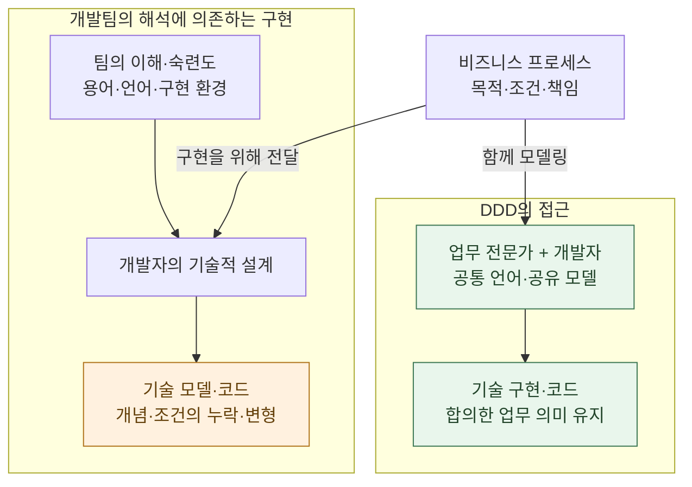
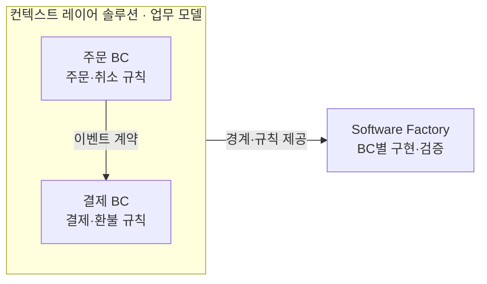
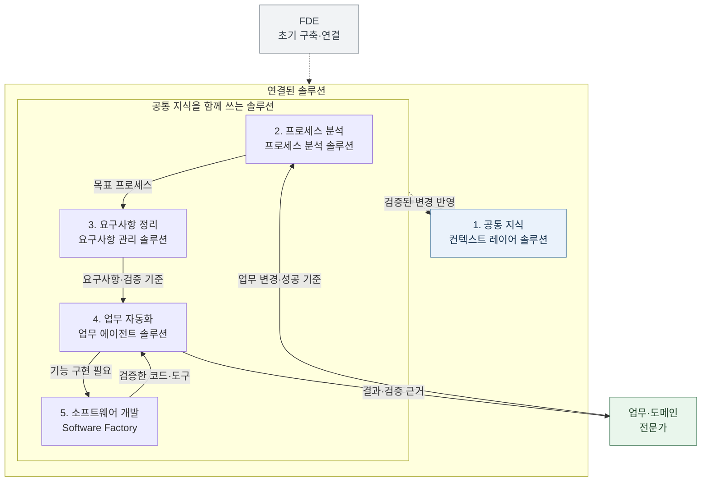
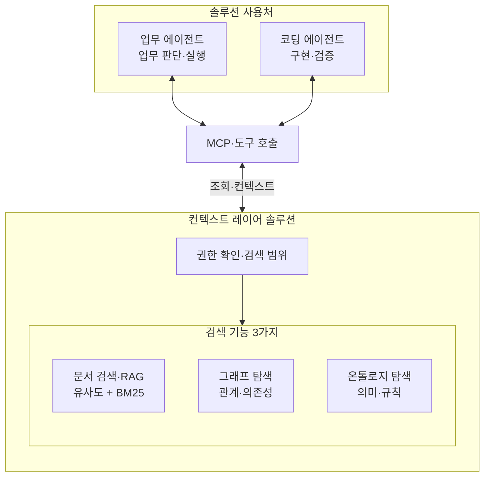
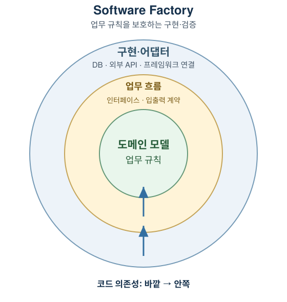
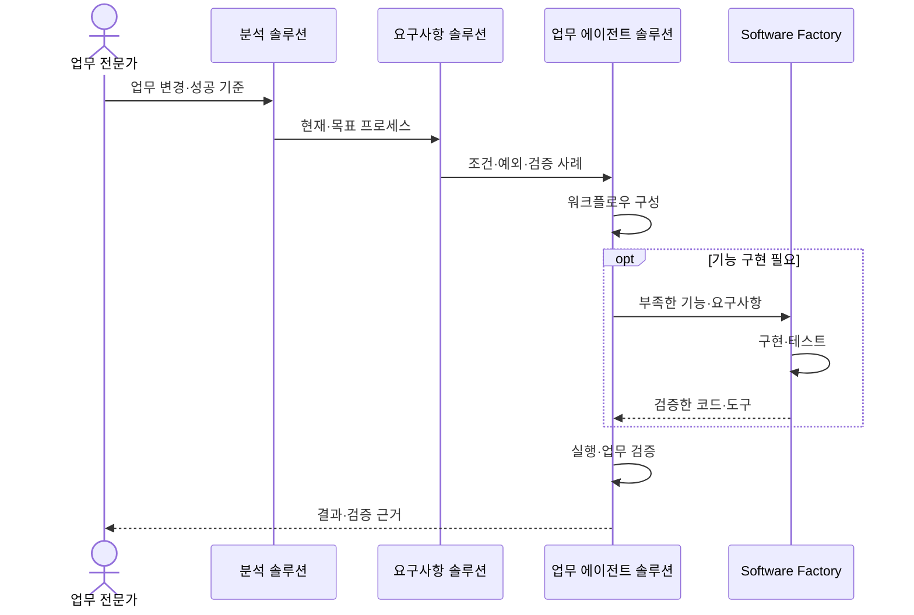
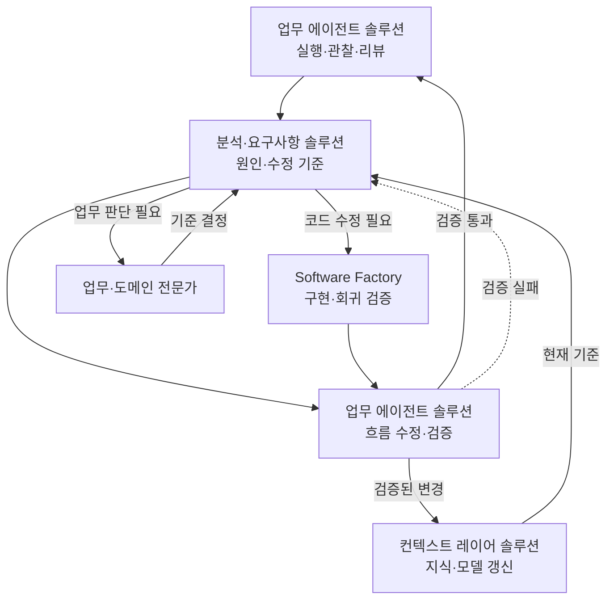

## TL;DR

- 엔터프라이즈 AX는 재사용 가능한 솔루션을 기반으로 구축해야 한다.
- 업무 모델은 업무 언어와 구현의 의미를 일치시키는 기준이다.
- 단계별 솔루션이 업무 변경의 구현·검증·개선을 맡아야 한다.

## 시작하며

기업의 업무를 에이전트 기반으로 전환하는 AX(Agentic Transformation)에는 데이터 연결, 접근권한, 업무 지식, 평가와 운영이 함께 필요하다. 팀마다 이를 새로 만들면 비슷한 준비를 반복하고, 이후의 변경도 처음 구축한 기술 전문가에게 의존하기 쉽다.

**엔터프라이즈 AX는 단계별로 재사용 가능한 솔루션을 갖추고 연결해 구축해야 한다.** 공통 지식, 프로세스 분석, 요구사항 정리, 업무 자동화, 소프트웨어 개발을 맡을 솔루션을 마련하고, 고객의 업무 규칙과 프로세스를 그 위에 구성한다.

업무 변경을 분석하고 요구사항을 갱신하며 코드를 수정·검증하는 기능까지 솔루션이 맡아야, 전문가의 요청이 개발자의 수작업을 기다리지 않고 실제 운영 변경으로 이어진다.

기존 소프트웨어 개발에서는 비즈니스 프로세스를 제한된 리소스로 구현할 수 있는 형태나 개발팀에 익숙한 기술과 구조에 맞춰 코드로 옮기는 일이 많았다. 그 과정에서 업무의 뜻과 흐름이 달라지면, 비즈니스는 원래 업무를 기준으로 말하고 개발은 구현된 시스템을 기준으로 답하게 된다. 같은 업무를 두고도 해석이 달라 충돌이 반복되기 쉽다.

이 충돌을 줄이려면 비즈니스와 개발이 함께 정리한 업무의 언어와 규칙이 구현에서도 유지되어야 한다. DDD(Domain-Driven Design, 도메인 주도 설계)의 핵심 철학인 **업무 모델과 구현의 의미를 일치시키는 것**은 업무 전문가의 의도를 에이전트의 실행으로 연결하려는 AX와 잘 맞는다.

에이전트 기반 업무 자동화와 자가 개선 에이전트는 이 모델을 구현에 반영하고 유지하는 수단이 될 수 있다. 업무 규칙과 예외를 아는 도메인 전문가가 변화를 발견하고 변경을 요청하면, 에이전트가 같은 업무 모델을 기준으로 처리 흐름을 고치도록 구성한다. 필요한 코드의 구현·검증·변경 전달은 소프트웨어 개발 솔루션인 Software Factory가 이어받는다.

## 1. 업무 의미와 바운디드 컨텍스트

업무 규칙·경계를 관리할 컨텍스트 레이어 솔루션과, 그 기준을 코드로 구현·검증할 Software Factory가 연결되어야 한다.

### 업무 프로세스가 기술 구조에 맞춰 바뀌는 경우

비즈니스 프로세스는 고객과 업무 담당자의 목적·조건·책임으로 설명된다. 이를 소프트웨어로 만들 때 개발자는 업무를 메서드, 데이터 구조, API 호출 같은 기술 요소로 옮긴다. 이 과정에서 비즈니스와 코드 사이에 **개발자의 해석과 기술적 설계라는 층**이 생긴다.

그 해석은 팀의 업무 이해도와 숙련도, 익숙한 용어와 프로그래밍 언어, 기존 시스템과 구현 환경의 영향을 받는다. 함께 유지할 업무 모델 없이 기술 구조부터 정하면, 업무의 개념과 책임이 다르게 묶이거나 중요한 조건과 예외가 코드에 빠질 수 있다.

예를 들어 업무의 ‘환불 승인’에는 누가 어떤 조건에서 돈을 돌려줘도 된다고 판단하는지가 담겨 있다. 이를 화면의 조건 검사, 범용 상태 변경 코드, DB 갱신으로 나누는 동안 판단 기준까지 각 부분에 흩어지면, 원래의 업무가 코드에서 어떻게 실현됐는지 다시 해석해야 한다.

DDD는 업무 전문가와 개발자가 **같은 뜻으로 사용하는 공통 언어(Ubiquitous Language)**를 만들고, 그 언어로 업무 모델을 정리해 설계와 코드에 계속 반영하는 방식으로 이 간극을 줄인다. ‘환불 승인’의 개념과 조건이 업무 설명, 모델, 코드에서 같은 의미로 이어지게 하는 것이다.





개발자는 언어와 실행 환경에 맞는 구현을 선택하면서도, 업무 전문가와 합의한 모델을 기준으로 개념·조건·책임이 코드에 유지되는지 확인한다.

### 업무 의미의 경계를 정하기

공통 언어를 만들 때는 그 말이 통하는 범위도 정해야 한다. 주문의 ‘완료’와 결제의 ‘완료’처럼 같은 단어가 다른 기준을 뜻할 수 있기 때문이다.

**바운디드 컨텍스트(BC, Bounded Context)는 한 업무 모델의 용어와 규칙이 일관된 뜻을 갖는 범위**다. 주문과 결제의 경계를 나누고, 각 BC 안에서는 업무에서 쓰는 의미와 실제 구현의 의미를 맞춘다.





주문 취소 이벤트를 받은 결제 BC는 자신의 승인·환불 규칙에 따라 처리한다. BC 사이에는 어떤 정보를 어떤 뜻으로 주고받는지 계약을 두어, 주문 취소와 환불 완료를 혼동하지 않게 한다.

이렇게 정한 책임을 담당 조직과 소프트웨어 구성 요소에 반영한다. 하나의 BC를 여러 애플리케이션이 구현할 수도 있으므로, BC는 업무 의미의 경계로 이해해야 한다. 용어와 경계에 관한 자세한 설명은 [처음 DDD를 공부할 때 알아두면 좋을 내용들](/2021/10/11/thoughts-for-ddd-starters.html)을 참고할 수 있다.

## 2. 솔루션을 연결해 AX를 도입하는 흐름

엔터프라이즈 AX는 아래 다섯 단계마다 담당 솔루션을 갖추고 연결하는 방식으로 구축해야 한다. FDE(Forward Deployed Engineer)는 현업과 함께 이 기반을 구축하는 엔지니어다. **FDE가 떠난 뒤에도 업무·도메인 전문가와 이 솔루션들만으로 업무 변경과 운영 개선을 이어갈 수 있어야 한다.**





| 단계 | 담당할 솔루션 | 읽고 전달하는 정보 |
| --- | --- | --- |
| 1. 공통 지식 | 컨텍스트 레이어 솔루션 | 모든 솔루션에 업무·구현 지식을 제공하고 검증된 변경을 반영 |
| 2. 프로세스 분석 | 프로세스 분석 솔루션 | 현재 업무를 읽어 목표 프로세스와 영향 범위를 요구사항 관리로 전달 |
| 3. 요구사항 정리 | 요구사항 관리 솔루션 | 업무 규칙·예외를 읽어 요구사항과 검증 기준을 자동화·개발에 전달 |
| 4. 업무 자동화 | 업무 에이전트 솔루션 | 업무 기준으로 실행하고, 부족한 기능은 개발에 요청하며 결과를 전문가에게 전달 |
| 5. 소프트웨어 개발 | Software Factory | 업무 모델·저장소·애플리케이션 관계를 읽어 검증한 코드와 도구를 자동화에 제공 |

전문가는 바꿀 업무와 성공 기준을 판단하고, 연결된 솔루션은 분석·요구사항·실행·구현을 이어간다. 실행과 리뷰에서 검증한 업무 규칙, 구현 관계, 검증 근거는 다시 공통 지식에 반영되어 다음 작업의 기준이 된다.

예를 들어 환불 승인 조건을 바꾸면, 분석·요구사항 솔루션이 공통 지식의 현재 규칙과 주문·결제 관계를 읽어 영향 범위와 검증 기준을 정리한다. 업무 에이전트와 Software Factory는 그 기준을 사용해 처리 흐름과 필요한 코드를 바꾸고 결과를 전문가에게 돌려준다. 확인된 새 규칙과 구현 관계가 공통 지식에 남으므로 다음 변경도 같은 기준에서 시작할 수 있다.

업무 담당자와 프로세스를 먼저 그려본 조직은 그 결과로 필요한 데이터를 확보할 수도 있다. 다만 프로세스 분석 자체를 자동화하려면 읽을 자료와 권한이 먼저 있어야 한다. 어느 접근이든 공통 지식의 준비를 뒤로 미루기는 어렵다.

### AWS와 팔란티어 FDE의 솔루션 기반 접근

AWS와 팔란티어의 공개 자료에서도 고객별 업무를 공통 기술 기반 위에 구현하는 방식을 확인할 수 있다.

AWS는 고객 계정에 업무의 의미와 데이터를 연결하는 시맨틱 계층을 배치하고, 거버넌스와 버전 관리가 적용된 지식 그래프를 에이전트가 사용하게 한다고 설명한다. 지식 그래프·운영 절차·설계 문서를 고객에게 남기고, 고객 엔지니어가 공동 개발을 거쳐 독립 운영자로 성장하는 것을 목표로 한다.[^1]

파트너용 지침은 업무 지식·도구·검증 체계를 묶은 **하네스**를 재사용할 기반으로 제시한다. 온톨로지, 평가 체계, 외부 도구 연결, 에이전트 운영과 설계 기록을 파트너가 축적해 다음 고객의 구축에 활용하는 방식이다.[^2]

팔란티어는 데이터와 업무 모델을 다루는 Foundry, 에이전트와 AI 워크플로우를 만드는 AIP, 배포·인프라를 관리하는 Apollo를 공통 플랫폼으로 제공한다. FDE는 고객 현장에 들어가 이 기반 위에서 필요한 기능을 만든다.[^3] 중심에 있는 Ontology는 주문이나 설비 같은 업무 객체·관계와 액션·함수를 연결해 업무의 뜻을 실제 로직으로 이어준다.[^4]

이 사례들의 공통점은 **재사용 가능한 기술 기반과 고객 고유의 업무 모델을 결합한다는 것**이다. 공통 기반을 활용하더라도 고객의 규칙이 모델과 구현에서 같은 의미를 갖도록 설계해야 한다.

## 3. 업무·코딩 에이전트를 위한 공통 지식

AX를 진행하면 업무 문서와 업무 간 관계, 여러 저장소와 애플리케이션에 흩어진 구현 정보를 에이전트가 찾아 읽어야 한다. **이 지식을 관리하고 필요한 컨텍스트를 제공하는 컨텍스트 레이어 솔루션을 갖춰야 한다.**

문서 검색 결과를 모델의 작업에 활용하는 RAG(Retrieval-Augmented Generation, 검색 증강 생성), 관계를 따라가는 그래프 탐색, 업무 개념과 규칙을 찾는 온톨로지 탐색을 이 솔루션 안에 묶는다. 업무·코딩 에이전트는 MCP나 도구 호출을 통해 솔루션을 사용한다. MCP(Model Context Protocol)는 에이전트가 외부 데이터와 도구를 사용하도록 연결하는 규약이다.





이 솔루션은 요청자의 권한과 업무 범위를 적용한 뒤 필요한 검색을 수행하고, 출처와 버전을 포함한 컨텍스트를 반환한다. **각 단계의 솔루션은 이 접점을 통해 같은 업무 기준을 읽고, 검증된 변경을 다시 반영한다.**

### 세 가지 방식으로 지식을 찾기

**문서 검색·RAG**는 업무 문서, 회의록, 설계 기록 등에서 필요한 근거를 찾고 작업에 활용한다. 의미가 비슷한 구간을 찾는 유사도 검색과 단어의 일치를 기준으로 문서를 정렬하는 BM25를 결합한 하이브리드 검색이 필요하다. ‘돈을 돌려받고 싶다’와 ‘환불 요청’처럼 표현이 다른 경우와, 상품 코드처럼 정확한 단어를 찾아야 하는 경우를 함께 다루기 위해서다.

**그래프 탐색**은 기록된 연결을 따라 관련 대상을 찾는다. 환불 업무가 넘기는 이벤트, 결제 애플리케이션이 호출하는 API, 저장소 사이의 의존 관계를 따라가면 한 곳의 변경이 어디까지 영향을 미치는지 살펴볼 수 있다.

**온톨로지 탐색**은 개념과 관계의 업무 의미, 적용할 규칙과 예외를 찾는다. 주문의 ‘취소 완료’와 결제의 ‘환불 완료’가 무엇을 뜻하고 어떤 조건에서 성립하는지를 명시해, 에이전트가 매번 문서 조각에서 업무 기준을 다시 추론하지 않게 한다.

세 기능은 조합해서 사용한다. 그래프가 연결을 따라가는 방법이라면 온톨로지는 그 연결과 개념의 의미를 정의하며, 그래프나 온톨로지에서 찾은 정보도 RAG의 입력으로 쓸 수 있다.

### 두 종류의 에이전트에 맞게 제공하기

**업무 에이전트**는 비즈니스 지식과 규칙을 주로 요구한다. 환불 요청을 처리한다면 고객과 주문의 상태, 승인 조건, 처리 순서와 예외를 함께 읽고 업무상 허용되는 행동을 판단해야 한다.

**코딩 에이전트**는 같은 업무 기준에 더해 이를 구현하기 위한 지식을 요구한다. 어느 프로젝트의 어떤 저장소를 고쳐야 하는지, 관련 애플리케이션이 어떤 API와 이벤트로 연결되는지, 어떤 계약과 테스트를 지켜야 하는지를 알아야 한다.

두 종류의 에이전트는 같은 비즈니스 개념과 규칙을 공유하면서 각자의 작업에 필요한 범위를 조회하게 해야 한다. 업무 에이전트도 애플리케이션 간 관계를 확인할 수 있고, 코딩 에이전트도 온톨로지에서 업무의 뜻을 확인해야 한다.

컨텍스트 레이어 솔루션은 소유자·출처·버전·허용 범위를 관리하고, 조회 전에 에이전트의 역할과 업무 범위에 맞는 접근권한을 적용한다. 업무 조직은 규칙의 뜻과 사용 범위를 결정하고, 플랫폼 조직은 그 결정이 에이전트와 외부 솔루션의 실제 조회에 적용되도록 운영한다.

### 업무 지식을 계층으로 탐색하기

온톨로지 탐색에 반드시 그래프 데이터베이스가 필요한 것은 아니다. Turtle 같은 텍스트 형식으로 업무 지식을 정리하고, 개요에서 필요한 상세로 내려갈 수 있게 해줘도 된다.

각 BC의 책임과 핵심 업무를 먼저 보여주고, 에이전트가 관련 BC 안에서 규칙과 예외를 찾게 하는 방식이다.

에이전트가 개요를 읽고 다음 탐색 범위를 판단하게 하면, 기업 전체의 자료를 한꺼번에 읽히지 않고 필요한 영역부터 좁혀갈 수 있다. 업무 지식이 커져도 관련 영역의 상세만 가져오므로, 관계없는 내용을 컨텍스트에 넣는 일을 줄일 수 있다.

이를 위해서는 각 계층의 개요가 다음 탐색 범위를 고를 수 있을 만큼 정확해야 한다. 개요에서 빠진 예외도 상세 규칙과 원문에서는 찾아볼 수 있어야 한다.

아래는 [온톨로지 도구](https://github.com/haandol/alps-writer-plugins)로 영어 학습 앱 [잉크버드(EncBird)](https://www.encbird.com)의 ‘표현 사전’ BC를 3D로 연 화면이다. 표현 등록·확장·사전 관리와 대화·팟캐스트·복습 사이의 관계를 보여준다.[^5]

이 정보는 **전체 학습 프로세스 안에서 현재 업무의 위치와 연결을 조망하는 버드아이 뷰**를 제공한다. 사람이 3D 화면에서 관계를 살펴보듯, 에이전트는 같은 모델에 기록된 프로세스와 조건을 읽어 앞뒤 업무와의 관계를 파악할 수 있다.

예를 들어 “팟캐스트에서 나온 표현을 더 쉽게 등록하도록 바꿔달라”는 요청이 들어왔다고 하자. 에이전트는 추천 표현이 모이는 과정부터 학습자의 선택과 등록 판정, 등록 후 복습·학습 기록 반영까지 연결해 살펴볼 수 있다.

그러면 학습자의 승인 없이 등록하지 않는지, 이미 등록된 표현에 다시 비용을 청구하지 않는지, 등록 결과가 복습과 학습 기록으로 전달되는지가 검토 대상이 된다. 전체 관계에서 영향 범위를 먼저 좁힌 뒤 각 프로세스의 규칙과 예외를 읽으면, 에이전트가 고려해야 할 조건을 더 쉽게 정리할 수 있다.

### 업무 모델과 구현의 책임을 분리하기

**업무 프로세스를 가장 높은 추상화 계층에 두고, 이를 실현할 기능 계약과 코드를 아래에 둔다.** 온톨로지는 업무의 흐름·책임·인계 규칙을 표현하고, ADR(Architecture Decision Record, 설계 결정 기록)은 각 기능이 그 업무를 실현하기 위해 지켜야 할 계약과 설계 결정을 담는다. 코드와 테스트는 그 계약을 구현하고 검증한다.[^6]

컨텍스트 레이어 솔루션은 업무 모델을 제공하고, 요구사항 관리 솔루션은 이를 기능별 입출력·조건·예외와 검증 기준으로 구체화한다. Software Factory는 그 계약을 기준으로 코드와 테스트를 만들고, 실제 결과가 업무 기준을 충족하는지 확인한다.

{: .diagram-image }

[클린·헥사고날 아키텍처](/2022/02/13/demystifying-hexgagonal-architecture.html)가 도메인 로직을 구현 디테일로부터 보호하듯, 이 구조에서는 업무 프로세스를 표현한 계층을 보호한다. 온톨로지에 코드의 파일 경로나 클래스명, 사용 라이브러리를 넣지 않고, 하위 기능이 어떤 업무 단계를 실현하는지 연결한다. 그래야 코드 구조를 바꿀 때 업무 모델까지 고칠 필요가 없다.

예를 들어 환불 승인 뒤 별도 지급 담당자가 처리하던 업무를 자동 지급으로 바꾸면, 온톨로지의 책임과 인계 흐름부터 달라진다. 요구사항 관리 솔루션이 관련 기능 계약과 검증 기준을 갱신하고, Software Factory가 지급 코드와 테스트를 수정해야 한다.

반면 같은 환불 업무를 유지하면서 DB 저장 방식이나 API 연결 라이브러리를 교체한다면, Software Factory는 구현을 바꾸고 기존 계약을 만족하는지 검증한다. **코드가 바뀌었다는 이유만으로 상위의 비즈니스 프로세스를 수정하지 않는다.** 업무 모델은 전문가의 언어로 유지되고, 솔루션은 그 기준 안에서 구현을 개선할 수 있다.

## 4. 업무 변경을 실행으로 이어가는 솔루션

프로세스 분석, 요구사항 관리, 업무 에이전트, Software Factory는 각각 다음 일을 맡는다. 모든 솔루션이 컨텍스트 레이어 솔루션에서 같은 업무 기준을 읽고, 앞 단계의 결과를 다음 단계에 넘긴다.





### 프로세스 분석 솔루션: 현재 업무와 목표 업무 찾기

프로세스 분석 솔루션은 공통 지식과 업무 담당자의 설명으로 현재 프로세스(As-Is)를 정리하고, 에이전트가 처리할 목표 프로세스(To-Be)를 설계한다. 에이전트 스토밍이나 [이벤트 스토밍](/2020/12/10/demystifying-event-storming.html)에서 다루는 사건·규칙·예외와 책임을 모아, 자동화할 부분과 바꿔야 할 연결을 제안한다.

환불이라면 상담팀의 요청 접수, 주문팀의 배송 확인, 재무팀의 승인이 어떻게 이어지는지 분석한다. 전문가는 에이전트가 처리할 조건과 권한, 사람이 맡을 예외 판단을 결정한다. 이 결과가 요구사항 관리 솔루션의 입력이 된다.

### 요구사항 관리 솔루션: 변경과 검증의 기준 만들기

“배송 전에 취소한 주문은 별도 승인 없이 환불하도록 바꿔달라”는 요청을 받으면, 요구사항 관리 솔루션은 배송·취소·승인·환불의 뜻을 공통 모델에서 확인한다. 필요한 데이터, 입출력, 허용 조건과 예외, 기대 결과를 확인할 사례를 정리해 실행·개발 솔루션에 전달한다.

전문가는 업무의 뜻과 성공 기준을 판단한다. 솔루션은 그 결정을 구현 계약과 검증 사례로 관리하고, 업무 기준이 바뀌면 관련 요구사항과 사례를 함께 갱신한다.

### 업무 에이전트 솔루션: 구성·실행·관찰·개선하기

업무 에이전트 솔루션은 요구사항에 맞는 에이전트·도구·권한을 연결해 워크플로우를 구성하고 실행한다. 입력과 출력, 업무 규칙, 실패 처리와 결과를 검증하고 실행 기록을 남긴다. 부족한 기능은 필요한 업무 기준과 함께 Software Factory에 요청한다.

자가 개선 에이전트는 실행·리뷰 결과를 바탕으로 작업 순서, 지침과 도구 사용을 수정하고 다시 검증한다. 이 기능이 솔루션에 있어야 운영 중 발견한 문제도 다음 실행의 개선으로 이어진다.

### Software Factory: 필요한 기능을 구현하고 반영하기

Software Factory는 업무 모델, 구현 계약, 저장소와 애플리케이션 관계를 읽고 코드·도구·테스트를 만든다. 업무 에이전트 솔루션이 사용할 수 있게 연결하고, **어떤 업무 조건을 구현했으며 무엇을 검증했는지 보여주는 근거**를 돌려준다.

[Software Factory의 평가](/2026/10/05/software-factory-evals-and-tension-metrics.html)는 코드 생성 여부와 함께 업무 조건 충족 여부를 확인해야 한다. 이 구현·검증·반영 과정을 솔루션이 맡아야 다음 업무 변경도 개발자의 수동 작업을 기다리지 않고 이어갈 수 있다.

## 5. 솔루션이 운영 결과를 다음 개선으로 이어받기

업무 에이전트 솔루션은 실행·세션 기록을 모으고 결과를 평가한다. 분석·요구사항 솔루션은 그 기록에서 문제의 원인과 수정 기준을 찾는다. 흐름의 문제는 업무 에이전트 솔루션이, 코드와 도구의 문제는 Software Factory가 수정·검증한다.

업무 기준이 정해져 있으면 그 기준에 맞춰 개선을 이어가고, 새로운 정책 판단이 필요하면 전문가에게 근거를 돌려준다. 코드에 맞추려고 업무의 뜻이나 검증 기준을 바꾸어서는 안 된다.





최종 결과와 저장된 지식은 함께 확인해야 한다. 원문 검색으로 답은 맞췄어도 온톨로지에 잘못된 규칙이 남아 있으면 다음 실행에 다시 쓰일 수 있다. 검증한 업무 규칙·구현 관계·실행 근거를 컨텍스트 레이어 솔루션에 반영해야 모든 솔루션이 갱신된 기준으로 작업한다.

### 업무의 결정권과 검증 책임을 함께 옮기기

이 흐름을 만들려면 조직도 바뀌어야 한다. 업무 모델과 성과를 책임지는 도메인 전문가에게 변경 결정권과 결과 검증 책임을 함께 주고, 플랫폼·기술 조직은 공통 실행 환경과 권한·검증·복구 기준을 책임지게 해야 한다.

| 역할 | 맡을 책임 |
| --- | --- |
| 도메인 전문가 | 업무 변화 파악, 규칙·성과 기준 결정, 결과 검증 |
| 플랫폼·기술 조직 | 재사용할 실행 기반, 권한·검증·복구 체계 운영 |
| FDE | 초기 모델과 적용 구조 정리, 업무 팀의 변경·검증 체계 마련 |

하나의 프로세스에 여러 부서가 참여하면 완료 기준과 변경 책임도 함께 합의해야 한다. 사람의 소속만 바꾸고 결정권과 평가 기준을 그대로 두면, 다른 팀의 판단을 기다리는 일도 남는다.

공통 플랫폼 팀이 모든 업무별 기능을 직접 만들어주면, 요청이 늘 때 그 팀을 기다리게 된다. [사내 FDE](/2026/09/03/developers-to-internal-fde.html)는 초기 구축을 돕되, 이후에는 업무 팀이 같은 기준으로 변경과 검증을 이어갈 수 있게 해야 한다.

### 업무 변경 하나로 확인하기

업무 변경을 기술 전문가의 재해석 없이 처리할 수 있는지는 실제 변경 사례로 확인해야 한다. 환불 정책이 바뀌었을 때 도메인 전문가가 자신의 언어로 새 조건을 요청하고, 시스템이 반영한 결과를 업무 사례로 검증할 수 있는지 보는 것이다.

이때 처리 시간·실패·재작업과 함께 전문가가 설명하고 확인하는 시간도 포함해야 한다. 변경마다 FDE나 개발자가 요청을 다시 해석해야 한다면, 업무를 실행하는 일부 과정은 자동화했어도 변경과 관리의 의존 구조는 남아 있는 셈이다.

## 마치며

이상적인 AX의 목표는 **업무 프로세스와 조직의 책임 구조, 실제 구현이 같은 업무 모델을 따르고, 구현의 세부는 그 기준 안에서 자율적으로 관리되는 시스템**이다.

FDE가 구축을 마치고 떠난 뒤 비즈니스 전문가가 솔루션의 기술적 해석까지 따로 익혀야 한다면, 개발자가 하던 역할을 떠안은 것이다. 업무 전문가가 자신의 언어로 변경을 요청하고 결과를 판단할 수 있어야 한다.

**지식·분석·요구사항·자동화·개발의 각 역할을 솔루션으로 마련하고 연결해야 한다.** 전문가는 업무의 방향과 결과를 판단하고, 솔루션은 그 판단을 구현·검증·개선으로 이어가야 한다. 조직의 권한과 책임도 전문가가 이 흐름을 주도할 수 있게 나눠야 한다.

[^1]: AWS, [AWS invests $1 billion to embed AI forward deployed engineers with customers](https://www.aboutamazon.com/news/aws/aws-1-billion-forward-deployed-ai-engineers), 2026-06-30. 고객 계정의 시맨틱 계층·지식 그래프와 고객 엔지니어의 독립 운영 역량을 설명한다.
[^2]: AWS Partner Network Blog, [Introducing Forward Deployed Engineering for Partners](https://aws.amazon.com/blogs/apn/introducing-forward-deployed-engineering-for-partners-winning-the-future-of-enterprise-ai/). 파트너가 보유·재사용하는 온톨로지·평가·도구 연결·에이전트 운영 하네스를 설명한다.
[^3]: Palantir, [Integrated platforms: AIP, Foundry, and Apollo](https://www.palantir.com/docs/foundry/architecture-center/platforms). 표준 플랫폼과 고객별 맞춤화, FDE의 관계를 설명한다.
[^4]: Palantir, [Ontology building](https://www.palantir.com/docs/foundry/ontology/overview). 업무 객체·관계와 액션·함수를 함께 다루는 운영 계층을 설명한다.
[^5]: [업무 온톨로지 도구의 3D 보기](https://github.com/haandol/alps-writer-plugins/tree/main/plugins/ontology-writer). 잉크버드의 업무 모델에서 생성한 ‘표현 사전’ BC 화면.
[^6]: [온톨로지 계층의 책임과 변경 방향](https://github.com/haandol/alps-writer-plugins/blob/main/plugins/ontology-writer/references/ontology.md). 업무 온톨로지·ADR·코드의 책임을 나누고, 업무 변경은 하위 구현으로 전달하며 코드 리팩터링은 업무 모델을 변경하지 않도록 정한 설계 원칙.
