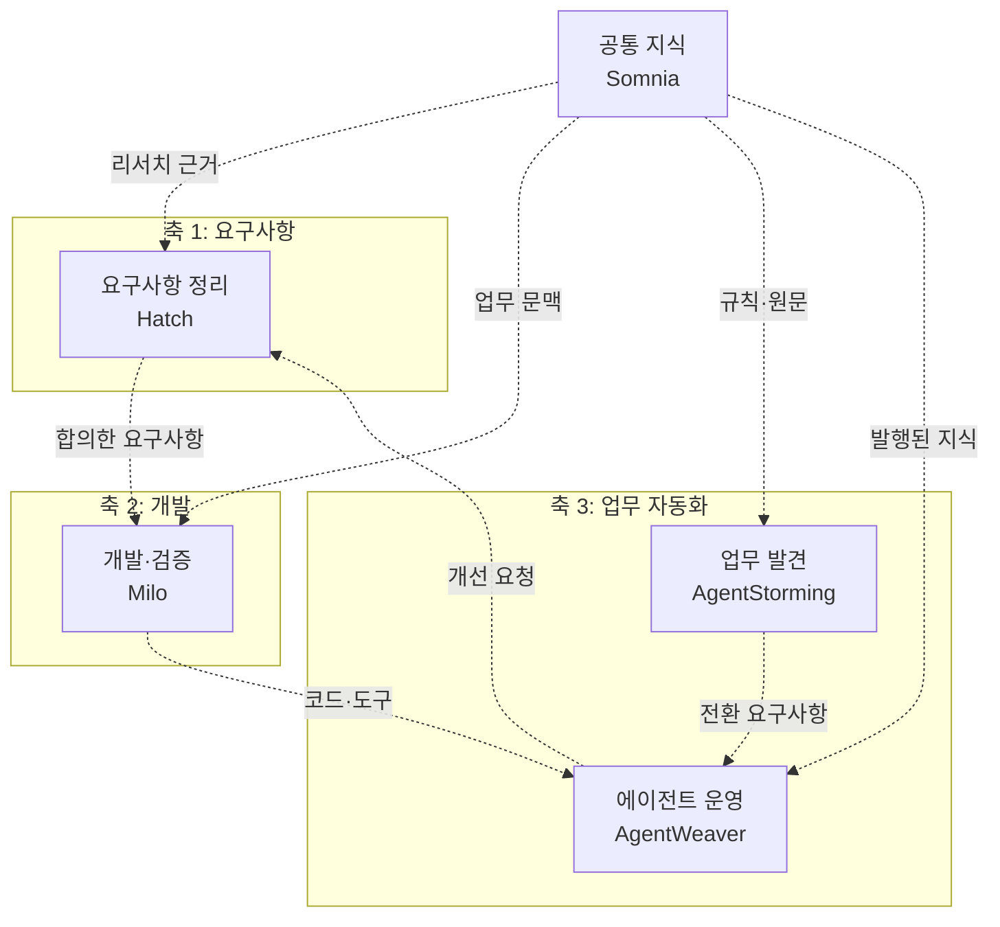
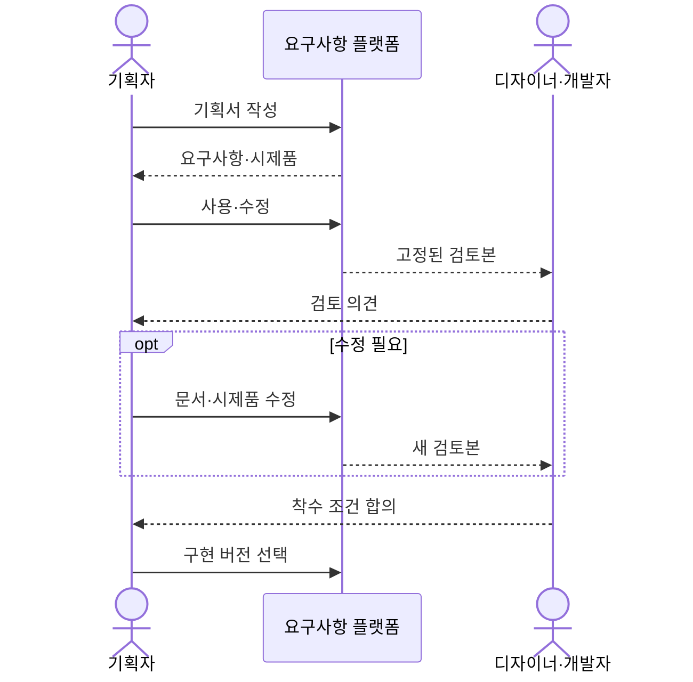
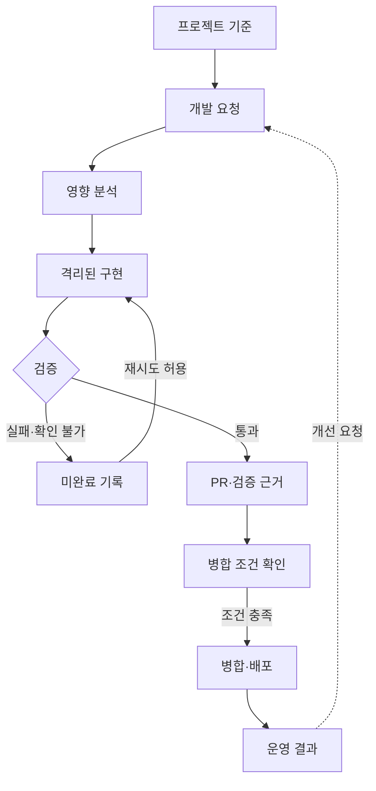
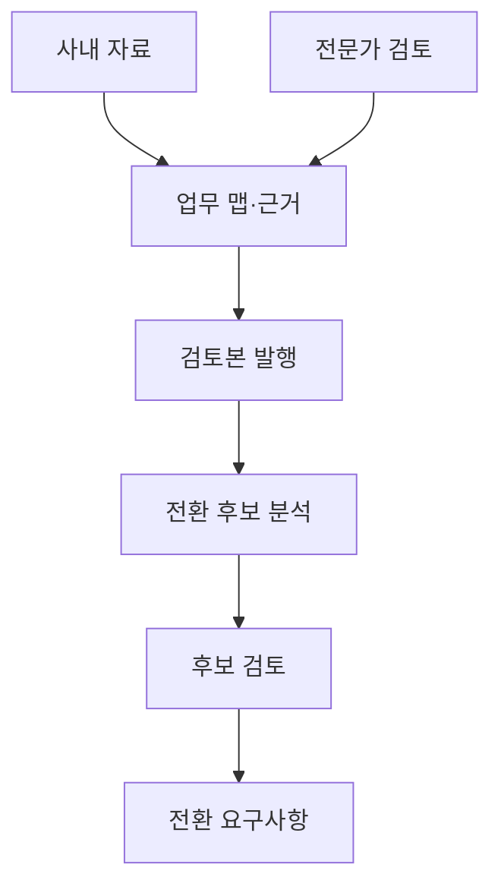
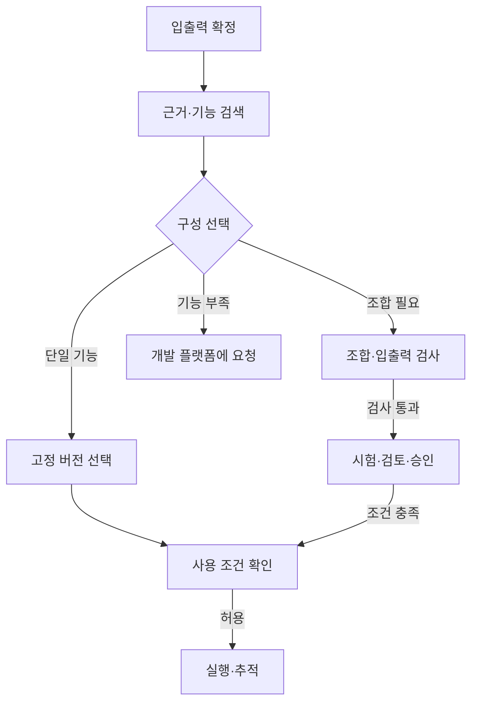
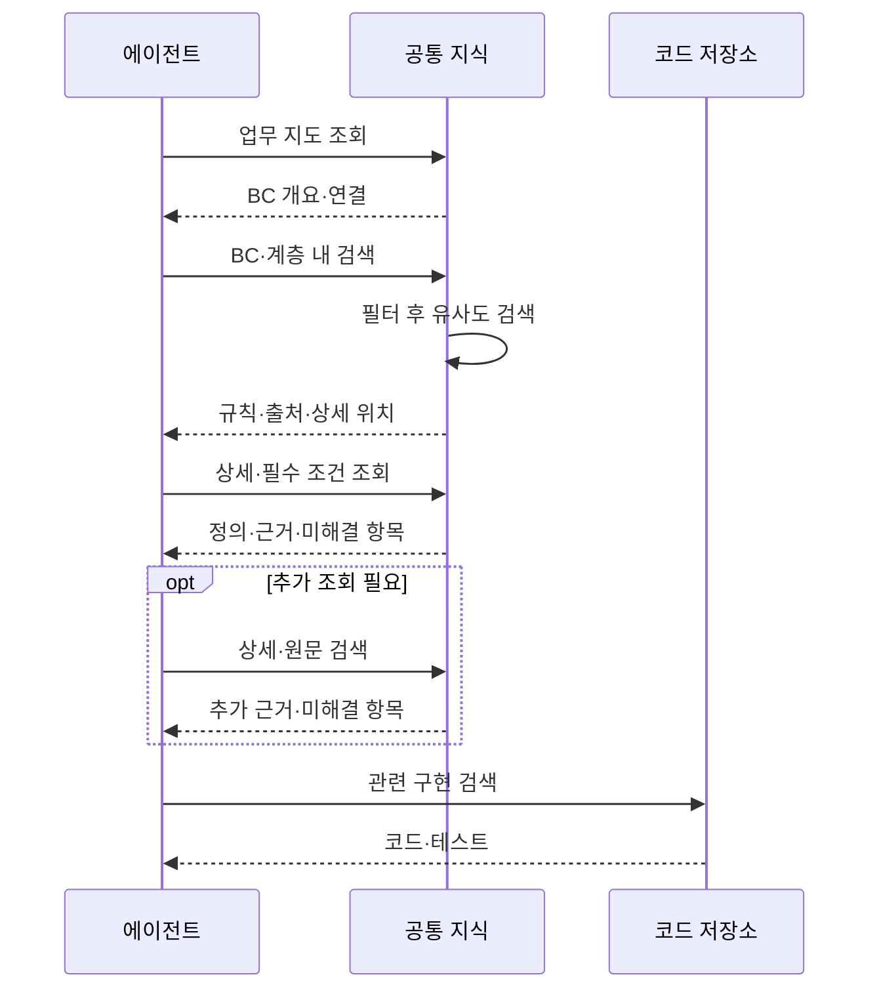
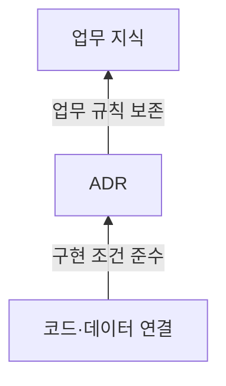
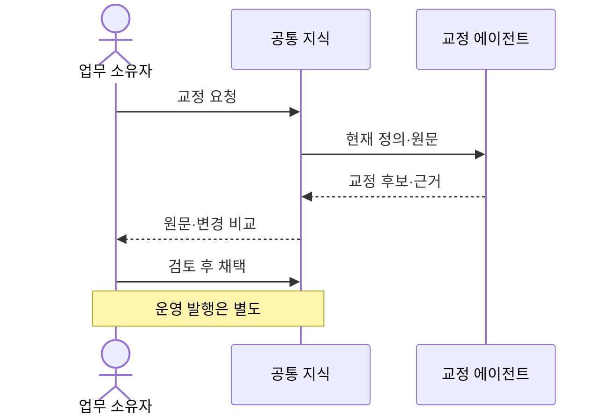
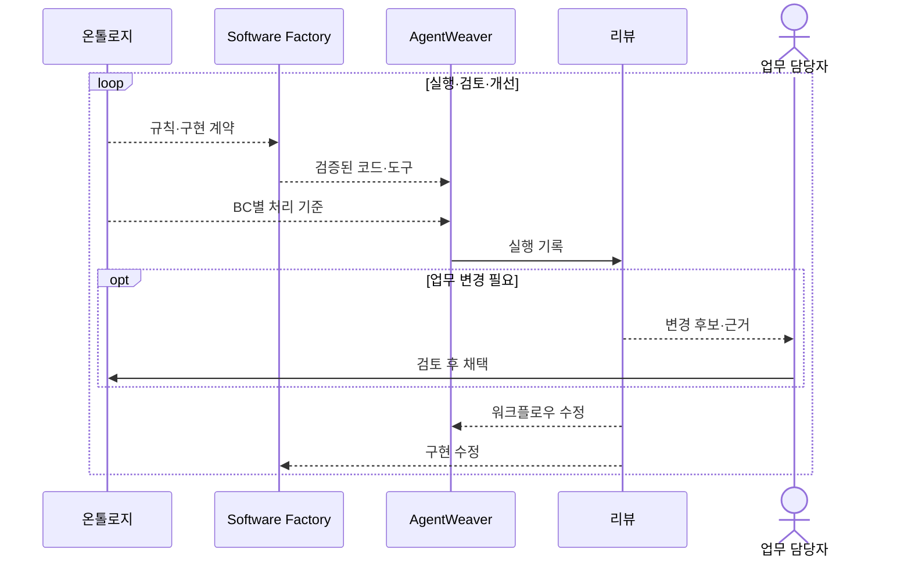
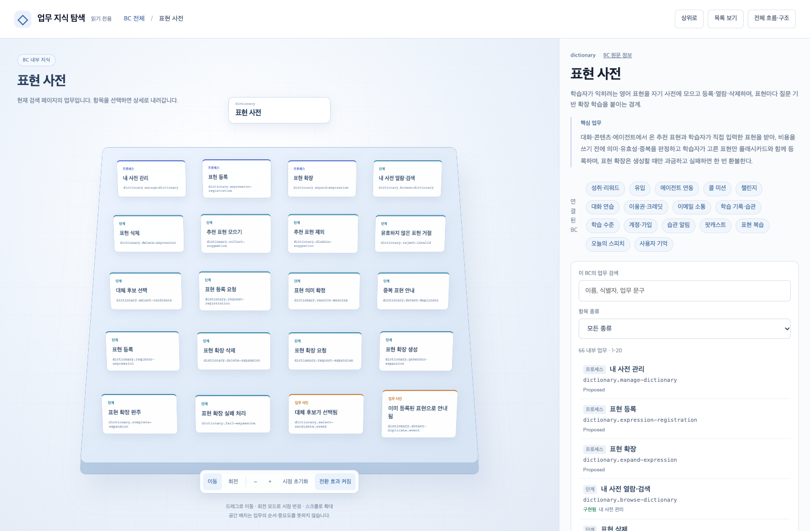

## TL;DR

- 전사 AX에는 요구사항·개발·업무 자동화를 지원하는 플랫폼이 필요하다.
- 플랫폼의 산출물은 다음 단계의 입력으로 이어져야 한다.
- 업무 모델과 실행·코드는 리뷰를 통해 함께 개선해야 한다.

## 시작하며

최근 하네스 엔지니어링, AI 코딩 리뷰의 인지부하, 현업 자동화를 맡는 사내 엔지니어인 FDE, Software Factory에 대해 글을 쓰면서 회사 전체의 AX를 어떻게 진행해야 할지 생각해봤다.

여기서 AX(Agentic Transformation)는 업무 프로세스 전반에서 사람의 개입을 없애 자동화하고, 나아가 운영 결과를 바탕으로 프로세스가 스스로 개선되게 만드는 것을 말한다.

한 팀에서 에이전트로 업무 하나를 자동화했다면 다음 팀도 비슷한 일을 시도할 수 있다. 그런데 팀마다 자료 연결, 에이전트 실행 환경, 검토와 승인, 결과 추적을 처음부터 준비해야 한다면 자동화할 업무가 늘어날수록 그 준비와 유지에 드는 일도 늘어난다.

나는 **전사 규모로 AX를 하려면 요구사항을 정리하고, 소프트웨어를 개발하고, 현업의 일을 자동화하는 데 필요한 기능을 플랫폼으로 제공해야 한다**고 생각한다. 여러 팀이 공통 기능과 작업 절차를 재사용하면서, 자기 업무의 규칙과 시스템에 맞게 바꿔 쓸 수 있어야 하기 때문이다.

이 글에서는 이 세 가지 역할을 전사 AX의 축으로 삼고, 이를 함께 지원하는 공통 지식 계층까지 어떤 기능을 갖춰야 하는지 정리해본다. 현재 작업 중인 Hatch, Milo, AgentStorming, AgentWeaver, Somnia(기존 Knowledge Layers)는 요구사항을 구체화하는 사례로 사용한다.[^7]

## 1. 세 축의 플랫폼과 공통 지식 계층

회사에서 새 기능을 만들 때는 업무의 요구를 정리하고, 이를 코드로 구현하고, 완성한 시스템을 실제 업무에 적용한다. 운영하면서 발견한 문제는 다시 요구사항이 된다.

전사 AX를 위한 플랫폼도 이 흐름에 맞춰 나눠볼 수 있다.

| 구분 | 플랫폼이 맡을 일 | 다음 단계에 남길 것 |
| --- | --- | --- |
| 축 1 · 요구사항 전환 | 리서치, 기획서와 시제품 작성, 이해관계자의 공동 검토 | 합의한 요구사항·시제품·성공 기준의 버전 |
| 축 2 · 소프트웨어 개발 | 영향 분석, 코드 수정과 검사, 리뷰·병합·배포 흐름의 자동화 | 검증한 코드·검사 근거·운영 결과 |
| 축 3 · 업무 자동화 | 현재 업무 발견, 전환 후보 선정, 에이전트 구성과 운영 | 업무 맵·전환 요구사항·실행 기록 |
| 공통 · 지식 | 일반 정보의 하이브리드 검색, 업무 지식의 온톨로지 검색, 데이터 연결·근거·권한·버전 관리 | 여러 플랫폼이 함께 읽을 자료와 업무 지식 |

축 3은 **업무를 파악하고 전환할 일을 정하는 부분**과 **정한 일을 실행하는 부분**을 이어야 한다. 두 부분을 각각 업무 발견 플랫폼과 에이전트 운영 플랫폼으로 구성할 수 있다.

아래는 내가 생각하는 전사 AX의 플랫폼 구성이다. 점선은 플랫폼 사이에서 넘겨야 할 산출물과 지식의 흐름이며, 각 상자에 현재 프로젝트를 구현 사례로 표시했다.





모든 업무가 축 1부터 순서대로 시작하는 것은 아니다. 기존 시스템과 도구만으로 처리할 수 있으면 축 3에서 바로 자동화를 시도하고, 새 기능이 필요해지면 축 1과 축 2로 돌아가면 된다.

플랫폼을 이렇게 구분하는 것은 각각의 책임과 산출물을 정하기 위해서다. 한 제품이 여러 역할을 맡을 수도 있지만, 어느 단계의 입력이 늦거나 결과를 다음 단계에서 쓸 수 없다면 그 부분에서 전체 흐름이 멈춘다.

## 2. 축 1: 요구사항을 함께 만들고 합의하는 플랫폼

기획자가 설명한 아이디어를 시제품으로 바로 만들 수 있어도, 개발팀이 구현할 업무 규칙과 성공 기준이 정해지는 것은 아니다. 기획서와 화면이 따로 바뀌면 디자이너와 개발자는 어떤 내용을 기준으로 검토할지 다시 맞춰야 한다.

축 1의 플랫폼은 **기획자가 아이디어를 구체화하고 직접 써본 뒤, 개발 착수에 필요한 합의를 같은 버전으로 남길 수 있게** 해야 한다.

### 리서치와 요구사항 작성

기획자는 참고 자료를 모으고, 어떤 고객의 어떤 문제를 풀지와 필요한 업무 규칙을 정리할 수 있어야 한다. AI가 자료에서 찾은 사실, 제안한 내용, 아직 확인하지 못한 가정을 구분하고, 기획자가 검토한 내용을 문서에 반영하는 기능이 필요하다.

사내 자료를 읽을 때는 조직에서 허용한 연결을 사용해야 한다. 에이전트가 외부 도구와 자료에 접근하는 규약인 MCP(Model Context Protocol)를 사용할 수 있지만, 연결했다는 사실만으로 모든 자료를 읽을 권한이 생기지는 않는다.

### 동작하는 시제품과 검토 기준

기획자가 개발 환경을 직접 관리하지 않아도 시제품을 만들고 수정하며 써볼 수 있어야 한다. 어떤 순서로 무엇을 확인할지 적은 데모 시나리오를 함께 두면, 화면이 열리는 것과 원하는 업무를 할 수 있는 것을 구분하기 쉽다.

새 시제품을 만드는 실행은 현재 검토 중인 결과와 분리해야 한다. 생성이나 검증에 실패한 후보가 기존 시제품을 덮으면, 다른 사람이 보고 있던 결과까지 사라지기 때문이다.

### 공동 검토와 버전 인계

기획서, 데모 시나리오, 검증한 시제품을 같은 버전으로 묶고, 디자이너와 개발자가 그 버전을 보며 의견을 남길 수 있어야 한다. 수정이 필요하면 문서와 시제품을 함께 바꿔 다음 버전으로 검토한다.





공유할 버전이 생긴 것과 개발 착수에 합의한 것은 구분해야 한다. 플랫폼은 공유한 날짜만 기록할 것이 아니라, 어떤 조건에 합의했고 무엇이 아직 미정인지도 남겨야 한다.

Hatch는 이런 요구사항을 구체화한 예다. AI와 대화하며 PRD(Product Requirements Document, 제품 요구사항 문서)를 작성하고, 시제품을 생성·수정한 뒤 PRD와 데모 시나리오, 검증한 시제품을 하나의 Version으로 발행한다. 조직별 접근 권한과 공유 기능도 이 작업을 여러 팀이 함께 쓰기 위한 구성이다.

## 3. 축 2: 구현과 검증을 이어가는 개발 플랫폼

축 1에서 요구사항에 합의했다면, 축 2는 그 요구를 검증한 코드로 바꾸고 실제 서비스에 전달해야 한다. 코딩 에이전트가 빠르게 구현해도 이후의 리뷰와 검사, 배포가 따로 움직이면 회사 전체의 전달 속도는 그만큼 줄지 않는다.

Faros AI의 2025년 보고서에서는 개발자 1만 명 이상의 데이터를 바탕으로 팀별 AI 활용도가 낮았던 시기와 높았던 시기를 비교했다. 병합 PR은 98% 늘었지만 리뷰 시간도 91% 늘었고, 회사 단위에서는 AI 활용도와 성과 개선 사이에 유의미한 상관이 없었다.[^1] PR(Pull Request)은 코드 변경을 검토하고 기존 코드에 병합하기 위한 요청이다.

이 보고서는 자동완성 중심으로 사용하던 2025년 6월 기준의 관찰 분석이다. 지금의 에이전트도 같은 결과를 낸다는 증거는 아니지만, 구현 처리량이 늘어도 후속 단계가 따라오지 못할 수 있다는 점은 보여준다.

그래서 축 2에는 **요청 접수부터 영향 분석, 격리된 구현, 검사와 변경 전달까지 이어주는 개발 플랫폼**이 필요하다고 생각한다.

### 프로젝트별 기준과 실행 환경

플랫폼은 기존 저장소와 티켓, 운영 알림, CI를 연결할 수 있어야 한다. CI(Continuous Integration)는 코드 변경마다 빌드와 검사를 자동 실행하는 과정이다. 팀마다 다른 도구를 전부 교체하기보다, 현재 개발 흐름에 에이전트의 작업을 연결하는 편이 도입하기 쉽다.

프로젝트별 설계 기준과 작업 지침, 검사 명령을 등록하고 어떤 버전을 기준으로 작업했는지 남겨야 한다. 같은 저장소를 여러 에이전트가 동시에 고치면서 충돌하지 않도록 작업을 조정하고, 실행 시간과 비용, 재시도 한도도 관리해야 한다.

### 수정 결과와 검증 근거

코드 수정은 기존 작업과 분리한 환경에서 실행하고, 요구사항을 만족하는지 실제 빌드·테스트·업무 시나리오로 확인해야 한다. 검사를 실행하지 못했거나 실패했다면 그 상태를 보존하고, 성공한 변경과 같은 방식으로 전달하지 않아야 한다.

에이전트가 남길 것은 코드와 함께 **무엇을 바꿨고 어떤 조건을 확인했는지 보여주는 근거**다. [AI 코딩 리뷰의 인지부하 글](/2026/08/18/ai-coding-review-cognitive-load.html)에서 다룬 것처럼, 사람이 구현 의도와 영향을 처음부터 복원해야 한다면 리뷰 병목은 계속 남는다.

### 리뷰·병합 정책과 운영 피드백

리뷰를 줄이는 방법에는 작은 변경 단위, AI 리뷰·승인, 위험도에 따른 처리 같은 것들이 있다.[^2][^3] 플랫폼은 회사가 채택한 정책을 적용하고, 자동 처리할 범위와 사람이 볼 범위를 관리할 수 있어야 한다.

자동 병합 가능으로 분류한 것만으로 코드를 합쳐서는 안 된다. 실제 병합 시점의 검사 결과, 저장소의 보호 조건, 권한과 변경 버전이 여전히 맞는지 확인해야 한다. 배포 뒤의 장애와 수정 요청도 다음 작업으로 돌아와야 한다.





이 역할의 Software Factory 솔루션이 Milo다. 기존 저장소·티켓·알림·CI를 연결하고, 프로젝트의 기준선과 요구사항 결정, 격리된 Codex 수정·검사, PR과 자동화 정책을 관리하는 자체 운영형 베이스 프로젝트다. 실제 PR 예시로 정책을 만들고 별도 사례로 검증하며, 분류 결과와 실제 병합 권한을 구분한다.

Software Factory가 맡아야 할 범위는 요구사항 구현부터 검증과 전달, 운영 중 발견한 문제의 수정까지 이어진다. StrongDM의 시나리오 기반 검증 사례[^4]와 [Software Factory와 Eval 글](/2026/10/05/software-factory-evals-and-tension-metrics.html)에서도 무엇을 성공으로 볼지와 다음 수정을 어떻게 판단할지가 중요했다.

## 4. 축 3: 업무 발견과 에이전트 운영을 연결하는 플랫폼

개발이 자동화돼도 현업의 일을 무엇부터 바꿀지 정해지지는 않는다. 부서마다 흩어진 업무를 파악하고, 자동화할 범위를 고른 뒤, 그 일을 실행할 기능과 운영 책임을 연결해야 한다.

### 업무 발견: 맵과 근거를 함께 만들기

예를 들어 환불 업무에서는 상담팀이 요청을 받고, 주문팀이 배송 상태를 확인하고, 재무팀이 금액에 따라 승인한다. [이벤트 스토밍](/2020/12/10/demystifying-event-storming.html) 같은 워크숍은 이런 사건과 규칙을 모아 전체 흐름을 그리는 데 쓰인다.

전사 규모에서는 모든 전문가가 같은 시간에 모이기 어렵다. 한 부서가 빠지면 그 부서가 아는 승인 조건도 빠질 수 있고, 워크숍 뒤에는 맵의 항목이 누구의 어떤 설명에서 나왔는지 다시 찾아야 할 수 있다.

업무 발견 플랫폼은 사내 문서와 읽기 전용 도구로 맵의 초안을 만들고, 담당자가 비동기로 질문에 답하거나 직접 편집할 수 있어야 한다. 사건·규칙·예외마다 출처와 원문 버전, 확인 상태를 연결하고, 충돌하는 설명과 미확인 질문도 남겨야 한다.

검토한 맵은 근거와 질문 상태를 함께 고정해 발행해야 한다. 미완성 맵도 공유할 수 있지만, 발행했다는 사실을 업무 파악이 끝났다는 뜻으로 사용해서는 안 된다.

### 전환 후보와 구현용 요구사항

업무 맵에서는 요청이 자주 들어오는 곳과 대기가 긴 곳을 찾고, 예외 빈도와 실패 영향을 함께 봐야 한다. 필요한 데이터를 읽고 실제 업무를 실행할 도구가 있는지도 확인해야 한다.

환불이라면 규칙이 명확한 소액 건을 먼저 검토할 수 있다. 다만 사람이 매번 승인해야 해서 기다리는 업무라면, 에이전트가 처리할 조건과 한도를 재무팀과 합의해야 그 대기도 줄어든다. 분쟁처럼 예외 판단이 많은 건은 사람이 맡을 범위로 남길 수 있다.

플랫폼은 에이전트가 판단할 일, 정해진 규칙으로 처리할 일, 사람이 맡을 일, 근거가 부족한 일을 구분하도록 도와야 한다. 선택한 후보는 다음 단계가 구현할 수 있는 요구사항으로 남긴다.

| 남길 내용 | 환불 업무의 예 |
| --- | --- |
| 목표와 자동화 범위 | 소액 환불의 처리 시간을 줄이고 분쟁 건은 상담원에게 넘긴다 |
| 데이터와 사용 조건 | 배송 상태·환불 규정의 소유자와 권한, 최신성, 조회 실패 시 처리 |
| 입력과 출력 | 환불 요청을 받아 승인·거절·사람 검토 중 하나와 이유를 반환한다 |
| 대표 사례와 성공 기준 | 허용되는 취소, 규정상 거절, 승인 한도 초과에 대한 기대 결과 |

AgentStorming은 이런 업무 발견 플랫폼의 예다. 같은 발행본에서 업무 경계와 전환 후보를 분석하고, 목표·데이터·입출력·서로 다른 세 가지 예시를 Lite ALPS 요구사항 문서와 JSON으로 내보낸다. 원래 업무 맵과의 연결, 아직 답하지 못한 질문도 문서에 유지한다.





### 에이전트 운영: 필요한 기능을 찾아 실행하기

전환할 업무를 정했다면 에이전트 운영 플랫폼은 요청의 입력과 기대 출력을 구체화하고, 사용 가능한 에이전트와 도구를 찾아 연결해야 한다. 부서마다 같은 기능을 새로 만들지 않도록 등록·검색·공유하는 카탈로그가 필요하다.

기존 에이전트 하나가 같은 입출력을 제공하면 그 버전을 재사용하고, 여러 기능이 필요하면 워크플로우로 묶을 수 있어야 한다. 이때 단계 사이의 데이터 형식과 필수 값이 맞는지 검사해야 한다. 필요한 기능이 없다면 새 구현이 필요한 상태로 남겨 축 2로 넘긴다.

환불 예시에서도 배송 조회와 규정 확인, 환불 처리를 할 수 있는 기능이 먼저 있어야 한다. 워크플로우를 생성했다는 것만으로 그 기능이나 실행 권한까지 준비된 것은 아니다.

운영 플랫폼에는 다음 기능도 함께 필요하다.

- **시험·검토·공유:** 새 버전을 시험하고 필요한 보안 검토와 승인을 거쳐 허용한 사용자에게 제공한다.
- **버전·실행 통제:** 승인한 버전을 고정하고, 실행할 때 현재 권한과 사용정지 여부를 확인한다.
- **실행 추적·평가:** 입력과 단계별 도구 호출, 결과, 실패와 비용을 연결해 남긴다.
- **피드백·개선:** 실패 사례를 평가와 작업 절차에 반영하고, 개선한 버전을 다시 검토한다.





AgentWeaver는 이 역할을 맡는 솔루션이다. 부서별 에이전트·MCP·워크플로우를 등록하고, 대화로 확정한 입출력에 맞는 승인된 기능을 찾아 연결한다. 단일 에이전트 선택과 워크플로우 구성을 구분하고, 실행 단계에서도 현재 사용 조건을 검사한다.

운영 결과를 보고 업무 절차와 평가 사례를 고칠 담당자도 있어야 한다. [사내 FDE 글](/2026/09/03/developers-to-internal-fde.html)에서 말한 FDE(Forward Deployed Engineer)는 현업 가까이에서 이런 자동화의 구현과 개선을 맡는 엔지니어다. 플랫폼이 실행 기록을 남겨도 그 기록으로 업무를 고칠 주체가 없으면 개선은 이어지기 어렵다.

## 5. 공통 지식 플랫폼: 같은 뜻과 근거로 업무 이해하기

세 축은 모두 사내 지식을 필요로 한다. 요구사항 플랫폼은 업무 규칙을 조사하고, 개발 플랫폼은 그 규칙을 코드로 옮기며, 에이전트 운영 플랫폼은 실행 중 같은 규칙을 사용한다.

각 플랫폼이 자료를 따로 정리하면 같은 일을 반복할 뿐 아니라, 서로 다른 버전의 규칙을 읽을 수 있다. 그래서 **업무 정의와 근거, 데이터 연결을 함께 관리하는 공통 지식 플랫폼**이 필요하다.

공통 지식 계층은 **일반 정보를 찾는 하이브리드 검색**과 **업무 프로세스와 규칙을 찾는 온톨로지 검색**을 제공해야 한다. 비슷한 상담 사례를 찾는 일과, 환불을 어떤 순서와 조건으로 처리해야 하는지 이해하는 일은 필요한 지식의 형태가 다르기 때문이다.

Somnia는 이 공통 지식 계층을 구현하는 프로젝트다. 표와 문서, 기존 온톨로지의 원문 근거를 보존하고, 그 자료에서 찾은 관측과 원천의 뜻, 여러 자료를 연결한 개념, 업무 규칙을 구분해 구성한다. 업무 정의와 실제 사례를 저장한 뒤 필요한 범위에서 다시 찾고, 원문과 대조해 교정하는 기능도 연결했다.[^9]

### 일반 정보: 유사도와 BM25를 결합한 하이브리드 검색

문서와 회의록, 상담 기록 같은 일반 정보는 질문과 의미가 비슷한 구간을 찾는 유사도 검색과, 실제 단어가 얼마나 잘 맞는지 보는 BM25 검색을 함께 쓰는 편이 좋다. BM25는 검색어의 출현 빈도와 희소성, 문서 길이 등을 고려해 관련 문서를 정렬하는 방식이다.

예를 들어 고객이 쓴 ‘돈을 돌려받고 싶다’와 사내 문서의 ‘환불 요청’은 표현이 달라도 유사도 검색으로 연결할 수 있다. 반면 특정 상품 코드나 오류 메시지를 찾을 때는 그 문자열이 실제로 등장하는지를 확인하는 검색이 유용하다. 두 결과를 합쳐 순위를 정하는 하이브리드 검색은 이런 차이를 보완한다.

검색 결과에는 관련 구간과 함께 원문 위치와 개정 버전을 남겨야 한다. 에이전트가 답을 만들거나 요구사항의 근거로 쓸 때 원래 설명과 조건을 다시 확인할 수 있어야 하기 때문이다.

Somnia의 로컬 검색도 키워드와 벡터 유사도의 순위를 결합한다. 다만 키워드 점수는 자체 계산식을 쓰므로, 위의 BM25 조합은 현재 구현을 그대로 설명한 것이 아니라 공통 플랫폼에 요구하는 기준이다.

Somnia의 문서 검색은 관련 문서를 고른 뒤 그 문서의 필요한 구간을 다시 찾는다. 이때 지식 모델에 연결된 문서만 후보로 삼으면 아직 정리하지 못한 자료를 놓칠 수 있으므로, 같은 허용 범위에서 원문 구간을 직접 검색해 얻은 문서 후보도 함께 사용한다. 검색용 요약이나 벡터에 남은 본문을 그대로 답하지 않고, 선택한 문서의 정확한 개정에서 본문과 인용 위치를 확인한다.

### 업무 지식: 추상화 계층을 따라 온톨로지 검색하기

환불 처리 순서와 승인 조건, 다른 업무에 미치는 영향을 이해하려면 관련 문장 몇 개만으로는 부족할 수 있다. 업무의 개념과 관계, 프로세스와 규칙을 명시적으로 정리한 온톨로지가 있으면, 에이전트가 어떤 업무의 어느 조건을 읽고 있는지 확인하면서 탐색할 수 있다.

**온톨로지 검색을 위해 반드시 그래프 데이터베이스나 그래프 순회 엔진을 둘 필요는 없다.** 개념과 관계를 텍스트로 기록하는 형식인 Turtle로 업무 프로세스를 구성하고, 추상화 계층을 나눠 필요한 내용을 찾아 내려갈 수 있게 해줘도 된다. 여기서 계층을 나눈다는 것은 업무 영역의 책임과 핵심 규칙, 내부 프로세스, 구현이 지켜야 할 조건을 서로 다른 상세 수준으로 정리한다는 뜻이다.

Somnia에서는 업무 용어와 규칙을 책임지는 범위인 바운디드 컨텍스트(BC, Bounded Context)의 지도를 먼저 제공한다. 여기에는 영역별 책임과 핵심 업무, 다른 영역과의 연결만 담는다. 미리 준비한 개요가 에이전트의 입력 한도에 들어가면 접근 가능한 지도 전체를 읽게 하고, 무거운 내부 업무는 선택한 BC 안에서 찾게 했다.

예를 들어 환불 기능을 고치는 에이전트는 주문과 결제의 개요를 보고 관련 영역을 고른 뒤, 그 안에서 환불 프로세스와 승인·예외 규칙을 유사도 검색한다. 구현이 필요하면 관련 아키텍처 결정 기록인 ADR(Architecture Decision Record)과 현재 코드로 내려간다. 이미 필요한 규칙이나 ADR을 알고 있다면 그 상세에서 바로 시작할 수도 있다.

**업무 범위와 읽을 계층을 먼저 정하고, 그 안에서 유사도를 비교하는 방식**이다. 모든 내부 부모·자식 관계를 완성하지 않아도 BC 소속과 정보의 상세 수준이 확인되면 검색할 수 있다. 여러 BC에 적용되는 규칙은 그 관계를 유지하고, 소속을 모르는 자료는 임의의 영역에 넣지 않는다.





요즘 에이전트는 상위 설명을 읽고 다음에 어느 영역과 항목을 찾아야 할지 판단하는 일을 꽤 잘한다. 나는 각 계층에 필요한 설명과 다음 계층으로 내려갈 경로를 갖춰주는 방식만으로도 상당한 규모의 업무 지식을 다루기에 충분한 경우가 많다고 생각한다.

엔터프라이즈처럼 규모가 커질수록 이런 추상화 설계가 더 중요해진다. 하나의 거대한 데이터 레이크 전체를 대상으로 검색해 여러 업무의 상세 자료를 한꺼번에 가져오면, 에이전트가 그 안에서 현재 업무의 조건을 다시 골라야 한다. 상위 계층에서 범위를 좁히고 계층별로 검색하면 관계없는 상세 정보를 컨텍스트에 넣는 일을 줄일 수 있다.

데이터를 중앙에 모아두더라도 검색은 계층별로 구성할 수 있다. 내가 말하는 효율은 저장소를 읽는 속도보다 **에이전트에게 필요한 정보를 얼마나 적은 컨텍스트로 전달하느냐**에 있다.

다만 개요에 없는 드문 예외까지 사라져서는 안 된다. Somnia는 선택한 정의와 필수 조건을 함께 읽고, 같은 허용 범위의 상세와 원문도 직접 찾을 수 있게 했다. 입력 한도를 넘는 정의는 중간을 잘라 완전한 결과처럼 반환하지 않고, 읽지 못한 의존과 범위를 남겨 나눠 읽거나 선택을 조정하게 한다.

### DDD로 업무 프로세스를 추상화하고 계층 분리하기

앞처럼 업무 개요에서 필요한 상세를 찾아가려면, 지식을 만들 때부터 업무 경계와 각 계층의 책임을 정해야 한다. Somnia에서는 업무의 언어와 규칙을 중심으로 모델을 설계하는 DDD(Domain-Driven Design, 도메인 주도 설계)를 바탕으로 이 경계를 잡는다.

먼저 같은 용어와 규칙이 통하는 범위를 BC로 나누고, 각 BC가 맡는 업무와 다른 BC에 넘길 결과를 정리한다. 예를 들어 주문의 ‘취소 완료’와 결제의 ‘환불 완료’는 서로 다른 사건이다. 환불 프로세스가 두 영역을 지나더라도 두 개념을 하나로 합치지 않고, 어떤 사건과 조건으로 이어지는지 남긴다.

찾아낸 BC는 실제 에이전트가 요청을 처리하는 기준에도 반영되어야 한다. 어떤 업무의 문맥과 규칙을 읽을지, 어떤 도구와 권한으로 처리할지, 다른 BC에 어떤 결과를 넘길지를 실행 구성에 연결해야 한다. 에이전트 하나가 여러 BC의 일을 맡더라도 단계마다 사용하는 용어와 판단 기준, 넘기는 결과의 의미가 구분되어야 한다.

그 안의 업무 프로세스는 목적, 참여자, 입력과 결과, 단계별 조건과 예외로 추상화한다. 업무를 왜 하고 무엇을 지켜야 하는지 이해하는 데 필요한 내용을 담고, 테이블 이름이나 코드 파일, 작업 명령은 구현을 다루는 계층에 둔다. 이렇게 해야 저장 방식이나 구현 도구가 바뀌어도 업무 프로세스의 뜻은 유지할 수 있다.

**상위 계층은 자기 수준의 질문에 답할 수 있어야 하고, 하위 계층은 그 기준을 지켜야 한다.** 업무 지식에는 프로세스와 규칙을, ADR에는 구현이 지켜야 할 결정과 정확한 조건을, 코드와 데이터 연결에는 구체적인 처리 방법을 둔다. 승인 한도나 예외처럼 결과를 바꾸는 조건은 그 조건을 소유한 계층에 빠짐없이 남겨야 한다. 추상화한다고 이런 조건까지 흐리게 만들어서는 안 된다.

다음은 하위 구현이 어떤 기준에 의존하는지 보여주는 그림이다.





에이전트는 같은 버전의 상위 기준과 현재 구현을 함께 읽고, 경계를 유지하는 변경을 제안해야 한다. 환불 상태 컬럼이 바뀌었다면 기존 완료 기준에 맞게 데이터 연결을 고치고, 그 연결을 맞추려고 완료의 뜻이나 검증 기준을 바꾸지는 않는다. 업무 담당자가 완료 기준 자체를 바꾸기로 했다면, 그 결정부터 반영한 뒤 영향을 받는 ADR과 구현·데이터 연결을 다시 검증한다.

이런 책임의 분리는 업무 지식을 읽을 때의 확대 수준과도 구분해야 한다. BC 개요와 내부 프로세스는 같은 업무 지식을 다른 상세 수준으로 보여줄 수 있지만, 개요를 짧게 고치거나 검색 색인을 다시 만드는 일이 업무 규칙의 변경으로 이어져서는 안 된다.

### 저장한 업무 지식을 원문과 대조해 개선하기

업무 지식은 한 번 만들어두면 끝나는 자료가 아니다. 새로운 사례에서 예외를 발견하거나, 기존 정의가 원문의 조건을 잘못 옮겼다는 것을 알게 되면 다음 작업에서도 쓸 수 있게 고쳐야 한다.

Somnia는 업무 정의와 별도로 원문·사례 목록을 유지하고, 선택한 원문과 현재 정의를 함께 읽어 교정 후보를 만든다. 검토 화면에서는 원문, 기존 조항, 후보 조항을 나란히 보여줘 조건·부정·수치·예외가 어떻게 바뀌는지 확인할 수 있다. 성공한 처리 방법과 확인된 사실도 남기며, 이번에 고른 원문에 언급이 없다는 이유만으로 기존 사실을 지우지 않도록 했다.





현재 Somnia는 요청에 따라 교정 후보를 만들고 업무 소유자가 채택하는 흐름을 제공한다. 세션 리뷰나 워크플로우 리뷰에서 나온 근거를 이 교정 흐름에 연결하는 것은 플랫폼이 더 갖춰야 할 부분이다. 저장한 사례는 같은 업무 범위와 개정에서 다시 검색할 수 있고, 당시 입력과 관측 결과를 현재 규칙이나 다른 업무의 사실로 자동 일반화하지 않는다.

교정이 도움이 됐는지도 따로 확인해야 한다. Somnia의 비교 도구는 같은 자료와 질문으로 원문 검색만 사용하는 경우, 현재 업무 지식과 원문을 함께 사용하는 경우, 교정한 업무 지식과 원문을 함께 사용하는 경우를 비교한다. 답변 품질뿐 아니라 처음 지식을 만들고 색인을 준비한 비용, 교정 비용, 질문마다 드는 조회·답변 비용을 나눠 기록한다.

답변이 맞았더라도 원문 검색이 잘못된 업무 정의를 보완했을 수 있다. 그래서 어느 검색 경로가 필수 근거를 찾았는지와, 업무 정의 자체가 원문의 조건과 예외를 보존했는지를 별도로 본다. 나는 지식 계층을 평가할 때도 **최종 답변과 저장한 지식의 정확성을 나눠 확인해야 한다**고 생각한다.

채택한 지식과 운영에 사용할 발행본은 버전으로 구분하고, 원본 자료가 바뀌거나 접근 권한이 철회되면 조회 경로에도 반영해야 한다. 조회할 때와 결과를 반환할 때 현재 권한을 확인하며, 검색 도중 권한이 철회됐다면 이미 찾은 자료라도 반환해서는 안 된다.

Somnia의 검색과 업무 문맥 읽기는 MCP 같은 공개 표준으로 여러 플랫폼에 제공할 수 있다.[^5] 연결할 때는 인증 방식뿐 아니라 요청자의 권한과 읽을 지식의 정확한 개정을 함께 전달해야 한다. 여러 플랫폼이 같은 지식을 재사용하더라도, 어느 시점의 어떤 규칙을 읽었는지는 남아야 한다.

## 6. 플랫폼 사이의 인계와 전사 운영

플랫폼을 각각 구축했어도 단계가 바뀔 때 사람이 내용을 다시 설명하고 데이터를 옮겨야 한다면, 그 인계가 새로운 병목이 된다. 따라서 **다음 플랫폼이 합의한 조건과 근거를 이어받을 수 있는 산출물**을 남겨야 한다.

요구사항 플랫폼은 기획서·시제품·성공 기준을 같은 버전으로 넘기고, 업무 발견 플랫폼은 전환 요구사항에 원본 업무 맵과 미정 질문을 연결해야 한다. 실행 결과도 어떤 요구사항과 지식 버전으로 처리했는지 돌아와야 다음 수정의 근거로 쓸 수 있다.

Hatch의 검토본을 Milo에서 구현하거나 AgentStorming의 요구사항을 AgentWeaver에서 이어받는다면 이런 정보가 함께 넘어가야 한다. 파일 형식이 비슷하거나 MCP를 제공한다는 사실만으로 자동 연동이 끝나는 것은 아니다.

### 리뷰를 온톨로지·워크플로우·코드의 다음 변경으로 잇기

BC를 실제 처리에 반영했다면, 세션 리뷰와 에이전트 워크플로우 리뷰도 같은 업무 모델을 기준으로 해야 한다. 세션에서는 에이전트가 어떤 문맥을 읽고 어떤 규칙으로 판단했는지 확인하고, 워크플로우에서는 여러 단계와 BC 사이에서 조건과 결과가 제대로 전달됐는지 확인한다.

리뷰에서 발견한 차이는 원인에 맞는 계층에 반영해야 한다. 업무 모델에 조건이나 예외가 빠졌다면 근거와 함께 온톨로지 변경을 제안하고, 이미 정해진 규칙을 실행이 지키지 못했다면 에이전트의 작업 절차나 도구·코드를 고친다. 검토해 채택한 업무 변경은 관련 워크플로우와 ADR, 구현까지 이어져야 하고, 그때 사용한 사례는 다음 변경을 검증할 기준으로 남겨야 한다.

예를 들어 주문 취소만 확인하고 환불까지 끝났다고 답한 세션이 있었다면, 주문 취소와 환불의 완료 조건이 모델에 구분되어 있는지부터 본다. 조건이 있는데도 에이전트가 확인을 생략했다면 워크플로우를 고치고, 필요한 조회 기능이 없다면 구현을 추가한다. 결제 영역에서 환불 완료를 확인하기 전에는 고객에게 환불이 끝났다고 답하지 않는지도 다시 검증해야 한다.

Software Factory는 이렇게 정리한 업무 규칙과 구현 계약을 코드와 테스트에 반영하고, AgentWeaver는 그 코드와 도구를 실제 업무 프로세스에 맞게 연결해 실행하는 역할을 맡아야 한다. 실행 기록과 리뷰는 다시 온톨로지와 워크플로우, 구현을 고치는 근거가 된다.

다음은 내가 생각하는 두 플랫폼의 반복 개선 구조다.





이 과정을 여러 번 반복하면서 업무 모델과 실제 동작의 차이를 줄여가야 한다. 처음 모델을 잘 만드는 것과 함께, 운영에서 더 잘 이해하게 된 업무를 다음 모델과 실행에 반영할 수 있어야 한다.

### 공통 운영과 업무별 맞춤화

전사 플랫폼에는 조직·프로젝트별 접근 권한, 사용량과 비용, 버전과 보안 패치, 장애 대응을 관리할 주체가 필요하다. 각 업무 팀에는 규칙과 예외, 평가 사례를 고칠 담당자가 있어야 한다.

나는 공통 플랫폼을 관리하는 조직과 그것을 받아 맞춤화하고 운영하는 팀을 함께 두는 편이 낫다고 생각한다. 공통 조직이 매번 업무별 기능까지 만들어주는 방식으로는 요청이 늘어날 때 다시 그 조직을 기다리게 된다.

팀이 에이전트로 맞춤화할 수 있도록 작업 지침, 도구, 검사와 평가 기준을 묶은 하네스도 제공해야 한다.[^6] 공통 코드를 제각각 고치기보다 설정과 확장 지점을 사용하고, 변경 부분뿐 아니라 그 영향 범위도 검토해야 보안 패치와 개선을 계속 받아갈 수 있다.

상용 서비스의 기능으로 충분한 부분은 그대로 사용할 수 있다. 직접 개발이 필요한 부분은 공통 베이스에서 시작하되, 어느 방식을 택하든 업무 설정과 평가, 개선을 맡을 내부 팀은 필요하다.

### 도입 속도와 업무 성과를 나눠 측정하기

플랫폼을 쓰는 팀이 늘거나 첫 시제품이 빨리 나왔다고 전사 AX의 효과가 확인되는 것은 아니다. 준비 과정이 빨라진 것과 실제 업무가 좋아진 것을 나눠 봐야 한다.

| 범위 | 확인할 결과 |
| --- | --- |
| 요구사항 전환 | 아이디어 정리부터 기획자·디자이너·개발자가 착수에 합의하기까지의 시간 |
| 소프트웨어 개발 | 요구사항 확정부터 안정적인 변경 전달까지의 시간, 검사 실패·재작업 |
| 업무 자동화 | 요청부터 완료까지의 시간, 사람 개입, 오처리·재처리, 건당 총비용 |
| 플랫폼 운영 | 업무를 스스로 운영·개선하는 팀, 공통 변경을 적용하는 부담과 비용 |

업무 맵도 작성 시간과 함께 누락한 항목, 잘못 추가한 항목, 근거를 확인하지 못한 항목을 따로 봐야 한다. 확인한 규칙을 모두 담았더라도 틀린 규칙을 많이 추가했다면 좋은 맵이라고 할 수 없다.

기존 방식의 기준선을 먼저 확보하고, 같은 업무 범위와 예외 비중으로 비교해야 한다. 전문가가 질문에 답하고 결과를 검토하는 시간까지 포함했을 때 일이 줄어드는지 봐야, 수작업을 다른 사람에게 옮긴 것을 자동화 성과로 세지 않을 수 있다.

## 마치며

나는 전사 AX를 추진한다면 각 축의 플랫폼 요구사항부터 정하는 편이 낫다고 생각한다. 요구사항에 합의하는 일, 소프트웨어를 구현하고 검증하는 일, 업무를 발견하고 운영하는 일에는 서로 다른 기능과 책임이 필요하다.

그 플랫폼들이 함께 이루려는 것은 **비즈니스의 언어와 규칙이 실제 처리와 코드의 구조·동작까지 이어지는 것**이다. 나는 이것이 DDD가 바라던 이상이라고 생각한다. 업무 담당자와 함께 만든 모델을 에이전트가 실행과 구현의 기준으로 읽고, 리뷰에서 얻은 이해를 다시 모델에 반영할 수 있어야 한다.

업무 모델을 구성하고 개발로 연결하는 부분은 [ALPS Writer Plugins](https://github.com/haandol/alps-writer-plugins)의 `ontology-writer`로 구현해뒀다. 업무 프로세스와 단계, 사건과 규칙을 Turtle로 구성하고, 업무 영역의 개요에서 내부 지식을 검색한 뒤 관련 ADR로 이어갈 수 있게 했다.[^8]

아래는 영어 학습 서비스 EncBird에 구성한 온톨로지를 실제 UI로 연 화면이다. ‘표현 사전’ BC를 선택하면, 그 안의 표현 등록·확장 프로세스와 단계를 검색하고 상세로 내려갈 수 있다.

에이전트가 업무 모델과 구현 사이의 연결을 찾고, 수정하고, 검증하는 일을 맡으면 이런 구성을 유지하는 부담도 줄일 수 있다. Software Factory와 AgentWeaver는 이 과정을 여러 번 반복해 업무 지식과 워크플로우, 코드가 함께 발전하게 해야 한다. 나는 **에이전트 덕분에 DDD가 원래 이루려던 이상을 실제로 구현하고 유지할 수 있게 됐다**고 생각한다.

---

[^1]: Faros AI, [The AI Productivity Paradox Report 2025](https://www.faros.ai/blog/ai-software-engineering). 2025년 6월 기준의 AI 활용도와 PR 처리량·리뷰 시간·회사 단위 성과의 관찰 분석.
[^2]: Google, [Small CLs](https://google.github.io/eng-practices/review/developer/small-cls.html). 리뷰하기 쉽도록 변경을 작게 나누는 관행.
[^3]: GitHub, [Copilot code review](https://github.blog/changelog/2026-10-28-copilot-code-review-merge-with-confidence-with-max-and-approvals); Meta Engineering, [Diff Risk Score](https://engineering.fb.com/2025/08/06/developer-tools/diff-risk-score-drs-ai-risk-aware-software-development-meta/). 각각 AI 리뷰·승인과 위험도 기반 배포 통제의 사례다.
[^4]: StrongDM, [Software Factories and the Agentic Moment](https://factory.strongdm.ai/). 스펙과 시나리오 기반 검증으로 사람의 코드 리뷰 없이 소프트웨어를 만드는 사례.
[^5]: Anthropic, [Donating the Model Context Protocol and establishing the Agentic AI Foundation](https://www.anthropic.com/news/donating-the-model-context-protocol-and-establishing-of-the-agentic-ai-foundation).
[^6]: [하네스 엔지니어링 글](/2026/03/15/harness-engineering-beyond-context-engineering.html). 작업 지침·도구·실행 환경·검증과 복구 절차를 함께 다룬다.
[^7]: 2026-11-06 기준 Hatch, Milo, AgentStorming, AgentWeaver, Knowledge Layers(현재 Somnia)의 문서와 주요 구현 경로를 참고했다. AgentStorming 저장소의 제품명은 AgentStorm이다. 프로젝트별 기능 확인과 별개로, 다섯 프로젝트의 통합 실행이나 전사 도입 효과를 검증한 결과를 뜻하지는 않는다.
[^8]: [ontology-writer](https://github.com/haandol/alps-writer-plugins/tree/main/plugins/ontology-writer)의 업무 지식 계층과 탐색 기능. 화면은 2026-11-09 기준 EncBird의 `docs/ontology/`에서 생성했다. 파일 기반 구현은 조회할 때 Turtle 모델을 읽되 에이전트에는 선택한 계층의 지식만 반환한다. 화면은 업무 지식의 구성을 보여주며, 전사 규모의 검색 성능 측정 결과는 아니다.

[^9]: 2026-11-09 기준 Somnia의 업무 해상도 탐색, 계층 계약, 문서 검색, 근거 기반 교정 설계와 관련 구현·테스트를 참고했다. 원문 검색·현재 지식·교정 후 지식을 비교하는 경로를 확인했으며, 이 글에서 실제 모델의 정확도나 전사 규모의 성능 향상을 새로 측정한 것은 아니다.
