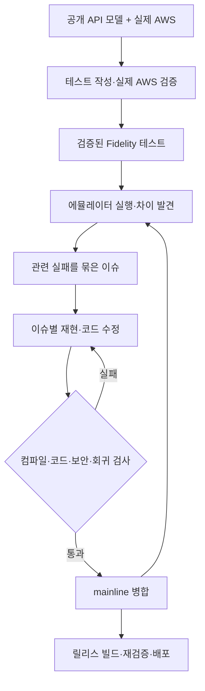

## TL;DR

- L2로 PMF를 확인한 뒤 자동화 범위를 넓힌다.
- 검증된 실패를 다음 개발 작업으로 연결한다.
- 실행·평가·복구를 재사용 가능한 솔루션으로 만든다.

## 시작하며

AI가 코드를 대부분 작성하는 제품은 이미 많다. 하지만 사람이 매번 고칠 문제를 찾아 지시해야 한다면, 사람이 자리를 비운 동안 제품이 계속 좋아지는 것은 아니다.

[이전 글](/2026/10/05/software-factory-evals-and-tension-metrics.html)에서는 구현·검증·운영 결과를 다음 개선으로 연결하는 시스템을 Software Factory라고 설명했다. 무엇이 좋아졌는지 판단할 평가가 있어야 하고, 목표 지표가 오르는 동안 다른 품질이 나빠지는지 확인하는 텐션 메트릭도 필요하다는 내용이었다.

그러면 이 시스템을 실제로는 어떤 순서로 만들어야 할까. 나는 **사람이 문제와 성공 조건을 정하고 AI가 구현·검증하는 수준에서 시작해, 제품의 가치를 확인한 뒤 자동화 범위를 넓히는 편이 좋다**고 생각한다.

AWS Emulator는 이 순서를 살펴보기 좋은 사례다. AWS API를 로컬에서 흉내 내 개발과 테스트에 사용하는 도구인데, 작은 시제품에서 시작해 테스트 작성·문제 발견·수정이 이어지는 자동 개발 체계로 발전했다.[^1] 여기서는 그 공개 구조를 먼저 살펴보고, 우리 제품에 적용할 구축 절차로 옮겨보려고 한다.

## 1. 자동화할 범위부터 정하기

코드 생성 비율만으로는 무엇을 자동화했는지 알기 어렵다. 작업 하나의 실행, 다음 문제의 발견, 개발 시스템 자체의 개선을 나누어 볼 필요가 있다.

아래 L1~L5는 이 글에서 사용할 비공식 구분이다. 제품이나 회사에 붙이는 성능 등급이 아니라, 어떤 판단과 실행을 맡겼는지 설명하기 위한 구분이다.

| 수준 | 자동화하는 범위 | 사람이 준비하거나 판단할 일 |
| --- | --- | --- |
| L1 · 코드 생성 보조 | 요청한 코드 작성 | 작업 분해, 실행, 결과 확인 |
| L2 · 작업 자율 실행 | 주어진 목표의 설계·구현·테스트·수정 | 문제와 성공 조건, 실행 환경, 결과 판단 |
| L3 · 개발 파이프라인 | 작업 큐에서 일을 받아 검증·병합까지 처리 | 작업 선택 기준, 실행·병합 정책, 예외 처리 |
| L4 · 제품 개선 루프 | 평가에서 문제를 찾아 작업을 만들고 수정·재평가 | 제품 목적, 평가 기준, 허용 범위와 운영 책임 |
| L5 · 개발 시스템의 재귀적 개선 | AI 자신의 개발 역량을 개선할 목표·방법·검증까지 자율 수행 | 상위 목적, 통제 경계, 독립 검증과 책임 체계 |

프로덕션 배포까지 자동으로 이어진다고 L5가 되는 것은 아니다. L4는 정해진 목적 안에서 제품을 개선하는 것이고, L5는 그 제품을 만드는 AI 시스템의 능력까지 개선 대상으로 삼는다. Anthropic도 「When AI builds itself」에서 AI가 자신의 후속 시스템을 완전히 자율적으로 설계·개발하는 단계에는 아직 도달하지 않았다고 설명한다.[^2]

**자동화 수준을 높이려면 사람이 개발 루프 밖에서 오작동을 찾아내고 바로잡는 데 많은 시간과 노력을 들여야 한다.** 에이전트로 구성한 루프는 입력과 최종 결과만 보면 사실상 블랙박스에 가깝다. 어떤 정보를 읽고 도구를 실행했으며, 어느 단계에서 잘못된 결과를 다음 단계로 넘겼는지 겉으로 드러나지 않기 때문이다.

예를 들어 에이전트가 테스트를 통과했다고 보고해도, 필요한 테스트를 빠뜨린 것인지 실패한 결과를 성공으로 처리한 것인지 구분해야 한다. 같은 수정을 계속 반복한다면 제품 코드의 문제뿐 아니라, 이전 실행 결과를 잃어버리거나 수정되지 않은 상태를 진전으로 판단하는 등 루프 자체의 실패 양상(failure mode)도 찾아야 한다.

이를 확인하려면 단계별 입력, 도구 호출과 반환값, 상태 변화, 평가 결과와 종료 이유를 하나의 실행 기록으로 연결해야 한다. 어떤 모델·지침·코드 버전으로 실행했는지도 남겨야 실패한 경로를 다시 추적할 수 있다. 이런 기록으로 내부 동작을 파악할 수 있게 하는 옵저버빌리티(observability)를 정교하게 구성하는 일부터 필요하다.

사람은 그 기록에서 실패 원인을 좁히고, 재현한 상황을 평가 사례로 남기며, 루프의 지침·도구·검증·중단 조건을 수정해야 한다. 수정한 뒤에는 같은 상황에서 루프가 제대로 동작하는지 다시 확인한다. 자동화한 단계가 많아지고 실행이 길어질수록 이런 실패의 조합과 단계 사이의 전달까지 살펴야 하므로, 루프를 관측하고 고치는 체계에도 더 많은 투자가 필요하다.

이 기반이 안정되어야 사람의 반복 작업을 줄일 수 있다. 아직 고객이 원하는 제품인지도 모르는 시점에 완전 자동화부터 시도하면, 제품 가설을 검증하기 전에 개발 루프를 디버깅하는 데 시간을 쓰게 된다. 그래서 처음에는 L2로 제품의 가치를 확인하고, 반복해서 필요한 작업부터 관측·평가·복구 체계를 갖추며 자동화 범위를 넓히는 편이 낫다고 생각한다.

## 2. AWS Emulator는 어떤 루프를 만들었나

### 작은 구현으로 쓸모부터 확인했다

AWS의 Matthew Goldberg는 Kiro에 세 가지를 요청하며 실험을 시작했다. AWS CLI 기반 테스트를 만들고, 실제 AWS에서 통과하도록 다듬고, 같은 테스트를 통과하는 메모리 기반 구현을 만들라는 요청이었다.[^1]

공식 글에 따르면 약 15분 뒤 메시지를 큐에 넣고 꺼내는 서비스인 Amazon SQS의 첫 구현이 나왔고, 주말 동안 범위를 넓힌 뒤 월요일부터 팀에서 테스트에 사용했다. 고객에게 제공할 수 있는 제품으로 만드는 데에는 이후 상당한 엔지니어링이 필요했다고 저자도 설명한다.

이 순서가 중요하다고 생각한다. 작은 제품이 실제로 쓰이는 것을 확인한 뒤, 그 제품을 반복해서 개선할 체계에 투자한 것이다.

### 정답을 확인할 곳이 있었다

AWS Emulator에는 API의 입력·출력·오류를 기술한 공개 API 모델과, 실제 동작을 확인할 AWS 서비스가 있었다. API 모델에서 테스트할 시나리오를 만들고 실제 AWS에서 확인한 결과를 기준으로 에뮬레이터를 비교할 수 있다.[^1][^3]

이 동작 일치도를 Fidelity라고 부른다. 예를 들어 SQS에는 수신한 메시지를 일정 시간 다른 수신자에게 숨기는 Visibility Timeout이 있다. 테스트는 메시지를 보냈다는 사실뿐 아니라 이 상태 변화까지 확인해야 한다.[^3]

에이전트가 그럴듯한 결과를 만들었는지 대신, **같은 시나리오에서 기준 시스템과 같은 동작을 하는지** 물을 수 있다는 점이 자동화에 유리하다.

### 세 역할과 병합 검사를 연결했다

AWS는 일을 세 에이전트 팀으로 나눴다.[^1]

| 역할 | 하는 일 | 다음 단계에 남기는 것 |
| --- | --- | --- |
| 테스트 작성 | API 모델로 시나리오를 만들고 실제 AWS에서 검증 | AWS의 동작을 확인한 Fidelity 테스트 |
| 문제 발견 | 에뮬레이터에서 테스트를 재실행하고 실패 원인을 묶음 | 관련 실패와 원인 가설을 담은 이슈 |
| 이슈 수정 | 이슈 하나를 재현하고 코드를 수정 | 병합 검사를 받을 변경 |

수정한 코드는 컴파일, 코딩 규칙, 보안 검토, Fidelity 회귀 검사를 거친다. 하나라도 실패하면 수정 에이전트로 돌아가고, 모두 통과하면 개발 기준 브랜치인 mainline에 합쳐진다. 합쳐진 변경은 릴리스 파이프라인에서 다시 빌드·검증한 뒤 배포된다.





GitHub 저장소에는 미해결 문제가 `issues/things-that-do-not-work`, 해결한 문제가 `issues/things-that-now-work`에 남는다. 다만 에이전트가 일하는 기본 저장소는 CodeCommit이고, GitHub에는 릴리스 과정의 마지막에 코드가 공개된다. 공개 저장소를 복제하는 것만으로 이 개발 체계 전체가 생기는 것은 아니다.[^1]

이 사례에서 가져올 것은 **검증된 차이가 다음 수정 작업이 되는 구조**다. 다음 절부터는 이 구조를 제품에 적용하기 위한 구축안을 정리한다.

## 3. L2로 시작하기 — 제품 가설 하나를 구현한다

처음 준비할 것은 자동 이슈 생성기가 아니라 사용자가 끝내려는 일이다. PMF(Product-Market Fit)는 제품이 시장의 수요에 맞아 반복적으로 선택되는 상태를 말한다. PMF를 찾는 동안에는 무엇을 만들지 빠르게 바꾸고 실제 사용 결과를 확인할 수 있어야 한다.

AWS Emulator처럼 시작한다면 “SQS를 쓰는 개발자가 클라우드 배포 없이 메시지 처리 테스트를 실행한다” 정도로 좁힐 수 있다. 처음부터 모든 AWS 서비스를 지원하는 팩토리를 만들 필요는 없다.

작업을 맡기기 전에 아래 내용을 한 장에 적는다.

```text
사용자: SQS 기반 작업 처리기를 개발하는 팀
문제: 작은 변경을 확인할 때마다 클라우드 환경을 준비해야 한다.
첫 범위: 큐 생성 → 메시지 전송 → 수신 → 삭제
성공 조건: 팀의 대표 테스트가 로컬에서 실행된다.
필수 조건: 테스트 간 상태가 섞이지 않는다.
확인할 수요: 다음 개발 작업에서도 팀이 이 도구를 다시 사용하는가?
이번에 제외: 다른 AWS 서비스의 지원, 자동 이슈 발견
```

에이전트에는 이 목표, 관련 코드, 실행 방법과 성공 조건을 주고 구현·테스트·수정까지 맡긴다. 사람은 구현 중간을 계속 조작하기보다, 결과가 실제 작업에 쓰이는지와 다음에 해결할 문제가 무엇인지 판단한다.

이때도 최소한의 테스트와 접근권한 제한, 변경을 되돌릴 방법은 필요하다. L2에서 미루는 것은 대규모 자율 운영 체계다.

**다음 단계로 넘어갈 근거는 반복 사용과 반복 작업이다.** 같은 사용자가 계속 쓰는지, 비용을 지불하거나 기존 업무에 넣을 이유가 있는지 확인한다. 그 과정에서 비슷한 버그 수정과 검증이 쌓이면 자동화에 투자할 대상도 구체화된다. 반대로 제품 가설이 계속 바뀐다면 L2에서 더 탐색하는 편이 낫다.

산출물은 작동하는 제품, 실제 사용 피드백, 반복되는 개발 작업 목록이다. 이를 제품의 사용 결과와 연결하지 않은 채 생성 코드량이나 PR 개수로 대체해서는 안 된다.

## 4. 평가 기반 만들기 — 무엇을 고치면 되는지 실행으로 확인한다

자동으로 문제를 고치려면 실패를 같은 조건으로 다시 만들 수 있어야 한다. 평가 체계는 L2에서도 작게 필요하고, L3와 L4로 갈수록 적용 범위를 넓힌다.

AWS Emulator의 방법을 빌리면 다음 순서다.

1. 사용자가 실제로 수행하는 시나리오를 고른다.
2. API 모델과 문서로 입력·출력·예외 조건을 정리한다.
3. 기준 시스템에서 실행해 기대 결과를 확인한다.
4. 같은 시나리오를 제품에서 반복 실행할 수 있게 만든다.
5. 제품 버전과 평가 기준 버전을 함께 기록한다.

예를 들어 순서를 보장하는 SQS FIFO 큐에서, 같은 메시지 그룹에 A와 B를 차례로 넣는 시나리오를 고른다. 한 번에 하나씩 수신하도록 설정해 A를 받은 뒤, A를 삭제하지 않고 Visibility Timeout도 지나지 않은 동안 B가 반환되지 않는지 확인한다. A를 삭제한 뒤에는 B를 받을 수 있어야 한다.[^10]

시간에 따라 결과가 바뀌므로 대기 조건과 시간 오차 처리까지 테스트에 들어가야 한다. 큐 종류와 그룹, 수신 개수도 재현 입력에 남긴다. 특히 Standard 큐에는 중복 전달 가능성이 있으므로, 모든 큐에 같은 전달 보장을 가정해서는 안 된다.[^10]

매번 달라지는 요청 ID나 리소스 이름은 비교할 의미를 정해 처리한다. 반면 메시지의 본문, 오류 종류, 상태 변화처럼 사용자 동작을 결정하는 차이는 비교에서 빼면 안 된다. 원본 결과와 비교 규칙을 같이 남겨야 실패가 사라진 이유를 설명할 수 있다.

실제 AWS를 호출해 기준을 만드는 작업에는 별도 테스트 계정, 허용할 서비스와 비용 한도, 생성한 리소스를 정리하는 절차를 둔다. AWS의 설명처럼 확인한 테스트를 로컬에서 반복할 수 있게 하면, 수정할 때마다 클라우드 호출 비용과 대기 시간을 부담하지 않아도 된다.[^1]

기준 시스템이 없는 제품이라면 업무 규칙과 전문가가 확인한 사례로 시작한다. 영어 교정 제품이라면 “부산에 갈 수도 있다”를 “부산에 다녀왔다”로 바꾸지 않는다는 조건처럼, 실행 성공과 의미 보존을 따로 확인해야 한다. 문맥 판단에 모델 평가자를 쓰더라도 사람이 판정한 사례와 대조하고, 수정에 사용하지 않은 별도 사례도 남긴다.[^4]

이 단계의 완료 조건은 **같은 실패를 재현하고, 기존 버전과 수정 버전을 같은 기준으로 비교할 수 있는 것**이다. 테스트를 고쳐야 하는 상황도 있지만, 제품을 고치는 작업에서 평가 기준까지 슬쩍 낮추지 못하도록 변경 경로를 분리해야 한다.

## 5. L3로 확장하기 — 작업 하나를 끝까지 처리하게 한다

반복 작업과 검증 방법이 생겼다면, 먼저 사람이 고른 작업 하나를 받아 끝내는 경로를 만든다. 문제 발견 자동화는 그다음이다.

### 작업을 실행 가능한 형태로 전달한다

이슈에는 제목만 적지 말고, 무엇을 재현하고 어디까지 고칠지 담는다. 앞의 SQS 예시를 이어가면 다음과 같다.

```yaml
id: sqs-visibility-001
goal: "FIFO 큐에서 처리 중인 메시지보다 같은 그룹의 다음 메시지를 먼저 전달하지 않는다."
evidence:
  scenario: "같은 그룹에 A·B 전송 → A만 수신 → A 삭제 전·제한 시간 안에 다시 수신"
  expected: "B는 아직 반환되지 않는다."
  actual: "A를 삭제하지 않았고 제한 시간도 지나지 않았는데 B가 반환된다."
  attachments: "재현 입력·실행 로그·제품 및 테스트 버전"
scope: "SQS 메시지 수신과 가시성 상태 처리"
acceptance:
  - "수정 전 재현되는 실패가 수정 후 해결된다."
  - "A를 삭제하면 다음 메시지 B를 수신할 수 있다."
  - "기존 필수 테스트를 통과한다."
protected: "평가 기준, 병합 정책, 자격증명, 다른 서비스"
on_blocked: "실행 기록과 막힌 이유를 남기고 담당자에게 반환한다."
```

위 내용은 작업 전달 형식의 예다. 실제 솔루션에서는 재현 자료를 찾을 수 있는 경로, 기준 커밋과 평가 버전을 구체적인 값으로 저장한다.

### 실행 환경과 종료 조건을 만든다

각 작업에는 코드 작업 공간과 테스트 데이터를 분리해 제공한다. 에이전트가 제품을 실행하고 로그를 읽을 수 있게 하며, 다른 작업의 파일이나 상태가 섞이지 않도록 한다.

OpenAI의 Harness Engineering 사례도 여기에 많은 투자를 했다. 작업마다 분리된 앱을 실행하고 UI, 로그, 지표를 에이전트가 직접 확인하도록 만들었다. 이 기반 위에서 버그 재현부터 수정·검증·PR·리뷰 대응·병합까지 맡길 수 있었다. 이는 Codex를 사용한 별도 내부 제품의 사례다.[^5]

작업 상태와 그 상태를 바꾸는 조건도 솔루션이 관리해야 한다.

| 현재 상태 | 확인할 조건 | 다음 상태 |
| --- | --- | --- |
| 준비 | 재현 자료·성공 조건·수정 권한이 갖춰짐 | 실행 중 |
| 실행 중 | 수정과 로컬 검증을 마침 | 검증 중 |
| 검증 중 | 별도 검증이 원래 실패의 해결과 회귀 여부를 확인 | 병합 대기 |
| 병합 대기 | 현재 변경의 검사·승인이 유효하고 최신 기준 브랜치와 합친 검증도 통과 | 병합 완료 |
| 진행 중인 모든 상태 | 예산 초과, 진전 없는 반복, 권한 부족, 기준 충돌 | 중단 |

완료 상태는 수정 에이전트의 보고서가 아니라 별도 검증 프로세스가 확인한 결과로 갱신한다. 필수 검사가 누락되거나 시간 초과로 끝나면 병합을 막는다. 평가 기준과 병합 정책은 수정 에이전트의 쓰기 권한에서 제외하고, 저장소의 보호 규칙으로 필요한 검사와 승인을 강제한다.

검증 실패는 남은 예산 안에서 수정으로 돌려보낸다. 예산이나 재시도 한도에 도달하면 실패 근거를 보존하고 중단한다. 한도를 채웠다는 이유로 통과시키지 않는다.

작업 조율에는 Symphony 같은 오케스트레이터를 참고할 수 있다. 오케스트레이터는 대기 중인 작업을 배정하고 실행 상태를 관리하는 구성 요소다. Symphony는 Linear 이슈와 분리된 작업 공간을 연결하고, 실행이 멈추면 다시 시작하며, 작업 간 의존 관계를 따라 진행한다.[^6]

재시작은 마지막 실행 기록과 현재 상태를 확인한 뒤 이어져야 한다. 같은 PR을 두 번 만들거나 완료한 변경을 다시 병합하지 않도록 작업 ID와 변경 ID를 연결한다. 병렬 작업이 같은 파일을 바꿨다면 최신 코드에 합친 결과를 다시 검사한다.

처음에는 한 작업만 실행해 이 경로를 확인한다. 실행 도중 중단하고 재개해도 중복 변경이 생기지 않고, 검증 실패가 완료로 처리되지 않으면 병렬 실행 수를 늘린다. **L3의 산출물은 에이전트 세션이 아니라, 검증 근거가 붙은 완료 작업이다.**

## 6. L4로 확장하기 — 평가 실패가 다음 작업을 만들게 한다

이제 사람이 만들던 이슈의 일부를 평가 결과에서 만들 수 있다. AWS Emulator의 문제 발견 팀이 맡는 역할이다.

발견기를 붙일 때는 다음 순서를 권하고 싶다.

1. 제품의 특정 버전에 대해 검증된 시나리오를 실행한다.
2. 실패를 제품 결함, 테스트 결함, 실행 환경 문제로 나눈다.
3. 제품 결함은 다시 재현하고 같은 원인의 실패끼리 묶는다.
4. 기존 이슈와 비교해 중복을 제거한다.
5. 영향도와 허용 범위에 따라 자동 작업 큐에 넣거나 판단을 요청한다.

예를 들어 Visibility Timeout 처리 하나가 잘못되어 여러 테스트가 실패했다면, 각 실패를 별도 수정 작업으로 보내지 않는다. 같은 코드에 여러 에이전트가 동시에 다른 수정을 넣을 수 있기 때문이다. 반대로 테스트 계정의 권한 부족이라면 제품 코드를 고칠 이유가 없다.

처음부터 발견한 모든 것을 고치게 할 필요도 없다. “이미 지원하기로 한 SQS 동작 중 재현되는 불일치”만 자동 큐에 넣고, 새 서비스 지원이나 제품 정책 변경은 사람이 결정하게 할 수 있다. 그 범위 안에서는 사용 빈도, 실패 영향, 반복 횟수 등을 기준으로 다음 작업을 자동 선택한다.

처음에는 발견기만 실행해 제안한 이슈를 사람이 판정한다. 실제 결함의 비율, 중복 작업, 놓친 실패를 확인한 뒤 제한된 자동 수정으로 연결한다. 이후에도 큐가 처리 속도보다 빠르게 늘어나면 새 작업 배정을 줄이고, 기존 작업의 정체 원인을 확인한다.

성과 지표인 KPI는 “고친 이슈 수”보다 사용 시나리오의 실패가 줄었는지에 두는 편이 낫다. 에뮬레이터라면 동일한 평가 집합에서의 동작 일치도를 보고, 기존에 통과하던 동작의 실패와 수정 비용을 함께 본다. 새 테스트가 늘어난 효과와 기존 동작이 좋아진 효과는 따로 기록해야 한다.

**L4로 넘어갔다고 볼 조건은 사람의 추가 지시 없이도 발견한 실패가 수정·검증으로 이어지는 것**이다. 그동안 평가 기준과 제품의 필수 조건이 유지되어야 하고, 해결하지 못한 문제는 근거와 함께 남아야 한다.

## 7. 프로덕션에 연결하기 — 병합과 출시를 나누어 검증한다

제품 코드를 고치는 루프가 돌아가도, 사용자에게 변경을 전달하는 경로에는 별도 검증이 필요하다. AWS Emulator 자체도 mainline 병합 이후 변경을 모아 빌드·재검증하는 릴리스 단계를 둔다.[^1]

여기서 AWS Emulator는 개발·테스트용 도구이며 프로덕션 워크로드나 보안 검증을 대신하는 용도로 사용하지 말라는 제약이 있다.[^7] 우리가 운영하는 제품도 에뮬레이터 테스트 통과만으로 실제 클라우드의 권한·네트워크·성능까지 검증했다고 판단해서는 안 된다.

릴리스 경로에는 다음 항목을 연결한다.

| 준비할 것 | 실행할 절차 | 실패했을 때 |
| --- | --- | --- |
| 변경 위험도와 승인 정책 | 권한·결제·데이터 변경 등 정해진 고위험 범위를 분류 | 필요한 전문가 판단 전에는 배포하지 않음 |
| 실제 환경 검증 | 스테이징에서 권한, 연동, 핵심 사용자 흐름을 확인 | 실패를 재현 자료와 함께 수정 큐로 반환 |
| 제한된 배포 | 내부 사용자나 일부 트래픽부터 적용 | 기준을 어기면 확대 중단 |
| 관측과 복구 | 오류·지연·업무 결과를 이전 버전과 비교 | 기능 끄기·이전 버전 복구·담당자 호출 |

각 항목에는 담당자, 비교할 기준 버전, 관찰 기간, 허용할 악화 폭을 값으로 정해둔다. 예를 들어 기존 서비스의 응답시간 약속을 위반하면 확대를 중단하고, 결제 중복처럼 허용할 수 없는 실패가 한 번이라도 발생하면 즉시 해당 기능을 멈추도록 정할 수 있다. 기준이 비어 있으면 자동 출시를 시작하지 않는다.

복구는 코드 버전을 되돌리는 것만으로 충분하지 않을 수 있다. 이미 외부로 보낸 메시지나 변경한 데이터는 그대로 남는다. 이런 작업은 중복 실행 방지와 데이터 복구·보정 방법까지 실제로 연습한 뒤 자동화 범위에 넣는다.

Anthropic의 Claude Code 팀은 변경의 위험도에 따라 사람의 승인 범위를 나누고, 최신 main에 합친 상태를 검사하는 Merge Queue, 단계적 배포, 빠른 복구를 함께 운영한다. 과거 장애는 전문가가 확인한 평가 사례로 만들어 리뷰어를 다시 검사한다.[^8] 승인 수를 줄이기 전에 실패를 발견하고 되돌리는 능력에 투자한 사례로 참고할 만하다.

배포 뒤 발견한 실패는 6절의 문제 발견 경로로 돌아간다. 다만 사용자에게 영향이 계속되는 장애에서는 복구를 먼저 수행한다. 새 버전의 자동 수정이 끝날 때까지 복구를 미뤄서는 안 된다.

## 8. 개발 방식의 개선으로 넓히기 — 공장을 고치는 루프를 분리한다

제품 개선이 반복되면 개발 과정의 실패도 쌓인다. 특정 테스트를 계속 빠뜨리거나, 리뷰어가 정상 코드를 버그로 판정하거나, 같은 작업에서 재시도 비용이 계속 늘어날 수 있다.

이제 코드뿐 아니라 에이전트의 지침·도구·실행 환경·검증 절차를 묶은 하네스도 개선 대상으로 삼을 수 있다. 앞의 L5 방향으로 나아가기 위한 제한된 실천이지만, 하네스를 몇 번 자동 수정했다고 AI가 자신의 후속 시스템을 자율적으로 개발하는 수준에 도달한 것은 아니다.

여기서는 제품 수정 루프와 개발 방식 수정 루프를 분리해 운영하는 편이 좋다.

1. 실패한 개발 작업과 제대로 처리한 작업을 평가 집합에 모은다.
2. 빠뜨린 검사나 잘못된 리뷰를 근거로 지침·도구의 수정 후보를 만든다.
3. 기존 하네스와 후보 하네스를 동일한 작업 집합에서 실행한다.
4. 성공률, 놓친 결함, 잘못된 지적, 비용과 사람의 개입을 비교한다.
5. 검증한 후보만 버전을 붙여 제한된 작업부터 적용한다.

SQS 수정에서 Visibility Timeout 테스트를 계속 누락했다면, 수신 로직 변경 시 이 테스트를 실행하도록 후보 지침을 만들 수 있다. 다른 서비스의 작업에서도 불필요한 전체 테스트를 매번 돌리게 됐다면 비용이 늘었는지 함께 확인한다. 성공 사례도 평가 집합에 있어야 기존에 잘하던 작업을 망가뜨린 변경을 찾을 수 있다.

평가 기준을 바꾸는 후보는 더 엄격하게 다룬다. 제품과 하네스의 기존 버전도 새 기준으로 다시 평가하고, 과거의 실패 사례가 사라지지 않았는지 확인한다. 수정 에이전트가 자신을 심사하는 기준과 승인 정책을 같은 작업에서 바꾸게 해서는 안 된다.

상위 제품 목적과 필수 조건, 권한 확대는 별도 결정 경로에 남긴다. 지표 선택과 목표 조정도 점차 자동화하려면 그 결정이 목적을 잘 반영하는지 검증할 기반부터 필요하다. 이전 글에서 말한 KPI 관리의 자동화는 이런 추가 루프를 요구한다.

이 단계는 제품의 반복 수요와 개발 작업의 규모가 투자 비용을 감당할 때 시작하는 것이 좋다. L5를 목표로 한다고, PMF를 찾기도 전에 이 평가·통제 체계를 모두 만들어야 하는 것은 아니다.

## 9. 이 과정을 재사용 가능한 솔루션으로 묶기

앞의 절차를 특정 개발자가 터미널에서 매번 조율해야 한다면 다른 팀에 적용할 때도 그 사람이 필요하다. **Software Factory는 작업을 받고, 실행·평가·복구한 뒤 근거를 돌려주는 솔루션으로 제공해야 한다.**

[엔터프라이즈 AX 글](/2026/11/05/enterprise-wide-ax-essentials.html)에서는 공통 기술 기반을 재사용하고, 업무 전문가의 규칙과 프로세스를 그 위에 구성해야 한다고 설명했다. Software Factory에서도 다음 경계를 둘 수 있다.

| 재사용할 솔루션 기능 | 제품·업무별로 넣을 내용 |
| --- | --- |
| 작업 접수·상태·중복·재시도 관리 | 어떤 문제를 자동 처리할지, 우선순위 |
| 격리된 에이전트 실행·권한·예산 관리 | 저장소, 실행 방법, 접근할 데이터 |
| 평가 실행·결과 비교·근거 보관 | 업무 규칙, 테스트 시나리오, 필수 조건 |
| 병합·출시·관측·복구 | 위험도 정책, 실제 환경 검사, 복구 기준 |
| 개발 방식의 버전 관리·비교 | 제품별 실패 사례와 허용할 개선 범위 |

이를 서로 다른 다섯 제품으로 나눌 필요는 없다. 처음에는 기존 코딩 에이전트, 이슈 관리, CI와 배포 도구를 연결해 한 작업의 흐름부터 제공하면 된다. 공통 기능은 그 연결 안에 남기고, 다음 제품에서는 업무 기준과 실행 설정을 바꾸어 적용할 수 있게 한다.

### 세 회사에서 가져올 부분이 다르다

공개 사례를 이 구축 순서에 놓으면 접근의 차이가 더 잘 보인다.

| 공개 사례 | 자동화를 넓히며 투자한 곳 | 우리 구축에서 참고할 시점 |
| --- | --- | --- |
| AWS Emulator | 실제 AWS로 확인한 테스트, 문제 발견·수정, 병합 검사 | 기준 동작과의 차이를 지속적으로 줄일 때 |
| OpenAI의 내부 제품과 Symphony | 에이전트가 읽고 실행할 수 있는 환경, 이슈 기반 작업 조율 | 사람이 여러 개발 세션을 관리하느라 막힐 때 |
| Anthropic의 Claude Code 팀 | 피드백 활용, 위험도별 리뷰, 단계적 배포와 복구, 리뷰어 평가 | 생성된 변경을 검증하고 출시하는 과정이 막힐 때 |

OpenAI에도 정기적으로 코드의 문제를 찾아 정리하는 작업이 있고, Symphony의 에이전트는 후속 이슈를 만들 수 있다.[^5][^6] Anthropic은 고객 피드백 요약을 자동화하고 프로토타입을 내부 사용자에게 제공한 뒤 피드백을 반영한다.[^9] 문제 발견이 AWS에만 있는 기능은 아니다.

AWS 사례는 기준 시스템과의 불일치를 개발 작업으로 연결하는 루프가 명확하게 공개되어 있다. OpenAI와 Anthropic의 사례에서는 작업 실행과 조직의 검증 병목을 줄이는 구체적인 방법을 얻을 수 있다. 이 차이를 회사 전체의 고정된 L2·L3·L4 등급으로 바꾸면 실제로 가져다 쓸 부분을 놓치기 쉽다.

솔루션을 만들 때도 같은 기준으로 고르면 된다. 제품의 문제가 분명하지 않다면 L2에서 사용자 반응을 더 확인하고, 실행이 자꾸 멈춘다면 하네스와 작업 조율을 먼저 고친다. 검증과 출시가 밀린다면 리뷰·복구 체계를 보완하고, 안정적으로 처리할 수 있는 실패 유형부터 발견기를 연결한다.

마지막으로 다른 담당자가 같은 작업을 실행해보게 한다. 원래 구축한 사람이 없어도 실패 원인을 찾고, 중단한 작업을 재개하고, 잘못된 배포를 되돌릴 수 있어야 한다. 업무 전문가는 기술 연결을 다시 해석하는 대신, 자신의 규칙을 바꾸고 결과를 판단할 수 있어야 한다.

## 마치며

내가 운영하는 잉크버드(EncBird)와 픽셀뱅크(PixelBank)는 이 글의 구분으로 L3를 기본으로 하고, 일부 흐름은 L4로 구성되어 있다. 장애 대응이 그중 하나다.

CloudWatch에서 장애 알람을 받으면 에이전트 실행 환경인 Amazon Bedrock AgentCore Runtime을 통해 Codex를 실행한다. 하나의 Codex 세션에서 장애를 분석하고 코드를 수정한 뒤 리뷰를 거쳐 PR을 생성한다. 간단한 버그이거나 긴급히 고쳐야 하는 버그는 바로 배포한다.

이 흐름을 기본 Lambda 실행 환경에 올리면 함수 호출 한 번의 최대 실행 시간인 15분을 고려해야 한다.[^11] 그보다 오래 걸리는 장애 분석·코드 수정·리뷰·PR 생성을 처리하려면 작업을 나누고 중간 상태를 이어가는 구성이 필요하다. 현재 두 서비스의 규모에서는 이 과정을 잘게 나눌 필요 없이 AgentCore Runtime에서 하나의 Codex 세션으로 처리하면 된다.

사람이 알람을 읽고 수정 작업을 따로 지시할 필요 없이 이어지므로, 이 장애 대응은 운영 결과가 다음 개발 작업을 만드는 L4 흐름에 해당한다. AWS Emulator가 테스트에서 발견한 동작 차이를 수정 작업으로 바꾸듯, 여기서는 운영 알람이 개선 루프의 출발점이 된다.

**소프트웨어 팩토리도 현재 제품과 반복되는 작업의 규모에 맞춰 구축하는 편이 낫다고 생각한다.** L2로 제품을 만들고 PMF를 찾은 뒤, 실제로 필요한 작업부터 관측·평가·복구 체계를 갖추며 자동화 범위를 넓히면 된다. 그렇게 검증한 실행 기반을 재사용 가능한 솔루션으로 남겨야 다음 제품에서도 같은 준비를 반복하지 않을 수 있다.

[^1]: Matthew Goldberg, [How we built the agents that built AWS Emulator](https://www.aboutamazon.com/news/aws/how-autonomous-ai-agents-built-aws-emulator), 2026-11-11. 초기 실험, 세 에이전트 팀, 병합 검사와 릴리스 구조를 설명한다.
[^2]: Anthropic, [When AI builds itself](https://www.anthropic.com/institute/recursive-self-improvement). AI 개발의 자동화와 목표 선택의 한계, 재귀적 자기개선을 구분한다.
[^3]: Swami Sivasubramanian, [AWS Emulator and the engineer’s job when agents write the code](https://www.allthingsdistributed.com/2026/11/aws-emulator-and-the-engineers-job-when-agents-write-the-code.html), 2026-11-11. API 모델·실제 AWS를 기준으로 삼는 방식과 엔지니어의 역할을 설명한다.
[^4]: [사용자를 기억하는 AI는 어떻게 평가할까 — EncBird의 메모리와 대화 평가](/2026/10/05/evaluating-new-agent-applications.html). 평가 입력·기대 조건과 실제 실행 결과를 비교하는 방법을 다룬다.
[^5]: Ryan Lopopolo, OpenAI, [Harness engineering: leveraging Codex in an agent-first world](https://openai.com/index/harness-engineering/), 2026-02-11. Codex로 개발한 내부 제품의 실행 환경과 검증·유지보수 자동화 사례다.
[^6]: OpenAI, [An open-source spec for Codex orchestration: Symphony](https://openai.com/index/open-source-codex-orchestration-symphony/), 2026-04-27. [공개 저장소](https://github.com/openai/symphony)도 참고할 수 있다.
[^7]: AWS, [AWS Emulator README](https://github.com/aws/aws-emulator). 개발·테스트 목적과 프로덕션·보안 테스트에 관한 사용 제약을 명시한다.
[^8]: Addy Osmani, Morgan Westlee Lunt, Qing Wang, [How the Claude Code team does code review](https://claude.dev/blog/solving-code-review-at-anthropic/), 2026-10-15. [이전 정리](/2026/10/19/how-anthropic-reviews-ai-generated-code.html)에서는 리뷰·승인·복구와 평가를 자세히 다뤘다.
[^9]: Fiona Fung, [Running an AI-native engineering org](https://claude.com/resources/articles/running-an-ai-native-engineering-org). 프로토타입 중심의 기획, 피드백 요약과 사람의 전문 판단을 설명한다.
[^10]: AWS, [Amazon SQS visibility timeout](https://docs.aws.amazon.com/AWSSimpleQueueService/latest/SQSDeveloperGuide/sqs-visibility-timeout.html). Standard 큐의 중복 전달 가능성과 FIFO 큐의 메시지 그룹 처리 조건을 설명한다.
[^11]: AWS, [Configure Lambda function timeout](https://docs.aws.amazon.com/lambda/latest/dg/configuration-timeout.html). 기본 실행 환경의 함수 호출은 최대 900초이며, Managed Instances의 일부 호출 등 다른 실행 옵션은 제한이 다르다.
