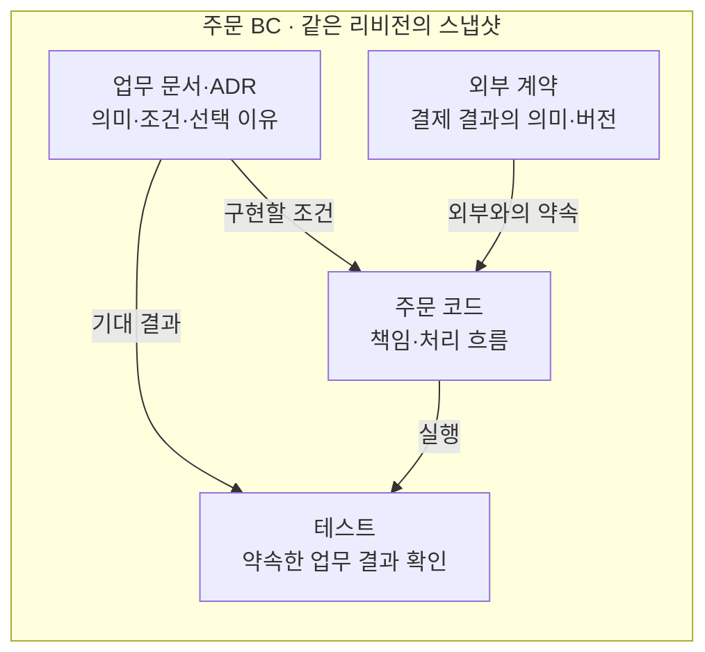
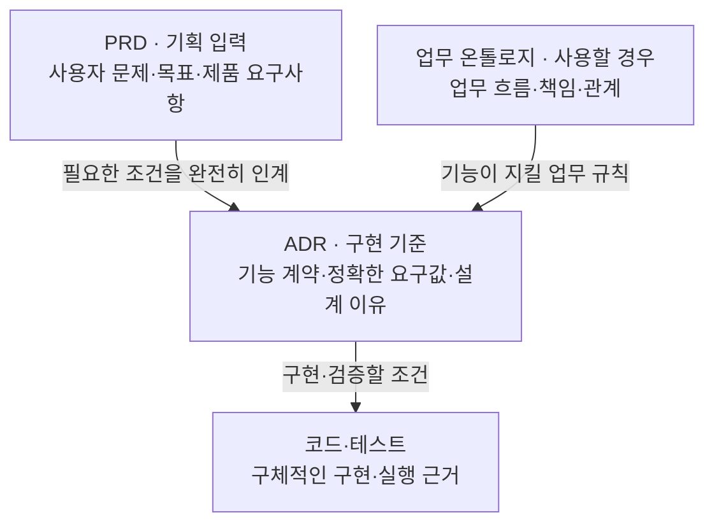
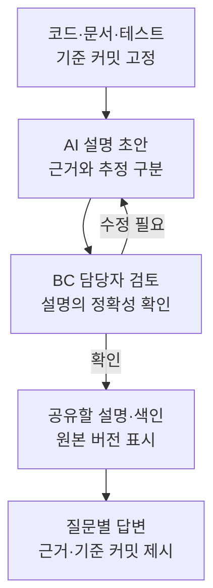
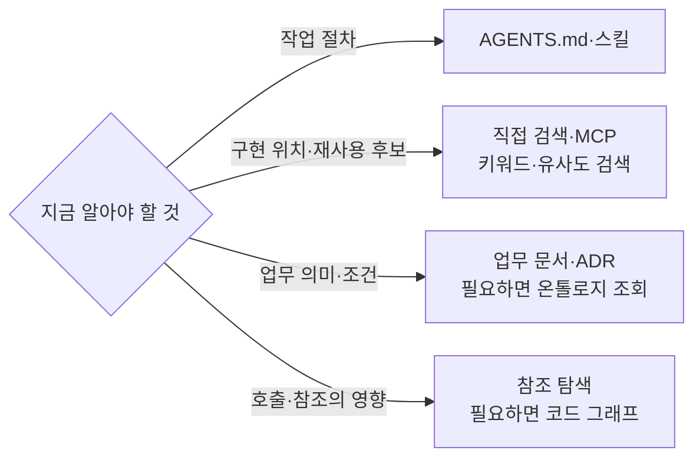
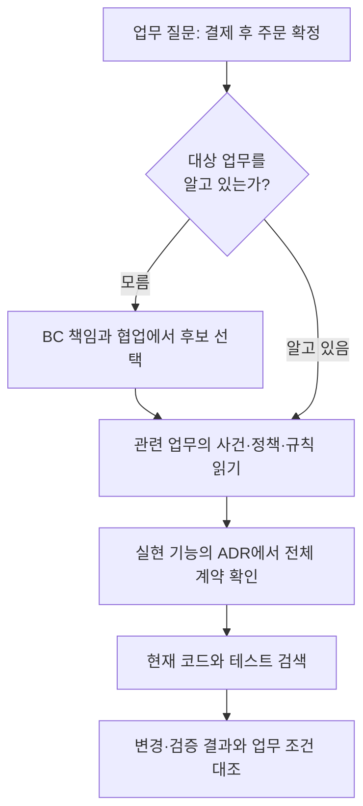
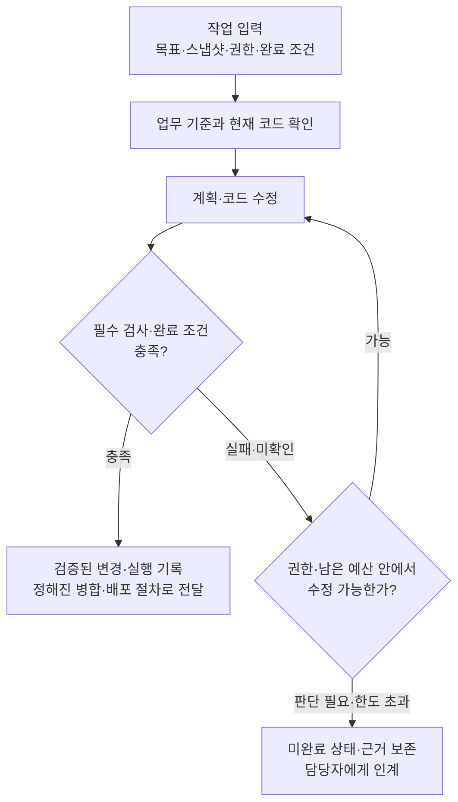
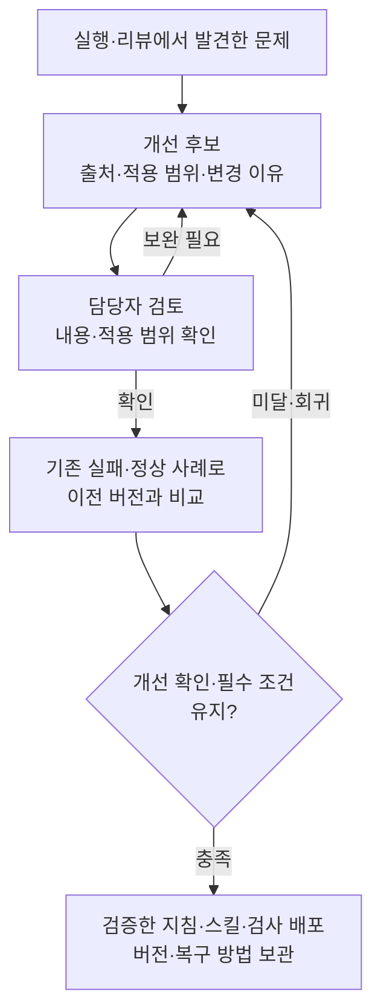

## TL;DR

- BC의 한 시점 코드와 문서만으로 업무와 구현을 설명할 수 있어야 한다.
- 업무 조회와 코드 탐색에 서로 다른 도구를 쓴다.
- 반복해서 검증한 작업부터 자동화 범위를 넓힌다.

## 시작하며

소프트웨어 팩토리는 AI 에이전트가 요구사항을 구현·검증하고, 실행 결과에서 다음 개선을 찾아 이어가는 시스템이다. 최근 공개되는 사례를 보면서도, 나는 이런 방식이 한동안은 개발 자동화를 앞서 실험하는 일부 프론티어 팀의 실천으로 남을 것이라고 생각한다.

시간이 지나면 모든 개발팀이 이런 방식으로 일하려 하겠지만, 지금 일반적인 엔터프라이즈 팀이 적용할 수 있는 범위는 제한적이다. 기존 시스템과 조직의 검증·운영 체계를 함께 바꿔야 하므로, 현재 맡길 수 있는 작업부터 단계적으로 준비하는 편이 현실적이라고 생각한다. AWS Emulator 사례를 다룬 글[^1]에서도 작은 작업의 실행·평가·복구부터 갖추며 자동화 범위를 넓히는 과정을 정리했다.

이를 개발팀에 적용하려면 AX(Agentic Transformation)의 두 측면을 나누어 볼 필요가 있다. 하나는 에이전트를 도입해 업무를 자동화하는 것이고, 다른 하나는 개발팀이 설계·코드 작성·테스트·수정을 에이전트와 수행하는 에이전틱 엔지니어링을 도입하는 것이다. 시리즈 1편[^10]은 전자를 다뤘고, 2편인 이 글은 후자를 다룬다. 다른 팀의 저장소에서 필요한 코드를 찾고 우리 서비스가 쓰는 버전의 계약을 확인하는 방법은 [코드베이스 관리 심화편](/2026/11/25/enterprise-codebase-management.html)에 정리했다.

지금 일반적으로 이야기하는 AX는 주로 비개발자의 업무 자동화에 집중되어 있다. 내외부의 비즈니스 정보와 업무 규칙을 바탕으로 내부 프로세스를 개선하는 것이다. 개발팀의 자동화는 이런 정보에 기획문서, 내부 코드와 설계, 외부 라이브러리와 API 문서, 테스트와 실행 기록까지 더해 엔드유저에게 전달할 코드를 만든다.

업무 규칙이 그대로여도 코드를 수정하면 의존 관계와 검증할 구현이 바뀐다. 그래서 개발팀은 일반적인 업무 자동화보다 더 넓고 자주 변하는 맥락을 다뤄야 하며, **변경 뒤에도 안정적으로 동작하는 코드를 만드는 것**이 핵심이 된다. 업무 정보를 연결하는 데서 더 나아가 현재 코드를 탐색하고 실행·검증할 도구까지 갖춰야 하는 이유다.

이번 글에서는 AI를 막 도입한 엔터프라이즈 개발팀이 이 기반을 어떤 순서로 구성하고 관리할지 정리하려고 한다. 요구사항은 위키에, 예외 처리는 예전 대화에 있고 코드와도 조금씩 다르다면, 개발자는 매 작업마다 배경을 다시 설명해야 한다. 먼저 이 의존을 줄이고, 검증한 작업부터 에이전트에 맡기는 순서로 접근한다.

내가 만든 ALPS Writer Plugins[^2]도 이 문제를 다룬다. 제품의 요구사항을 정리하고, 업무의 흐름을 모델로 남기고, 구현이 지킬 결정을 아키텍처 결정 기록(ADR)에 담아 코드와 검증까지 연결한다. 그 과정에서 중요하게 생각하는 것은 **각 계층이 무엇을 설명할 책임이 있는지 분명히 하는 것**이다.

나는 그 책임을 나누는 출발점으로 DDD가 중요하다고 생각한다. AI에게 많은 자료를 주기 전에, 팀이 관리하는 코드와 문서가 어떤 업무를 온전히 설명하는지부터 정해야 한다.

## 0. 기본 원칙: BC의 스냅샷 안에서 설명이 끝나야 한다

DDD(Domain-Driven Design)는 업무의 개념과 규칙을 소프트웨어에 반영하는 설계 방식이다. 그중 바운디드 컨텍스트(Bounded Context, 이하 BC)는 같은 용어와 규칙이 일관된 의미를 갖는 범위다.[^3] 주문 관리에서의 ‘확정’과 결제 처리에서의 ‘완료’는 서로 연결되지만, 각 업무가 책임지는 결과는 다르다.

나는 이 관점을 개발팀의 관리 원칙으로 더 구체화하고 싶다.

**특정 시점의 BC를 떼어놓고 보아도, 그 스냅샷 안의 코드와 문서만으로 업무와 구현을 온전히 설명할 수 있어야 한다.** 모노레포라면 해당 BC 부분이, BC별 멀티레포라면 해당 저장소가 그 단위가 된다.

여기서 스냅샷은 같은 시점으로 고정한 코드와 문서의 묶음이다. 현재 코드에 다른 시점의 위키 설명을 붙여놓고 완전하다고 할 수는 없다.

### 코드와 문서에서 서로에게 도달할 수 있어야 한다

문서를 읽으면 무엇을 만들어야 하고 어떤 결과가 옳은지 알 수 있어야 한다. 코드를 읽으면 그 업무가 어떤 책임과 흐름으로 구현되어 있는지, 테스트가 무엇을 확인하는지 알 수 있어야 한다.

예를 들어 “결제가 완료된 주문을 확정한다”는 규칙이 있다면, 문서에는 어떤 결제를 인정하고 중복·실패를 어떻게 처리할지 남긴다. 코드에는 결제 결과를 확인하는 책임과 주문을 확정하는 책임이 드러나야 한다. 테스트는 다른 주문의 결제나 중복 통지가 왔을 때도 약속한 결과를 지키는지 확인한다.

왜 그 정책을 선택했는지는 코드만으로 복원하기 어렵다. 그 이유와 지켜야 할 조건은 문서가 맡고, 실제 처리 방식은 코드가 맡는다. 문서로부터 같은 업무 조건을 만족하는 구현을 다시 만들 수 있고, 현재 코드가 그 조건을 어떻게 실현했는지도 설명할 수 있어야 한다.[^4]

### 외부와의 약속도 스냅샷에 포함한다

주문 BC가 결제 BC와 협업한다면 주문 쪽에는 자신이 받는 결제 결과의 의미, 식별 방법, 실패와 중복 처리 조건이 있어야 한다. 이를 이해하기 위해 결제 저장소의 내부 코드부터 읽어야 한다면 주문 BC의 설명이 빠진 것이다.

이렇게 어떤 입력을 받아 무엇을 보장할지 정한 약속을 여기서는 계약이라고 부르겠다. 외부 API와 이벤트의 필요한 계약, 적용 버전, 그 약속을 확인하는 테스트나 로컬 검증용 대체 구현을 함께 보관한다. 공통 정책을 중앙에서 관리하더라도 이 BC에 적용되는 내용과 버전은 스냅샷에 남긴다. 외부 링크는 출처를 찾는 데 쓸 수 있지만, 링크를 열어야만 필수 규칙을 알 수 있게 두지는 않는다.

BC와 저장소는 항상 일대일이 아니다. 한 BC가 여러 저장소에 흩어져 있다면 각 저장소가 맡는 책임과 다른 부분에 기대는 계약을 명시하고, BC 전체를 구성하는 버전 조합도 기록해야 한다. 모노레포의 BC를 분리해서 볼 때 필요한 공통 설정과 문서도 같은 리비전의 묶음에 포함한다.

주문 BC를 따로 읽는 사람에게 필요한 정보는 다음처럼 하나의 스냅샷 안에 있어야 한다.





이 원칙에서 요구하는 것은 업무와 구현을 설명할 수 있는 완전성이다. 실제 결제망에 연결하지 않고도 운영 결과를 재현할 수 있다는 뜻은 아니다. 실서비스의 상태와 장애 원인은 별도의 실행 기록으로 확인하되, 그 기록을 해석하는 데 필요한 계약은 저장소에 있어야 한다.

## 1. 먼저 나눌 것: 업무, 구현 계약, 코드

자료가 모였다고 모두 같은 역할을 하는 것은 아니다. 나는 ALPS Writer Plugins에서 다음과 같이 책임을 나누었다.[^2][^5]

| 계층 | 답해야 하는 질문 | 보관할 내용 |
| --- | --- | --- |
| PRD, 제품 요구사항 문서 | 누구의 어떤 문제를 풀 것인가? | 사용자 문제, 기대 결과, 제품 범위와 요구사항 |
| 업무 온톨로지 | 어떤 업무가 누구의 책임으로 이어지는가? | BC, 업무 흐름, 사건, 정책, 업무 사이 규칙과 용어 |
| ADR, 아키텍처 결정 기록 | 이 기능은 무엇을 보장해야 하며 왜 이렇게 정했는가? | 입력·결과·권한·실패 조건, 정확한 요구값, 설계 이유와 대안 |
| 코드와 테스트 | 그 조건을 어떻게 구현하고 확인하는가? | 함수와 자료구조, 라이브러리, 실행 설정, 검증 코드 |

온톨로지는 업무의 개념과 관계를 정해 검색할 수 있게 만든 모델이다. 여기서는 모든 회사 정보를 담는 거대한 지식 체계보다, 개발에 필요한 업무 맥락을 찾는 용도로 쓴다. 작은 팀은 문서로 업무를 설명하는 것부터 시작하고, 관계를 반복해서 찾아야 할 때 이 모델을 추가하면 된다.

ALPS의 PRD는 기획 단계의 입력이다. 구현에 필요한 조건을 ADR로 완전히 넘긴 뒤에는 ADR이 구현 기준을 소유하고, PRD는 기획 기록으로 남는다. 나중에 PRD가 바뀌어도 구현 기준이 저절로 바뀌지는 않는다. 현재 ADR과 비교해 변경할 조건을 결정해야 한다.[^5]





### 추상화하면서 요구사항을 버리면 안 된다

가령 환불 업무에서 “환불 신청 기간은 배송 완료부터 계산한다”는 관계는 온톨로지에 둔다. 그 기간이 30일이라는 요구사항은 ADR에 두고, 날짜를 계산하는 함수와 사용하는 라이브러리는 코드에 둔다. 여러 기능이 함께 지켜야 하는 정확한 값은 BC 수준의 ADR에서 관리할 수 있다.

‘30일’이 현재 코드에서 보인다는 이유로 문서에서 지우면, 다음 구현이 무엇을 지켜야 하는지 사라진다. 반대로 교체 가능한 날짜 라이브러리의 사용법을 ADR에 옮기면 구현을 바꿀 때마다 상위 문서도 고쳐야 한다.

ALPS Writer Plugins의 기준도 먼저 요구사항을 보존하고, 그다음 코드에서 읽을 수 있는 구현 사실을 문서에서 덜어내는 순서다. **추상화는 세부사항을 일괄 삭제하는 일이 아니라, 그 사실을 책임질 위치를 정하는 일이다.**

### 연결은 의미를 따라가고, 파일 위치는 다시 찾는다

플러그인의 ADR 색인은 업무 단계와 이를 실현하는 기능을 연결하지만 코드 파일 경로를 저장하지 않는다. ADR 본문에 함수명과 줄 번호를 나열하거나, 코드에 ADR 번호를 박아 넣지도 않는다. 에이전트가 ADR의 업무 의미를 읽고 현재 저장소에서 구현을 찾는다.[^5]

온톨로지의 업무 변경은 ADR의 계약을 거쳐 코드로 내려간다. 코드 리팩토링만으로 업무 모델을 다시 쓰지는 않는다. 코드와 문서가 어긋나면 현재 동작과 승인된 조건의 차이를 기록하고, 버그를 고칠지 요구사항을 바꿀지 구분한다. 실제 코드가 그렇게 동작한다는 이유만으로 문서를 맞추면 버그를 규칙으로 굳힐 수 있다.

이제 이 구분을 팀의 도구 구성에 적용해보자. 아래 단계는 달력에 맞춘 일정이 아니라, 다음 일을 맡길 준비가 됐는지 확인하는 순서다.

## 2. 첫 단계: 한 BC에서 공통 작업 환경을 만든다

처음에는 변경이 잦고 담당자가 분명한 BC 하나를 고른다. 팀 전체 저장소를 한 번에 정리하기보다, 그 BC에서 자주 하는 설명·수정·테스트 작업을 같은 환경으로 수행하게 한다.

**담당 개발자는 코드와 문서의 기준을 맡고, 팀 리드는 자동으로 맡길 작업과 사람의 판단이 필요한 조건을 정한다.** 소규모 팀에서는 같은 사람이 두 역할을 맡아도 된다.

1. 현재 코드, 업무 조건, 실행 방법을 같은 리비전에서 읽을 수 있게 모은다. 담당자의 기억에만 있던 규칙은 사실을 확인해 문서나 테스트에 넣는다.
2. 루트 `AGENTS.md`에는 공통 작업 방법과 검증 명령을, BC 내부 지침에는 그 범위의 제약과 알려진 함정을 적는다. 코드의 모든 파일을 요약하지 않는다.
3. 여러 단계가 반복되는 절차는 필요할 때 불러오는 스킬로 분리한다. 빌드·테스트처럼 실행 결과가 있는 일은 실제 명령과 연결한다.
4. 같은 작업을 변경 전후로 실행해 정답 여부, 빠뜨린 검사, 사람이 보충한 설명, 소요 시간과 비용을 남긴다.

스킬은 에이전트가 특정 작업을 할 때 읽는 절차서다. 매 작업에 필요한 짧은 지침과, 장애 분석처럼 그때만 필요한 절차를 분리하면 관련 없는 설명을 계속 읽히지 않아도 된다.

자동으로 검사할 수 있는 규칙은 지침에 적는 데서 끝내지 않는다. 예를 들어 “다른 BC의 내부 모듈을 직접 참조하지 않는다”는 규칙은 의존성 검사로 확인하고, 실패하면 병합을 막는다. 사람이 판단해야 하는 업무 조건은 어떤 근거를 보고 누가 결정할지 남긴다.[^6]

완료 여부는 새 대화에서 확인한다. 이전 대화와 외부 위키를 주지 않은 에이전트나 동료가 해당 BC의 스냅샷으로 작은 변경을 수행하게 한다. 업무 규칙을 찾고, 관련 코드를 설명하고, 정해진 검사를 실행하며, 결정되지 않은 부분을 질문으로 남길 수 있어야 한다.

담당자가 옆에서 설명해야만 성공했다면 그 설명 중 무엇이 빠졌는지 확인한다. 필요한 조건은 저장소에 반영하고 같은 작업을 다시 확인한다. 이 단계의 산출물은 큰 프롬프트가 아니라 **다른 사람이 이어받아도 동작하는 작업 환경**이다.

## 3. 초기 사용자를 돕기: 코드 설명과 질의응답을 준비한다

저장소가 스스로 설명할 수 있어도 처음 온 사람은 무엇부터 읽을지 모를 수 있다. AI 도구에 익숙하지 않은 개발자에게 처음부터 검색어와 파일 경로를 고르게 하면 도입 자체가 어려워진다.

이때 코드를 미리 분석해 설명을 만들고 질문에 답하는 시스템이 도움이 될 수 있다. 저장소의 목적, 주요 업무 흐름, 실행 방법, 자주 묻는 질문을 정리해 “결제가 끝났는데 주문이 확정되지 않는다면 어디부터 보나?” 같은 질문으로 들어가게 한다.

생성된 설명은 특정 버전의 코드를 읽기 위한 안내다. `AGENTS.md`의 작업 지침이나 승인된 업무 규칙과는 쓰임이 다르다. 긴 코드 설명 전체를 매 세션에 넣지 않고 질문에 필요한 부분만 근거와 함께 가져온다.

### 생성부터 갱신까지 팀이 맡는다

이 시스템을 담당하는 개발자는 다음 흐름을 준비한다.

1. 저장소·BC·커밋을 지정해 코드와 문서, 테스트에서 설명 초안을 만든다. 각 설명에 근거 위치와 생성 기준 버전을 남긴다.
2. BC 담당자가 주요 흐름과 업무 해석을 검토한다. 코드에서 확인한 사실, 문서의 요구사항, AI의 추정을 구분하고 미확인 내용은 그대로 표시한다.
3. 질문을 받으면 답변에 근거와 기준 커밋을 붙인다. 다른 버전을 묻는 경우 같은 버전으로 다시 확인하거나 차이를 알린다.
4. 코드 변경 후 영향받은 설명을 갱신하고 색인을 교체한다. 갱신이 실패하면 오래된 상태를 표시하고 현재 소스로 안내한다.

초안을 만드는 일과 팀이 읽을 설명으로 제공하는 일 사이에 검토를 둔다. 코드가 바뀌면 같은 경로로 영향받은 설명을 다시 확인한다.





예를 들어 “중복 결제 통지는 안전한가?”라는 질문에 코드 요약만으로 “안전하다”고 답해서는 곤란하다. 어떤 중복 조건을 구현이 처리하는지, 그 조건을 테스트했는지, 현재 ADR이 요구하는 범위와 일치하는지를 보여줘야 한다.

계속 필요한 업무 조건이 질의응답 시스템에만 남아서도 안 된다. 검토를 거쳐 BC의 문서와 테스트에 반영해야 시스템이 없어도 스냅샷의 설명이 완전하게 남는다. 생성 문서는 그 원본으로부터 다시 만들 수 있게 한다.

새 구성원에게 실제 온보딩 질문으로 사용하게 해본다. 정답과 근거를 찾는 데 걸린 시간, 틀린 확신을 준 답변, 오래된 버전으로 답한 경우, 여전히 담당자를 불러야 했던 질문을 확인한다. 원래 읽을 수 없는 저장소의 내용이 요약이나 답변에 나타나지 않는지도 검사한다.

이 단계는 온보딩이 병목일 때 추가한다. 몇 개의 문서와 직접 검색만으로 팀원이 충분히 이해한다면 별도 질의응답 서비스를 운영할 필요는 없다.

## 4. 탐색을 넓히기: 직접 검색, MCP, 필요한 코드 그래프

코드를 수정할 때는 현재 구현을 확인해야 한다. 먼저 질문이 얼마나 구체적인지에 따라 탐색 방법을 고른다.

| 알고 있는 것 | 먼저 사용할 방법 | 다음에 확인할 것 |
| --- | --- | --- |
| 함수명, 오류 문구, 업무 용어 | 로컬 키워드·심볼 검색 | 정의, 호출 위치, 관련 테스트 |
| 다른 저장소의 위치나 유사한 구현 | 내부 코드의 키워드·유사도 검색 | 저장소와 커밋을 확인한 뒤 원문 읽기 |
| 여러 단계를 거친 호출·참조 관계 | IDE 참조 탐색, 필요하면 코드 그래프 | 실제 변경 경로와 검증할 영향 범위 |

예를 들어 주문 확정 로직을 찾는다면 로컬에서 업무 용어와 관련 이름을 먼저 검색한다.

```bash
rg -n 'confirmOrder|PaymentCompleted|주문 확정' src tests docs
```

여기서 얻은 이름으로 정의와 사용처를 좁혀가면 된다. 해당 저장소에 없는 예시 구현이나 사내 공통 라이브러리를 찾을 때는 내부 코드 검색으로 범위를 넓힌다. 같은 행동을 다른 이름으로 구현했을 때는 질문과 코드의 의미상 유사성을 찾는 검색이 후보를 찾는 데 도움이 된다.

MCP(Model Context Protocol)는 에이전트가 이런 검색 도구를 호출하도록 연결하는 방식이다. 검색 품질은 MCP를 붙였다는 사실보다 대상 코드, 검색 방법, 버전과 접근 권한을 어떻게 관리하느냐에 달려 있다.

내부 검색 담당자는 결과에 저장소, BC 범위, 파일, 근거 구간, 커밋과 색인 상태가 나오게 한다. 에이전트는 후보의 원문과 현재 작업 버전의 차이를 확인한 뒤 사용한다. 검색 대상 밖이거나 색인이 오래된 경우도 구분해야 검색 결과가 없다는 이유로 구현이 없다고 판단하지 않는다.

다른 저장소를 검색해 재사용할 구현을 발견할 수는 있다. 그 구현이 새 의존성이 된다면 적용 버전과 필요한 계약을 현재 저장소에 남겨야 한다. 탐색 도구가 앞의 스냅샷 원칙을 대신해주지는 않는다.

### 코드 그래프는 관계를 놓치는 문제가 생길 때 붙인다

코드 그래프는 함수·클래스·패키지와 호출·참조 관계를 연결한 데이터다. “이 함수를 누가 호출하는가”를 여러 단계 따라가야 하거나, 저장소를 가로지르는 영향 분석에서 반복해서 누락이 생길 때 도입할 이유가 생긴다.

먼저 놓친 관계 때문에 실패한 변경을 모으고, 기존 검색으로 찾은 범위와 그래프를 사용해 찾은 범위를 비교한다. 추가로 발견한 영향, 잘못 연결한 관계, 분석 시간과 갱신 비용을 보고 유지 여부를 정한다.

동적 호출, 실행 시 주입되는 의존성, 메시지 통신은 정적 분석만으로 모두 드러나지 않을 수 있다. 그래프가 지원하는 언어와 관계의 범위를 밝히고, 필요한 계약 테스트와 실행 기록을 함께 본다. 온보딩 설명을 생성하는 내부 과정에서 그래프를 쓰더라도 모든 개발 작업이 그래프 조회부터 시작할 이유는 없다.

**코드 그래프가 답하는 것은 구현의 연결이고, 업무 온톨로지가 답하는 것은 업무의 의미와 책임이다.** 둘을 같은 그래프에 담을 수 있느냐보다, 질문에 맞는 사실을 정확히 찾을 수 있느냐가 도구를 고르는 기준이다.

질문을 나누면 어떤 자료와 도구를 먼저 볼지도 구분할 수 있다.





## 5. 업무가 복잡해지면: 온톨로지로 필요한 맥락만 가져온다

코드는 찾았는데 왜 그 일을 하는지, 어느 업무의 규칙까지 지켜야 하는지 다시 조사하는 시간이 길어질 수 있다. 여러 기능에 걸친 규칙과 BC 사이의 인계를 반복해서 찾아야 한다면 업무 온톨로지를 추가할 시점이다.

업무 담당자와 개발자는 실제 업무의 시작, 결과, 수행자, 사건과 예외를 함께 확인한다. AI가 기존 문서와 코드에서 후보를 뽑을 수 있지만, 현재 코드의 구조를 그대로 업무 경계로 확정하지 않는다. 조직도나 ADR 폴더도 BC를 자동으로 정의해주지는 않는다.

ALPS Writer Plugins의 업무 지식은 두 수준으로 나뉜다. 위에는 BC의 책임, 핵심 업무, 다른 BC와의 협업을 작게 담고, 내부에는 프로세스·단계·사건·정책·규칙을 둔다. 상위 설명은 미리 확인해 작성한 지식이며, 질문할 때마다 AI가 즉석에서 만든 요약을 확정된 사실처럼 사용하지 않는다.[^7]

### 어디를 바꿀지 모를 때만 위에서 시작한다

플러그인의 공개 주문·결제 학습 예시에는 주문 관리와 결제 처리 BC가 있다. “결제 완료 후 주문을 확정한다”는 흐름은 결제 완료 사건, 그 결제가 해당 주문의 것인지 확인하는 정책, 주문 확정 단계로 표현된다.[^8]

이 예시는 업무 자료와 모델을 제공한다. 팀에서 이 업무의 ADR과 구현까지 갖추고 개발에 활용한다면, 다음 경로로 필요한 정보를 찾을 수 있다.





주문 확정 단계를 이미 안다면 곧바로 그 상세를 읽으면 된다. 질문과 관련된 책임과 규칙, 인계, ADR을 찾았다면 탐색을 멈춘다. 관련 없는 모든 BC를 읽을 필요는 없지만, 여러 BC에 걸친 조건을 검색 결과의 길이를 줄이려고 잘라내서도 안 된다.

이 예시에는 중복 결제 통지 같은 미정 경로도 남아 있다. 온톨로지에서 정상 흐름을 찾았다는 이유로 중복 처리까지 정해졌다고 추론하지 않는다. 실제로 구현할 때는 책임자가 조건을 결정하고 해당 ADR에 구체적인 입력·결과·실패 처리를 남겨야 한다.

업무 모델에는 결제 이벤트를 전달하는 라이브러리나 주문 확정 함수의 위치를 넣지 않는다. 구현에서 필요한 정확한 값과 상태 전이는 ADR에서 읽고, 현재 파일은 검색으로 찾는다. 이 구분이 있어야 온톨로지를 매 코드 변경마다 고치지 않고 업무 정보를 찾는 데 사용할 수 있다.

또한 조회 시스템이 중앙에 있더라도, 해당 BC를 설명하는 모델과 외부 업무의 인계 조건은 코드와 함께 버전을 고정해 보관한다. 조회 결과는 작업 중 활용하는 자료이고, 그 결과만 남겨 원래 모델을 대체하지 않는다.

완료 기준은 그래프의 크기가 아니다. 팀의 실제 변경 질문으로 필요한 업무와 ADR을 찾을 수 있고, 미정·누락·깨진 연결을 구분할 수 있어야 한다. 업무 담당자가 모델을 고쳤을 때 어떤 구현 계약을 다시 봐야 하는지도 확인한다. 조회 시간은 줄었지만 중요한 조건을 놓친다면 아직 다음 자동화에 사용할 수 없다.

## 6. 작업을 맡기기: 탐색부터 검증까지 연결한다

이제 에이전트가 업무 기준을 읽고 현재 구현을 찾을 수 있다. 이 정보를 실행·검증·실패 대응과 연결한 환경이 하네스(harness)다.[^6] 처음에는 사람이 고른 작은 작업 하나를 끝까지 처리하게 한다.

팀은 작업에 다음 입력을 남긴다.

| 작업 입력 | 기록할 내용 |
| --- | --- |
| 목표와 근거 | 바꿀 업무 결과, 현재 문제와 재현 자료 |
| 기준 스냅샷 | 코드·문서 리비전, 적용할 외부 계약 버전 |
| 허용 범위 | 변경할 BC와 작업 공간, 사용할 도구와 권한 |
| 완료 조건 | 관찰할 결과, 필수 검사, 필요한 승인 |
| 종료·복구 조건 | 시간·비용·재시도 한도, 중단 시 인계할 담당자 |

에이전트는 필요한 업무 맥락과 ADR을 읽고, 코드를 찾아 계획한 뒤 수정한다. 검사는 구현이 바뀌었다는 사실이 아니라 원래의 업무 조건이 충족되는지를 확인한다. 실패하면 그 근거로 다시 수정하고, 정책 결정이나 권한이 필요한 경우에는 미완료 상태와 근거를 넘긴다.





작업 공간과 테스트 데이터를 다른 실행과 분리하고, 코드와 업무 문서의 리비전, AI 모델과 지침·도구의 버전, 읽은 근거, 실행한 검사와 종료 이유를 작업 기록으로 연결한다. 그래야 잘못된 결과가 오래된 설명, 검색 누락, 구현 오류, 빠진 검사 중 어디에서 시작했는지 찾을 수 있다.

필수 검사와 병합 정책은 수정 에이전트가 같은 작업에서 약화할 수 없게 한다. 검사 누락이나 시간 초과도 완료로 처리하지 않는다. 병합은 현재 변경에 대한 유효한 검사·승인을 확인하고, 배포는 실제 연동 환경과 복구 절차까지 확인한 범위에서 연결한다.[^1]

이 경로를 중단했다가 재개해도 작업이 중복 실행되지 않고, 실패한 작업이 성공으로 기록되지 않는지 확인한다. 다른 팀원이 같은 입력으로 이어받을 수 있으면 작업 큐와 병렬 실행으로 범위를 넓힌다.

그다음에는 운영 기록이나 평가에서 재현 가능한 실패를 찾아 작업으로 만들 수 있다. 제품 결함과 실행 환경 문제를 구분하고 중복을 제거한 뒤, 이미 허용한 유형만 수정 경로로 보낸다. 이때부터 실행 결과가 다음 개발 작업으로 돌아오는 소프트웨어 팩토리의 흐름이 생긴다.

## 7. 도구를 도입한 뒤: 개발 환경도 제품처럼 관리한다

팀의 작업 방식은 모델 하나로 결정되지 않는다. 지침, 스킬, 검색 색인, 질의응답 자료, 업무 모델, 검사와 배포 정책이 함께 결과를 만든다. 이 구성도 담당자와 버전, 변경 검증과 되돌릴 방법이 있어야 한다.

처음에는 다음처럼 책임을 나눌 수 있다. 별도 플랫폼팀이 없는 조직이라면 기존 개발팀 안에서 담당자를 정한다.

| 관리 대상 | 담당할 역할 | 변경할 때 확인할 것 |
| --- | --- | --- |
| 업무 모델·요구사항 | 업무 책임자와 BC 담당 개발자 | 바뀐 의미, 영향받는 계약, 미정 조건 |
| ADR·코드·테스트·BC 지침 | BC 담당 개발자 | 같은 스냅샷의 일치와 업무 검증 결과 |
| 검색·코드 설명·질의응답 | 개발 도구 담당자 | 원본 버전, 누락과 갱신 실패, 접근 권한 |
| 공통 스킬·MCP·검사 환경 | 플랫폼 또는 공통 도구 담당자 | 필요한 도구 범위, 작업 성공 여부, 비용과 회귀 |

BC 지침은 해당 코드 변경과 함께 검토하고, 공통 스킬과 도구 구성은 버전이 있는 패키지로 배포한다. 어떤 팀이 어느 버전을 쓰는지 알 수 있게 하고, 문제가 생기면 이전 버전으로 돌아갈 수 있게 한다. 모든 MCP 도구를 기본으로 켜두기보다 검색·구현·운영 등 맡기는 일에 필요한 묶음을 제공한다.

### 실패를 어디에 반영할지 정한다

반복되는 오류를 모두 `AGENTS.md`에 추가하면 지침만 커진다. 실패한 위치에 맞춰 고칠 대상을 정하는 편이 낫다.

| 발견한 문제 | 남길 개선 |
| --- | --- |
| 업무 조건을 아무도 명확히 설명하지 못함 | 업무 결정 후 모델·ADR 보완 |
| 이름과 책임이 달라 관련 코드를 찾기 어려움 | 코드의 이름과 책임 정리 |
| 검색이나 생성 설명이 과거 코드로 안내함 | 색인·설명 갱신과 오래된 결과 처리 수정 |
| 같은 절차에서 검사를 계속 빠뜨림 | 스킬 수정, 실행 검사와 차단 조건 추가 |
| 검사는 통과했지만 사용자가 같은 문제를 겪음 | 업무 결과를 확인하는 평가 사례 추가 |

새로 얻은 지식은 출처와 적용 범위를 붙여 후보로 남긴다. BC 담당자가 확인한 규칙만 공통 기준에 넣고, 일회성 우회 방법과 모델의 추정은 승인된 정책으로 승격하지 않는다.

개발 지침과 도구를 바꿀 때는 다음처럼 후보의 검토와 실행 평가를 거쳐 배포한다.





도구나 지침을 바꿀 때는 이전 실패 사례와 정상 처리 사례를 함께 다시 실행한다. 검증을 마친 변경까지 걸린 시간과 사람의 개입이 줄었는지 보고, 놓친 결함·재작업·실행 비용이 늘었는지도 확인한다. 처리 속도만 좋아지는 변경을 걸러내기 위해서다.[^9]

코드 생성량이나 도구 호출량은 이 판단을 대신하기 어렵다. 검색 도구를 더 많이 썼다는 사실보다 필요한 근거를 찾았는지, 자동으로 끝낸 작업 수보다 그 결과가 실제로 옳았는지를 봐야 한다.

## 8. 팀에서 시작할 순서

앞의 내용을 실제 준비 순서로 모으면 다음과 같다. 첫 행부터 실행하되, 추가 도구는 해당 문제가 있을 때 선택한다.

| 현재 막히는 곳 | 이번에 준비할 것 | 다음으로 넘어갈 기준 |
| --- | --- | --- |
| AI에게 매번 배경을 설명함 | 한 BC의 코드·문서 스냅샷, 짧은 지침, 실행 가능한 검사 | 새 대화에서도 규칙을 읽고 작은 변경을 검증함 |
| 처음 온 사람이 읽을 곳을 모름 | 버전을 밝히는 코드 설명과 근거 기반 질의응답 | 실제 질문에서 정확한 근거를 찾고 미확인을 구분함 |
| 구현 위치와 재사용 후보를 찾기 어려움 | 직접 검색과 내부 키워드·유사도 검색 | 현재 작업 버전의 원문에 도달함 |
| 업무 규칙과 BC 사이 인계를 반복 조사함 | 계층을 나눈 업무 온톨로지와 ADR 연결 | 필요한 조건을 빠짐없이 찾아 구현 기준으로 넘김 |
| 호출·참조 관계를 자꾸 놓침 | 필요한 범위의 코드 그래프 | 영향 누락이 줄고 갱신 비용을 감당할 수 있음 |
| 사람이 매 단계 실행을 재촉함 | 격리된 실행, 검증·중단·인계가 연결된 작업 경로 | 실패를 숨기지 않고 다른 담당자가 재개할 수 있음 |
| 같은 실패를 사람이 계속 찾아 지시함 | 평가·운영 실패를 작업 큐로 연결 | 허용한 실패 유형이 재현·수정·재검증으로 이어짐 |

온보딩 질의응답이나 코드 그래프가 필요 없는 팀도 있다. 도구의 개수를 단계로 세기보다, 지금 사람이 메우는 빈틈이 무엇인지 확인하고 그 일을 반복 가능하게 만드는 순서로 접근하면 된다.

## 마치며

나는 소프트웨어 팩토리를 준비하는 개발팀이 먼저 **자신이 소유한 업무를 코드와 문서로 완결되게 설명하는 능력**을 갖춰야 한다고 생각한다. 그 단위를 정하는 데 DDD의 BC가 유용하다.

그 기반 위에서 처음 온 사람에게는 코드 설명을, 구현을 찾는 에이전트에게는 검색을, 업무 판단이 필요한 작업에는 온톨로지와 ADR을 제공한다. 실행 결과를 검사하고 실패를 다음 개선으로 연결할 수 있게 되면 맡기는 범위도 넓어진다.

다음 주에 시작한다면 BC 하나와 자주 하는 변경 하나를 고르겠다. 이전 대화 없이 그 스냅샷만으로 업무를 이해하고 코드를 고쳐 검증할 수 있는지 확인하는 것이다. 그 과정에서 사람이 설명하거나 대신 처리한 일이, 우리 팀이 다음으로 정리할 문서와 도구를 알려줄 것이다.

[^1]: [AWS Emulator로 배우는 소프트웨어 팩토리 구축](/2026/11/16/building-software-factory-with-aws-emulator.html). 작업 실행부터 평가·문제 발견·복구까지 자동화 범위를 넓히는 과정.
[^2]: [ALPS Writer Plugins](https://github.com/haandol/alps-writer-plugins/tree/c187eca43ba0fc245fdcfae83a7a385510099362). 제품 요구사항, 업무 모델, ADR, 구현과 검증의 역할을 나눈 공개 프로젝트. 이 글은 2026-11-17의 문서를 기준으로 한다.
[^3]: [처음 DDD를 공부할 때 알아두면 좋을 내용들](/2021/10/11/thoughts-for-ddd-starters.html). 보편언어와 BC에 대한 설명. 이 글의 스냅샷 관리 원칙은 그 관점을 개발팀 운영에 적용한 내 제안이다.
[^4]: [에이전트가 읽을 좋은 코드, 비즈니스를 외치는 코드](/2026/03/13/agentic-dev-business-aligned-code.html), [컨텍스트 엔지니어링](/2026/03/11/context-engineering-static-vs-dynamic.html). 업무를 드러내는 코드와 오래 유지할 판단 기준의 역할.
[^5]: ALPS Writer Plugins의 [계층별 의존과 인계 원칙](https://github.com/haandol/alps-writer-plugins/blob/c187eca43ba0fc245fdcfae83a7a385510099362/docs/dependency-model.md), [업무 온톨로지의 책임](https://github.com/haandol/alps-writer-plugins/blob/c187eca43ba0fc245fdcfae83a7a385510099362/plugins/ontology-writer/references/ontology.md).
[^6]: [쉽게 설명한 하네스 엔지니어링](/2026/03/15/harness-engineering-beyond-context-engineering.html). 지침을 도구 실행·검증·실패 대응에 연결하는 방법.
[^7]: ALPS Writer Plugins의 [업무 지식 계층과 조회 원칙](https://github.com/haandol/alps-writer-plugins/blob/c187eca43ba0fc245fdcfae83a7a385510099362/plugins/ontology-writer/references/knowledge-layers.md). 현재 구현은 로컬 텍스트·관계 조회를 사용한다.
[^8]: [주문·결제 학습 예시](https://github.com/haandol/alps-writer-plugins/blob/c187eca43ba0fc245fdcfae83a7a385510099362/plugins/ontology-writer/docs/order-payment-example.md). 업무 자료와 모델을 제공하는 예제로, 실제 주문 서비스 구현이나 검증 성과를 나타내지 않는다.
[^9]: [Software Factory의 평가와 KPI, 텐션 메트릭](/2026/10/05/software-factory-evals-and-tension-metrics.html). 원하는 성과와 그 과정에서 나빠질 수 있는 품질을 함께 확인하는 방법.
[^10]: [AX의 두 축 1: 에이전트로 업무 자동화하기](/2026/11/05/enterprise-wide-ax-essentials.html). 업무 전문가가 에이전트와 연결된 솔루션을 통해 업무 변경과 개선을 이어가는 구조.
