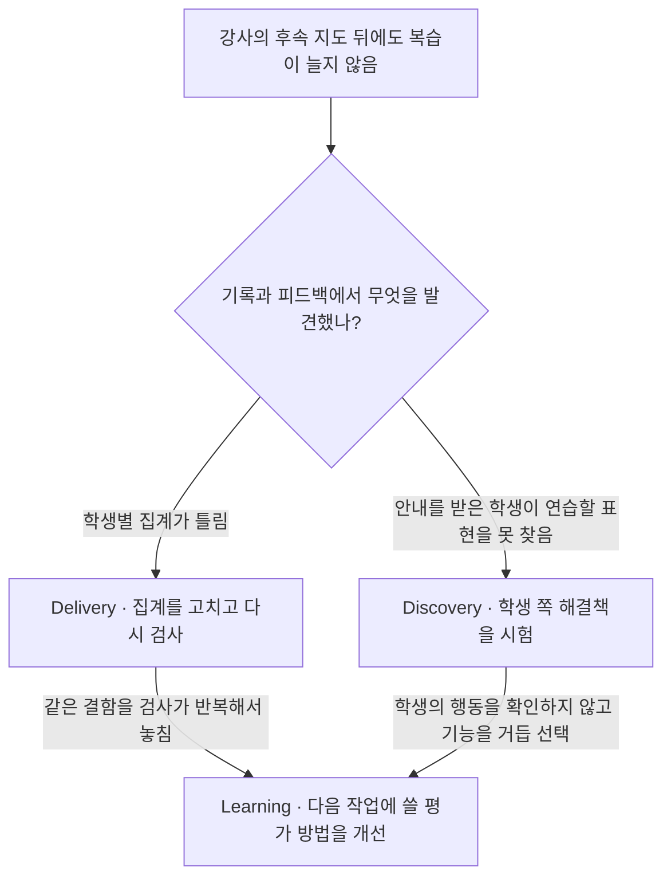

## TL;DR

- 에이전트는 실행 결과를 보면서 세부 작업을 다시 짠다.
- 팀은 사용자가 얻어야 할 변화와 지켜야 할 조건을 정한다.
- 출시 후 관찰한 결과가 다음 개발 작업을 결정한다.

## 시작하며

2025년에 코딩 에이전트로 소프트웨어를 개발할 때 어떤 방식이 가장 잘 통하는지 찾아봤다. 당시 내 결론은 요구사항에서 기능을 뽑고, 각 기능을 에이전트에게 맡길 만한 작은 작업으로 나누고, 구현이 끝나면 결과를 돌아보는 것이었다. 이 다섯 단계에 **RFTCR(Requirement → Feature → Task → Code → Reflect)**이라는 이름을 붙였다. ‘리팩터링’을 떠올리면 순서를 외우기 쉽겠다 싶었다.[^1]

그 글을 쓴 뒤 코딩 에이전트는 놀라울 만큼 빠르게 발전했다. 당시에는 내가 직접 구현 계획을 세우고 에이전트 밖에서 Task 목록을 관리했다. 작업 하나가 끝나면 결과를 확인하고 목록을 고쳐 다음 작업을 넘기는 것도 내 몫이었다. 지금은 코드를 읽고 계획을 짜는 일부터 테스트 결과에 따라 작업 순서를 바꾸는 일까지 에이전트가 대부분 스스로 한다.

내가 운영하는 잉크버드와 픽셀뱅크에서는 CloudWatch가 장애를 알리면 Codex가 한 세션에서 원인을 조사하고, 코드를 고치고, 리뷰를 거쳐 PR을 연다.[^2] 코드를 만드는 도중에 내가 개입해서 다음 단계를 지시할 일이 그만큼 줄었다. 특히 **에이전트에게 넘길 Task 목록을 내가 따로 만들어 최신 상태로 유지할 필요는 없어졌다.**

개발 과정에도 변화가 생겼다. **소프트웨어 팩토리**에서는 에이전트가 제품을 만들고, 운영에서 관찰한 결과가 다시 기획과 개발의 입력이 된다. 예를 들어 영어 학습 앱인 잉크버드를 쓰는 학원에서 강사용 주간 리포트를 요청했다고 해보자. 기능은 출시했는데 강사가 리포트를 읽고도 누구에게 어떤 복습을 권할지 판단하기 어렵다면, 다음에 할 일은 강사가 수업을 어떻게 준비하는지 다시 살펴보는 것이다.

그래서 2025년에 RFTCR로 정리했던 개발 방식이 지금은 **RLO(Requirement → Loop → Outcome)**에 가까워졌다고 생각한다. 팀은 사용자에게 어떤 변화가 필요한지 요구사항으로 정한다. 에이전트는 해결책을 시험하고 구현과 검증을 반복한다. 출시 뒤 사용자에게 실제로 생긴 변화가 다음에 풀 문제를 정할 근거가 된다.

## 1. 작업 목록은 누가 관리하나

주간 리포트를 구현할 때 개발자가 미리 할 일을 쪼갠다면 ‘학생별 학습 횟수 집계’, ‘강사용 조회 API 추가’, ‘리포트 화면 구현’ 정도가 나온다. 그런데 에이전트가 저장소를 읽어 보니 학생 앱의 학습 기록 화면에 이미 주간 집계가 있다면 어떨까. 먼저 확인할 것은 기존 집계가 강사가 알고 싶은 횟수를 세고 있는지다.

**Task가 코딩 에이전트 안으로 들어갔다는 말은 작업 목록의 주인이 바뀌었다는 뜻이다.** 코드를 조사하고, 할 일을 나누고, 테스트 결과를 보고 순서를 고쳐 쓰는 주체가 같은 에이전트다. 중간에 멈췄다면 남은 작업을 기록해 이어갈 수 있다. 다음 달 리포트 기능을 바꿀 때는 그때의 코드와 요구사항에서 다시 계획을 세우면 된다.[^3]

Anthropic의 앱 개발 실험에서도 비슷한 변화를 볼 수 있다. Opus 4.5를 쓸 때는 개발을 스프린트로 나누고 구현자와 평가자가 매번 완료 조건을 합의했다. 4.6에서는 기획 역할을 유지하면서 스프린트를 없애고 평가를 실행 마지막으로 옮겼다. 모델이 혼자 안정적으로 끝내기 어려운 부분에서는 별도 평가가 여전히 도움이 됐다.[^4]

## 2. 요구사항에는 강사가 하려는 일을 적는다

리포트를 요청한 강사가 다음 수업을 준비하는 모습을 떠올려 보자. 강사는 학생들에게 일일이 물어보지 않고도 누가 복습을 건너뛰었는지 알아내 그 학생에게 연습할 표현을 짚어 주고 싶을 수 있다. 그렇다면 팩토리에 줄 요구사항은 이렇게 적을 수 있다.

> 강사의 확인 시간을 늘리지 않으면서, 학생들이 수업에서 배운 표현을 다음 수업 전까지 다시 연습할 수 있게 한다.

이 요구사항에는 **누구의 어떤 행동을 바꿀지와 무엇을 지켜야 할지**가 들어 있다. 주간 리포트는 그 요구를 충족시킬 수 있는 후보 하나다. 학생이 연습할 표현을 못 찾아 복습을 그만두고 있다면 수업 직후에 해당 표현을 보내 주는 쪽이 나을 수도 있다.

AX(Agentic Transformation)의 두 축인 업무 자동화와 개발 자동화는 여기서 같은 업무 규칙을 공유한다.[^5][^6] 강사의 업무를 돕는 에이전트는 담당 반과 연습 기록을 읽어 누구에게 도움을 줄지 알려줄 수 있다. 개발 에이전트는 그 기록이 어떻게 생기는지 코드에서 확인한다. 강사는 표현을 다시 연습해야 복습으로 치는데 앱은 복습 화면을 여는 것만으로 횟수를 올린다면, 집계를 아무리 정확히 해도 엉뚱한 학생에게 연락하게 된다. **무엇을 복습으로 볼지는 강사가 정하고, 개발팀은 그 활동이 실제로 기록되는지 확인한다.** 이 정의는 나중에 복습이 늘었는지 볼 때도 그대로 쓰인다.

## 3. 기획에서 합의한 동작을 개발로 넘긴다

나도 영어 학습 사이드 프로젝트를 시작할 때 종이에 그린 화면을 눌러볼 수 있게 만들어 아이디어를 시험한 적이 있다.[^7] 학원용 기능도 비슷하게 시험해 볼 수 있다. 에이전트가 같은 학습 기록으로 대시보드와 주간 리포트 시안을 만들고, 강사에게 각각을 써서 다음 수업을 준비해 달라고 하는 것이다.

평소 방식으로 수업을 준비할 때와 각 시안을 쓸 때를 비교해 보자. 준비 시간은 얼마나 걸렸고, 복습을 건너뛴 학생 중 강사가 놓친 사람은 누구였을까? 두 시안 모두 도움이 되지 않았다면 개발을 보류하고 학생들이 무엇 때문에 연습을 멈췄는지 더 알아볼 수 있다. 이렇게 사용자가 시안을 써 본 결과로 다음에 무엇을 시험하거나 만들지 정하는 과정이 **Discovery Loop**다.

리포트를 시범 도입하기로 했다면 두 가지를 기록해 둘 만하다. ‘현재 담당하는 반의 학생별 복습 내역을 볼 수 있다’는 **제품이 보장할 동작**이다. ‘그 내역을 본 강사가 후속 지도를 하면 학생들이 복습을 다시 시작할 것이다’는 **시범 도입에서 확인할 가설**이다. 열람 권한은 출시 전에 검사할 수 있다. 학생이 다시 연습하는지는 강사와 학생이 제품을 써야 알 수 있다.

구현으로 넘기기 전에는 명세 자체도 검사한다. 예를 들어 ‘담당 강사만 볼 수 있다’와 ‘대체 강사에게도 월요일마다 발송한다’가 함께 적혀 있다면, 대체 수업 때 누가 어떤 학생 기록을 볼 수 있는지 정해야 한다. 기획 에이전트는 충돌하는 두 조건을 찾아 물을 수 있고, 열람 범위는 제품 책임자가 정한다. Kiro도 설계에 들어가기 전에 기능 요구사항 사이의 모순이나 빠진 조건을 찾아 질문하는 기능을 제공한다.[^8]

내가 쓰는 기획 도구인 ALPS Writer에서는 제품 요구사항 문서(PRD)에 사용자 문제, 선택한 기능과 선택 이유를 적는다. 구현으로 넘길 때는 권한과 예외를 포함해 지켜야 할 요구사항과 결정 이유를 아키텍처 결정 기록(ADR)에 옮긴다. **인계 뒤 구현의 기준은 ADR**이고, PRD에는 그 결정을 내린 당시의 기획이 남는다.[^9] 시범 운영 중 열람 정책을 바꿀 필요가 생기면 변경할 조건을 검토해 현재 ADR에 반영한다.

## 4. 리포트의 정확성과 학생에게 생긴 변화를 따로 확인한다

주간 리포트를 개발 에이전트에게 맡길 때는 목표와 변경 범위, 완료 근거와 중단 조건을 한 작업에 담을 수 있다.

| 맡길 때 정할 것 | 주간 리포트의 예 |
| --- | --- |
| 목표와 기준 | 강사가 자기 반의 지난주 복습 현황을 볼 수 있게 한다. 이번 실행에 적용할 ADR 버전을 지정한다. |
| 변경 범위 | 리포트의 집계·조회·표시를 수정할 수 있다. 학생 기록의 열람 정책을 바꾸려면 제품 책임자의 결정이 필요하다. |
| 완료 근거 | 담당 반의 집계가 학습 기록과 일치하고 다른 반의 기록은 조회되지 않는지 확인한다. |
| 중단 조건 | 실행 예산에 도달하면 마지막 검사 결과와 남은 실패를 기록하고 멈춘다. |

에이전트는 이 범위 안에서 할 일을 나누고, 합의한 동작과 어긋나면 고쳐서 다시 검사한다. 이 과정이 **Delivery Loop**다. 팩토리에 남길 기록은 어느 명세로 실행했고, 어떤 입력에서 무엇을 확인했으며, 시간과 비용을 얼마나 썼는지다. 그래야 다른 사람이 이어받을 때도 어느 조건까지 검증됐는지 알 수 있다.

예를 들어 두 반에 지난주 복습 기록을 넣고 강사 A에게 한 반만 배정한다. A로 로그인했을 때 담당 반의 횟수가 맞는지 확인한 뒤, 같은 계정으로 다른 반의 리포트도 열어 본다. 화면에서 다른 반의 이름만 숨긴 구현은 첫 검사에는 통과하지만 두 번째 검사에서는 학생 기록을 노출한다. 이 실패는 에이전트가 재현해서 수정할 수 있다. 리포트의 오탈자는 곧바로 수정하고 확인해도 되지만, 열람 권한에 영향을 주는 변경은 구현 중에 쓰지 않은 반과 강사 조합으로 한 번 더 검사하는 편이 좋다.

이 검사를 모두 통과한 리포트를 내보냈다고 해보자. **이제 확인할 것은 강사의 부담을 늘리지 않고 더 많은 학생이 복습하도록 도왔는지다.** 시범 도입 전후에 같은 기준으로 수업 사이에 복습한 학생의 비율을 집계하고, 강사가 기록을 확인하고 후속 지도를 준비하는 데 든 시간도 함께 본다. 시험 기간처럼 일정의 영향이 크다면 비슷한 반에 시차를 두고 도입해 비교할 수 있다. 리포트를 몇 번 열었는지만으로는 학생이 더 연습했는지 알 수 없다.

## 5. 결과를 보고 다음에 고칠 곳을 정한다

많은 강사가 리포트를 읽어도 수업 사이에 복습하는 학생의 비율은 그대로일 수 있다. 이때 집계가 틀려 강사가 엉뚱한 학생에게 연락했다면 구현을 고쳐야 한다. 집계도 정확하고 강사가 안내도 했는데 학생이 어떤 표현을 연습할지 찾지 못했다면, 기획으로 돌아가 학생에게 직접 연습할 표현을 건네는 방법을 시험할 차례다.





반복해서 놓치는 일이 생기면 팩토리 자체도 고칠 수 있다. 이를 **Learning Loop**라고 부른다. 가령 다른 반의 학생 기록이 노출되는 결함을 배포 전 검사에서 여러 번 놓쳤다고 하자. 실행 기록을 보니 매번 한 반의 데이터만으로 검사했다면, 두 반의 기록을 함께 넣은 사례를 추가한다. 이전에 놓친 결함을 잡는지, 담당 강사의 정상 조회도 여전히 허용하는지 같은 입력으로 비교한 뒤 새 검사를 채택한다.[^10]

기획 방법도 마찬가지다. “써보고 싶다”는 인터뷰 답변만으로 고른 기능들이 번번이 수업에서 쓰이지 않았다면, 다음에는 강사가 시안으로 수업을 준비하는 장면까지 관찰하고 개발 여부를 결정해 볼 만하다. 그렇게 골랐을 때 실제 사용이 늘었는지, 강사에게 실험을 부탁하는 부담은 얼마나 커졌는지를 보고 이 방법을 유지할지 정할 수 있다.

## 마치며

소프트웨어 팩토리에서는 기획과 개발, 검증, 출시 후 운영과 성과 측정까지 연결해야 한다. 조직에 도입할 때는 이 흐름을 공통 솔루션으로 묶고, 업무 규칙과 지표는 각 조직에 맞게 정하는 편이 좋다고 생각한다.

[^1]: [RFTCR, 에이전트 주도 소프트웨어 개발을 위한 SDLC 프레임워크](/2025/05/11/rftcr-framework-for-agentic-dev.html)
[^2]: [AWS Emulator로 배우는 소프트웨어 팩토리 구축](/2026/11/16/building-software-factory-with-aws-emulator.html)
[^3]: [컨텍스트 엔지니어링에서 사람이 관리할 것](/2026/03/11/context-engineering-static-vs-dynamic.html)
[^4]: Prithvi Rajasekaran, Anthropic. [Harness design for long-running application development](https://www.anthropic.com/research/harness-design-long-running-apps)
[^5]: [AX의 두 축 1, 에이전트로 업무 자동화하기](/2026/11/05/enterprise-wide-ax-essentials.html)
[^6]: [AX의 두 축 2, 개발팀에 에이전틱 엔지니어링 도입하기](/2026/11/17/software-factory-team-tooling-runbook.html)
[^7]: [사이드프로젝트로 린스타트업 실천해보기, 준비하기](/2024/01/13/lean-startup-in-action-with-side-project.html)
[^8]: Kiro, [Analyze Requirements](https://kiro.dev/docs/specs/analyze-requirements/)
[^9]: [PRD·ADR·코드를 왜 나눠야 할까](/2026/07/25/alps-adr-abstraction-boundaries.html)
[^10]: [Software Factory가 스스로 개선하려면](/2026/10/05/software-factory-evals-and-tension-metrics.html)
