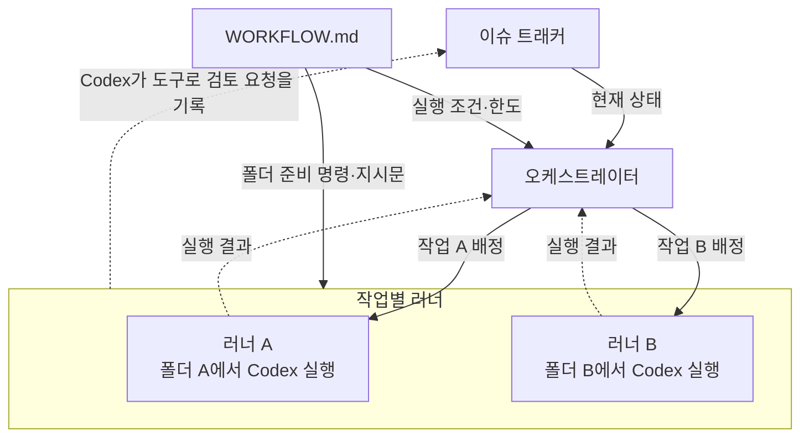
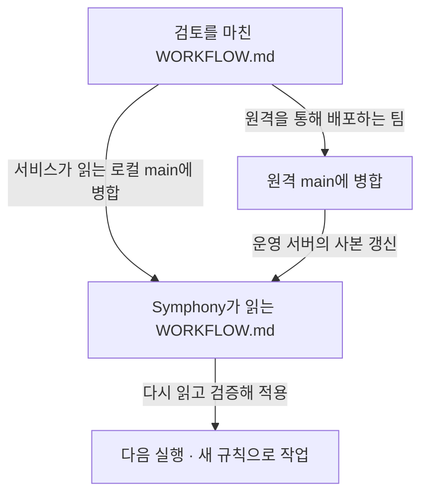

## TL;DR

- Symphony는 팀의 작업 보드에 올라온 일을 코딩 에이전트에 맡긴다.
- OpenAI는 사내에서 쓰던 방식을 독립된 명세로 공개했다.
- 팀마다 다른 검증과 인계 절차는 `WORKFLOW.md`에 담긴다.

## 시작하며

**OpenAI Symphony(심포니)는 개발팀의 작업 보드와 코딩 에이전트를 연결하는 오픈소스 프로젝트다.** 예를 들어 개발자가 Linear라는 업무 관리 도구에 버그를 등록하고 작업 대상으로 표시하면, Symphony가 별도의 작업 폴더를 마련해 Codex를 실행한다. 개발자는 보드에 올라온 코드 변경 링크와 테스트 결과를 보고 수정을 더 요청하거나 변경을 승인할 수 있다.[^1]

앞서 소프트웨어 팩토리를 다룬 글에서 Symphony를 여러 에이전트에 일을 나눠 주는 예로 짧게 소개했다.[^2] 당시 OpenAI 팀에서는 어느 작업이 끝났고 무엇이 중간에 멈췄는지 알려면 개발자가 Codex 대화창을 하나씩 열어 봐야 했다. 이 수고를 줄이려다 나온 도구가 Symphony다.[^1]

## 1. 사내 개발 실험에서 공개 명세가 되기까지

2025년 8월 말, OpenAI의 한 팀이 사내 생산성 도구를 만들면서 첫 커밋을 올렸다. 팀에는 ‘저장소의 모든 코드는 Codex가 작성한다’는 원칙이 있었다. 엔지니어는 Codex가 필요한 문서와 도구를 찾을 수 있게 저장소를 정리하고, 잘못 고쳤을 때 스스로 알아챌 수 있게 자동 검사를 갖췄다.[^3][^1]

팀의 회고에 따르면 개발자 한 사람이 무리 없이 챙길 수 있는 Codex 세션은 대개 3~5개였다. 그보다 많아지면 어느 창에서 무엇을 고치는지 잊거나, 중간에 멈춘 작업을 뒤늦게 발견했다. 팀은 이미 쓰고 있던 Linear 보드에서 에이전트가 직접 할 일을 가져가는 방식을 시험했다.[^1]

첫 버전은 터미널 세션을 계속 띄워 두는 도구인 `tmux` 안에서 돌아가는 Codex 세션 하나였다. 이 세션이 Linear를 주기적으로 확인하고 새 일이 들어오면 하위 에이전트를 띄웠다. 아이디어는 통했지만 안정적으로 운영하기는 어려웠다. 두 번째 버전은 에이전트용 도구와 테스트가 이미 갖춰진 사내 제품 저장소 안에 만들었다. 기본 기능이 돌아간 뒤에는 **Symphony를 개선하는 작업도 Symphony에 맡겼다.**[^1]

사내 시연에서는 에이전트가 작업을 처리하고, 완성된 기능이 실제로 동작하는 영상까지 티켓에 첨부하는 모습을 보여줬다. 시연 뒤 프로젝트 채널에 사람이 모였고 다른 팀들도 자발적으로 쓰기 시작했다. 이런 반응을 보고 개발팀은 Symphony를 회사 밖에도 공개하기로 했다.[^1]

개발팀은 사내 저장소에 의존하던 부분을 덜어내고 핵심 동작을 `SPEC.md`라는 **명세**로 정리했다. 이어 Codex에 이 명세를 주고 Elixir로 서비스를 만들게 했다. 공개 저장소에서 실행해 볼 수 있는 **참조 구현**이 이 프로그램이다.[^1]

## 2. 계속 실행되는 서비스와 작업마다 뜨는 Codex

Symphony는 Linear나 GitHub Issues 같은 **이슈 트래커**에서 팀이 맡긴 일과 진행 상태를 읽는다. 작업을 몇 개까지 동시에 실행할지, 에이전트에게 무엇을 시킬지는 팀이 코드 저장소의 **`WORKFLOW.md`**에 적어 둔다. 서비스는 시작할 때 지정한 경로에서 이 파일을 읽고 설정을 검증한다.[^4]

서비스 안에서 **오케스트레이터**는 어떤 작업을 언제 시작하고 멈출지 결정한다. 트래커마다 다른 이슈 형식은 연동 모듈인 어댑터가 같은 형식으로 바꿔 준다. 오케스트레이터가 일을 배정하면 **에이전트 러너**가 작업 폴더를 준비하고 그 안에서 Codex와 대화를 시작한다. 서로 다른 두 작업을 동시에 맡기면 같은 팀 규칙을 읽은 Codex 세션 둘이 각자 자기 폴더에서 코드를 고친다.[^4][^6]





**트래커**에는 팀이 보는 진행 상태가, **오케스트레이터의 메모리**에는 현재 실행 중인 작업과 재시도 예약이, **작업 폴더**에는 에이전트가 고친 파일이 있다. 사람이 트래커에서 작업을 취소하면 오케스트레이터는 그 변경을 읽어 실행을 멈춘다. 구현을 마친 Codex는 트래커 도구를 호출해 검토를 요청한다. 이 도구가 Symphony를 실행하는 호스트의 자격 증명으로 결과를 기록하면, 사람과 오케스트레이터가 같은 상태를 볼 수 있다.[^4][^7]

## 3. 팀의 개발 절차를 실행하는 WORKFLOW.md

OpenAI의 `WORKFLOW.md`에서 일부를 뽑아 보면, 맨 위 YAML 설정에 Codex가 맡을 Linear 상태 네 개와 동시 실행 한도 열 개가 적혀 있다.[^5]


```markdown
---
tracker:
  active_states: [Todo, In Progress, Merging, Rework]
agent:
  max_concurrent_agents: 10
---
You are working on a Linear ticket `{{ issue.identifier }}`
```


맨 아래 문장에서 러너는 실제 이슈 번호를 채워 Codex에 보낸다. 같은 프롬프트에 트래커에서 읽은 제목, 현재 상태, 설명도 채워 넣으므로 Codex는 어떤 동작을 고쳐야 하는지 알 수 있다. 본문에는 문제를 먼저 재현하고, 이슈 댓글 하나에 계획과 검사 결과를 갱신하고, 변경 검토 요청(PR)을 올리라는 지시가 이어진다. Codex는 검사와 리뷰 의견 처리를 마친 뒤 이슈를 `Human Review`로 옮긴다.[^5]

**`Human Review`는 위 설정의 활성 상태 목록에서 빠져 있다.** 그래서 Codex가 본문의 지시대로 검토를 요청하면 오케스트레이터는 해당 작업의 실행을 멈춘다. 사람이 수정을 요청해 `Rework`로 옮기면 다시 Codex가 작업할 수 있고, 병합을 승인해 `Merging`으로 옮기면 Codex는 그 상태에 지정된 병합 절차를 따른다.

## 4. 여러 세션을 돌리고 중단된 작업을 복구하는 방식

Elixir 구현의 `Orchestrator`는 배정할 때 참고하는 메모리 상태를 한곳에서 갱신한다. 매 조회 주기마다 먼저 실행 중인 작업을 트래커와 대조하고, 그다음 빈 자리에 새 일을 배정한다. 우선순위가 같으면 먼저 만들어진 일부터 고른다. 실행 중이거나 재시도를 기다리는 일은 이미 맡긴 것으로 표시해 한 이슈에 러너 둘이 붙는 것을 막는다. 명세의 기본 조회 간격은 30초이고, 앞의 OpenAI 예제는 이 값을 5초로 설정한다.[^4][^5][^6]

배정을 받은 러너는 작업 식별자에 대응하는 폴더를 만들거나 기존 폴더를 연다. 새 폴더에 무엇을 채울지는 `after_create`라는 훅, 즉 폴더를 처음 만들 때 실행할 명령에 달려 있다. OpenAI 예제에서는 이 훅이 Symphony 저장소 자체를 복제한다. 매 실행 전에 돌릴 명령은 `before_run`에 따로 둔다. 폴더가 준비되면 러너는 `codex app-server`를 실행한다. Symphony가 요청을 보내고 Codex의 응답과 실행 이벤트를 받는 모드다.[^5][^6]

테스트가 실패하면 그 출력은 **Codex**가 읽는다. Codex는 기대 동작과 어긋난 부분을 찾아 코드를 고치고 같은 검사를 다시 돌릴 수 있다. Codex가 한 번의 요청에 응답하면 러너가 같은 대화를 이어갈지 정한다. 러너 자체가 종료되면 **오케스트레이터**가 종료 사유와 마지막 세션 이벤트를 보고 재시도 여부를 결정한다.[^4][^6][^8]

| 무엇이 끝났나 | Symphony가 이어가는 방법 |
| --- | --- |
| Codex가 요청 하나에 대한 작업과 응답을 마쳤다 | 이슈가 여전히 실행 대상이고 턴 한도가 남으면 같은 대화에 다음 요청을 보낸다. 요청부터 응답까지가 한 턴이다. |
| 러너가 정상 종료했고 사람에게 요청한 입력이나 승인이 없다 | 1초 뒤 이슈를 다시 확인한다. 여전히 대상이고 자리가 있으면 같은 폴더에 **새 세션**을 연다. |
| 실행 오류로 러너가 종료됐다 | 사람의 응답을 기다리는 경우를 제외하고 재시도를 예약한다. 오류가 반복되면 간격을 10초, 20초, 40초처럼 늘린다. |
| 입력이나 승인이 필요하다고 기록된 상태에서 러너가 종료됐다 | 오케스트레이터가 그 이유를 기록하고 작업을 차단 상태로 둔다. 이 경우 재시도 타이머를 잡지 않는다. |
| Symphony 서비스 자체가 재시작됐다 | 메모리에 있던 세션과 타이머는 복구되지 않는다. 트래커를 다시 읽어 종료한 작업의 폴더를 정리하고, 여전히 맡길 일은 남아 있는 폴더에서 다시 시작할 수 있다. |

운영자가 특정 작업이 멈춘 이유를 찾을 때는 이슈 식별자와 세션 식별자가 담긴 로그를 따라간다. 참조 구현은 실행 중인 세션의 마지막 이벤트와 토큰 사용량, 재시도를 기다리는 작업도 보여 준다.[^6][^8]

## 5. 잉크버드에서 Symphony를 쓴다면

내가 만드는 영어 학습 앱 잉크버드(EncBird)는 검증한 변경을 기본 저장소의 로컬 `main`에 먼저 합치고, 원격 저장소에 올리거나 배포하려면 별도 요청을 받는다.

GitHub에 “저장한 영어 대화 연습의 제목을 바꾸고 싶다”는 이슈 600번이 올라왔다고 하자. GitHub 연동 모듈은 열린 상태와 닫힌 상태를 구분하므로, 이 팀은 열린 이슈 중 `symphony` 라벨이 붙은 것을 실행 대상으로 정한다. 팀은 `after_create`에서 기본 저장소의 로컬 `main`을 `GH-600` 폴더에 복제하고 작업 브랜치를 만들도록 설정할 수 있다. 러너가 이 폴더에서 Codex를 시작하면 아직 원격에 올리지 않은 변경까지 포함한 코드로 작업할 수 있다.[^9]

이 팀의 검토 대상은 **작업 폴더의 로컬 커밋**이다. 지시문에는 웹 앱의 타입 검사와 테스트, 빌드를 실행하고 이슈에 검사 결과와 커밋 번호를 남기도록 적는다. Codex가 마지막에 `symphony`를 `human-review` 라벨로 교체하면 실행 대상에서 빠지지만 작업 폴더는 남는다. 리뷰어는 그 폴더의 코드를 확인하고, 수정을 원하면 댓글을 남기고 라벨을 되돌린다. 승인하면 `GH-600` 밖의 기본 저장소에 변경을 합친 뒤 이슈를 닫는다. 종료된 작업의 폴더는 Symphony의 정리 대상이기 때문이다.[^4][^9]

## 6. 새 작업 규칙이 Symphony에 적용되는 시점

리뷰어가 매번 “화면을 다시 열어도 바꾼 제목이 남아 있나요?”라고 묻는다면, `WORKFLOW.md`에 제목을 저장한 뒤 화면을 다시 열어 확인한 결과까지 남기도록 적을 수 있다. 이 변경도 에이전트에 맡겨 리뷰를 받을 수 있다.

Codex가 고친 파일은 작업 폴더에 있다. Symphony가 읽는 것은 **서비스를 시작할 때 지정한 경로의 파일**이다. 잉크버드 예시에서 그 경로가 기본 저장소의 `WORKFLOW.md`라면, 검토한 변경을 로컬 `main`에 합칠 때 서비스가 읽는 파일도 바뀐다. 원격 저장소를 거쳐 별도의 운영 서버로 배포하는 팀이라면, 원격 `main`에 병합한 뒤 서버의 사본까지 갱신해야 한다.[^10]





호스트의 파일이 바뀌면 Symphony는 재시작 없이 설정과 지시문을 다시 읽는다. 지시문을 바꾸면 새 작업에 전달하는 내용이 달라지고, 동시 실행 한도를 바꾸면 이후 배정에 반영된다. `after_create`를 바꾸면 다음에 폴더를 만들 때 호스트가 실행할 명령도 달라진다. 이미 실행 중인 세션을 일괄 재시작할 필요는 없다. 파일을 다시 읽다가 오류가 나면 마지막 정상 설정을 보관하고 운영자에게 오류를 알린다.[^10]

제품 코드가 바뀌었다면 사용자에게 전달되는 시점은 제품의 배포 절차가 정한다. 오케스트레이터의 배정 알고리즘 자체를 고쳤다면 새 버전의 Symphony 서비스를 배포해야 한다. 팀의 검증·인계 규칙은 그 사이에서 독립적으로 바꿀 수 있다.

## 마치며

OpenAI의 회고에서 가장 흥미로웠던 건 PM과 디자이너가 Symphony를 쓰는 방식이다. 원하는 기능을 작업 보드에 적으면, 실제 제품에서 그 기능을 써 보는 영상이 검토 자료로 돌아온다.[^1] 기능을 요청한 사람이 Codex 세션을 열 줄 몰라도 “내가 원한 동작이 맞다”거나 “이 부분은 고쳐 달라”고 직접 말할 수 있다.

[^1]: Alex Kotliarskyi, Victor Zhu, Zach Brock, OpenAI. [An open-source spec for Codex orchestration: Symphony](https://openai.com/index/open-source-codex-orchestration-symphony/), 2026-04-27.
[^2]: [AWS Emulator로 배우는 소프트웨어 팩토리 구축](/2026/11/16/building-software-factory-with-aws-emulator.html)
[^3]: Ryan Lopopolo, OpenAI. [Harness engineering: leveraging Codex in an agent-first world](https://openai.com/index/harness-engineering/), 2026-02-11.
[^4]: OpenAI Symphony 명세 Draft v1 및 Elixir 참조 구현 (`be10a1b`). [전체 구조와 설계 목표](https://github.com/openai/symphony/blob/be10a1b79df723d6d7612b5651c8522704dafb2e/SPEC.md#3-system-overview), [배정과 재조정](https://github.com/openai/symphony/blob/be10a1b79df723d6d7612b5651c8522704dafb2e/SPEC.md#8-polling-scheduling-and-reconciliation)
[^5]: OpenAI Symphony. [Elixir 참조 구현의 WORKFLOW.md](https://github.com/openai/symphony/blob/be10a1b79df723d6d7612b5651c8522704dafb2e/elixir/WORKFLOW.md)
[^6]: OpenAI Symphony. [Orchestrator](https://github.com/openai/symphony/blob/be10a1b79df723d6d7612b5651c8522704dafb2e/elixir/lib/symphony_elixir/orchestrator.ex), [AgentRunner](https://github.com/openai/symphony/blob/be10a1b79df723d6d7612b5651c8522704dafb2e/elixir/lib/symphony_elixir/agent_runner.ex), [Workspace](https://github.com/openai/symphony/blob/be10a1b79df723d6d7612b5651c8522704dafb2e/elixir/lib/symphony_elixir/workspace.ex)
[^7]: OpenAI Symphony. [트래커 도구 호출과 인증](https://github.com/openai/symphony/blob/be10a1b79df723d6d7612b5651c8522704dafb2e/SPEC.md#105-approval-tool-calls-and-user-input-policy)
[^8]: OpenAI Symphony. [실행 로그와 상태 관찰](https://github.com/openai/symphony/blob/be10a1b79df723d6d7612b5651c8522704dafb2e/SPEC.md#13-logging-status-and-observability), [서비스 재시작 후 복구](https://github.com/openai/symphony/blob/be10a1b79df723d6d7612b5651c8522704dafb2e/SPEC.md#143-partial-state-recovery-restart)
[^9]: OpenAI Symphony. [GitHub Issues 어댑터](https://github.com/openai/symphony/blob/be10a1b79df723d6d7612b5651c8522704dafb2e/elixir/lib/symphony_elixir/github/adapter.ex), [이슈 식별자와 라벨](https://github.com/openai/symphony/blob/be10a1b79df723d6d7612b5651c8522704dafb2e/elixir/lib/symphony_elixir/github/client.ex)
[^10]: OpenAI Symphony. [워크플로 경로](https://github.com/openai/symphony/blob/be10a1b79df723d6d7612b5651c8522704dafb2e/SPEC.md#51-file-discovery-and-path-resolution), [동적 재적용](https://github.com/openai/symphony/blob/be10a1b79df723d6d7612b5651c8522704dafb2e/SPEC.md#62-dynamic-reload-semantics), [WorkflowStore](https://github.com/openai/symphony/blob/be10a1b79df723d6d7612b5651c8522704dafb2e/elixir/lib/symphony_elixir/workflow_store.ex)
