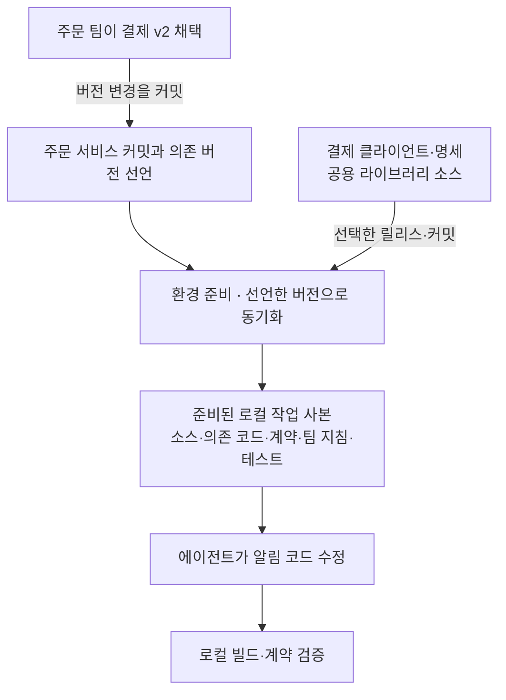
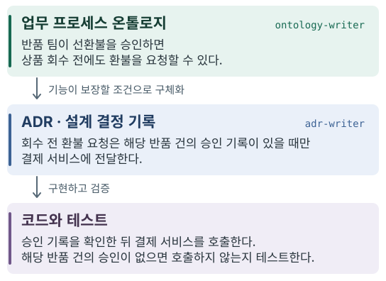
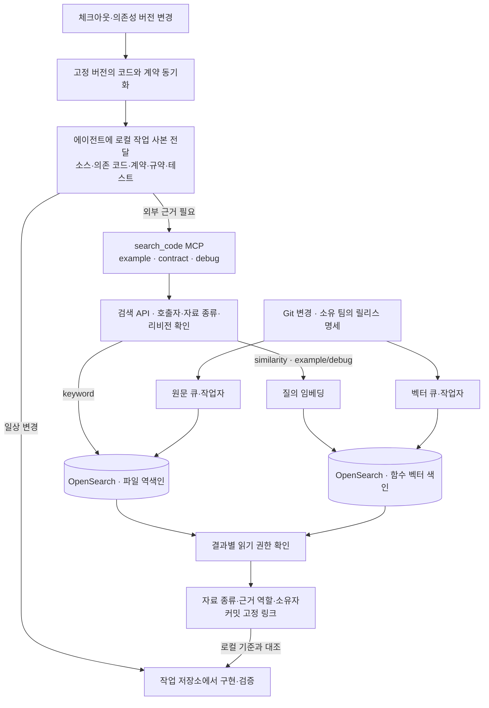

## TL;DR

- 개발에 필요한 코드와 계약은 에이전트에게 작업을 주기 전에 버전을 고정해 동기화한다.
- 일상적인 수정과 검증은 준비된 로컬 작업 사본에서 끝낸다.
- 전사 검색은 참고 사례, 계약 변경, 장애 조사가 필요할 때 호출한다.

## 시작하며

주문 서비스의 환불 알림을 고치는 에이전트가 작업할 때마다 결제 팀 저장소를 열고 최신 클라이언트 코드를 가져온다고 해보자. 어제 테스트한 주문 커밋을 오늘 다시 열어도, 결제 팀이 그사이 배포했다면 오늘 에이전트는 다른 코드를 읽게 된다. **어떤 코드에 맞춰 개발할지는 에이전트가 작업을 시작하기 전에 정해져 있어야 한다.**

내가 일하는 Amazon에서 우리 팀의 여러 구성요소는 한 저장소 안에 있지만, 우리 서비스가 의존하는 다른 팀의 코드는 그 팀의 저장소에서 독립적으로 바뀐다. [AX 개발팀 편](/2026/11/17/software-factory-team-tooling-runbook.html)에서는 한 팀이 코드와 테스트를 갖추고 검증 가능한 작업부터 에이전트에 맡기는 과정을 다뤘다. 여기서 관심 있는 것은 여러 저장소에 걸친 의존성을 가진 팀이 **코드까지 완결된 로컬 개발 환경**을 어떻게 준비하느냐는 점이다.

소프트웨어 팩토리에서는 코드를 공급하는 속도도 중요해진다. Anthropic은 모노레포에 병합하는 변경이 2026년 5월 하루 평균 약 2,500건에서 9월 하루 3만 건 이상으로 늘었고, CI의 코드 체크아웃만 하루 약 2,500만 회였다고 밝혔다. Anthropic은 이 부하를 감당하기 위해 자체 버전 관리 시스템 Scion을 만들어 5개월 만에 모노레포를 Git에서 옮겼다.[^1] 여러 팀이 따로 배포한다면 공급 속도와 함께 각 작업 사본에 어떤 버전을 담을지도 결정해야 한다.

## 0. 에이전트에게 넘기기 전에 작업 사본을 완성한다

도메인 주도 설계(DDD)의 바운디드 컨텍스트(BC)는 한 업무 모델과 용어가 일관된 뜻을 갖는 범위다. 이 경계에서 외부에 약속한 동작이 유지되면 제공 팀은 내부 구현을 고치고 독립적으로 배포할 수 있다.[^2] 같은 원칙을 개발 환경에도 적용할 수 있다. **어떤 시점의 BC를 체크아웃해 준비한 뒤에는, 그 작업 사본에 있는 코드·계약·팀 규약·테스트로 일상 변경을 설명하고 검증할 수 있어야 한다.** 한 저장소에 여러 BC가 있거나 한 BC의 코드가 여러 패키지에 나뉘어 있어도 마찬가지다.

준비할 때는 먼저 소비 팀의 커밋을 체크아웃한다. 이어 그 커밋의 잠금 파일이나 의존성 목록을 읽어 외부 패키지를 고정한 릴리스로 설치하고, 소스로 참조하는 외부 라이브러리는 지정한 커밋으로 가져온다. 예를 들어 주문 코드가 공용 금액 계산 라이브러리를 직접 호출한다면, 계산을 읽고 수정 결과를 검증하는 데 필요한 그 버전의 코드가 로컬에 있어야 한다. 네트워크로 호출하는 결제 서비스는 공개한 클라이언트와 API 명세, 계약 테스트나 테스트 대역을 같은 버전에 맞춰 준비한다.[^16]

오픈 소스 브라우저 프로젝트 Chromium에서는 이 준비 단계를 실제로 볼 수 있다. 브라우저 소스의 `DEPS`에 V8 같은 외부 Git 의존성의 주소와 커밋 해시를 기록한다. 개발자가 `gclient sync`를 실행하면 그 버전의 의존성 소스가 작업 디렉터리에 들어온다.[^19] 새 작업 사본을 만들거나 의존성을 올릴 때 이렇게 동기화해 두면, 이후에는 에이전트가 다음 파일을 읽을 때마다 원격 저장소를 조회할 이유가 없다.

예를 들어 주문 서비스가 결제 v1을 쓰고 있고 v2에 환불 완료 이벤트가 새로 생겼다고 하자. 아래에서 개발 환경으로 들어오는 것은 주문 팀이 고른 v1이다. 결제 팀의 새 배포만으로 그 입력이 바뀌지는 않는다.





확인 방법은 간단하다. 준비가 끝난 뒤 전사 검색을 끄고 “환불 완료 알림의 문구를 바꿔 달라”고 해본다. 에이전트가 주문 코드에서 호출하는 결제 클라이언트의 정의를 로컬에서 열고, 알림을 수정해 빌드할 수 있어야 한다. 결제 v1의 테스트 대역으로 ‘접수’에서는 보류하고 ‘완료’에서만 보내는지 확인할 수 있어야 한다. 여기서 클라이언트 소스나 명세를 매번 다시 받아야 한다면, 작업 환경 준비 단계에 그 항목을 넣을 일이다. 여러 팀의 서비스가 실제 배포 환경에서 함께 동작하는지는 별도의 통합 검증으로 확인한다.

## 1. Spotify는 변경 대상을 전사에서 찾고 각 저장소에 수정을 제안한다

Spotify가 2026년에 공개한 사례에서는 사용자 데이터셋 두 개가 새 버전으로 바뀌면서 기존 데이터를 직접 읽는 파이프라인 약 1,800개가 영향을 받았다. 데이터 팀은 사내 개발자 포털 Backstage에서 어떤 파이프라인이 두 데이터셋을 읽는지 확인하고, 코드 검색으로 수정할 저장소를 골랐다.[^3]

저장소를 찾고 나서도 문제가 하나 남았다. Spotify의 코딩 에이전트 Honk에 사람이 읽던 마이그레이션 가이드를 정리해 줬더니, 새 데이터셋의 어느 필드가 예전 필드에 대응하는지 잘못 짐작하는 경우가 있었다. 데이터 팀은 이전 필드와 새 필드의 대응표를 제공했다. 사용하는 팀의 업무 판단이 필요한 필드는 그대로 두고, 변경을 검토할 사람이 볼 가이드를 주석으로 남기게 했다.[^3]

Spotify는 이 방식으로 SQL 기반 파이프라인 저장소에 코드 변경을 제안하는 풀 리퀘스트(PR) 240건을 보냈다. 저장소별 구현 차이가 큰 Scala 기반 파이프라인은 Honk의 자동 수정 대상에서 제외했다. 전사 검색이 답해 준 것은 **어디를 바꿔야 하는가**였다. 각 저장소에서 코드를 제대로 바꿀 수 있게 해준 정보는 데이터 소유 팀이 작성한 두 버전 사이의 대응표였다.[^3]

## 2. Amazon에서 사내 검색으로 서비스를 찾으면 개발을 시작할 수 있는 이유

마이크로서비스 아키텍처(MSA)에서는 한 팀이 서비스를 책임지고 다른 팀은 공개된 인터페이스를 통해 그 서비스를 쓴다. 그래야 서비스 팀이 내부 구현을 고칠 때마다 사용하는 팀들까지 함께 배포할 필요가 없다.[^4]

내가 경험한 Amazon의 개발 방식에서는 이 책임 구분이 저장소에도 이어진다. 서비스를 제공하는 팀은 다른 팀이 참조할 코드와 계약을 버전별로 관리하고, 우리 팀 저장소에는 우리가 채택한 의존성 버전이 기록된다. 상대 팀이 새 버전을 내놓아도 우리 팀은 기존 계약이 지원되는 동안 그 계약으로 계속 개발할 수 있다.

내가 Amazon에서 쓰는 MCP(Model Context Protocol) 도구로는 사내 코드와 위키 같은 비정형 문서를 검색할 수 있다. 사내 코드 검색에는 문자열을 찾는 모드와 코드 자체를 임베딩해 비슷한 기능을 찾는 모드가 있다. 예를 들어 에이전트는 ‘환불 완료’로 문서를 검색해 결제 팀이 쓰는 이벤트 이름을 알아낼 수 있다. 이번에는 그 이름으로 코드를 검색하면 이벤트 정의와 이미 그 이벤트를 처리하고 있는 서비스의 테스트까지 찾아갈 수 있다. 처음부터 저장소나 함수 이름을 알고 있을 필요가 없다.

**Discover globally, understand locally**에서 전사 검색이 필요한 순간은 로컬 자료만으로 답할 수 없는 질문이 생겼을 때다. 예를 들어 비동기 작업을 기다리는 방법이 팀의 테스트 지침에 있으면 그대로 쓴다. 새로운 테스트 패턴을 정해야 한다면 다른 팀의 사례를 찾아볼 수 있다. 팀이 그 패턴을 채택하면 로컬 지침이나 린터에 남겨 다음 작업부터 바로 쓸 수 있게 한다.

Google은 사람이 수행한 코드 검색의 약 3분의 1이 다른 사람이 비슷한 일을 어떻게 했는지 살펴보는 데 쓰였다고 설명한다. 운영 장애를 조사할 때는 장애가 발생한 시점의 코드를 볼 수 있어야 한다고도 짚는다.[^17] 소프트웨어 팩토리에서도 이런 목적으로 검색을 쉽게 열 수 있어야 한다고 생각한다. 반대로 같은 구현을 고칠 때마다 외부 소스가 필요하다면, 먼저 작업 사본에서 빠진 의존 코드나 계약을 찾는 편이 낫다.

### 작업 저장소에서 에이전트가 읽는 자료

OpenAI에서 Codex로 제품을 개발하는 한 팀도 에이전트가 작업 중에 읽을 자료를 저장소에서 관리한다. 짧은 `AGENTS.md`는 필요한 문서의 위치를 안내한다. 설계 결정, 데이터베이스 스키마, 외부 도구의 참고 문서를 코드와 함께 버전 관리한다. 채팅에서 합의한 결정도 구현에 필요하면 저장소에 옮긴다. 에이전트가 어느 시점의 코드를 열든 그때의 결정과 코드를 함께 읽을 수 있게 하는 것이다.[^7]

Claude Code 팀은 에이전트가 작업 중에 읽을 코드를 **스스로 찾도록** 검색 도구를 설계했다고 설명한다. 사내 초기 버전에서는 코드베이스를 벡터로 미리 색인하고 매 응답 전에 관련 코드 조각을 Claude에게 건넸다. 팀이 `Grep` 도구를 도입하면서 Claude가 직접 검색어를 고르고, 일치하는 파일을 읽으며 필요한 문맥을 모을 수 있게 됐다.[^9]

OpenAI의 *Codex Prompting Guide*에서도 비슷한 설계 선택을 볼 수 있다. 내부 평가를 거쳐 다듬은 권장 프롬프트는 텍스트를 찾을 때 `rg`(ripgrep)를, 파일 목록을 얻을 때 `rg --files`를 우선하라고 지시한다. 별도 의미 검색 도구를 추가할 때는 모델에 익숙한 ripgrep의 출력과 구별되게 결과를 보여 주라는 조언도 있다.[^14]

두 사례에서 내가 주목한 점은 **에이전트가 작업 저장소의 원문에서 다음 단서를 찾는다는 것**이다. 주문 서비스에 환불 알림을 추가한다면 먼저 잠금 파일에서 결제 계약의 버전을 확인하고, 로컬 명세에 나온 이름으로 호출부와 테스트를 찾을 수 있다.

#### Cursor가 코드베이스 임베딩에서 로컬 grep으로 전환한 이유

Cursor는 에이전트의 코드 검색을 위해 저장소 전체를 미리 임베딩하던 방식을 중단했다. Cursor 팀은 모델이 grep으로 필요한 코드를 잘 찾게 되면서 별도 의미 검색 도구의 이점이 줄었다고 설명한다. 지금은 에이전트가 필요할 때 Instant Grep으로 작업 디렉터리를 검색하고 일치한 파일을 열어 원문을 읽는다.[^8]

Instant Grep의 **로컬 텍스트 색인**은 이때 에이전트가 파일을 훑느라 기다리는 시간을 줄여 준다. Cursor 팀은 대형 모노레포에서 `ripgrep` 호출 한 번이 15초를 넘기는 경우를 자주 관찰했다. 예를 들어 `Refund(Completed|Failed)`에 일치하는 문자열에는 모두 `Refund`가 들어간다. Instant Grep은 정규식에서 추출한 문자열 조각(sparse n-gram)을 로컬 색인에서 찾아 후보 파일을 좁힌 뒤, 그 파일의 원문에서 실제 일치를 확인한다.[^18]

색인은 Git 커밋을 기준으로 만들고, 사용자나 에이전트가 작업 중에 수정한 내용도 그 위에 반영한다. 그래서 에이전트가 테스트에 방금 추가한 `RefundCompleted`도 커밋하기 전에 로컬에서 찾을 수 있다.[^18]

## 3. MSA의 설계를 멀티레포 코드 관리에 적용하는 다섯 가지 원칙

주문 팀에서 ‘취소 완료’는 상품을 더 이상 보내지 않는다는 뜻일 수 있다. 결제 팀에서 ‘환불 완료’는 고객에게 돈을 돌려주는 처리가 끝났다는 뜻이다. DDD에서는 이렇게 업무 용어와 규칙이 일관된 뜻을 갖는 범위를 *바운디드 컨텍스트*라고 한다. 두 모델 사이에서 정보를 주고받을 때는 양쪽이 이해할 표현을 문서로 정의할 수 있다. DDD의 *Published Language* 패턴이다.[^2][^10]

결제 팀의 이벤트 명세가 두 팀 사이에서 이런 역할을 한다. 명세를 읽으면 주문 팀도 어떤 이벤트를 ‘환불 완료’로 받아들여야 하는지 알 수 있다. 결제 팀이 내부 상태를 더 잘게 나누더라도 이벤트가 약속한 의미를 유지하면, 주문 팀의 알림 코드는 그대로 동작한다.

MSA에서 서비스가 API를 통해 협업하듯, 여러 저장소에서 일하는 에이전트에게 필요한 지식도 같은 경계를 따라 전달할 수 있다. 주문과 결제에 적용하면 다섯 가지로 정리된다.

1. **각 바운디드 컨텍스트가 자기 도메인 지식을 소유한다.** 주문 취소가 언제 성립하는지는 주문 팀이, 환불이 언제 완료되는지는 결제 팀이 정의하고 관리한다.
2. **각 저장소에서 그 서비스의 동작을 이해하고 독립적으로 개발할 수 있어야 한다.** 주문 저장소에 해당 버전의 결제 계약을 설치하면, 결제 팀의 개발 환경을 따로 구성할 필요 없이 주문 코드에서 고객 알림 조건을 수정하고 테스트할 수 있어야 한다.
3. **다른 저장소에는 필요한 지식만 명시적인 인터페이스로 공개한다.** 결제 팀은 환불 상태와 이벤트의 의미를 API 명세에 담는다. 내부 테이블 구조는 결제 팀 안에서 바꿀 수 있다.
4. **중앙 카탈로그는 지식의 위치, 소유자, 관계를 관리한다.** 카탈로그 항목도 같은 도구로 검색할 수 있게 두면, ‘환불’로 결제 팀의 명세 위치와 이를 사용하는 주문 서비스를 찾을 수 있다. 환불 상태의 정의는 결제 팀이 원문에서 관리한다.
5. **환경을 준비할 때 필요한 버전의 원문을 동기화한다.** 주문 팀은 클라이언트와 공용 라이브러리 버전을 잠금 파일(lockfile)에 고정한다. 따로 배포하지 않는 명세나 소스는 커밋을 고정한다. 에이전트는 이렇게 준비된 파일을 읽는다.

주문 팀이 결제 v2의 환불 완료 이벤트를 검색에서 발견해도, v1에만 연동한 주문 코드가 그 이벤트를 기다리면 고객에게 알림이 가지 않는다. 이벤트 방식으로 옮기는 날에는 결제 팀이 해당 환경에서 v2를 지원하는지 확인하고, 주문 저장소의 버전 선언을 바꿔 새 클라이언트와 명세를 동기화한 뒤 알림 코드와 테스트를 함께 바꾼다.

## 4. 업무 프로세스는 현업의 언어로 미리 정리한다

결제 명세를 읽으면 환불을 어떻게 요청하는지 알 수 있다. 그런데 반품 상품을 회수하기 전에 고객에게 돈을 돌려줘도 되는지는 누가 정할까? 코드에서 회수 전에 환불을 요청하는 경로를 찾았다고 해도, 현업이 승인한 예외인지 회수 확인을 빠뜨린 버그인지는 코드만 보고 결정하기 어렵다.

그래서 나는 선환불처럼 여러 업무 단계에 걸친 규칙은 현업과 먼저 정리해 두는 편이 좋다고 생각한다. 업무 개념과 그 관계를 기록한 모델을 온톨로지라고 한다. 반품 팀이 ‘선환불 승인’이라고 부르는 결정을 그 이름으로 기록하고, 누가 승인하며 그 뒤에 어떤 일을 할 수 있는지 연결한다. DDD의 **유비쿼터스 언어**를 이렇게 쓰면, 에이전트는 요구사항에 적힌 ‘선환불 승인’을 그대로 검색해 규칙 원문을 읽을 수 있다. ‘선환불 요청’과 ‘선환불 승인’의 뜻을 구분해 놓은 모델을 다시 임베딩할 필요도 없다.

### 업무 프로세스에서 코드까지 이어지는 세 계층

내가 생각하는 지식 구조에서 맨 위에는 업무 프로세스를 담은 온톨로지가 있다. 그 아래 ADR(Architecture Decision Record, 설계 결정 기록)에는 업무 규칙을 지키기 위해 선택한 설계와 그 이유, 기능이 보장해야 할 동작을 적는다. 맨 아래에서는 코드로 그 동작을 구현하고 테스트로 확인한다.

{: .diagram-image }

예를 들어 회수 전에 환불을 요청할 때, 다른 반품 건에 대한 승인이 있어도 그 요청을 통과시켜서는 안 된다. 이 조건을 ADR에 남기면, 승인 기록을 조회하는 라이브러리를 바꾸더라도 같은 테스트로 확인할 수 있다. 반품 팀이 선환불 자체를 폐지한다면 그때는 온톨로지의 업무 규칙부터 고치고 관련 ADR과 구현을 바꾼다.

### 업무 모델을 공유하고 필요한 깊이까지 읽기

반품 팀은 자기 저장소에 Turtle(`.ttl`) 파일을 두고 업무 온톨로지의 버전을 관리할 수 있다. 업무 개념과 관계를 텍스트로 기록하는 데는 이 형식으로 충분하다.[^11]

여러 팀이 전사 공용 저장소에 온톨로지를 함께 두더라도 **선환불 조건을 정하고 그 규칙의 변경을 승인하는 주체는 반품 팀**이다. 이 규칙을 쓰는 팀은 처음 연동하거나 규칙이 개정됐을 때 원본을 찾고, 일상적인 구현에서는 자기 저장소에 기록한 버전을 따른다.

프로세스가 복잡해지면 나는 C4 모델의 **같은 대상을 다른 배율로 보는 방식**을 빌리는 편이 낫다고 생각한다. C4가 시스템 전체에서 구성요소로 시야를 좁히듯, 업무 개요에서는 반품·물류·결제 팀이 어디서 일을 주고받는지 본다. 선환불을 바꾸는 사람은 그중 반품 절차를 펼쳐 승인 주체와 회수 전 환불을 허용하는 조건까지 읽는다. 이 확대는 맨 위 온톨로지 안에서 일어난다.[^12]

내가 만든 `ontology-writer`와 `adr-writer` 플러그인에 이 구조를 구현해 두었다. `ontology-writer`는 프로젝트의 `docs/ontology/` 아래에 업무 모델을 Turtle로 저장하고, 구현이 필요한 업무 단계를 해당 기능의 ADR과 연결한다. `adr-writer`는 `docs/adr/`에 기능이 지켜야 할 조건과 설계 근거를 기록하고, `/adr-impl`에서 그 조건에 맞춰 구현하고 테스트한다. 여러 기능이 한 업무 절차로 동작하는지는 `ontology-writer`의 `/ontology-align`에서 확인한다.[^13]

## 5. 로컬에서 풀리지 않는 질문을 위한 전사 검색

계약을 처음 도입하거나 바꿀 때는 소유 팀의 공개 명세를, 관행을 참고할 때는 다른 팀의 예제를, 장애를 추적할 때는 실제 배포 커밋의 소스를 찾아야 한다. 이 세 경우를 한 도구로 지원하는 설계를 생각해볼 수 있다.

### GitHub가 전수 검색 비용을 계산한 이유

에이전트가 작업 디렉터리에서 `ripgrep`으로 문자열을 찾을 수 있다면, 전사 검색도 저장소마다 같은 명령을 돌리면 될까? GitHub는 2023년 코드 검색 베타에서 이 비용을 계산했다. 8코어 Intel 장비에서 메모리에 캐시된 13GB 파일 전체를 정규식으로 검색하는 데 2.769초가 걸렸다. 코어 하나당 초당 약 0.6GB를 읽는 속도다.[^15]

GitHub는 이 측정값을 당시 검색 대상인 115TB에 대입했다. 코드 전체가 메모리에 있고 64코어 서버 32대가 일을 완벽하게 나눠도, 질의 한 건이 **2,048개 코어를 약 96초 동안** 점유한다는 추산이었다. 클러스터 전체로 초당 약 0.01건을 처리하는 셈이어서, 한 사람이 검색하는 동안 다른 사람은 기다려야 한다.[^15]

GitHub의 자체 코드 검색 엔진 Blackbird는 코드에서 색인할 문자열 조각(n-gram)을 고르고, 조각별로 그 조각이 등장하는 파일 목록을 만든다. 검색어를 이루는 조각들의 목록을 대조하면 원문을 확인할 후보 파일이 줄어든다.[^15] 사내 검색에도 이 원리를 적용할 수 있다. 전사에서는 텍스트 색인으로 관련 파일을 좁히고, 로컬에서는 에이전트가 작업 저장소에 고정된 버전의 원문을 직접 검색한다. 키워드를 찾는 이 경로에는 임베딩이 필요 없다.

### OpenSearch로 키워드·유사도 검색을 제공하는 MCP 도구

Amazon의 사내 도구인 Builder MCP에서 아이디어를 빌려, 에이전트에는 `search_code` 하나를 제공하고 뒤의 검색 서비스가 OpenSearch를 조회하도록 설계할 수 있다. 호출 여부는 에이전트가 로컬에서 무엇을 확인했는지에 달려 있다. 주문 코드와 채택한 결제 계약, 팀 지침과 테스트로 답을 낼 수 있으면 MCP를 호출하지 않고 변경을 끝낸다. 밖에서 자료를 찾아야 할 때는 **검색 방식**과 **찾는 목적**을 구분해서 넘긴다. 다음은 제안하는 도구의 호출·응답 조건이다.[^5]

| `purpose` | 전사 검색이 필요한 상황 | 결과를 쓰는 방법 |
| --- | --- | --- |
| `example` · 참고 사례 | 다른 팀이 중복 알림을 어떻게 테스트하는지, 공통 라이브러리를 어떤 패턴으로 사용하는지 보고 싶다. | 코드·테스트·가이드는 참고 자료다. 적용 여부는 우리 팀 지침, 린터, 테스트로 결정한다. |
| `contract` · 계약 확인 | 처음 연동할 서비스를 찾거나 의존 계약을 v1에서 v2로 올린다. | 최초 연동은 담당 팀이 공개한 명세에서 지원 버전을 고른다. 업그레이드는 기존 로컬 명세와 목표 버전의 명세·변경 기록을 비교한다. 두 경우 모두 선택한 계약으로 테스트한다. |
| `debug` · 장애 조사 | v1 계약대로 호출했는데 응답이나 이벤트가 예상과 다르고, 로컬 로그와 테스트만으로 원인을 설명할 수 없다. | 실제 배포 기록이나 실행한 패키지에서 확인한 커밋의 구현을 읽는다. 발견한 동작이 명세와 다르면 담당 팀에 재현 사례를 전달한다. 그 동작을 새 규칙으로 채택하려면 별도의 계약 변경이 필요하다. |

`mode=keyword`는 파일 역색인에서 코드·문서의 단어나 식별자를 찾는다. `mode=similarity`는 함수 본문 벡터 색인에서 자연어로 설명한 동작에 가까운 함수를 찾는다. 공개 계약은 `keyword`로 찾고, 제공 팀이 릴리스에 등록한 명세·변경 기록과 소유 정보를 함께 색인한다. 다른 팀이 테스트에서 우연히 같은 필드를 썼다고 해서 그 테스트가 계약 검색 결과에 올라오지는 않는다.





#### 목적을 정하고 호출하기

주문 팀이 채택한 결제 v2 명세에는 환불 완료 이벤트 이름이 `RefundCompleted`라고 적혀 있다. 주문 팀의 설계 결정 기록(ADR)에는 같은 이벤트가 두 번 와도 고객 알림은 한 번만 보낸다는 조건이 있다. 로컬 테스트에 중복 전달을 재현한 예가 없어서, 다른 팀은 이 상황을 어떻게 테스트하는지 보고 싶다고 하자. 다음은 에이전트가 MCP의 `tools/call`에 보내는 두 호출의 인자다.

```json
{
  "name": "search_code",
  "arguments": {
    "purpose": "example",
    "mode": "similarity",
    "query": "같은 이벤트가 두 번 전달돼도 고객 알림을 한 번만 보내는 처리"
  }
}
```

첫 응답에서 알림 팀의 `notifications` 저장소에 있는 `notifyOnce` 함수를 찾았다면, 그 이름으로 해당 팀의 테스트 파일만 검색한다. 테스트가 중복 전달을 재현하는 방식은 참고하고, 주문 코드가 무엇을 보장해야 하는지는 주문 팀의 ADR로 검증한다.

```json
{
  "name": "search_code",
  "arguments": {
    "purpose": "example",
    "mode": "keyword",
    "query": "notifyOnce",
    "repo": "notifications",
    "path_glob": "**/*.test.ts"
  }
}
```

같은 이름을 찾더라도 목적이 바뀌면 읽을 자료가 달라진다. 아직 v1을 쓰는 팀이 v2로 전환할 때는 `purpose=contract`로 결제 팀의 v2 릴리스에 해당하는 `repo`와 `revision`을 지정한다. 장애를 조사할 때는 `purpose=debug`로 관측한 배포의 저장소와 커밋을 **모두** 지정한다. 소비 팀이 고정한 API 버전과 제공 서비스의 배포 커밋은 다를 수 있다.

`ref`는 탐색할 브랜치이고 `revision`은 정확한 Git 커밋이다. 둘 중 하나만 지정한다. 어느 쪽도 지정하지 않으면 접근 가능한 저장소의 기본 브랜치를 검색한다. 커밋을 지정하지 않은 계약 검색은 탐색 후보만 돌려준다. 커밋을 지정한 계약 검색은 그 시점에 소유 팀이 공개한 명세와 변경 기록만 반환한다. 변경 기록은 바뀐 곳을 찾는 단서이고, 보장하는 동작은 공개 명세에서 확인한다.

검색 서비스는 저장소·커밋별로 해당 목적과 모드가 읽을 자료까지 색인이 끝났는지 확인한다. 예전 배포의 API 명세만 보관했다면 같은 커밋의 계약 검색은 가능해도 구현을 조사하는 `debug` 검색에는 `revision_not_indexed`와 빈 결과를 반환한다. 에이전트는 그 커밋을 체크아웃해 직접 확인할 수 있다. 해당 범위를 모두 검색하고도 일치 항목이 없을 때만 `ok`와 빈 결과를 돌려준다.

검색 결과에는 파일·줄 범위·코드 일부·커밋 고정 링크와 함께 `owner`, `source_kind`, `evidence_role`을 담는다. 같은 코드 한 줄도 예제 검색에서는 참고 사례이고, 장애 검색에서는 해당 리비전의 진단 근거다. 결과 수와 코드 길이를 제한하고 다음 페이지는 커서로 요청한다. 필수 인자와 결과 형식은 [MCP 도구 명세(JSON)](/assets/specs/enterprise-code-search-mcp.json)에 정리했다.

#### 커밋과 권한 변경을 검색에 반영하는 방법

에이전트가 잘못된 결론을 내리기 쉬운 순간은 방금 추가한 심볼을 찾았는데 결과가 0건일 때다. 코드가 실제로 없는 것인지, 그 브랜치를 색인하지 않는지, 작업이 밀린 것인지 알 수 있어야 한다. 다음은 이런 차이를 드러내는 운영안이다.

| 상황 | 제안하는 처리 방식 |
| --- | --- |
| 소유 팀의 릴리스 | 릴리스의 버전·커밋과 소유 팀이 공개한 계약 파일 목록을 기록한다. 배포 중이거나 소비 팀이 지원하는 릴리스의 명세와 변경 기록은 커밋을 지정해 검색할 수 있게 보관한다. |
| 새 저장소와 일반 push | 기본 브랜치와 지원 중인 릴리스 브랜치를 처음에 한 번 일괄 색인한다. 이후 push를 받을 때마다 마지막으로 반영한 커밋과의 차이만 큐에 넣는다. 원문 작업자는 바뀐 파일을 쓰고, 벡터 작업자는 새 함수나 본문이 달라진 함수를 임베딩한다. |
| 이동·삭제·줄 번호 변경 | 임베딩 입력과 모델 버전이 같으면 벡터를 재사용한다. 파일 이동이나 앞부분 편집으로 위치가 달라졌다면 결과의 커밋·경로·줄 범위를 새 소스에 맞게 갱신한다. 옛 경로와 삭제된 파일·함수의 항목은 두 색인에서 정리한다. |
| 누락·중복·순서 역전 | 브랜치별로 마지막 성공 커밋을 기록하고, 커밋마다 모드와 자료 범위(릴리스 자료·소스)의 색인 완료 여부를 따로 남긴다. 예를 들어 매일 밤 Git의 실제 브랜치 끝과 대조해 누락된 변경이나 삭제를 복구한다. 같은 이벤트를 다시 처리해도 결과는 같아야 하고, 늦게 끝난 이전 작업이 최신 색인을 덮어쓰지 못하게 한다. |
| 읽기 권한 회수 | 권한 변경도 별도 이벤트로 받아 검색 후보 필터를 갱신한다. 결과를 반환할 때는 원본 저장소의 현재 읽기 권한을 다시 확인한다. 읽기 권한이 없는 후보는 제외하고, 권한 서비스가 응답하지 않으면 검색 결과 대신 오류를 반환한다. 다음 페이지 커서도 호출자와 질의에 묶는다. |
| 반영 지연·부분 실패 | 원문과 벡터 갱신의 큐와 작업 용량을 분리한다. 임베딩이 밀려도 키워드 검색은 계속 제공한다. 특정 브랜치 검색에는 해당 모드의 마지막 색인 커밋과 시각을 표시한다. 일부 검색이 시간 초과됐으면 부분 결과임을 알리고, 미색인 브랜치도 구분해 응답한다. |

일시적인 색인 실패는 간격을 늘려 재시도하고, 반복해서 실패하는 작업은 별도 큐에 보관해 원인을 고친 뒤 재처리한다. 임베딩 모델을 교체할 때는 기존 모델로 검색을 제공하면서 새 벡터 색인을 채운 뒤, 질의 모델과 색인을 함께 전환한다.

파일럿에서는 예를 들어 **지원 브랜치 push의 95%가 2분 안에 키워드 검색에 보이는지**를 첫 목표로 삼을 수 있다. push를 받은 시점부터 실제 검색에서 추가한 줄이 나타나거나 삭제한 줄이 사라질 때까지 잰다. 유사도 모드도 검색 반영 시간을 따로 재고, 큐에서 가장 오래 기다린 작업의 대기 시간을 확인한다. 두 모드에 얼마를 투자할지는 키워드로 놓친 실제 질의에서 유사도 검색이 필요한 함수를 얼마나 더 찾아주는지 보고 정한다. 이미 채택한 같은 계약을 여러 작업에서 계속 검색한다면, 그 버전의 명세를 설치 단계에서 빠뜨렸는지도 확인한다.

## 마치며

내가 소프트웨어 팩토리에서 먼저 확인하고 싶은 것은 **같은 커밋으로 작업 사본을 다시 만들었을 때 에이전트가 같은 코드로 빌드하고 같은 테스트를 실행할 수 있는가**다. 주문 팀이 결제 v1을 고정했다면 결제 팀이 오늘 v2를 배포해도 내일의 주문 빌드는 여전히 v1을 사용해야 한다.

일상적인 개발은 그렇게 준비한 로컬 환경에서 끝낸다. 다른 팀의 컨벤션을 비교하거나, 새 계약을 채택하거나, 장애가 난 버전의 구현을 확인해야 할 때는 전사 검색에서 해당 원문으로 바로 갈 수 있게 한다. 외부 검색이 매 작업의 필수 단계가 되면 작업 사본에서 어떤 코드가 빠졌는지부터 돌아볼 일이다.

[^1]: Anthropic, [Redesigning source control at Anthropic](https://www.anthropic.com/research/redesigning-source-control).
[^2]: Microsoft Azure Architecture Center, [DDD로 마이크로서비스의 경계와 관계 설계하기](https://learn.microsoft.com/en-us/azure/architecture/microservices/model/domain-analysis).
[^3]: Spotify Engineering, [Background Coding Agents: Supercharging Downstream Consumer Dataset Migrations](https://engineering.atspotify.com/2026/4/background-coding-agents-dataset-migrations-honk-part-4).
[^4]: AWS, [마이크로서비스의 독립 배포와 인터페이스](https://aws.amazon.com/microservices/), [Amazon 서비스 팀의 소유권](https://aws.amazon.com/executive-insights/content/amazon-two-pizza-team/).
[^5]: MCP, [도구 호출 규약](https://modelcontextprotocol.io/specification/2025-11-25/server/tools). OpenSearch, [원문 질의](https://docs.opensearch.org/latest/query-dsl/full-text/index/), [벡터 근접 검색](https://docs.opensearch.org/latest/query-dsl/specialized/k-nn/index/), [일괄 쓰기](https://docs.opensearch.org/latest/api-reference/document-apis/bulk/), [쓰기와 검색 반영 시점](https://docs.opensearch.org/latest/api-reference/index-apis/refresh/).
[^7]: OpenAI, [Harness engineering: leveraging Codex in an agent-first world](https://openai.com/index/harness-engineering/).
[^8]: [Cursor 팀의 검색 방식 설명](https://forum.cursor.com/t/codebase-indexing-not-working-in-v-3-12-onwards/167527/7)과 [현재 Cursor 검색 문서](https://cursor.com/docs/agent/tools/search).
[^9]: Anthropic, [Seeing like an agent: how we design tools in Claude Code](https://claude.dev/blog/seeing-like-an-agent/)의 “Designing a search interface”.
[^10]: [개발팀에 에이전틱 엔지니어링 도입하기](/2026/11/17/software-factory-team-tooling-runbook.html).
[^11]: W3C, [RDF 1.1 Turtle](https://www.w3.org/TR/turtle/).
[^12]: [쉽게 설명한 C4Model](/2022/12/17/demystifying-c4model.html), Simon Brown, [C4 모델의 다이어그램과 확대 수준](https://c4model.com/diagrams).
[^13]: 내가 만든 [ontology-writer](https://github.com/haandol/alps-writer-plugins/blob/757049099990adfb4418238711d22dbe19bcbf22/plugins/ontology-writer/README.md)와 [adr-writer](https://github.com/haandol/alps-writer-plugins/blob/757049099990adfb4418238711d22dbe19bcbf22/plugins/adr-writer/README.md).
[^14]: OpenAI, [Codex Prompting Guide](https://developers.openai.com/cookbook/examples/gpt-5/codex_prompting_guide)의 “Recommended Starter Prompt”와 “Other Custom Tools”.

[^15]: Timothy Clem, [The technology behind GitHub’s new code search](https://github.blog/engineering/architecture-optimization/the-technology-behind-githubs-new-code-search/), GitHub Engineering (2023).
[^16]: Pact, [계약 테스트로 소비자와 제공자의 상호작용 검증하기](https://docs.pact.io/).
[^17]: Google, [Software Engineering at Google, Code Search](https://abseil.io/resources/swe-book/html/ch17.html).
[^18]: Cursor, [빠른 정규식 검색: Agent 도구를 위한 텍스트 인덱싱](https://cursor.com/ko/blog/fast-regex-search).
[^19]: Chromium, [Managing Chromium dependencies](https://chromium.googlesource.com/chromium/src/+/main/docs/dependencies.md).
