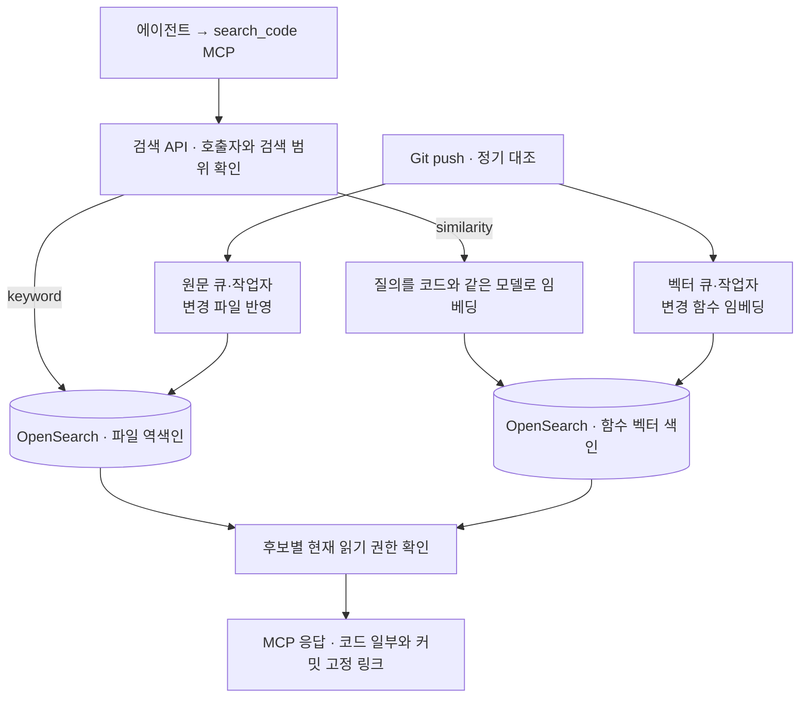
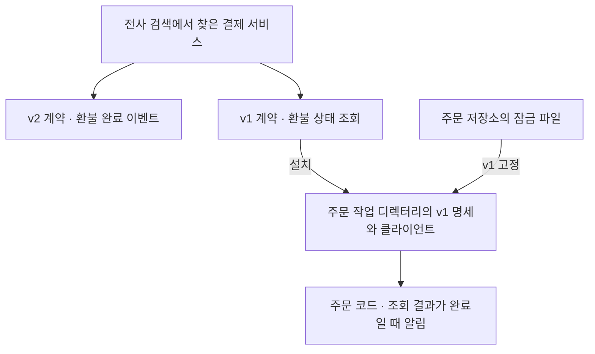

## TL;DR

- 에이전트는 전사 저장소의 코드와 문서를 원문 검색으로 탐색한다.
- 구현할 때는 우리 저장소가 채택한 버전의 계약을 읽는다.
- 업무 프로세스는 현업이 쓰는 언어로 미리 정리한다.

## 시작하며

Anthropic의 모노레포에 병합된 코드 변경은 2026년 5월 하루 평균 약 2,500건에서 9월 하루 3만 건 이상으로 늘었다. CI가 빌드와 테스트를 위해 코드를 체크아웃하는 횟수만 하루 약 2,500만 회였다. 수백 개의 Git 미러를 운영해도 늘어나는 부하를 감당하기 어려워지자, Anthropic은 자체 버전 관리 시스템 Scion을 만들어 5개월 만에 모노레포를 Git에서 옮겼다.[^1]

에이전트가 요구사항을 받아 구현하고 테스트하는 소프트웨어 팩토리에서는 코드 작성이 빨라진 만큼, 변경을 병합하고 테스트할 코드를 제때 공급하는 일도 개발 속도를 좌우한다.

[AX 개발팀 편](/2026/11/17/software-factory-team-tooling-runbook.html)에서는 한 팀이 코드와 계약, 테스트를 갖추고 검증 가능한 작업부터 에이전트에 맡기는 과정을 다뤘다. 여러 팀이 별도 저장소에서 일하면 코드 관리에 한 가지 질문이 더 생긴다. **에이전트에게 어느 버전의 코드를 건넬 것인가?**

Amazon에서 우리 팀은 여러 구성요소를 한 저장소에서 관리한다. 그런데 우리 서비스가 의존하는 다른 팀의 코드는 그 팀의 저장소에서 독립적으로 바뀐다. 팀 안에서는 모노레포여도 이 서비스들을 함께 놓고 보면 조직의 코드베이스는 멀티레포다. 예를 들어 주문 서비스의 결제 호출부를 고치려면 주문 팀이 어떤 버전의 결제 API를 쓰는지 알아야 한다.

도메인 주도 설계(DDD)에서는 업무 모델의 경계를 정하고, 그 경계를 넘어 어떤 정보를 주고받을지 명시한다. 이 원칙으로 마이크로서비스를 설계하면, 한 팀이 외부에 약속한 동작을 유지하는 한 내부 구현을 고쳐도 다른 팀이 함께 코드를 바꿀 필요가 없다.[^2]

이 원칙을 코딩 에이전트의 작업에 적용하면 **Discover globally, understand locally**라고 표현할 수 있다. 여기서 *discover globally*는 회사의 모든 저장소에 있는 코드와 문서의 본문을 텍스트로 검색한다는 뜻이다. 검색어가 나오는 원문을 찾는 데는 텍스트의 의미를 숫자 벡터로 표현하는 임베딩 작업이 필요하지 않다. *Understand locally*는 검색으로 찾은 서비스와 연동할 때, 우리 저장소가 채택한 버전의 계약과 코드를 읽고 구현을 결정한다는 뜻이다.

## 1. Spotify는 변경 대상을 전사에서 찾고 각 저장소에 수정을 제안한다

Spotify가 2026년에 공개한 사례에서는 사용자 데이터셋 두 개가 새 버전으로 바뀌면서 기존 데이터를 직접 읽는 파이프라인 약 1,800개가 영향을 받았다. 데이터 팀은 사내 개발자 포털 Backstage에서 어떤 파이프라인이 두 데이터셋을 읽는지 확인하고, 코드 검색으로 수정할 저장소를 골랐다.[^3]

저장소를 찾고 나서도 문제가 하나 남았다. Spotify의 코딩 에이전트 Honk에 사람이 읽던 마이그레이션 가이드를 정리해 줬더니, 새 데이터셋의 어느 필드가 예전 필드에 대응하는지 잘못 짐작하는 경우가 있었다. 데이터 팀은 이전 필드와 새 필드의 대응표를 제공했다. 사용하는 팀의 업무 판단이 필요한 필드는 그대로 두고, 변경을 검토할 사람이 볼 가이드를 주석으로 남기게 했다.[^3]

Spotify는 이 방식으로 SQL 기반 파이프라인 저장소에 코드 변경을 제안하는 풀 리퀘스트(PR) 240건을 보냈다. 저장소별 구현 차이가 큰 Scala 기반 파이프라인은 Honk의 자동 수정 대상에서 제외했다. 전사 검색이 답해 준 것은 **어디를 바꿔야 하는가**였다. 각 저장소에서 코드를 제대로 바꿀 수 있게 해준 정보는 데이터 소유 팀이 작성한 두 버전 사이의 대응표였다.[^3]

## 2. Amazon에서 사내 검색으로 서비스를 찾으면 개발을 시작할 수 있는 이유

마이크로서비스 아키텍처(MSA)에서는 한 팀이 서비스를 책임지고 다른 팀은 공개된 인터페이스를 통해 그 서비스를 쓴다. 그래야 서비스 팀이 내부 구현을 고칠 때마다 사용하는 팀들까지 함께 배포할 필요가 없다.[^4]

내가 경험한 Amazon의 개발 방식에서는 이 책임 구분이 저장소에도 이어진다. 서비스를 제공하는 팀은 다른 팀이 참조할 코드와 계약을 버전별로 관리하고, 우리 팀 저장소에는 우리가 채택한 의존성 버전이 기록된다. 상대 팀이 새 버전을 내놓아도 우리 팀은 기존 계약이 지원되는 동안 그 계약으로 계속 개발할 수 있다.

내가 Amazon에서 쓰는 MCP(Model Context Protocol) 도구로는 사내 코드와 위키 같은 비정형 문서를 검색할 수 있다. 사내 코드 검색에는 문자열을 찾는 모드와 코드 자체를 임베딩해 비슷한 기능을 찾는 모드가 있다. 예를 들어 에이전트는 ‘환불 완료’로 문서를 검색해 결제 팀이 쓰는 이벤트 이름을 알아낼 수 있다. 이번에는 그 이름으로 코드를 검색하면 이벤트 정의와 이미 그 이벤트를 처리하고 있는 서비스의 테스트까지 찾아갈 수 있다. 처음부터 저장소나 함수 이름을 알고 있을 필요가 없다.

나는 **모든 저장소의 코드와 문서를 한 도구로 검색할 수 있으면 에이전트가 대부분의 개발 문제를 풀 수 있을 것**이라고 생각한다. 에이전트는 원문을 읽으면서 검색어를 바꿀 수 있고, 구현에 쓸 버전은 작업 저장소에서 확인할 수 있기 때문이다. 처음 연동하는 서비스라면 사용할 버전을 골라 기록하고, 이미 쓰는 서비스라면 로컬에 설치된 버전의 계약과 코드를 읽는다.

### OpenSearch로 키워드·유사도 검색을 제공하는 MCP 도구

Builder MCP의 코드 검색에서 참고할 만한 점은 에이전트가 검색 방식을 고르고, 실제 색인 조회는 뒤의 검색 서비스에 맡긴다는 것이다. 사내 검색 도구로는 두 모드를 고를 수 있는 `search_code` 하나를 권한다. 함수명이나 오류 문자열을 알면 `keyword`, 하는 일만 알면 `similarity`를 고른다. 기본 검색 범위는 각 저장소의 기본 브랜치다. 필요하면 저장소(`repo`), 지원 브랜치(`ref`), 경로 패턴(`path_glob`)으로 좁힌다.[^5]

키워드 모드는 코드와 문서를 파일 단위로 읽고, 단어나 식별자가 어느 파일에 나오는지 기록한 OpenSearch 역색인을 조회한다. 유사도 모드는 함수 본문을 직접 임베딩해 별도 벡터 색인에 저장한다. 질의할 때는 같은 모델로 질문을 벡터로 바꾸고, 가까운 함수부터 후보로 가져온다. 어느 경로든 검색 API가 사용자 권한을 확인한 뒤 **저장소, 브랜치, 색인한 커밋, 파일과 줄 번호, 일치한 코드 일부, 해당 커밋의 원문 링크**를 돌려준다.





#### 함수 이름을 모를 때와 알게 된 뒤

환불이 끝나면 어느 함수가 이벤트를 보내는지 찾는다고 하자. 담당 저장소는 `payments`로 알고 있지만 함수 이름은 모른다. 에이전트가 MCP의 `tools/call`에 보내는 인자와, 그 결과를 이용한 다음 호출은 다음과 같다.

```json
{
  "name": "search_code",
  "arguments": {
    "mode": "similarity",
    "query": "환불 처리가 완료되면 이벤트를 발행하는 함수",
    "repo": "payments"
  }
}
```

첫 응답에 `payments@8e2b61a · src/refunds/complete.ts:41–48`과 코드 한 줄 `emit(RefundCompleted)`가 왔다고 하자. 이제 이벤트 이름을 알았으니, 두 번째 호출에서는 저장소 제한을 풀고 이 이름을 쓰는 테스트를 찾는다.

```json
{
  "name": "search_code",
  "arguments": {
    "mode": "keyword",
    "query": "RefundCompleted",
    "path_glob": "**/*.test.ts"
  }
}
```

반환할 코드의 줄 수와 결과 수는 제한하고 다음 페이지 커서를 함께 준다. 에이전트는 필요한 파일만 원문 링크로 열 수 있다. 여기서 찾은 커밋은 **검색 결과의 출처**다. 주문 코드를 고치기 전에는 주문 저장소가 어느 버전의 결제 계약을 쓰는지 확인한다.

#### 커밋과 권한 변경을 검색에 반영하는 방법

에이전트가 잘못된 결론을 내리기 쉬운 순간은 방금 추가한 심볼을 찾았는데 결과가 0건일 때다. 코드가 실제로 없는 것인지, 그 브랜치를 색인하지 않는지, 작업이 밀린 것인지 알 수 있어야 한다. 다음은 이런 차이를 드러내는 운영안이다.

| 상황 | 제안하는 처리 방식 |
| --- | --- |
| 새 저장소와 일반 push | 기본 브랜치와 지원 중인 릴리스 브랜치를 처음에 한 번 일괄 색인한다. 이후 push를 받을 때마다 마지막으로 반영한 커밋과의 차이만 큐에 넣는다. 원문 작업자는 바뀐 파일을 쓰고, 벡터 작업자는 새 함수나 본문이 달라진 함수를 임베딩한다. |
| 이동·삭제·줄 번호 변경 | 임베딩 입력과 모델 버전이 같으면 벡터를 재사용한다. 파일 이동이나 앞부분 편집으로 위치가 달라졌다면 결과의 커밋·경로·줄 범위를 새 소스에 맞게 갱신한다. 옛 경로와 삭제된 파일·함수의 항목은 두 색인에서 정리한다. |
| 누락·중복·순서 역전 | 두 색인의 마지막 성공 커밋을 브랜치별로 따로 기록한다. 예를 들어 매일 밤 Git의 실제 브랜치 끝과 대조해 누락된 변경이나 삭제를 복구한다. 같은 이벤트를 다시 처리해도 결과는 같아야 하고, 늦게 끝난 이전 작업이 최신 색인을 덮어쓰지 못하게 한다. |
| 읽기 권한 회수 | 권한 변경도 별도 이벤트로 받아 검색 후보 필터를 갱신한다. 결과를 반환할 때는 원본 저장소의 현재 읽기 권한을 다시 확인한다. 읽기 권한이 없는 후보는 제외하고, 권한 서비스가 응답하지 않으면 검색 결과 대신 오류를 반환한다. 다음 페이지 커서도 호출자와 질의에 묶는다. |
| 반영 지연·부분 실패 | 원문과 벡터 갱신의 큐와 작업 용량을 분리한다. 임베딩이 밀려도 키워드 검색은 계속 제공한다. 특정 브랜치 검색에는 해당 모드의 마지막 색인 커밋과 시각을 표시한다. 일부 검색이 시간 초과됐으면 부분 결과임을 알리고, 미색인 브랜치도 구분해 응답한다. |

일시적인 색인 실패는 간격을 늘려 재시도하고, 반복해서 실패하는 작업은 별도 큐에 보관해 원인을 고친 뒤 재처리한다. 임베딩 모델을 교체할 때는 기존 모델로 검색을 제공하면서 새 벡터 색인을 채운 뒤, 질의 모델과 색인을 함께 전환한다.

파일럿에서는 예를 들어 **지원 브랜치 push의 95%가 2분 안에 키워드 검색에 보이는지**를 첫 목표로 삼을 수 있다. push를 받은 시점부터 실제 검색에서 추가한 줄이 나타나거나 삭제한 줄이 사라질 때까지 잰다. 유사도 모드도 검색 반영 시간을 따로 재고, 큐에서 가장 오래 기다린 작업의 대기 시간을 확인한다. 두 모드에 얼마를 투자할지는 키워드로 놓친 실제 질의에서 유사도 검색이 필요한 함수를 얼마나 더 찾아주는지 보고 정한다.

### 작업 저장소에서 에이전트가 읽는 자료

OpenAI에서 Codex로 제품을 개발하는 한 팀도 에이전트가 작업 중에 읽을 자료를 저장소에서 관리한다. 짧은 `AGENTS.md`는 필요한 문서의 위치를 안내한다. 설계 결정, 데이터베이스 스키마, 외부 도구의 참고 문서를 코드와 함께 버전 관리한다. 채팅에서 합의한 결정도 구현에 필요하면 저장소에 옮긴다. 에이전트가 어느 시점의 코드를 열든 그때의 결정과 코드를 함께 읽을 수 있게 하는 것이다.[^7]

Claude Code 팀은 에이전트가 작업 중에 읽을 코드를 **스스로 찾도록** 검색 도구를 설계했다고 설명한다. 사내 초기 버전에서는 코드베이스를 벡터로 미리 색인하고 매 응답 전에 관련 코드 조각을 Claude에게 건넸다. 팀이 `Grep` 도구를 도입하면서 Claude가 직접 검색어를 고르고, 일치하는 파일을 읽으며 필요한 문맥을 모을 수 있게 됐다.[^9]

OpenAI의 *Codex Prompting Guide*에서도 비슷한 설계 선택을 볼 수 있다. 내부 평가를 거쳐 다듬은 권장 프롬프트는 텍스트를 찾을 때 `rg`(ripgrep)를, 파일 목록을 얻을 때 `rg --files`를 우선하라고 지시한다. 별도 의미 검색 도구를 추가할 때는 모델에 익숙한 ripgrep의 출력과 구별되게 결과를 보여 주라는 조언도 있다.[^14]

두 사례에서 내가 주목한 점은 **에이전트가 원문의 단서를 따라 다음 검색을 할 수 있게 한다는 것**이다. 앞의 환불 예시라면 전사 검색에서 찾은 `RefundCompleted`를 주문 저장소에서 다시 검색한다. 사용처가 나오지 않으면 잠금 파일을 열어 어느 버전의 결제 계약을 쓰는지 확인할 수 있다. Cursor는 코드 임베딩을 이용한 의미 검색을 중단했고, 현재는 로컬 **텍스트 인덱스**를 쓰는 Instant Grep으로 이름과 패턴을 찾은 뒤 해당 파일을 연다.[^8]

## 3. MSA의 설계를 멀티레포 코드 관리에 적용하는 다섯 가지 원칙

주문 팀에서 ‘취소 완료’는 상품을 더 이상 보내지 않는다는 뜻일 수 있다. 결제 팀에서 ‘환불 완료’는 고객에게 돈을 돌려주는 처리가 끝났다는 뜻이다. DDD에서는 이렇게 업무 용어와 규칙이 일관된 뜻을 갖는 범위를 *바운디드 컨텍스트*라고 한다. 두 모델 사이에서 정보를 주고받을 때는 양쪽이 이해할 표현을 문서로 정의할 수 있다. DDD의 *Published Language* 패턴이다.[^2][^10]

결제 팀의 이벤트 명세가 두 팀 사이에서 이런 역할을 한다. 명세를 읽으면 주문 팀도 어떤 이벤트를 ‘환불 완료’로 받아들여야 하는지 알 수 있다. 결제 팀이 내부 상태를 더 잘게 나누더라도 이벤트가 약속한 의미를 유지하면, 주문 팀의 알림 코드는 그대로 동작한다.

MSA에서 서비스가 API를 통해 협업하듯, 여러 저장소에서 일하는 에이전트에게 필요한 지식도 같은 경계를 따라 전달할 수 있다. 주문과 결제에 적용하면 다섯 가지로 정리된다.

1. **각 바운디드 컨텍스트가 자기 도메인 지식을 소유한다.** 주문 취소가 언제 성립하는지는 주문 팀이, 환불이 언제 완료되는지는 결제 팀이 정의하고 관리한다.
2. **각 저장소에서 그 서비스의 동작을 이해하고 독립적으로 개발할 수 있어야 한다.** 주문 저장소에 해당 버전의 결제 계약을 설치하면, 결제 팀의 개발 환경을 따로 구성할 필요 없이 주문 코드에서 고객 알림 조건을 수정하고 테스트할 수 있어야 한다.
3. **다른 저장소에는 필요한 지식만 명시적인 인터페이스로 공개한다.** 결제 팀은 환불 상태와 이벤트의 의미를 API 명세에 담는다. 내부 테이블 구조는 결제 팀 안에서 바꿀 수 있다.
4. **중앙 카탈로그는 지식의 위치, 소유자, 관계를 관리한다.** 카탈로그 항목도 같은 도구로 검색할 수 있게 두면, ‘환불’로 결제 팀의 명세 위치와 이를 사용하는 주문 서비스를 찾을 수 있다. 환불 상태의 정의는 결제 팀이 원문에서 관리한다.
5. **에이전트는 작업할 때 필요한 버전의 원문을 가져온다.** 주문 저장소의 잠금 파일(lockfile)이 지정한 결제 명세와 클라이언트를 설치해 읽는다. 패키지로 배포하지 않는 명세라면 주문 저장소에 기록한 커밋에서 원문을 가져온다.

예를 들어 전사 검색에서 결제 v2가 발행하는 환불 완료 이벤트를 찾았다고 하자. 주문 서비스가 연동한 v1에서는 상태 조회로만 환불 완료를 확인할 수 있다. 에이전트가 검색 결과를 보고 v2 이벤트를 기다리는 코드를 작성하면 고객은 알림을 받지 못한다. 검색 결과가 최신이어도 주문 서비스가 쓰는 계약은 v1이다. 로컬의 v1 명세를 읽으면 ‘접수’에서는 알림을 보류하고 ‘완료’에서만 보내는 코드와 테스트를 작성할 수 있다.





## 4. 업무 프로세스는 현업의 언어로 미리 정리한다

결제 명세를 읽으면 환불을 어떻게 요청하는지 알 수 있다. 그런데 반품 상품을 회수하기 전에 고객에게 돈을 돌려줘도 되는지는 누가 정할까? 코드에서 회수 전에 환불을 요청하는 경로를 찾았다고 해도, 현업이 승인한 예외인지 회수 확인을 빠뜨린 버그인지는 코드만 보고 결정하기 어렵다.

그래서 나는 선환불처럼 여러 업무 단계에 걸친 규칙은 현업과 먼저 정리해 두는 편이 좋다고 생각한다. 업무 개념과 그 관계를 기록한 모델을 온톨로지라고 한다. 반품 팀이 ‘선환불 승인’이라고 부르는 결정을 그 이름으로 기록하고, 누가 승인하며 그 뒤에 어떤 일을 할 수 있는지 연결한다. DDD의 **유비쿼터스 언어**를 이렇게 쓰면, 에이전트는 요구사항에 적힌 ‘선환불 승인’을 그대로 검색해 규칙 원문을 읽을 수 있다. ‘선환불 요청’과 ‘선환불 승인’의 뜻을 구분해 놓은 모델을 다시 임베딩할 필요도 없다.

### 업무 프로세스에서 코드까지 이어지는 세 계층

내가 생각하는 지식 구조에서 맨 위에는 업무 프로세스를 담은 온톨로지가 있다. 그 아래 ADR(Architecture Decision Record, 설계 결정 기록)에는 업무 규칙을 지키기 위해 선택한 설계와 그 이유, 기능이 보장해야 할 동작을 적는다. 맨 아래에서는 코드로 그 동작을 구현하고 테스트로 확인한다.

{: .diagram-image }

예를 들어 회수 전에 환불을 요청할 때, 다른 반품 건에 대한 승인이 있어도 그 요청을 통과시켜서는 안 된다. 이 조건을 ADR에 남기면, 승인 기록을 조회하는 라이브러리를 바꾸더라도 같은 테스트로 확인할 수 있다. 반품 팀이 선환불 자체를 폐지한다면 그때는 온톨로지의 업무 규칙부터 고치고 관련 ADR과 구현을 바꾼다.

### 업무 모델을 공유하고 필요한 깊이까지 읽기

반품 팀은 자기 저장소에 Turtle(`.ttl`) 파일을 두고 업무 온톨로지의 버전을 관리할 수 있다. 업무 개념과 관계를 텍스트로 기록하는 데는 이 형식으로 충분하다.[^11]

여러 팀이 전사 공용 저장소에 온톨로지를 함께 두더라도 **선환불 조건을 정하고 그 규칙의 변경을 승인하는 주체는 반품 팀**이다. 이 규칙을 쓰는 팀은 전사 검색으로 원본을 찾고, 자기 저장소에 기록한 버전에 맞춰 구현한다.

프로세스가 복잡해지면 나는 C4 모델의 **같은 대상을 다른 배율로 보는 방식**을 빌리는 편이 낫다고 생각한다. C4가 시스템 전체에서 구성요소로 시야를 좁히듯, 업무 개요에서는 반품·물류·결제 팀이 어디서 일을 주고받는지 본다. 선환불을 바꾸는 사람은 그중 반품 절차를 펼쳐 승인 주체와 회수 전 환불을 허용하는 조건까지 읽는다. 이 확대는 맨 위 온톨로지 안에서 일어난다.[^12]

내가 만든 `ontology-writer`와 `adr-writer` 플러그인에 이 구조를 구현해 두었다. `ontology-writer`는 프로젝트의 `docs/ontology/` 아래에 업무 모델을 Turtle로 저장하고, 구현이 필요한 업무 단계를 해당 기능의 ADR과 연결한다. `adr-writer`는 `docs/adr/`에 기능이 지켜야 할 조건과 설계 근거를 기록하고, `/adr-impl`에서 그 조건에 맞춰 구현하고 테스트한다. 여러 기능이 한 업무 절차로 동작하는지는 `ontology-writer`의 `/ontology-align`에서 확인한다.[^13]

## 마치며

결제 팀이 새 이벤트를 공개하는 시점과 주문 팀이 그 이벤트를 쓰기로 하는 시점은 다를 수 있다. 결제 팀은 이벤트의 의미와 지원 범위를 계약으로 남기고, 주문 팀은 그 계약을 채택하는 변경을 자기 저장소에 남긴다. 내가 Amazon에서 경험한 개발 방식에서도 이런 경계가 각 팀이 독립적으로 코드를 바꿀 여지를 준다. 에이전트도 전사 검색으로 새 기능을 발견하고, 주문 코드를 고칠 때는 주문 팀이 채택한 계약에 맞춰 일할 수 있다.

[^1]: Anthropic, [Redesigning source control at Anthropic](https://www.anthropic.com/research/redesigning-source-control).
[^2]: Microsoft Azure Architecture Center, [DDD로 마이크로서비스의 경계와 관계 설계하기](https://learn.microsoft.com/en-us/azure/architecture/microservices/model/domain-analysis).
[^3]: Spotify Engineering, [Background Coding Agents: Supercharging Downstream Consumer Dataset Migrations](https://engineering.atspotify.com/2026/4/background-coding-agents-dataset-migrations-honk-part-4).
[^4]: AWS, [마이크로서비스의 독립 배포와 인터페이스](https://aws.amazon.com/microservices/), [Amazon 서비스 팀의 소유권](https://aws.amazon.com/executive-insights/content/amazon-two-pizza-team/).
[^5]: MCP, [도구 호출 규약](https://modelcontextprotocol.io/specification/2025-11-25/server/tools). OpenSearch, [원문 질의](https://docs.opensearch.org/latest/query-dsl/full-text/index/), [벡터 근접 검색](https://docs.opensearch.org/latest/query-dsl/specialized/k-nn/index/), [일괄 쓰기](https://docs.opensearch.org/latest/api-reference/document-apis/bulk/), [쓰기와 검색 반영 시점](https://docs.opensearch.org/latest/api-reference/index-apis/refresh/).
[^7]: OpenAI, [Harness engineering: leveraging Codex in an agent-first world](https://openai.com/index/harness-engineering/).
[^8]: [Cursor 팀의 검색 방식 설명](https://forum.cursor.com/t/codebase-indexing-not-working-in-v-3-12-onwards/167527/7)과 [현재 Cursor 검색 문서](https://cursor.com/docs/agent/tools/search).
[^9]: Anthropic, [Seeing like an agent: how we design tools in Claude Code](https://claude.dev/blog/seeing-like-an-agent/)의 “Designing a search interface”.
[^10]: [개발팀에 에이전틱 엔지니어링 도입하기](/2026/11/17/software-factory-team-tooling-runbook.html).
[^11]: W3C, [RDF 1.1 Turtle](https://www.w3.org/TR/turtle/).
[^12]: [쉽게 설명한 C4Model](/2022/12/17/demystifying-c4model.html), Simon Brown, [C4 모델의 다이어그램과 확대 수준](https://c4model.com/diagrams).
[^13]: 내가 만든 [ontology-writer](https://github.com/haandol/alps-writer-plugins/blob/757049099990adfb4418238711d22dbe19bcbf22/plugins/ontology-writer/README.md)와 [adr-writer](https://github.com/haandol/alps-writer-plugins/blob/757049099990adfb4418238711d22dbe19bcbf22/plugins/adr-writer/README.md).
[^14]: OpenAI, [Codex Prompting Guide](https://developers.openai.com/cookbook/examples/gpt-5/codex_prompting_guide)의 “Recommended Starter Prompt”와 “Other Custom Tools”.
